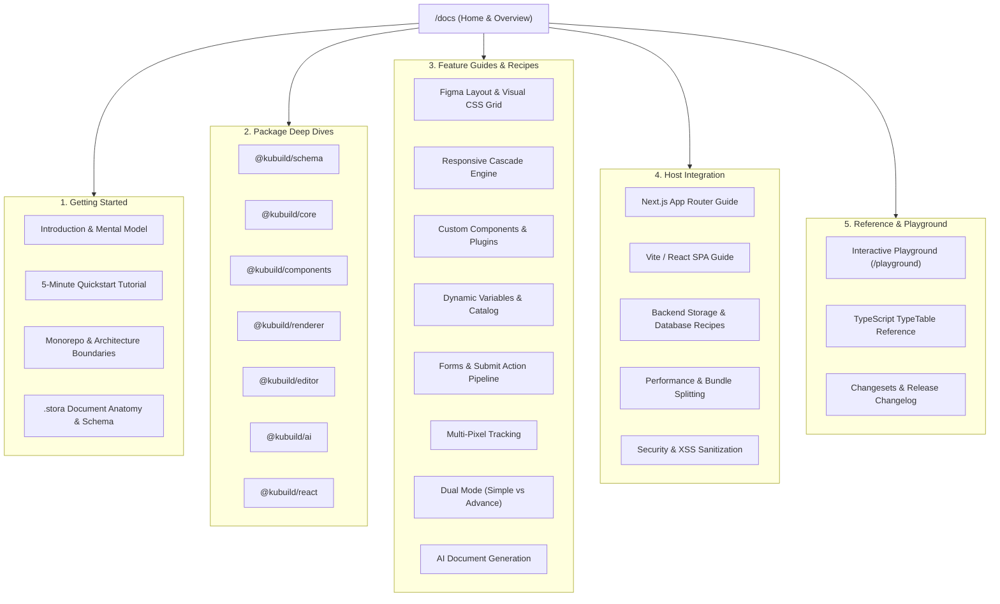

# KUBUILD Documentation Planning & Jira Task List

**Product:** KUBUILD (`BUILDER-01`)  
**Target Path:** `/apps/docs`  
**Engine:** [Fumadocs](https://fumadocs.vercel.app/) (Next.js 15 App Router + `fumadocs-mdx` + Tailwind CSS)  
**Status:** Approved for Implementation  
**Created At:** 2026-11-07  

---

## 1. Executive Summary & Goals

`kubuild` adalah library web page builder yang open, modular, dan backend-agnostic dengan format dokumen portabel `.stora`.
Dokumentasi di `/apps/docs` dirancang untuk memposisikan `kubuild` sebagai framework/engine visual builder standar enterprise untuk internal ecosystem (seperti Stora.page) dan pengembang publik/open source.

### Kriteria Utama Dokumentasi:
1. **Interactive & Live**: Pembaca dapat menguji komponen, form, layout engine, dan custom plugin secara langsung di dalam dokumentasi melalui embed canvas/renderer.
2. **Arsitektur Eksplisit**: Membedah struktur internal monorepo, isolasi core (zero UI dependencies), dan schema document yang terverifikasi Zod.
3. **Comprehensive Recipes**: Menyediakan solusi siap pakai untuk kasus nyata (Next.js App Router, SSR hydration prevention, custom backend database/S3, analytics pixel tracking, AI provider integration).
4. **Developer Experience Maksimal**: Full-text instant search (`Cmd+K`), TypeTable otomatis dari TypeScript `.d.ts`, code block multi-tab, dan tema responsif Dark/Light.

---

## 2. Information Architecture (IA) & Sitemap

---

## 3. Comprehensive Jira-Style Task Breakdown

### EPIC 1: [KU-DOCS-01] Infrastructure & Fumadocs Setup (`/apps/docs`)
*Tujuan: Menginisialisasi aplikasi Next.js 15 dengan Fumadocs di monorepo pnpm, terhubung ke Turborepo build pipeline.*

---

#### 🎫 KU-101: Scaffold `/apps/docs` dengan Next.js 15 & Fumadocs
- **Issue Type:** Story  
- **Priority:** Highest  
- **Component:** `apps/docs`, `pnpm-workspace`  
- **Story Points:** 3  
- **Status:** Done  
- **Description:**  
  Inisialisasi aplikasi Next.js 15 baru di `/apps/docs` menggunakan template resmi `fumadocs-ui` + `fumadocs-mdx`. Daftarkan ke `pnpm-workspace.yaml` dan root `package.json`.
- **Acceptance Criteria (AC):**
  - [x] Folder `/apps/docs` terdaftar dalam workspace monorepo.
  - [x] Dependensi `fumadocs-ui`, `fumadocs-core`, `next`, `react`, `react-dom` terpasang rapi dengan pnpm.
  - [x] Perintah `pnpm --filter docs dev` berhasil menjalankan server lokal dokumentasi pada port `3001` (atau port tersendiri).
  - [x] Rute root `/` mengarah ke `/docs` layout dengan sidebar standar Fumadocs.

---

#### 🎫 KU-102: Konfigurasi Branding, Theme & Custom Styling
- **Issue Type:** Task  
- **Priority:** Medium  
- **Component:** `apps/docs`, `theme`  
- **Story Points:** 2  
- **Status:** Done  
- **Description:**  
  Konfigurasi Tailwind CSS untuk Fumadocs UI, custom color palette (kustora / kubuild brand), logo SVG, dark/light mode switcher, dan typography.
- **Acceptance Criteria (AC):**
  - [x] Tema gelap dan terang berjalan mulus dengan persistensi local storage.
  - [x] Logo KUBUILD (`BUILDER-01`) tampil di navigation bar kiri atas.
  - [x] Metadata OpenGraph, favicon, dan title tags dikonfigurasi untuk SEO.
  - [x] Navigasi header memiliki link ke GitHub repository, Playground demo, dan Discord/Community jika ada.

---

#### 🎫 KU-103: Integrasi Search Engine & Code Block Enhancements
- **Issue Type:** Task  
- **Priority:** High  
- **Component:** `apps/docs`, `search`  
- **Story Points:** 2  
- **Status:** Done  
- **Description:**  
  Setup instant search menggunakan Fumadocs internal search (Orama atau local Flexsearch). Konfigurasi syntax highlighting (Shiki), code tabs, copy button, dan line highlighting.
- **Acceptance Criteria (AC):**
  - [x] Fitur search modal (`Cmd+K` / `Ctrl+K`) mengindeks seluruh file MDX di `/content/docs`.
  - [x] Search query menampilkan judul dokumen, heading, dan highlight snippet isi.
  - [x] Code block mendukung badge bahasa, tombol "Copy", dan multi-tab (misal: npm vs pnpm vs yarn).

---

#### 🎫 KU-104: Turborepo Pipeline Integration & CI Validation
- **Issue Type:** Task  
- **Priority:** High  
- **Component:** `turbo.json`, `ci`  
- **Story Points:** 2  
- **Status:** Done  
- **Description:**  
  Tambahkan task `build`, `lint`, `typecheck` untuk `apps/docs` ke dalam root `turbo.json`. Pastikan package `@kubuild/*` yang diimpor sebagai referensi di-build terlebih dahulu.
- **Acceptance Criteria (AC):**
  - [x] Menjalankan `pnpm build` dari root workspace sukses mem-build `apps/docs` tanpa TypeScript error.
  - [x] `pnpm typecheck` dan `pnpm lint` memvalidasi file di `apps/docs`.
  - [x] Caching Turborepo untuk build static export/output docs bekerja optimal.

---

#### 🎫 KU-105: Pembuatan Komponen Interactive Preview / Sandbox di MDX
- **Issue Type:** Story  
- **Priority:** High  
- **Component:** `apps/docs`, `mdx-components`  
- **Story Points:** 5  
- **Status:** Done  
- **Description:**  
  Buat custom MDX component `<InteractiveRenderer document={...} />` atau `<InteractivePlayground />` yang mengimpor langsung `@kubuild/renderer` dan `@kubuild/components` dari monorepo. Memungkinkan pembaca mencoba komponen secara interaktif langsung di halaman docs.
- **Acceptance Criteria (AC):**
  - [x] Custom component dapat dipanggil di dalam file `.mdx` tanpa hydration mismatch.
  - [x] Menampilkan toggle antara live render dan preview JSON `.stora`.
  - [x] Dynamic import diterapkan agar bundle visual editor tidak membebani initial page load docs.

---

### EPIC 2: [KU-DOCS-02] Getting Started & Core Concepts
*Tujuan: Memberikan onboarding cepat bagi developer baru untuk memahami filosofi KUBUILD dan membuat landing page pertama dalam 5 menit.*

---

#### 🎫 KU-201: Overview, Philosophy & Mental Model
- **Issue Type:** Story  
- **Priority:** Highest  
- **Component:** `content/docs/index.mdx`  
- **Story Points:** 2  
- **Status:** Done  
- **Description:**  
  Menulis halaman pengantar yang menjelaskan apa itu KUBUILD, bedanya dengan CMS tradisional (WordPress/Webflow) atau builder monolitik (GrapesJS). Menjelaskan slogan *"Build once, render anywhere, portable .stora format"*.
- **Acceptance Criteria (AC):**
  - [x] Menjelaskan pemisahan tegas antara Editor, Renderer, Core, dan Document Schema.
  - [x] Diagram lifecycle: `Create -> Customize -> Export -> Share -> Import -> Publish`.
  - [x] Penjelasan kapan menggunakan `@kubuild/react` vs individual modular packages.

---

#### 🎫 KU-202: 5-Minute Quickstart Tutorial
- **Issue Type:** Story  
- **Priority:** Highest  
- **Component:** `content/docs/getting-started/quickstart.mdx`  
- **Story Points:** 3  
- **Status:** Done  
- **Description:**  
  Panduan step-by-step mengintegrasikan `@kubuild/react` ke dalam aplikasi React baru. Mencakup instalasi paket, membuat dokumen kosong (`createBlankDocument`), menampilkan `<KubuildEditor />`, dan merender hasil akhir via `<KubuildRenderer />`.
- **Acceptance Criteria (AC):**
  - [x] Instruksi instalasi lengkap (`pnpm add @kubuild/react @kubuild/schema`).
  - [x] Snippet kode lengkap yang siap copy-paste (dengan TypeScript type annotations).
  - [x] Penjelasan props mendasar: `initialDocument`, `onChange`, `readOnly`.
  - [x] Contoh live sandbox / embed interaktif.

---

#### 🎫 KU-203: Monorepo Architecture & Dependency Boundaries
- **Issue Type:** Story  
- **Priority:** High  
- **Component:** `content/docs/getting-started/architecture.mdx`  
- **Story Points:** 3  
- **Status:** Done  
- **Description:**  
  Dokumentasi mendalam mengenai batasan arsitektural monorepo KUBUILD. Menguraikan mengapa `@kubuild/core` bebas dari UI/DOM dependencies, bagaimana arah dependensi mengalir ke dalam, dan isolasi package.
- **Acceptance Criteria (AC):**
  - [x] Diagram dependensi monorepo (`core` <- `schema` <- `components` <- `renderer` <- `editor` <- `react`).
  - [x] Aturan boundary ESLint (`no-restricted-imports`) yang diterapkan dalam codebase.
  - [x] Cara kerja build toolchain (`tsup`, dual ESM/CJS output, `.d.ts` generation).

---

#### 🎫 KU-204: `.stora` Document Anatomy & Format Specification
- **Issue Type:** Story  
- **Priority:** High  
- **Component:** `content/docs/getting-started/stora-document.mdx`  
- **Story Points:** 3  
- **Status:** Done  
- **Description:**  
  Dokumentasi spesifikasi struktur JSON dokumen `.stora`. Menjelaskan tree hierarchy (`rootId`, `nodes`, `parentId`, `childrenIds`), node types (`container`, `section`, `text`, `button`, dll.), `styleProps`, metadata, variable bindings, dan asset catalog.
- **Acceptance Criteria (AC):**
  - [x] Contoh JSON `.stora` lengkap dengan anotasi di tiap property.
  - [x] Penjelasan normalisasi state vs nested tree.
  - [x] Schema validation menggunakan Zod di runtime.

---

### EPIC 3: [KU-DOCS-03] Package-by-Package Deep Dives
*Tujuan: Panduan lengkap dan API reference untuk tiap individual package dalam monorepo.*

---

#### 🎫 KU-301: `@kubuild/schema` Package Guide & Reference
- **Issue Type:** Story  
- **Priority:** High  
- **Component:** `content/docs/packages/schema.mdx`  
- **Story Points:** 3  
- **Status:** Done  
- **Description:**  
  Dokumentasi package `@kubuild/schema`. Membahas Zod schemas (`storaDocumentSchema`, `storaNodeSchema`, `stylePropsSchema`), type inferensi TypeScript, utilitas migrasi versi schema, dan validasi data tak dikenal.
- **Acceptance Criteria (AC):**
  - [x] Daftar semua schema utama dan tipe TypeScript yang diekspor.
  - [x] Contoh validasi input eksternal menggunakan `safeParse`.
  - [x] Panduan extend schema untuk custom metadata.

---

#### 🎫 KU-302: `@kubuild/core` Package Guide & Engine Internals
- **Issue Type:** Story  
- **Priority:** High  
- **Component:** `content/docs/packages/core.mdx`  
- **Story Points:** 5  
- **Status:** Done  
- **Description:**  
  Dokumentasi package `@kubuild/core`. Menjelaskan node operations (`addNode`, `moveNode`, `deleteNode`, `duplicateNode`), Command pattern, History Stack (Undo/Redo grouping), Serializer/Deserializer, dan layout calculation helpers.
- **Acceptance Criteria (AC):**
  - [x] Contoh manipulasi headless document tree tanpa React/UI.
  - [x] Dokumentasi History transaction (batching continuous updates seperti typing/resizing).
  - [x] Math & layout calculation utilities (bounding boxes, collision, snapping rules).

---

#### 🎫 KU-303: `@kubuild/components` Package & Registry Guide
- **Issue Type:** Story  
- **Priority:** High  
- **Component:** `content/docs/packages/components.mdx`  
- **Story Points:** 3  
- **Status:** Done  
- **Description:**  
  Dokumentasi builtin component registry. Menguraikan semua komponen standar bawaan (Section, Container, Grid, Text, Heading, Button, Image, Video, Form, Input, Checkbox, Radio, Divider, Embed).
- **Acceptance Criteria (AC):**
  - [x] Katalog visual semua builtin components dengan daftar default props dan style capabilities.
  - [x] `ComponentRegistry` API: cara mendaftarkan, override, atau me-replace komponen standar.
  - [x] Spesifikasi `ComponentDefinition` (icon, label, defaultStyles, allowedChildren).

---

#### 🎫 KU-304: `@kubuild/renderer` Package Guide
- **Issue Type:** Story  
- **Priority:** Highest  
- **Component:** `content/docs/packages/renderer.mdx`  
- **Story Points:** 3  
- **Status:** Done  
- **Description:**  
  Dokumentasi engine renderer runtime. Membahas `<KubuildRenderer />`, `RenderContext`, responsive viewport styling injection, variable interpolation runtime, event bubbling, dan security sanitization.
- **Acceptance Criteria (AC):**
  - [x] Props `<KubuildRenderer />` (`document`, `variables`, `onAction`, `onFormSubmit`, `customComponents`).
  - [x] Penjelasan cara kerja dynamic style generator (inline CSS vs generated style tags).
  - [x] Runtime variable substitution (`{{ variables.user_name }}`).

---

#### 🎫 KU-305: `@kubuild/editor` Package Guide
- **Issue Type:** Story  
- **Priority:** Highest  
- **Component:** `content/docs/packages/editor.mdx`  
- **Story Points:** 5  
- **Status:** Done  
- **Description:**  
  Dokumentasi lengkap visual canvas & editor chrome. Menjelaskan canvas navigation (zoom, pan), 8-point resize handles, node selection (single/multi-select), breadcrumbs, layers tree panel, settings/style inspector, dan dual mode (`Simple` vs `Advance`).
- **Acceptance Criteria (AC):**
  - [x] Struktur komponen `<KubuildEditor />` dan breakdown panels (Canvas, Sidebar, Inspector, Topbar).
  - [x] Penjelasan Zustand editor store (`useEditorStore`) dan custom hook yang dapat diakses host.
  - [x] Penjelasan mode `Simple | Advance` (progressive disclosure) untuk non-teknis vs pro-designer.

---

#### 🎫 KU-306: `@kubuild/ai` Package & Provider Adapter Guide
- **Issue Type:** Story  
- **Priority:** High  
- **Component:** `content/docs/packages/ai.mdx`  
- **Story Points:** 5  
- **Status:** Done  
- **Description:**  
  Dokumentasi package AI. Menjelaskan arsitektur adapter multi-provider (OpenAI, Anthropic Claude, Google Gemini, Ollama, DeepSeek), prompt schema, streaming AST normalizer, document mutation tools, dan validasi output JSON.
- **Acceptance Criteria (AC):**
  - [x] Setup API keys dan custom provider integration.
  - [x] Alur streaming document generation & continuous reconciliation.
  - [x] Contoh membuat custom prompt template untuk auto-generate landing page section.

---

#### 🎫 KU-307: `@kubuild/react` Unified Entrypoint Guide
- **Issue Type:** Story  
- **Priority:** High  
- **Component:** `content/docs/packages/react.mdx`  
- **Story Points:** 2  
- **Status:** Done  
- **Description:**  
  Dokumentasi package wrapper `@kubuild/react`. Menjelaskan kapan dan bagaimana mengimpor dari paket ini, tree-shaking, re-exports, dan optimalisasi packaging.
- **Acceptance Criteria (AC):**
  - [x] Cheatsheet import: apa saja yang ada di `@kubuild/react`.
  - [x] Bundling considerations (hindari import editor pada public render page).

---

### EPIC 4: [KU-DOCS-04] Feature Guides & Visual Engine Recipes
*Tujuan: Panduan mendalam untuk fitur-fitur teknis kompleks yang menjadi keunggulan KUBUILD.*

---

#### 🎫 KU-401: Figma-Grade Layout Engine (Auto Layout & Visual CSS Grid)
- **Issue Type:** Story  
- **Priority:** Highest  
- **Component:** `content/docs/guides/figma-layout.mdx`  
- **Story Points:** 5  
- **Status:** Done  
- **Description:**  
  Panduan lengkap cara kerja Auto Layout (Flexbox: direction, gap, wrap, alignment, distribute) dan 2D Visual CSS Grid (columns, rows, gap, template areas). Disertai animasi/diagram interaktif.
- **Acceptance Criteria (AC):**
  - [x] Menjelaskan padanan konsep Figma vs CSS flex/grid di KUBUILD.
  - [x] Panduan penggunaan 8-point drag handles dan smart snapping guides.
  - [x] Best practices membuat hero section responsif menggunakan Auto Layout.

---

#### 🎫 KU-402: Responsive Cascade & Viewport Overrides
- **Issue Type:** Story  
- **Priority:** High  
- **Component:** `content/docs/guides/responsive-cascade.mdx`  
- **Story Points:** 3  
- **Status:** Done  
- **Description:**  
  Panduan cara kerja cascade responsive: `Desktop (Base) -> Tablet -> Mobile`. Menjelaskan bagaimana nilai style diturunkan, bagaimana membuat per-device override, dan cara melakukan reset override.
- **Acceptance Criteria (AC):**
  - [x] Penjelasan aturan penurunan style (inheritance rules).
  - [x] Indikator visual override di inspector (amber/blue highlight ketika property di-override).
  - [x] Reset button behavior pada individual style sector.

---

#### 🎫 KU-403: Creating Custom Components & Host Plugins
- **Issue Type:** Story  
- **Priority:** Highest  
- **Component:** `content/docs/guides/custom-components.mdx`  
- **Story Points:** 5  
- **Status:** Done  
- **Description:**  
  Tutorial komprehensif membuat custom component baru dan meregistrasikannya ke dalam builder. Menentukan props schema (Zod), kontrol inspector kustom, preview component, dan runtime renderer component.
- **Acceptance Criteria (AC):**
  - [x] Contoh kode lengkap pembuatan custom component (misal: "Testimonial Card" atau "Pricing Table").
  - [x] Menentukan konfigurasi inspector field (ColorPicker, NumberInput, Select, Toggle).
  - [x] Panduan registrasi via `registerComponent()` pada host application.

---

#### 🎫 KU-404: Dynamic Variables & Host Variable Catalog
- **Issue Type:** Story  
- **Priority:** High  
- **Component:** `content/docs/guides/dynamic-variables.mdx`  
- **Story Points:** 3  
- **Status:** Done  
- **Description:**  
  Dokumentasi sistem variabel dinamis. Menjelaskan katalog variabel datar dengan pengelompokan opsional (`group`), sintaks binding `variables.<key>`, fallback values, dan injeksi data dinamis pada waktu render.
- **Acceptance Criteria (AC):**
  - [x] Contoh mendefinisikan variable catalog di host (misal: affiliate name, product price, countdown deadline).
  - [x] Cara user memilih variabel melalui text inline toolbar atau inspector selector.
  - [x] Cara passing runtime `variables` object ke `<KubuildRenderer variables={...} />`.

---

#### 🎫 KU-405: Forms, Validations & `onFormSubmit` Action Pipeline
- **Issue Type:** Story  
- **Priority:** High  
- **Component:** `content/docs/guides/forms-and-actions.mdx`  
- **Story Points:** 3  
- **Status:** Done  
- **Description:**  
  Dokumentasi pembuatan formulir lead capture / checkout. Menjelaskan form node hierarchy, validasi input bawaan (required, email, regex), field error messages, dan penanganan submit event via `onFormSubmit`.
- **Acceptance Criteria (AC):**
  - [x] Contoh form lengkap dengan berbagai input fields.
  - [x] Contoh implementasi `onFormSubmit` di host Next.js/React (mengirim ke API route / Webhook).
  - [x] Penanganan state loading, success redirect, dan error handling.

---

#### 🎫 KU-406: Multi-Pixel & Analytics Tracking Engine
- **Issue Type:** Story  
- **Priority:** Medium  
- **Component:** `content/docs/guides/tracking-pixels.mdx`  
- **Story Points:** 3  
- **Status:** Done  
- **Description:**  
  Dokumentasi konfigurasi multi-pixel tracking di halaman. Menjelaskan integrasi Meta Pixel (Facebook), Google Tag Manager / GA4, TikTok Pixel, dan custom script injection, serta event triggers pada tombol/form (Lead, Purchase, AddToCart).
- **Acceptance Criteria (AC):**
  - [x] Panduan setup pixel ID di page settings.
  - [x] Penjelasan trigger event pada Node click atau Form submit.
  - [x] Panduan privacy/consent & CSP compliance.

---

#### 🎫 KU-407: AI Document Assistant & Prompt Engineering
- **Issue Type:** Story  
- **Priority:** Medium  
- **Component:** `content/docs/guides/ai-assistant.mdx`  
- **Story Points:** 3  
- **Status:** Done  
- **Description:**  
  Panduan mengaktifkan AI Copilot di dalam editor. Menjelaskan cara kerja floating AI bar, prompt command ("Tambahkan testimonial section 3 kolom dengan warna biru modern"), review diff, dan undo AI changes.
- **Acceptance Criteria (AC):**
  - [x] Contoh konfigurasi AI provider di editor props.
  - [x] Panduan keamanan: memastikan AI tidak menghasilkan arbitrary script berbahaya.

---

### EPIC 5: [KU-DOCS-05] Host Integration & Production Deployment
*Tujuan: Membantu developer mengintegrasikan KUBUILD ke dalam aplikasi produksi skala enterprise (Next.js, Vite, Laravel).*

---

#### 🎫 KU-501: Next.js (App Router & Server Components) Integration
- **Issue Type:** Story  
- **Priority:** Highest  
- **Component:** `content/docs/integration/nextjs.mdx`  
- **Story Points:** 3  
- **Status:** Done  
- **Description:**  
  Panduan mendalam mengintegrasikan KUBUILD ke dalam Next.js App Router. Menjelaskan cara memisahkan Server Components (untuk fetch data `.stora`) dan Client Components (untuk interactive renderer / editor), dynamic imports dengan `next/dynamic` (`ssr: false` untuk canvas).
- **Acceptance Criteria (AC):**
  - [x] Struktur folder rekomendasi Next.js (`app/builder/[id]/page.tsx` & `app/[slug]/page.tsx`).
  - [x] Solusi SSR hydration mismatch untuk canvas editor.
  - [x] Dynamic SEO metadata generation berdasarkan document metadata.

---

#### 🎫 KU-502: Vite / React SPA Integration
- **Issue Type:** Task  
- **Priority:** Medium  
- **Component:** `content/docs/integration/vite.mdx`  
- **Story Points:** 2  
- **Status:** Done  
- **Description:**  
  Panduan integrasi untuk aplikasi Client-Side SPA berbasis Vite atau Create React App.
- **Acceptance Criteria (AC):**
  - [x] Konfigurasi `vite.config.ts` untuk alias atau subpath exports jika diperlukan.
  - [x] Routing dengan React Router (v6/v7).

---

#### 🎫 KU-503: Backend Storage & Document Lifecycle Recipes
- **Issue Type:** Story  
- **Priority:** High  
- **Component:** `content/docs/integration/backend-storage.mdx`  
- **Story Points:** 3  
- **Status:** Done  
- **Description:**  
  Kumpulan recipes dan contoh arsitektur penyimpanan dokumen `.stora` di backend: PostgreSQL (JSONB column), MongoDB, S3/Cloudflare R2 Object Storage, atau REST/GraphQL API.
- **Acceptance Criteria (AC):**
  - [x] Schema database rekomendasi (tabel `pages`: `id`, `slug`, `content_json`, `version`).
  - [x] Pola debounced auto-save dari `onChange` editor ke backend.
  - [x] Optimistic locking dan conflict resolution.

---

#### 🎫 KU-504: Performance, Bundle Splitting & Core Web Vitals
- **Issue Type:** Story  
- **Priority:** High  
- **Component:** `content/docs/integration/performance.mdx`  
- **Story Points:** 3  
- **Status:** Done  
- **Description:**  
  Panduan optimasi performa halaman yang dirender oleh KUBUILD. Membahas bundle isolation (jangan bundle editor di public reader), lazy loading gambar, font optimization, dan achieving 95+ Google Lighthouse score.
- **Acceptance Criteria (AC):**
  - [x] Benchmark ukuran bundle runtime renderer (<30KB gzipped).
  - [x] Panduan gambar responsif (`srcset`, WebP/AVIF format).
  - [x] CSS footprint minimizer.

---

#### 🎫 KU-505: Security, Sanitization & Content Security Policy (CSP)
- **Issue Type:** Story  
- **Priority:** High  
- **Component:** `content/docs/integration/security.mdx`  
- **Story Points:** 3  
- **Status:** Done  
- **Description:**  
  Panduan keamanan tingkat lanjut: pencegahan XSS melalui rich-text injection, pembersihan atribut HTML berbahaya, sanitasi link `javascript:`, dan rekomendasi HTTP CSP headers.
- **Acceptance Criteria (AC):**
  - [x] Penjelasan built-in sanitization pipeline di `@kubuild/renderer`.
  - [x] Konfigurasi CSP header yang aman untuk host application.

---

### EPIC 6: [KU-DOCS-06] Interactive Demos & Auto-Generated Type Reference
*Tujuan: Melengkapi dokumentasi dengan live playground interaktif dan referensi API otomatis.*

---

#### 🎫 KU-601: Interactive Standalone Playground di Docs
- **Issue Type:** Story  
- **Priority:** High  
- **Component:** `apps/docs/app/playground`  
- **Story Points:** 5  
- **Status:** Done  
- **Description:**  
  Sematkan versi lite dari Stora Playground langsung di dalam route `/apps/docs/app/playground`, memungkinkan pengunjung menguji builder secara full screen tanpa harus install repository.
- **Acceptance Criteria (AC):**
  - [x] Rute `/playground` memuat `<KubuildEditor />` dengan sample templates (Landing Page, Portfolio, Link-in-Bio).
  - [x] Tombol export `.stora` JSON dan copy embed code.

---

#### 🎫 KU-602: Automated TypeScript Type Reference (TypeTable / Fumadocs OpenAPI)
- **Issue Type:** Task  
- **Priority:** Medium  
- **Component:** `apps/docs`, `typedoc`  
- **Story Points:** 3  
- **Status:** Done  
- **Description:**  
  Integrasikan generator TypeTable Fumadocs atau TypeDoc untuk menghasilkan tabel referensi props dan API signature secara otomatis dari file `.d.ts` packages.
- **Acceptance Criteria (AC):**
  - [x] Komponen `<TypeTable />` merender props dari `KubuildEditorProps`, `KubuildRendererProps`, `StoraNode`, `StyleProps`.
  - [x] Deskripsi JSDoc di codebase langsung terefleksi di dokumentasi.

---

#### 🎫 KU-603: Changeset & Version Upgrade Migration Guides
- **Issue Type:** Task  
- **Priority:** Low  
- **Component:** `content/docs/reference/migrations.mdx`  
- **Story Points:** 2  
- **Status:** Done  
- **Description:**  
  Dokumentasi rilis, format changeset, semantic versioning policy, dan panduan breaking changes migration antara versi minor/mayor.
- **Acceptance Criteria (AC):**
  - [x] Halaman changelog yang terhubung dengan GitHub Releases atau Changesets.
  - [x] Panduan upgrade schema jika terjadi schema version increment.

---

## 4. Summary Table by Story Points & Priority

| Epic Key | Epic Title | Stories / Tasks | Total Story Points |
| :--- | :--- | :---: | :---: |
| **KU-DOCS-01** | Infrastructure & Fumadocs Setup | 5 issues | 14 pts |
| **KU-DOCS-02** | Getting Started & Core Concepts | 4 issues | 11 pts |
| **KU-DOCS-03** | Package-by-Package Deep Dives | 7 issues | 26 pts |
| **KU-DOCS-04** | Feature Guides & Visual Engine Recipes | 7 issues | 27 pts |
| **KU-DOCS-05** | Host Integration & Production Deployment | 5 issues | 14 pts |
| **KU-DOCS-06** | Interactive Demos & API Reference | 3 issues | 10 pts |
| **TOTAL** | **6 Epics** | **31 Issues** | **102 Story Points** |
