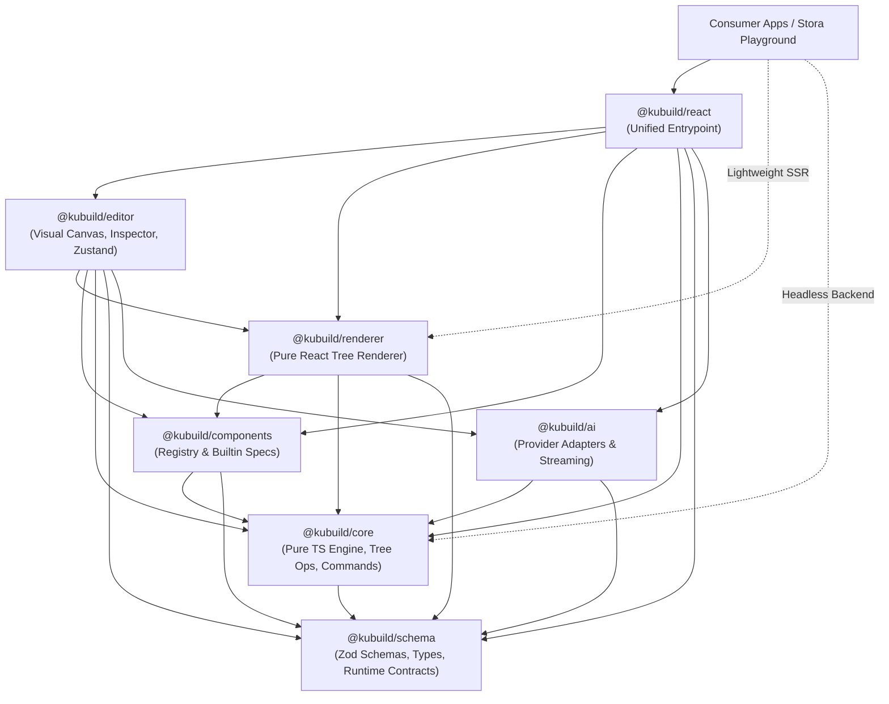
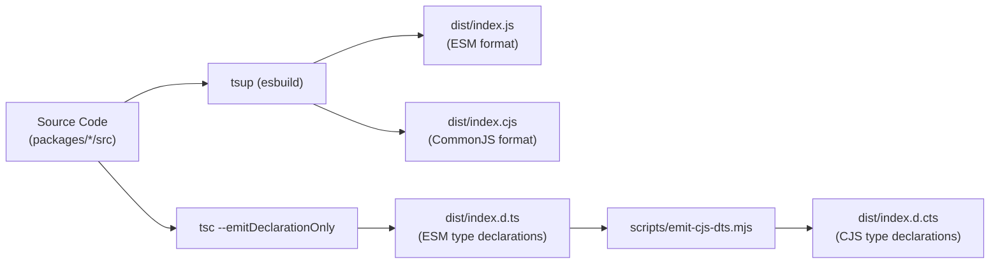

import { Callout } from 'fumadocs-ui/components/callout';
import { Card, Cards } from 'fumadocs-ui/components/card';
import { Tab, Tabs } from 'fumadocs-ui/components/tabs';
import { Accordion, Accordions } from 'fumadocs-ui/components/accordion';

KUBUILD is designed from the ground up as a **modular, multi-package monorepo**. Unlike traditional website builders that couple document schemas, visual canvases, UI widgets, and persistence logic into a monolithic bundle, KUBUILD enforces a strict separation of concerns.

Every package in the monorepo has a single, well-defined responsibility and strictly governed dependency boundaries.

---

## High-Level Monorepo Topology

The monorepo is managed using [pnpm workspaces](https://pnpm.io/workspaces) and orchestrated with [Turborepo](https://turbo.build/repo). It is partitioned into high-level applications (`apps/`) and seven core packages (`packages/`):

```
kubuild/
├── apps/
│   ├── docs/                  # Fumadocs Next.js 15 documentation portal
│   └── stora-playground/      # Reference visual editor & staging application
│
├── packages/
│   ├── schema/                # @kubuild/schema: Zod schemas & TypeScript definitions
│   ├── core/                  # @kubuild/core: Headless pure TS tree & command engine
│   ├── components/            # @kubuild/components: Component definitions & registry
│   ├── renderer/              # @kubuild/renderer: Pure React recursive tree renderer
│   ├── editor/                # @kubuild/editor: Visual canvas, inspector, & Zustand store
│   ├── ai/                    # @kubuild/ai: AI provider adapters & streaming AST normalizer
│   └── react/                 # @kubuild/react: Unified all-in-one developer entrypoint
│
└── scripts/
    ├── check-nodenext-consumer.mjs   # Strict NodeNext CJS/ESM compatibility verifier
    └── emit-cjs-dts.mjs              # Dual TypeScript declaration generator (.d.cts)
```

---

## Dependency Direction & Package Hierarchy

KUBUILD follows the **Inward Dependency Flow Principle**. All dependencies flow strictly inward toward the headless core (`@kubuild/core`) and the schema contracts (`@kubuild/schema`). 

The core engine and schema layers have **zero awareness** of the visual editor, React components, or host framework.



<Callout type="info" title="Strict Directed Acyclic Graph (DAG)">
  There are **no circular dependencies** anywhere in the KUBUILD codebase. A lower-tier package never imports from a higher-tier package. This guarantees deterministic bundling, tree-shaking, and predictable testing cycles.
</Callout>

---

## The 7 Packages Explained

<Cards>
  <Card title="@kubuild/schema" href="#1-kubuildschema">
    Zod contracts, AST TypeScript types, document versioning, and runtime integrity validation.
  </Card>
  <Card title="@kubuild/core" href="#2-kubuildcore">
    Framework-agnostic tree operations, transactional command history (Undo/Redo), and archive packing.
  </Card>
  <Card title="@kubuild/components" href="#3-kubuildcomponents">
    Component definitions, layout manifests, style schemas, and property inspector metadata.
  </Card>
  <Card title="@kubuild/renderer" href="#4-kubuildrenderer">
    Pure React recursive tree renderer, responsive CSS compiler, dynamic variables, and action runners.
  </Card>
  <Card title="@kubuild/editor" href="#5-kubuildeditor">
    Interactive WYSIWYG canvas, 8-point resizing handles, snap guides, and isolated Zustand store.
  </Card>
  <Card title="@kubuild/ai" href="#6-kubuildai">
    Multi-LLM adapters (OpenAI, Anthropic, Gemini), streaming AST normalizer, and mutation tools.
  </Card>
  <Card title="@kubuild/react" href="#7-kubuildreact">
    Umbrella convenience package bundling editor, renderer, and components for rapid application integration.
  </Card>
</Cards>

### 1. `@kubuild/schema`

`@kubuild/schema` is the bedrock of KUBUILD. It defines the universal `.stora` document schema and AST contracts using [Zod](https://zod.dev/).

- **Responsibilities**:
  - Exports runtime validation schemas: `pageDocumentSchema`, `pageNodeSchema`, `stylePropsSchema`, `variableSchema`, and `actionSchema`.
  - Infers TypeScript static types directly from Zod definitions (`PageDocument`, `PageNode`, `StyleProps`).
  - Enforces schema version constants (`CURRENT_SCHEMA_VERSION = '1.0.0'`) and metadata signatures (`SCHEMA_NAME = 'stora.page'`).
  - Provides safe parsing utilities (`validateDocument`, `safeParseDocument`) to protect runtime hosts against corrupted, tampered, or untrusted payload injections.
- **Dependencies**: Only `zod`. Zero internal monorepo dependencies.
- **Target Environments**: Everywhere (Node.js, Browser, Edge, Cloudflare Workers, Deno, Bun).

### 2. `@kubuild/core`

`@kubuild/core` is the framework-independent engine containing all business logic for document state mutations, tree transformations, and transactional operations.

- **Responsibilities**:
  - **Tree Operations**: Immutable and transactional node operations (`insertNode`, `removeNode`, `moveNode`, `duplicateNode`, `reparentChildren`).
  - **Command Pattern & History**: Inversion-of-control command engine with bounded undo/redo stacks, batch transactions, and state diffing.
  - **Archive Serialization**: Native binary packaging and decompression for `.stora` zip archives using `fflate`.
  - **Dynamic Variables & Expressions**: Variable substitution engine, catalog binding, and safe expression evaluation without `eval()`.
  - **Migration System**: Sequential version upgrade pipelines (`v1 -> v2`) for backward compatibility of stored documents.
- **Dependencies**: `@kubuild/schema`, `fflate`.
- **Target Environments**: Headless servers, background workers, CLI utilities, and frontend runtimes. **No React, no DOM APIs.**

### 3. `@kubuild/components`

`@kubuild/components` houses the component registry and specification manifests for all standard page-building primitives.

- **Responsibilities**:
  - Standard blocks specifications: `Container`, `Section`, `Grid`, `Text`, `Heading`, `Button`, `Image`, `Video`, `Form`, `Input`, `Navbar`, and `Footer`.
  - Defines prop definitions, default style models, layout capabilities (e.g. flexbox vs grid children constraints), and allowed nesting rules.
  - Exposes property editor schemas utilized by `@kubuild/editor` to dynamically render inspector panels for each component.
- **Dependencies**: `@kubuild/core`, `@kubuild/schema`.

### 4. `@kubuild/renderer`

`@kubuild/renderer` transforms a `.stora` JSON document into a production-ready, performant React component tree.

- **Responsibilities**:
  - **Recursive Tree Renderer**: Traverses the normalized document node dictionary and renders components matching registry IDs.
  - **Responsive Style Generator**: Compiles responsive style properties across breakpoints (`desktop`, `tablet`, `mobile`) into scoped CSS rules or inline styles.
  - **Dynamic Variable Injection**: Evaluates dynamic tokens (e.g. `{{ company.name }}`) at render time using runtime context providers.
  - **Action Pipeline Runner**: Dispatches and handles form submissions, custom modal dialog triggers, external redirects, and analytics tracking pixels.
- **Dependencies**: `@kubuild/components`, `@kubuild/core`, `@kubuild/schema`, `lucide-react`. Peer dependencies: `react`, `react-dom`.
- **Bundle Strategy**: Extremely lightweight (~18 KB gzipped) so it can be deployed on public edge-rendered sites without loading the heavy editor UI.

### 5. `@kubuild/editor`

`@kubuild/editor` provides the visual drag-and-drop authoring environment and canvas interface.

- **Responsibilities**:
  - **Figma-Grade Visual Canvas**: 8-point interactive resize handles, live dimension badges, and intelligent snap-to-edge guidelines.
  - **Interactive Drag & Drop**: Visual drop indicator lines, layout hierarchy reparenting, and multi-selection support.
  - **Inspector & Property Panels**: Visual controls for Flexbox / CSS Grid, typography, color pickers, borders, responsive overrides, and animation properties.
  - **Layer Tree & Breadcrumbs**: Hierarchical tree explorer for selecting, locking, and hiding document nodes.
  - **Zustand Editor Store**: High-performance local state management keeping canvas dragging smooth at 60 FPS without triggering React root re-renders.
- **Dependencies**: `@kubuild/ai`, `@kubuild/components`, `@kubuild/core`, `@kubuild/renderer`, `@kubuild/schema`, `zustand`, `lucide-react`.

### 6. `@kubuild/ai`

`@kubuild/ai` provides AI-assisted document generation, block generation, and structural mutations.

- **Responsibilities**:
  - Multi-provider adapters for LLM vendors: OpenAI, Anthropic Claude, Google Gemini, and Ollama/OpenAI-compatible endpoints.
  - **Streaming AST Normalizer**: Progressively repairs broken or truncated JSON streams in real time so the canvas can render previews while the LLM is still typing.
  - **Deterministic Mutation Tools**: AI tools and function-calling schemas that translate natural language prompts into atomic `@kubuild/core` command sequences.
  - **Server-Safe Entrypoint**: Dual entrypoints (`@kubuild/ai` for universal utilities, `@kubuild/ai/server` for confidential backend keys and API routes).
- **Dependencies**: `@kubuild/core`, `@kubuild/schema`.

### 7. `@kubuild/react`

`@kubuild/react` serves as the high-level umbrella package.

- **Responsibilities**:
  - Re-exports `<KubuildEditor />`, `<KubuildRenderer />`, and default component catalogs under a unified namespace.
  - Simplifies initial onboarding for standard React applications: developers install `@kubuild/react` and immediately have everything required to build and render pages.
- **Dependencies**: Bundles and re-exports all individual packages.

---

## Boundary Enforcements & The Zero-UI Core Rule

A core design principle of KUBUILD is:

> **The core engine must remain completely free of UI, DOM, and frontend framework dependencies.**

### Why Core Must Be Headless

Keeping `@kubuild/core` free of browser and framework dependencies yields major architectural advantages:

1. **Universal Execution Environments**:
   `@kubuild/core` can run anywhere JavaScript or WebAssembly executes: inside Node.js microservices, Next.js Server Components, Cloudflare Workers, Fastly Compute@Edge, AWS Lambda, or local CLI scripts.
2. **Deterministic State & History**:
   State transitions and undo/redo stacks operate as pure functional mutations, isolated from React's asynchronous render cycle or reconciliation behaviors.
3. **Multi-Framework Portability**:
   While the official editor and renderer are built on React, future community adapters (for Vue, Svelte, or native mobile runtimes) can consume `@kubuild/core` directly without refactoring core logic.
4. **Headless Document Pipelines**:
   Backend servers can generate, validate, merge, or migrate `.stora` documents in background queues without spinning up headless browser instances (like Puppeteer).

### ESLint `no-restricted-imports` Enforcement

To guarantee that these architectural boundaries are never accidentally violated by developers or pull requests, the repository enforces strict ESLint boundary rules in `eslint.config.mjs`:

```javascript title="eslint.config.mjs"
export default [
  // ... general configuration
  {
    files: ['packages/core/**/*.ts'],
    rules: {
      'no-restricted-imports': [
        'error',
        {
          paths: [
            { 
              name: 'react', 
              message: '@kubuild/core must remain framework-agnostic. No React allowed.' 
            },
            { 
              name: 'react-dom', 
              message: '@kubuild/core must remain framework-agnostic. No ReactDOM allowed.' 
            },
            { 
              name: '@kubuild/renderer', 
              message: '@kubuild/core must not depend on @kubuild/renderer' 
            },
            { 
              name: '@kubuild/editor', 
              message: '@kubuild/core must not depend on @kubuild/editor' 
            },
            { 
              name: '@kubuild/react', 
              message: '@kubuild/core must not depend on @kubuild/react' 
            },
          ],
        },
      ],
    },
  },
];
```

If an engineer attempts to import React or an upstream package inside `@kubuild/core`, the build fails immediately during `pnpm lint` and CI verification.

---

## Build Toolchain & Dual Packaging

KUBUILD is distributed as universal modern packages that run seamlessly across modern ESM bundlers (Vite, Next.js, Rollup) and traditional CommonJS environments (legacy Node.js enterprise microservices, Jest runners).



### The NodeNext Compatibility Challenge

Modern TypeScript setups using `"moduleResolution": "NodeNext"` strictly enforce declaration file formats:

- In a package marked `"type": "module"`, TypeScript interprets any `.d.ts` file as **ESM-only**.
- If a CommonJS consumer requires the package via `require('@kubuild/core')`, TypeScript will report a type error if only `.d.ts` is available, because the types masquerade as ESM.
- Relative imports inside CommonJS declaration files must resolve to `.cjs` extensions rather than `.js`.

### Dual Declaration Pipeline (`emit-cjs-dts.mjs`)

Each package runs a three-stage build script in its `package.json`:

```json title="packages/core/package.json"
{
  "type": "module",
  "main": "./dist/index.cjs",
  "module": "./dist/index.js",
  "types": "./dist/index.d.ts",
  "exports": {
    ".": {
      "import": {
        "types": "./dist/index.d.ts",
        "default": "./dist/index.js"
      },
      "require": {
        "types": "./dist/index.d.cts",
        "default": "./dist/index.cjs"
      }
    }
  },
  "scripts": {
    "build": "tsup && tsc --emitDeclarationOnly && node ../../scripts/emit-cjs-dts.mjs"
  }
}
```

The script `scripts/emit-cjs-dts.mjs` automatically inspects every emitted `.d.ts` file and generates a companion `.d.cts` file:

1. Rewrites relative import specifiers from `.js` to `.cjs` (e.g., `from './utils.js'` $\to$ `from './utils.cjs'`).
2. Clones and updates declaration sourcemaps (`.d.cts.map`).
3. Ensures CommonJS consumers resolving via `require` receive first-class TypeScript autocomplete without type leaks.

### Automated Consumer Verification (`check-nodenext-consumer.mjs`)

To ensure that changes never break external consumers, KUBUILD features an end-to-end type verification script (`scripts/check-nodenext-consumer.mjs`).

The script dynamically sets up two independent temporary consumer environments:
1. An ESM project (`"type": "module"`)
2. A CommonJS project (`"type": "commonjs"`)

Both test projects compile against KUBUILD's built declarations using `tsc` configured with:
- `"module": "NodeNext"`
- `"moduleResolution": "NodeNext"`
- `"skipLibCheck": false` (strict inspection of all imported definitions)

```bash title="Run Consumer Check"
pnpm run build
node scripts/check-nodenext-consumer.mjs
# Output:
# NodeNext module consumer: OK
# NodeNext commonjs consumer: OK
```

---

## Monorepo Package Matrix

| Package | Environment | UI/DOM Dependent? | Key Dependencies | Primary Purpose |
| :--- | :--- | :--- | :--- | :--- |
| **`@kubuild/schema`** | Universal | No | `zod` | Zod contracts, AST schemas, document validation |
| **`@kubuild/core`** | Universal / Headless | No | `@kubuild/schema`, `fflate` | Tree mutations, commands, undo/redo history, serialization |
| **`@kubuild/components`** | Universal | No | `@kubuild/core`, `@kubuild/schema` | Component catalog, property inspector schemas, block specs |
| **`@kubuild/renderer`** | React Runtimes | Yes (React) | `@kubuild/components`, `@kubuild/core`, `@kubuild/schema` | Recursive tree renderer, responsive CSS, action runner |
| **`@kubuild/editor`** | Browser Canvas | Yes (DOM + React) | `@kubuild/renderer`, `zustand`, `lucide-react`, `@kubuild/ai` | WYSIWYG canvas, 8-point resize handles, inspector panel |
| **`@kubuild/ai`** | Universal / Server | No | `@kubuild/core`, `@kubuild/schema` | LLM adapters, streaming JSON repair, mutation tools |
| **`@kubuild/react`** | React Client / Apps | Yes (React) | All packages | Unified umbrella entrypoint for rapid integration |

---

## Architectural Decision Records (ADR Highlights)

<Accordions>
  <Accordion title="ADR 01: Why Zod for Document Schemas instead of pure TypeScript interfaces?">
    TypeScript interfaces are stripped at compile time and provide zero protection against malformed, malicious, or outdated JSON documents received over the network or loaded from external `.stora` files. 

    By using Zod, KUBUILD achieves a single source of truth: runtime validation with `safeParse()` protects applications from crashes, while TypeScript types are automatically inferred via `z.infer<typeof schema>`.
  </Accordion>

  <Accordion title="ADR 02: Why Zustand for Editor State instead of React Context or Redux?">
    Canvas interactions (resizing bounding boxes, mouse tracking, multi-element dragging) trigger rapid state updates at 60 FPS. 
    
    Standard React Context causes entire subtrees to re-render on every mouse movement, degrading canvas frame rates. Zustand provides fine-grained, transient selector subscriptions, allowing handles and guides to update without re-rendering unaffected canvas nodes.
  </Accordion>

  <Accordion title="ADR 03: Why keep Renderer decoupled from Editor?">
    Production websites and published landing pages should never ship the visual editor's code (canvas handles, inspector pickers, AI assistants, dragging calculators). 

    By isolating `@kubuild/renderer`, public-facing production bundles remain under ~18 KB gzipped with near-instant Time to Interactive (TTI) and zero hydration overhead.
  </Accordion>
</Accordions>

---

## Next Steps

Now that you understand the monorepo architecture and dependency boundaries, explore how documents are structured and serialized:

<Cards>
  <Card title=".stora Document Anatomy" href="/docs/getting-started/stora-document">
    Examine the normalized JSON AST tree, node hierarchy, style properties, and metadata storage.
  </Card>
  <Card title="Quickstart Tutorial" href="/docs/getting-started/quickstart">
    Jump straight into integrating `@kubuild/react` into a live React application in under 5 minutes.
  </Card>
</Cards>
