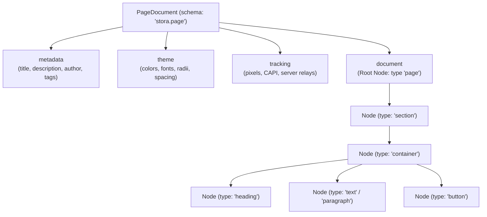
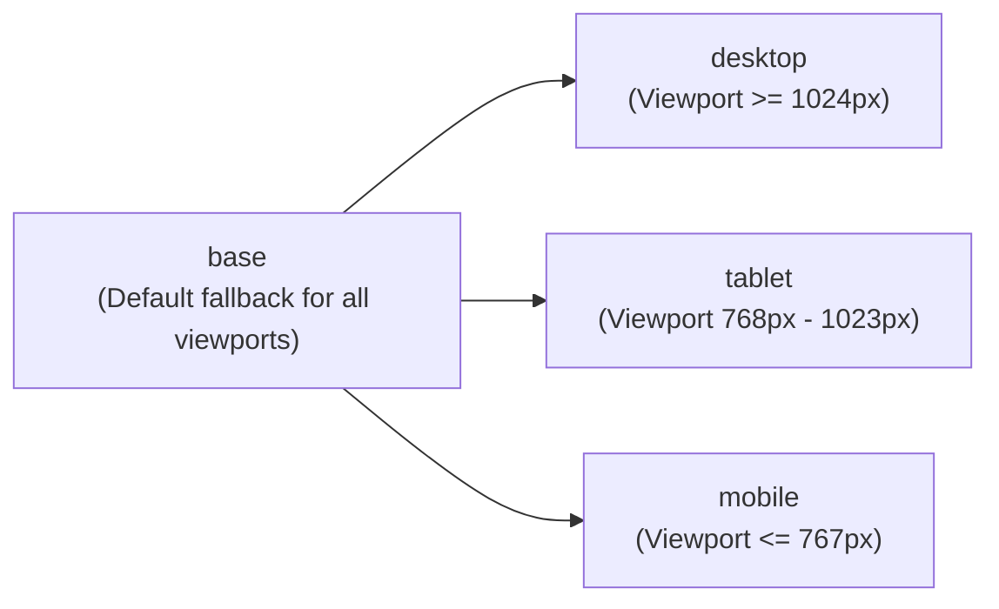
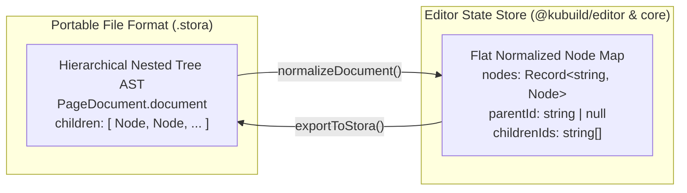

import { Callout } from 'fumadocs-ui/components/callout';
import { Card, Cards } from 'fumadocs-ui/components/card';
import { Tab, Tabs } from 'fumadocs-ui/components/tabs';
import { TypeTable } from 'fumadocs-ui/components/type-table';
import { Accordion, Accordions } from 'fumadocs-ui/components/accordion';
import { InteractiveRenderer } from '@/components/interactive-renderer';

The **`.stora`** file format (`stora.page` schema) is KUBUILD's core portable document model. It represents a fully serialized, deterministic, framework-agnostic Abstract Syntax Tree (AST) of a web page. 

Whether an author creates a landing page in the visual builder, an AI agent streams layout mutations, or an edge worker renders server-side HTML, the `.stora` document remains the single source of truth.

---

## High-Level Document Architecture

A `.stora` document is a pure JSON object conforming to version `1.3.0` of the `stora.page` schema specification. At the root level, it encapsulates document metadata, design tokens, marketing tracking configurations, and the hierarchical element tree:



---

## Interactive Live Preview

The interactive sandbox below demonstrates an actual `.stora` document parsed and rendered live using `@kubuild/renderer`. You can inspect the visual representation across desktop, tablet, and mobile viewports, or toggle the **JSON view** to inspect the underlying AST.

<InteractiveRenderer
  title="Hero Section with Action Pipeline & Design Tokens"
  defaultView="preview"
  defaultViewport="desktop"
  showJsonToggle={true}
  document={{
    schema: "stora.page",
    version: "1.3.0",
    metadata: {
      title: "KUBUILD High-Conversion Landing Page",
      description: "Production-ready hero section with theme tokens and interactive action triggers.",
      author: "KUBUILD Architecture Team",
      tags: ["landing", "saas", "hero", "responsive"],
      category: "landing-page",
      version: "1.3.0",
      createdAt: "2026-11-06T00:00:00.000Z",
      updatedAt: "2026-11-06T12:00:00.000Z",
      tracking: {
        pixels: [
          {
            id: "meta-pixel-prod",
            provider: "meta",
            label: "Production Meta Pixel",
            enabled: true,
            pixelId: "987654321012345",
            serverEnabled: true,
            testEventCode: "TEST42109",
            disabledEvents: []
          }
        ]
      }
    },
    theme: {
      colors: {
        primary: "#4f46e5",
        "primary-hover": "#4338ca",
        surface: "#ffffff",
        text: "#0f172a",
        muted: "#64748b"
      },
      fonts: {
        sans: "Inter, system-ui, -apple-system, sans-serif",
        mono: "JetBrains Mono, monospace"
      },
      radii: {
        sm: "6px",
        md: "10px",
        full: "9999px"
      },
      spacing: {
        sm: "12px",
        md: "24px",
        lg: "48px"
      }
    },
    document: {
      id: "root-page",
      type: "page",
      props: {
        title: "KUBUILD High-Conversion Landing Page"
      },
      styles: {
        base: {
          backgroundColor: "#f8fafc",
          color: "var(--kb-color-text)",
          fontFamily: "var(--kb-font-sans)",
          minHeight: "100%",
          padding: "0px",
          boxSizing: "border-box"
        }
      },
      children: [
        {
          id: "hero-section-01",
          type: "section",
          props: {},
          styles: {
            base: {
              display: "flex",
              flexDirection: "column",
              alignItems: "center",
              justifyContent: "center",
              padding: "48px 24px",
              boxSizing: "border-box"
            },
            desktop: {
              padding: "64px 32px"
            },
            mobile: {
              padding: "32px 16px"
            }
          },
          animation: {
            type: "fade-up",
            duration: 500,
            delay: 0,
            easing: "ease-out",
            once: true,
            hoverEffect: "none",
            loopEffect: "none"
          },
          children: [
            {
              id: "hero-container-01",
              type: "container",
              props: {},
              styles: {
                base: {
                  display: "flex",
                  flexDirection: "column",
                  alignItems: "center",
                  textAlign: "center",
                  maxWidth: "680px",
                  gap: "16px",
                  boxSizing: "border-box"
                }
              },
              children: [
                {
                  id: "hero-heading-01",
                  type: "heading",
                  props: {
                    level: 1,
                    text: "Build Once. Render Anywhere."
                  },
                  styles: {
                    base: {
                      fontSize: "32px",
                      fontWeight: "800",
                      lineHeight: "1.2",
                      letterSpacing: "-0.03em",
                      color: "var(--kb-color-text)",
                      margin: "0px"
                    },
                    desktop: {
                      fontSize: "40px"
                    },
                    mobile: {
                      fontSize: "26px"
                    }
                  }
                },
                {
                  id: "hero-desc-01",
                  type: "paragraph",
                  props: {
                    text: "The deterministic JSON document model behind KUBUILD decouples visual authoring from web rendering with zero vendor lock-in."
                  },
                  styles: {
                    base: {
                      fontSize: "16px",
                      lineHeight: "1.6",
                      color: "var(--kb-color-muted)",
                      margin: "0px"
                    },
                    desktop: {
                      fontSize: "17px"
                    }
                  }
                },
                {
                  id: "hero-cta-btn",
                  type: "button",
                  props: {
                    text: "Get Started Free",
                    variant: "primary"
                  },
                  styles: {
                    base: {
                      backgroundColor: "var(--kb-color-primary)",
                      color: "#ffffff",
                      fontSize: "14px",
                      fontWeight: "600",
                      padding: "12px 28px",
                      borderRadius: "var(--kb-radius-md)",
                      border: "none",
                      cursor: "pointer",
                      boxShadow: "0 4px 12px rgba(79, 70, 229, 0.25)",
                      marginTop: "12px",
                      transition: "all 0.2s ease"
                    },
                    states: {
                      ":hover": {
                        backgroundColor: "var(--kb-color-primary-hover)",
                        transform: "translateY(-1px)",
                        boxShadow: "0 6px 16px rgba(79, 70, 229, 0.35)"
                      }
                    }
                  },
                  actions: [
                    {
                      id: "cta-click-pipeline",
                      trigger: "click",
                      label: "Lead Tracking & Redirect",
                      enabled: true,
                      steps: [
                        {
                          id: "track-lead-event",
                          type: "track_event",
                          label: "Trigger Meta CAPI Lead Event",
                          payload: {
                            eventName: "Lead",
                            channel: "both",
                            customData: {
                              placement: "hero-cta",
                              campaign: "docs-onboarding"
                            }
                          }
                        },
                        {
                          id: "nav-to-signup",
                          type: "navigate",
                          label: "Navigate to Registration",
                          payload: {
                            url: "https://kustora.com/signup",
                            target: "_self"
                          }
                        }
                      ]
                    }
                  ]
                }
              ]
            }
          ]
        }
      ]
    }
  }}
/>

---

## Complete `.stora` Specification (JSON Reference)

Below is the complete, canonical JSON representation of a `.stora` document conforming to `PageDocumentSchema` (v1.3.0). Every top-level block and node attribute is annotated:

```json title="sample-landing-page.stora.json"
{
  "$schema": "https://schema.kustora.com/v1.3.0/stora.page.json",
  "schema": "stora.page",
  "version": "1.3.0",
  "metadata": {
    "title": "KUBUILD High-Conversion Landing Page",
    "description": "Production-ready hero section with theme tokens and interactive action triggers.",
    "author": "KUBUILD Architecture Team",
    "tags": ["landing", "saas", "hero", "responsive"],
    "category": "landing-page",
    "version": "1.3.0",
    "createdAt": "2026-11-06T00:00:00.000Z",
    "updatedAt": "2026-11-06T12:00:00.000Z",
    "custom": {
      "publishedBy": "ci-deployer",
      "environment": "production"
    },
    "tracking": {
      "pixels": [
        {
          "id": "meta-pixel-prod",
          "provider": "meta",
          "label": "Production Meta Pixel",
          "enabled": true,
          "pixelId": "987654321012345",
          "serverEnabled": true,
          "testEventCode": "TEST42109",
          "disabledEvents": []
        }
      ]
    }
  },
  "theme": {
    "colors": {
      "primary": "#4f46e5",
      "primary-hover": "#4338ca",
      "surface": "#ffffff",
      "text": "#0f172a",
      "muted": "#64748b"
    },
    "fonts": {
      "sans": "Inter, system-ui, -apple-system, sans-serif",
      "mono": "JetBrains Mono, monospace"
    },
    "radii": {
      "sm": "6px",
      "md": "10px",
      "full": "9999px"
    },
    "spacing": {
      "sm": "12px",
      "md": "24px",
      "lg": "48px"
    }
  },
  "document": {
    "id": "root-page",
    "type": "page",
    "props": {
      "title": "KUBUILD High-Conversion Landing Page"
    },
    "styles": {
      "base": {
        "backgroundColor": "#f8fafc",
        "color": "var(--kb-color-text)",
        "fontFamily": "var(--kb-font-sans)",
        "minHeight": "100vh",
        "padding": "0px",
        "boxSizing": "border-box"
      }
    },
    "children": [
      {
        "id": "hero-section-01",
        "type": "section",
        "props": {},
        "styles": {
          "base": {
            "display": "flex",
            "flexDirection": "column",
            "alignItems": "center",
            "justifyContent": "center",
            "padding": "64px 24px",
            "boxSizing": "border-box"
          },
          "desktop": {
            "padding": "96px 32px"
          },
          "tablet": {
            "padding": "64px 20px"
          },
          "mobile": {
            "padding": "40px 16px"
          }
        },
        "animation": {
          "type": "fade-up",
          "duration": 600,
          "delay": 100,
          "easing": "ease-out",
          "once": true,
          "hoverEffect": "none",
          "loopEffect": "none"
        },
        "children": [
          {
            "id": "hero-container-01",
            "type": "container",
            "props": {},
            "styles": {
              "base": {
                "display": "flex",
                "flexDirection": "column",
                "alignItems": "center",
                "textAlign": "center",
                "maxWidth": "720px",
                "gap": "20px",
                "boxSizing": "border-box"
              }
            },
            "children": [
              {
                "id": "hero-heading-01",
                "type": "heading",
                "props": {
                  "level": 1,
                  "text": "Build Once. Render Anywhere."
                },
                "styles": {
                  "base": {
                    "fontSize": "36px",
                    "fontWeight": "800",
                    "lineHeight": "1.2",
                    "letterSpacing": "-0.03em",
                    "color": "var(--kb-color-text)",
                    "margin": "0px"
                  },
                  "desktop": {
                    "fontSize": "48px"
                  },
                  "mobile": {
                    "fontSize": "28px"
                  }
                }
              },
              {
                "id": "hero-desc-01",
                "type": "paragraph",
                "props": {
                  "text": "The deterministic JSON document model behind KUBUILD decouples visual authoring from web rendering with zero vendor lock-in."
                },
                "styles": {
                  "base": {
                    "fontSize": "16px",
                    "lineHeight": "1.6",
                    "color": "var(--kb-color-muted)",
                    "margin": "0px"
                  },
                  "desktop": {
                    "fontSize": "18px"
                  }
                }
              },
              {
                "id": "hero-cta-btn",
                "type": "button",
                "props": {
                  "text": "Get Started Free",
                  "variant": "primary"
                },
                "styles": {
                  "base": {
                    "backgroundColor": "var(--kb-color-primary)",
                    "color": "#ffffff",
                    "fontSize": "15px",
                    "fontWeight": "600",
                    "padding": "14px 32px",
                    "borderRadius": "var(--kb-radius-md)",
                    "border": "none",
                    "cursor": "pointer",
                    "boxShadow": "0 4px 14px rgba(79, 70, 229, 0.3)",
                    "transition": "all 0.15s ease"
                  },
                  "states": {
                    ":hover": {
                      "backgroundColor": "var(--kb-color-primary-hover)",
                      "transform": "translateY(-1px)",
                      "boxShadow": "0 6px 20px rgba(79, 70, 229, 0.4)"
                    }
                  }
                },
                "actions": [
                  {
                    "id": "cta-click-pipeline",
                    "trigger": "click",
                    "label": "Lead Tracking & Redirect",
                    "enabled": true,
                    "steps": [
                      {
                        "id": "track-lead-event",
                        "type": "track_event",
                        "label": "Trigger Meta CAPI Lead Event",
                        "payload": {
                          "eventName": "Lead",
                          "channel": "both",
                          "customData": {
                            "placement": "hero-cta",
                            "campaign": "docs-onboarding"
                          }
                        }
                      },
                      {
                        "id": "nav-to-signup",
                        "type": "navigate",
                        "label": "Navigate to Registration",
                        "payload": {
                          "url": "https://kustora.com/signup",
                          "target": "_self"
                        }
                      }
                    ]
                  }
                ]
              }
            ]
          }
        ]
      }
    ]
  }
}
```

---

## Node Anatomy (`NodeSchema`)

In the `.stora` AST, every visual element, layout wrapper, text run, and form input is represented by a `Node` object.

```typescript
export interface Node {
  id: string;
  type: string;
  props?: Record<string, unknown>;
  styles?: ResponsiveStyles;
  animation?: AnimationConfig;
  actions?: ActionPipeline[];
  formConfig?: FormConfig;
  children?: Node[];
}
```

### Node Field Breakdown

| Field | Type | Required | Description |
| :--- | :--- | :---: | :--- |
| `id` | `string` | **Yes** | Deterministic, immutable AST identifier (e.g. `hero-heading-01`). Independent of React keys. |
| `type` | `string` | **Yes** | Registered component identifier matching `@kubuild/components` (e.g. `section`, `heading`, `button`). |
| `props` | `Record<string, unknown>` | No | Component-specific props (e.g. `level: 1`, `text: "Hello"`). |
| `styles` | `ResponsiveStyles` | No | Breakpoint cascade (`base`, `desktop`, `tablet`, `mobile`) and pseudo-classes (`states: { ":hover": ... }`). |
| `animation` | `AnimationConfig` | No | AOS entrance animation, durations, easing curves, and continuous micro-interactions. |
| `actions` | `ActionPipeline[]` | No | Event-triggered pipeline arrays executed on user interaction (`click`, `submit`, `load`, etc.). |
| `formConfig` | `FormConfig` | No | Field bindings, validation rules (`email`, `min_length`, `pattern`), and submission handlers. |
| `children` | `Node[]` | No | Array of nested child nodes. Empty array `[]` for leaf components. |

<Callout type="info" title="Deterministic Node ID Rules">
  1. **Cross-Document Uniqueness:** Every node ID must be globally unique within the document tree to allow deterministic command targeting (`updateNodeStyle`, `moveNode`, `deleteNode`).
  2. **Decoupled from React Keys:** Node IDs are persistent AST addresses, not transient React rendering keys. React reconciliation keys are generated at render time based on node ID and hierarchy index.
  3. **URL & DOM Safe:** Node IDs should be composed of alphanumeric characters, hyphens, and underscores (`^[a-zA-Z0-9_-]+$`) so they can safely map to DOM attributes (`data-kb-id="hero-heading-01"`).
</Callout>

---

## Responsive Breakpoint Cascade & Pseudo-States

Styles in KUBUILD are mobile-first and cascade cleanly through four breakpoint tiers:



### Style Cascade Resolution

When `@kubuild/renderer` renders a node at a given viewport, styles resolve in the following order:

1. **Base Styles (`styles.base`):** Universal style definitions applied to all screen sizes.
2. **Breakpoint Override (`styles[viewport]`):** Specific breakpoint overrides merged on top of `base`.
3. **Pseudo-State Layer (`styles.states[':hover']`):** Active interaction layers merged conditionally when the element state matches (e.g., `:hover`, `:focus`, `:active`).

```json title="Example Responsive & Pseudo-State Definition"
"styles": {
  "base": {
    "fontSize": "16px",
    "padding": "12px 24px",
    "backgroundColor": "var(--kb-color-primary)",
    "color": "#ffffff"
  },
  "desktop": {
    "fontSize": "18px",
    "padding": "16px 32px"
  },
  "mobile": {
    "fontSize": "14px",
    "padding": "10px 20px"
  },
  "states": {
    ":hover": {
      "backgroundColor": "var(--kb-color-primary-hover)",
      "transform": "translateY(-2px)"
    }
  }
}
```

---

## Design Tokens & Theme System (`ThemeSchema`)

The `.stora` specification provides first-class support for design tokens via the top-level `theme` object. Rather than hardcoding hex colors and arbitrary pixel spacings into hundreds of individual nodes, documents declare semantic tokens:

```json title="Theme Token Schema"
"theme": {
  "colors": {
    "primary": "#4f46e5",
    "primary-hover": "#4338ca",
    "surface": "#ffffff",
    "text": "#0f172a",
    "muted": "#64748b"
  },
  "fonts": {
    "sans": "Inter, system-ui, sans-serif",
    "mono": "JetBrains Mono, monospace"
  },
  "radii": {
    "sm": "4px",
    "md": "8px",
    "lg": "16px",
    "full": "9999px"
  },
  "spacing": {
    "sm": "8px",
    "md": "16px",
    "lg": "32px"
  }
}
```

### CSS Custom Property Emission

At render time, `@kubuild/renderer` automatically generates CSS custom properties on the root container:

| Token Group | Prefix | JSON Property | Generated CSS Custom Property |
| :--- | :--- | :--- | :--- |
| `colors` | `--kb-color-` | `theme.colors.primary` | `--kb-color-primary: #4f46e5;` |
| `fonts` | `--kb-font-` | `theme.fonts.sans` | `--kb-font-sans: Inter, system-ui;` |
| `radii` | `--kb-radius-` | `theme.radii.md` | `--kb-radius-md: 8px;` |
| `spacing` | `--kb-space-` | `theme.spacing.lg` | `--kb-space-lg: 32px;` |

Nodes reference tokens using native CSS `var()` expressions (e.g. `color: "var(--kb-color-primary)"`). If a document is exported as pure HTML or rendered without JavaScript, the design tokens resolve natively in all modern web browsers.

---

## Normalized State Map vs. Nested Tree AST

A common architectural question in web builder design is: **Why use a nested tree for `.stora` files, but a flat normalized map inside the editor runtime?**

KUBUILD uses a dual-state representation tailored to each environment's constraints:



<Cards>
  <Card title="Nested Tree (Persistence & Wire Format)" icon="FileJson">
    **Portability & Standards:**
    - Canonical `.stora` JSON format for disk storage, Git versioning, and edge SSR delivery.
    - Matches standard DOM hierarchy: easy to inspect, validate against JSON Schema, and serialize without relational overhead.
    - Self-contained: subtrees can be detached and saved as reusable component templates.
  </Card>

  <Card title="Flat Normalized Map (Editor Runtime)" icon="Cpu">
    **Performance & Reactivity:**
    - Managed by `@kubuild/core` and Zustand in `@kubuild/editor`.
    - **O(1) Node Lookup:** Read or mutate any node directly by ID (`nodes[nodeId]`) without recursive tree traversal.
    - **Instant Drag & Drop:** Moving a node between containers only updates `parentId` and `childrenIds` of the adjacent containers, avoiding deep immutable cloning of unaffected trees.
    - **Granular React Re-renders:** React components select only their individual node slice (`useNode(id)`), preventing entire canvas re-renders when editing a single style property.
  </Card>
</Cards>

---

## Runtime Zod Validation & Sanitization

Security and data integrity are enforced at the schema boundary. KUBUILD provides both direct Zod parsing and a zero-dependency runtime validation facade.

### Schema Validation API

<Tabs items={['@kubuild/schema/validate', '@kubuild/schema (Direct Zod)']}>
  <Tab value="@kubuild/schema/validate">
    ```typescript title="Validating a .stora Document (Host Safe)"
    import { validateDocument, isValidPageDocument } from '@kubuild/schema/validate';

    const rawJson = JSON.parse(uploadedFileContent);

    // Fast boolean guard
    if (!isValidPageDocument(rawJson)) {
      console.error('Invalid .stora document');
      return;
    }

    // Detailed issue reporting
    const result = validateDocument(rawJson);
    if (!result.success) {
      result.issues.forEach((issue) => {
        console.error(`Validation error at ${issue.path}: ${issue.message}`);
      });
    } else {
      console.log('Document successfully validated:', result.data.metadata?.title);
    }
    ```

    <Callout type="info" title="Zero Zod Leak Contract">
      `@kubuild/schema/validate` exports pure TypeScript types (`SchemaValidationResult<T>`) without exposing Zod types in its emitted `.d.ts`. This allows backend hosts using different Zod versions (or no Zod at all) to validate documents without library conflicts.
    </Callout>
  </Tab>

  <Tab value="@kubuild/schema (Direct Zod)">
    ```typescript title="Direct Zod Schema Parsing"
    import { PageDocumentSchema, NodeSchema } from '@kubuild/schema';

    const parseResult = PageDocumentSchema.safeParse(rawJson);

    if (!parseResult.success) {
      console.error('Zod validation failed:', parseResult.error.format());
    } else {
      const document = parseResult.data; // Fully typed PageDocument
      console.log('Valid schema version:', document.version);
    }
    ```
  </Tab>
</Tabs>

---

## Built-in Security & CSS Injection Defense

Allowing authors to customize CSS styles, animation easing, and action URLs introduces potential XSS attack surfaces if untrusted documents are imported. 

KUBUILD implements strict sanitization checks directly inside `StyleValueSchema`, `ThemeSchema`, and `ActionStepSchema`:

### 1. CSS & Script Injection Prevention

All string values assigned to `styles.*` and `theme.*` are verified against the dangerous value regex:

```typescript
const DANGEROUS_STYLE_VALUE_PATTERN =
  /javascript:|expression\(|@import|<script|vbscript:|data:text\/html/i;
```

Any attempt to inject malicious vectors (e.g. `backgroundImage: "url('javascript:alert(1)')"` or CSS expressions `expression(...)`) causes `safeParse()` to reject the document immediately with a descriptive validation error:

```json
{
  "path": ["document", "children", 0, "styles", "base", "backgroundImage"],
  "message": "Style value contains a disallowed or unsafe pattern"
}
```

### 2. Prototype Pollution Defense

The core validation engine in `@kubuild/core/validation/security` strictly rejects prohibited object properties:

```typescript
const PROHIBITED_PROPERTY_KEYS = [
  '__proto__',
  'constructor',
  'prototype',
  '__defineGetter__',
  '__defineSetter__',
  '__lookupGetter__',
  '__lookupSetter__'
];
```

### 3. Action URL Protocol Screening

Action navigation targets (`navigate` step payload) and asset links are strictly restricted to safe protocols:

```typescript
const ALLOWED_URL_SCHEMES = ['http:', 'https:', 'mailto:', 'tel:', '#', 'relative'];
```

Links attempting to execute scripts (such as `javascript:`, `data:`, or `vbscript:`) are automatically sanitized to safe fallback strings before execution.

---

## Next Steps

<Cards>
  <Card title="5-Minute Quickstart" href="/docs/getting-started/quickstart" icon="Zap">
    Embed the KUBUILD visual editor and renderer into your React application in 5 minutes.
  </Card>
  <Card title="Monorepo Architecture" href="/docs/getting-started/architecture" icon="Layers">
    Explore package hierarchy, inward dependency boundaries, and build toolchains.
  </Card>
</Cards>
