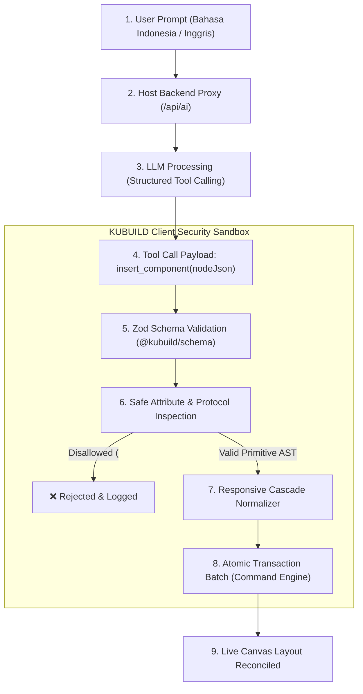

import { Callout } from 'fumadocs-ui/components/callout';
import { Card, Cards } from 'fumadocs-ui/components/card';
import { Tab, Tabs } from 'fumadocs-ui/components/tabs';
import { Accordion, Accordions } from 'fumadocs-ui/components/accordion';
import { TypeTable } from 'fumadocs-ui/components/type-table';
import { InteractiveRenderer } from '@/components/interactive-renderer';

Dalam lanskap pengembangan web dan *landing page builder* modern, adopsi Artificial Intelligence (AI) sering kali terbentur pada dua kutub ekstrem yang bermasalah:
1. **Raw HTML Generation**: Sebagian besar AI generator menghasilkan string raw HTML/CSS bebas tanpa batasan skema. Pendekatan ini sangat rentan terhadap celah keamanan injeksi skrip (XSS), menghasilkan CSS class konflik yang merusak desain induk, serta menghasilkan kode *spaghetti* yang mustahil diedit kembali secara visual oleh desainer.
2. **Kerapuhan Transaksi & Kebocoran Secret**: Banyak builder membebankan panggilan API AI langsung ke browser klien (*client-side SDK*). Akibatnya, API Key berbayar (OpenAI, Anthropic, Gemini) bocor di console DevTools, dan jika hasil generasi AI merusak layout, pengguna tidak memiliki mekanisme pembatalan atomik (*atomic rollback*) selain me-reload halaman dan kehilangan seluruh progres.

**KUBUILD mengatasi kendala tersebut melalui arsitektur AI Copilot generasi baru:**
- **Deterministic AST Enforcement**: Model AI tidak pernah menulis string HTML mentah. AI hanya dapat memanggil *JSON Tool Functions* terstruktur (`insert_component`, `update_node_props`) yang divalidasi skema Zod sebelum menyentuh dokumen.
- **Strict Anti-XSS Sanitizer**: Segala URI berbahaya (`javascript:`, `vbscript:`), manipulasi CSS kuno (`expression()`, `@import`), dan script injection otomatis ditolak di level normalizer.
- **Zero-Secret Backend-Proxy Pattern**: Kunci API AI 100% aman di server host. Klien browser hanya mengirimkan pesan ke endpoint proxy host (misal `/api/ai`), lengkap dengan session auth dan rate limiting.
- **Atomic Undo Transaction**: Ratusan mutasi node yang dihasilkan dari satu instruksi prompt dibundel dalam satu transaksi history engine (`beginTransaction` & `endTransaction`). Pengguna cukup menekan `Cmd+Z` (atau `Ctrl+Z`) sekali untuk membatalkan seluruh blok layout secara instan.

---

## Live Interactive Sandbox

Di bawah ini adalah live sandbox interaktif yang mendemonstrasikan **AI Document Assistant & Prompt Emulator** di runtime KUBUILD. 

Uji coba eksekusi prompt untuk melihat bagaimana kanvas merespons secara *real-time* dengan indikator rekonsiliasi *streaming*, diikuti dengan kemampuan **Atomic Undo (Cmd+Z)** seketika.

<Callout type="info" title="Skenario Eksperimen AI Generator">
- **Uji Rekomendasi Prompt**: Klik salah satu chip rekomendasi prompt di bawah:
  1. *"Tambahkan modern SaaS Pricing Table 3 kolom"*
  2. *"Generate Testimonial Section dengan rating bintang 5"*
  3. *"Buat FAQ Accordion modern"*
- **Perhatikan Streaming Indicator**: Perhatikan langkah-langkah rekonsiliasi yang ditampilkan saat proses berlangsung (`/api/ai proxy` $\rightarrow$ `Tool calling` $\rightarrow$ `Zod validation` $\rightarrow$ `AST Reconciliation`).
- **Uji Atomic Undo**: Setelah komponen baru ditambahkan ke dokumen, klik tombol **Undo AI (Cmd+Z)** atau tekan tombol pintasan keyboard `Cmd+Z` (`Ctrl+Z` di Windows). Perhatikan bahwa seluruh section baru langsung dibatalkan dalam satu ketukan tanpa sisa artefak!
- **Inspeksi JSON AST**: Beralih ke tab **JSON Schema** untuk melihat bahwa struktur yang dihasilkan adalah node JSON valid sesuai standar `.stora` v1.3.0.
</Callout>

<InteractiveRenderer
  title="AI Document Assistant & Prompt-to-Layout Emulator"
  height="620px"
  defaultViewport="desktop"
  showJsonToggle={true}
  enableAiEmulator={true}
  aiPromptSuggestions={[
    "Tambahkan modern SaaS Pricing Table 3 kolom",
    "Generate Testimonial Section dengan rating bintang 5",
    "Buat FAQ Accordion modern"
  ]}
  document={{
    schema: "stora.page",
    version: "1.3.0",
    metadata: {
      title: "AI Copilot Landing Page Demo",
      description: "Halaman interaktif dengan in-editor AI document generation dan atomic transaction.",
      author: "KUBUILD Core Team",
      tags: ["ai", "copilot", "prompt-engineering", "atomic-undo", "ast"],
      category: "guides",
      version: "1.0.0",
      createdAt: "2026-11-06T00:00:00.000Z",
      updatedAt: "2026-11-06T00:00:00.000Z"
    },
    document: {
      id: "root-ai-demo-page",
      type: "page",
      props: { title: "AI Assistant Interactive Playground" },
      styles: {
        base: {
          backgroundColor: "#030712",
          color: "#f9fafb",
          padding: "36px 20px",
          fontFamily: "Inter, system-ui, -apple-system, sans-serif",
          minHeight: "100%",
          boxSizing: "border-box"
        }
      },
      children: [
        {
          id: "hero-ai-section",
          type: "section",
          props: {},
          styles: {
            base: {
              display: "flex",
              flexDirection: "column",
              alignItems: "center",
              textAlign: "center",
              gap: "16px",
              maxWidth: "760px",
              margin: "0 auto 36px auto",
              padding: "24px 12px"
            }
          },
          children: [
            {
              id: "hero-badge",
              type: "badge",
              props: {
                text: "✨ KUBUILD AI COPILOT READY"
              },
              styles: {
                base: {
                  backgroundColor: "rgba(168, 85, 247, 0.18)",
                  color: "#d8b4fe",
                  border: "1px solid rgba(168, 85, 247, 0.35)",
                  padding: "6px 14px",
                  borderRadius: "9999px",
                  fontSize: "11px",
                  fontWeight: 700,
                  letterSpacing: "0.06em",
                  marginBottom: "4px"
                }
              }
            },
            {
              id: "hero-title",
              type: "heading",
              props: {
                text: "Bangun Halaman Web Lebih Cepat dengan AI Terstruktur",
                level: 1
              },
              styles: {
                base: {
                  fontSize: "32px",
                  fontWeight: 800,
                  letterSpacing: "-0.02em",
                  color: "#ffffff",
                  lineHeight: "1.25",
                  margin: 0
                }
              }
            },
            {
              id: "hero-desc",
              type: "paragraph",
              props: {
                text: "Ketik instruksi desain atau pilih salah satu prompt rekomendasi di atas. Mesin AI KUBUILD akan memvalidasi skema Zod dan menginjeksi AST ke kanvas secara atomik."
              },
              styles: {
                base: {
                  fontSize: "15px",
                  color: "#9ca3af",
                  lineHeight: "1.65",
                  maxWidth: "600px",
                  margin: 0
                }
              }
            }
          ]
        }
      ]
    }
  }}
/>

---

## Konfigurasi `AiEditorConfig` pada `<KubuildEditor />`

Untuk mengaktifkan AI Copilot di dalam editor visual, Anda cukup menyuplai prop `ai` pada komponen `<KubuildEditor />`.

Sesuai filosofi KUBUILD, fitur AI bersifat **100% opt-in**: jika prop `ai` tidak disertakan atau seluruh fiturnya diset `false`, editor akan me-render antarmuka murni tanpa toolbar AI, tanpa floating bar, dan tanpa overhead bundle ekstra.

```tsx title="src/components/MyEditor.tsx"
import { KubuildEditor } from '@kubuild/react';
import type { PageDocument } from '@kubuild/schema';

export function EditorView({ initialDocument }: { initialDocument: PageDocument }) {
  return (
    <KubuildEditor
      initialDocument={initialDocument}
      ai={{
        // 1. Rute proxy backend host (Wajib untuk provider berbayar)
        provider: {
          endpoint: '/api/ai',
          headers: {
            'X-Workspace-Id': 'ws_enterprise_991'
          }
        },
        // 2. Fitur per-kapabilitas yang diaktifkan
        features: {
          chat: true,      // Panel tanya-jawab kontekstual & styling advice
          generate: true,  // Prompt-to-section / prompt-to-page generation
          enhance: true,   // "Ask AI about this component" & selective refactoring
          agent: false     // Multi-turn agent mode dengan autonomous patching
        },
        // 3. Mode panel default saat editor dimuat: 'floating' | 'docked' | 'hidden'
        defaultPanelMode: 'floating',
        // 4. Prefix prompt sistem untuk standarisasi brand & persona copywriting
        systemPromptPrefix: 'Use high-conversion marketing copywriting in Indonesian. Always adhere strictly to minimalist modern design patterns.'
      }}
    />
  );
}
```

### Mengapa Backend-Proxy Pattern Wajib untuk Provider Berbayar?

<Callout type="warn" title="Peringatan Kritis: Bahaya Client-Side API Key">
Jangan pernah menginisialisasi adapter provider berbayar seperti `new OpenAiAdapter({ apiKey: 'sk-...' })` langsung di dalam kode komponen React sisi klien (*browser bundle*).

Kunci API yang berada di client bundle dapat dibaca oleh siapa saja melalui DevTools (`Sources` atau `Network`), memungkinkan pihak ketiga menyalahgunakan kuota API OpenAI / Anthropic / Gemini Anda.
</Callout>

Pola **Backend-Proxy Pattern** adalah standar emas arsitektur integrasi AI pada KUBUILD:
1. **Pemisahan Kredensial**: Variabel lingkungan `OPENAI_API_KEY` atau `ANTHROPIC_API_KEY` hanya dideklarasikan di environment server host (`process.env`), tidak pernah dipaparkan ke browser.
2. **Pemeriksaan Otorisasi (*Session & Role*)**: Host dapat memverifikasi token JWT, cookies sesi, atau hak akses pengguna sebelum permintaan diteruskan ke model LLM.
3. **Proteksi Rate Limiting & Kuota**: Host dapat membatasi jumlah token atau frekuensi eksekusi prompt per pengguna (*e.g. 20 generasi prompt per hari untuk paket gratis*).

Berikut adalah contoh implementasi rute Next.js App Router menggunakan helper resmi `@kubuild/ai/server`:

<Tabs items={['app/api/ai/route.ts (Next.js)', 'lib/auth-check.ts']}>
  <Tab value="app/api/ai/route.ts (Next.js)">
```typescript
import { KubuildAiEngine, OpenAiAdapter, createAiHandler } from '@kubuild/ai/server';
import { getSessionFromRequest, isRateLimited } from '@/lib/auth-check';

// 1. Inisialisasi engine server-side dengan provider pilihan host
const engine = new KubuildAiEngine({
  adapter: new OpenAiAdapter({
    apiKey: process.env.OPENAI_API_KEY!, // Aman di server
    model: 'gpt-4o',
    temperature: 0.3,
  }),
});

// 2. Buat HTTP handler standar Fetch API dengan middleware pengaman
export const POST = createAiHandler(engine, {
  // STORA-519: Guardrail hook dieksekusi sebelum request menyentuh LLM provider
  beforeRequest: async (request: Request) => {
    // Verifikasi identitas pengguna dari session cookie
    const session = await getSessionFromRequest(request);
    if (!session) {
      return new Response(JSON.stringify({ error: 'Unauthorized: Harap login terlebih dahulu' }), {
        status: 401,
        headers: { 'Content-Type': 'application/json' },
      });
    }

    // Periksa batas kuota harian pengguna
    const rateLimitExceeded = await isRateLimited(session.userId);
    if (rateLimitExceeded) {
      return new Response(JSON.stringify({ error: 'Too Many Requests: Batas kuota AI harian tercapai' }), {
        status: 429,
        headers: { 'Content-Type': 'application/json' },
      });
    }

    // Return undefined agar request diproses normal oleh engine
  },
  // Izinkan instruksi kustom dari prop editor (default: true, max 4000 karakter)
  allowClientInstructions: true,
});
```
  </Tab>
  <Tab value="lib/auth-check.ts">
```typescript
export async function getSessionFromRequest(request: Request) {
  const authHeader = request.headers.get('authorization');
  const cookieHeader = request.headers.get('cookie');
  
  // Validasi sesi pengguna di host database / JWT
  if (!authHeader && !cookieHeader) return null;
  return { userId: 'usr_premium_102', role: 'editor' };
}

export async function isRateLimited(userId: string): Promise<boolean> {
  // Implementasi Redis / Memory sliding-window limiter
  return false;
}
```
  </Tab>
</Tabs>

---

## Keamanan & Deterministic AST Enforcement

Salah satu pembeda utama KUBUILD dibanding visual website builder lainnya adalah perlindungan keamanan di tingkat kompilator AST (*Abstract Syntax Tree*).



### Mengapa AI di KUBUILD 100% Kebal terhadap XSS?

1. **Bukan String HTML Mentah**: AI tidak diinstruksikan untuk menulis `<div><script>alert(1)</script></div>`. AI KUBUILD diprogram dengan instruksi sistem ketat untuk memanggil fungsi tool call JSON (`insert_component`, `update_node_props`).
2. **Validasi Skema Zod Komprehensif**: Setiap node JSON yang diterima dari streaming wajib lolos validasi `NodeSchema` dari `@kubuild/schema`. Jika terdapat *field* yang tidak terdaftar di katalog komponen atau tipe data tidak valid (misal `styles.base` berisi objek alih-alih nilai primitif string/number), parser otomatis membatalkan operasi.
3. **Pembersihan URL & Protokol Berbahaya**:
   - Protokol berbahaya seperti `javascript:`, `vbscript:`, atau `data:text/html` pada aksi navigasi tautan atau tombol otomatis ditolak oleh fungsi `isSafeActionUrl`.
   - Hanya skema aman yang diperbolehkan: `https:`, `http:`, `mailto:`, `tel:`, dan anchor lokal `#section-id`.
4. **Pencegahan Injeksi Gaya CSS Ekstrem**:
   - Sintaks CSS warisan Internet Explorer yang mengeksekusi JavaScript seperti `expression(...)` otomatis dihapus.
   - Aturan `@import` eksternal dan tag `<style>` yang berpotensi melakukan *CSS keylogger* atau *layout hijacking* dilarang di tingkat renderer.

<Callout type="danger" title="Atribut Berbahaya yang Otomatis Ditolak">
- `javascript:...` pada link tombol, action href, atau iframe source.
- Tag `<script>` di dalam properti teks atau heading (dirender sebagai string biasa yang di-*escape*, bukan executable DOM).
- `expression(...)` atau `url(data:...)` pada properti CSS.
- Komponen ilegal di luar katalog registri (`ComponentRegistryLike`).
</Callout>

---

## Alur Eksekusi & Atomic Undo

Ketika pengguna berinteraksi dengan AI Copilot di KUBUILD, seluruh pipeline mutasi dikelola oleh **Command History Engine**:

```
[Prompt Pengguna] 
       ↓ 
[Backend Proxy /api/ai] 
       ↓ 
[LLM Tool Calling] 
       ↓ 
[Streaming Normalizer] 
       ↓ 
[CommandEngine.beginTransaction()] 
       ↓ 
[Mutasi Node 1, Node 2, ... Node N] 
       ↓ 
[CommandEngine.endTransaction()] 
       ↓ 
[Tersimpan sebagai 1 Entri Undo]
```

### Cara Kerja Atomic Undo (Satu Ketukan `Cmd+Z`)

Bayangkan sebuah prompt kompleks: *"Tambahkan modern SaaS Pricing Table 3 kolom lengkap dengan toggle dan badge populer"*. Prompt ini menghasilkan lebih dari 15 node baru (Section, Container, 3 Card Column, 3 Heading, 3 Price Badge, 3 Checklist Container, dan 3 Tombol CTA).

Jika perubahan tersebut dieksekusi tanpa transaksi atomik:
- Membatalkan perubahan akan membutuhkan **15 kali penekanan tombol Undo** berturut-turut!
- Jika pengguna berhenti di tengah jalan, halaman akan berada dalam *state* rusak (*corrupted partial layout*).

**Solusi KUBUILD Atomic Undo:**
1. Sebelum potongan AST streaming pertama diaplikasikan ke dokumen aktif, engine memanggil `beginTransaction('ai-generation')`.
2. Seluruh penambahan node, modifikasi style, dan rekonsiliasi layout dikelompokkan ke dalam satu grup ID transaksi.
3. Setelah proses streaming selesai dan divalidasi, engine memanggil `endTransaction()`.
4. Ketika pengguna menekan **`Cmd+Z`** (atau `Ctrl+Z` pada Windows), engine membalikkan seluruh transaksi tersebut sekaligus dalam waktu kurang dari 5 milidetik. Dokumen kembali persis ke kondisi awal sebelum AI dipanggil!

---

## Prompt Engineering Recipes untuk Web Generation

Berikut adalah resep prompt (*prompt recipes*) yang telah dioptimalkan untuk menghasilkan struktur tata letak web berkualitas tinggi dengan estetika modern, konversi maksimal, dan struktur AST yang rapi.

<Accordions>
  <Accordion title="Recipe 1: High-Converting Hero Section (Headline, Dual CTA, Social Proof)">
    **Instruksi Prompt:**
    ```text
    Buat modern Hero Section untuk produk AI Analytics SaaS. 
    Struktur wajib mencakup:
    1. Pill badge di atas: '🚀 Versi 2.0 Kini Tersedia' dengan aksen indigo.
    2. Headline tebal: 'Ubah Data Mentah Menjadi Keputusan Bisnis Nyata'.
    3. Paragraf sub-headline bernada persuasif dengan warna abu-abu netral (#94a3b8).
    4. Dua tombol CTA sejajar: Tombol utama 'Mulai Uji Coba Gratis' (background indigo gradient) dan tombol sekunder 'Jadwalkan Demo' (border netral transparan).
    5. Social proof bar di bagian bawah bertuliskan 'Dipercaya oleh 500+ perusahaan teknologi terkemuka'.
    ```

    **Hasil JSON AST yang Direkonsiliasi:**
    ```json
    {
      "id": "hero-analytics-section",
      "type": "section",
      "styles": {
        "base": {
          "padding": "64px 24px",
          "backgroundColor": "#030712",
          "textAlign": "center"
        }
      },
      "children": [
        {
          "id": "hero-badge-pill",
          "type": "badge",
          "props": { "text": "🚀 Versi 2.0 Kini Tersedia" },
          "styles": {
            "base": {
              "backgroundColor": "rgba(99, 102, 241, 0.15)",
              "color": "#818cf8",
              "padding": "6px 14px",
              "borderRadius": "9999px"
            }
          }
        },
        {
          "id": "hero-headline",
          "type": "heading",
          "props": { "text": "Ubah Data Mentah Menjadi Keputusan Bisnis Nyata", "level": 1 },
          "styles": { "base": { "fontSize": "36px", "fontWeight": 800, "color": "#ffffff" } }
        }
      ]
    }
    ```
  </Accordion>

  <Accordion title="Recipe 2: 3-Tier SaaS Pricing Table (Monthly/Annual Toggle, Feature Checklist, Recommended Badge)">
    **Instruksi Prompt:**
    ```text
    Tambahkan SaaS Pricing Table 3 kolom dengan tema gelap:
    1. Kolom 1: 'Starter' (Rp 199.000/bln) untuk solopreneur, tombol CTA standar.
    2. Kolom 2: 'Pro Growth' (Rp 499.000/bln) dengan border aksen ungu neon, badge 'Paling Populer', dan tombol CTA gradient yang mencolok.
    3. Kolom 3: 'Enterprise' (Hubungi Kami) untuk korporasi dengan kebutuhan dedicated server dan custom SLA.
    Gunakan layout responsif grid 3 kolom pada desktop yang otomatis stack vertikal pada layar mobile.
    ```
  </Accordion>

  <Accordion title="Recipe 3: Interactive FAQ Accordion">
    **Instruksi Prompt:**
    ```text
    Buat FAQ Section modern dengan 4 pertanyaan paling penting seputar produk:
    1. Apakah saya bisa membatalkan langganan kapan saja?
    2. Bagaimana sistem penagihan tagihan tahunan?
    3. Apakah tersedia uji coba gratis tanpa kartu kredit?
    4. Bagaimana data keamanan kami dienkripsi?
    Bungkus setiap item dalam container bergaya kartu dengan border halus (#1e293b) dan sudut melengkung 10px.
    ```
  </Accordion>

  <Accordion title="Recipe 4: Redesign & Copywriting Enhancement (In-Place Refactor)">
    **Instruksi Prompt (Bekerja pada node yang sedang dipilih / selected node):**
    ```text
    Ubah headline yang sedang saya pilih agar terdengar lebih mendesak dan berorientasi hasil bagi pengusaha e-commerce. Ubah warna tombol CTA di bawahnya dari warna abu-abu menjadi warna amber (#f59e0b) dengan hover state warna amber gelap (#d97706).
    ```

    **Respon Tool Call Model:**
    ```json
    {
      "tool": "update_node_props",
      "args": {
        "nodeId": "cta-primary-btn",
        "props": {
          "text": "Klaim Diskon 50% Hari Ini Saja →"
        },
        "styles": {
          "base": {
            "backgroundColor": "#f59e0b",
            "color": "#000000",
            "fontWeight": 700
          },
          "states": {
            ":hover": {
              "backgroundColor": "#d97706"
            }
          }
        }
      }
    }
    ```
  </Accordion>
</Accordions>

---

## Spesifikasi API & Tipe TypeScript

Berikut adalah definisi tipe TypeScript resmi dari `@kubuild/editor` untuk konfigurasi integrasi AI:

### `AiEditorConfig`

<TypeTable
  type={{
    provider: {
      description: 'Adapter instance AI (server-only) atau objek konfigurasi HTTP endpoint proxy host.',
      type: "AiProviderAdapter | { endpoint: string; headers?: Record<string, string>; credentials?: RequestCredentials }",
      required: true,
    },
    features: {
      description: 'Daftar flag kemampuan AI yang diaktifkan (chat, generate, enhance, agent).',
      type: '{ chat?: boolean; generate?: boolean; enhance?: boolean; agent?: boolean }',
      default: '{ chat: false, generate: false, enhance: false, agent: false }',
      required: false,
    },
    defaultPanelMode: {
      description: "Posisi panel AI saat editor pertama kali dimuat: 'floating' | 'docked' | 'hidden'.",
      type: "'floating' | 'docked' | 'hidden'",
      default: "'hidden'",
      required: false,
    },
    systemPromptPrefix: {
      description: 'Instruksi sistem tambahan spesifik host (branding, tone of voice, panduan copywriting).',
      type: 'string',
      required: false,
    },
  }}
/>

### `ResolvedAiEditorConfig`

Objek hasil normalisasi yang digunakan oleh internal hook `useAiEditor` di dalam `<KubuildEditor />`:

<TypeTable
  type={{
    enabled: {
      description: 'Status aktifasi AI secara global (true jika provider disediakan dan minimal satu fitur bernilai true).',
      type: 'boolean',
      required: true,
    },
    provider: {
      description: 'Provider adapter teresolusi atau konfigurasi endpoint proxy yang siap digunakan untuk fetch.',
      type: 'AiProviderAdapter | { endpoint: string; headers?: Record<string, string>; credentials?: RequestCredentials } | null',
      required: true,
    },
    features: {
      description: 'Status final per kemampuan fitur AI yang sudah dinormalisasi tanpa nilai undefined.',
      type: '{ chat: boolean; generate: boolean; enhance: boolean; agent: boolean }',
      required: true,
    },
    defaultPanelMode: {
      description: 'Mode tampilan panel default yang telah divalidasi.',
      type: "'floating' | 'docked' | 'hidden'",
      required: true,
    },
    systemPromptPrefix: {
      description: 'String prefix prompt sistem host yang siap dikompilasi.',
      type: 'string | undefined',
      required: false,
    },
  }}
/>

---

## FAQ & Troubleshooting

<Accordions>
  <Accordion title="Bagaimana cara mengatasi error CORS ketika host memisahkan frontend editor dan backend API AI?">
    Jika aplikasi frontend editor Anda berada di domain berbeda dari endpoint `/api/ai` (misal `app.stora.page` ke `api.stora.page`), pastikan server backend menyertakan header CORS berikut pada response:
    ```http
    Access-Control-Allow-Origin: https://app.stora.page
    Access-Control-Allow-Methods: POST, OPTIONS
    Access-Control-Allow-Headers: Content-Type, Authorization, X-Workspace-Id
    Access-Control-Allow-Credentials: true
    ```
    Dan sertakan `credentials: 'include'` pada properti provider di `AiEditorConfig`.
  </Accordion>

  <Accordion title="Apakah AI dapat membuat komponen kustom yang saya daftarkan sendiri di ComponentRegistry?">
    Ya! Fungsi `compileComponentCatalog` di `@kubuild/ai` secara dinamis membaca seluruh definisi komponen di `ComponentRegistry`, termasuk daftar `propFields`, tipe data, default value, dan batasan `acceptsChildren`. Seluruh metadata ini otomatis diinjeksikan ke dalam system prompt LLM sehingga AI mengenali dan dapat men-generate komponen kustom Anda secara akurat.
  </Accordion>

  <Accordion title="Bagaimana cara membatasi panjang teks instruksi yang dikirimkan klien?">
    Pada fungsi `createAiHandler(engine, options)`, Anda dapat menentukan batas karakter melalui opsi `maxClientInstructionsLength` (default: 4000 karakter). Jika pengguna mengirimkan teks melebihi batas, server akan menolak permintaan dengan status `400 Bad Request`.
  </Accordion>
</Accordions>
