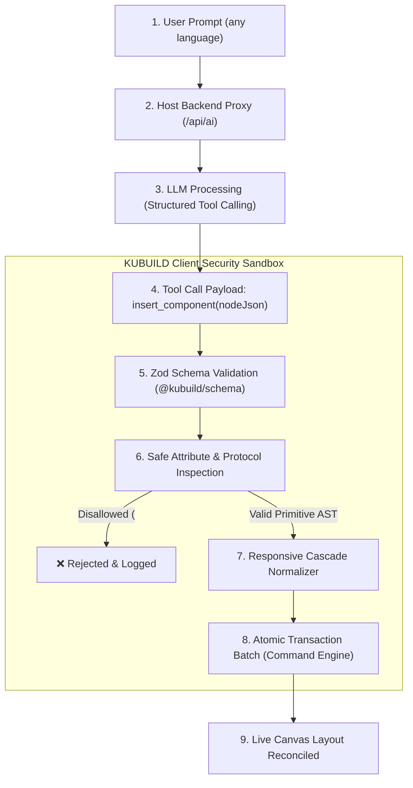

import { Callout } from 'fumadocs-ui/components/callout';
import { Card, Cards } from 'fumadocs-ui/components/card';
import { Tab, Tabs } from 'fumadocs-ui/components/tabs';
import { Accordion, Accordions } from 'fumadocs-ui/components/accordion';
import { TypeTable } from 'fumadocs-ui/components/type-table';
import { InteractiveRenderer } from '@/components/interactive-renderer';

In modern web development and *landing page builders*, AI adoption often runs into two problematic extremes:
1. **Raw HTML generation**: most AI generators emit free-form HTML/CSS strings with no schema constraints. This is highly vulnerable to script injection (XSS), produces conflicting CSS classes that break the parent design, and creates *spaghetti* code designers can't edit visually.
2. **Fragile transactions & leaked secrets**: many builders call AI APIs directly from the browser (*client-side SDK*). Paid API keys (OpenAI, Anthropic, Gemini) leak in DevTools, and if the AI output breaks the layout, users have no *atomic rollback* besides reloading the page and losing all progress.

**KUBUILD solves this with a new-generation AI Copilot architecture:**
- **Deterministic AST enforcement**: the model never writes raw HTML strings. It can only call structured *JSON tool functions* (`insert_component`, `update_node_props`) that are validated with Zod schemas before touching the document.
- **Strict anti-XSS sanitizer**: dangerous URIs (`javascript:`, `vbscript:`), legacy CSS tricks (`expression()`, `@import`), and script injection are rejected at the normalizer level.
- **Zero-secret backend-proxy pattern**: AI API keys stay 100% on the host server. The browser only sends messages to a host proxy endpoint (e.g. `/api/ai`) with session auth and rate limiting.
- **Atomic undo transactions**: the many node mutations produced by one prompt are bundled into a single history transaction (`beginTransaction` & `endTransaction`). Users press `Cmd+Z` (or `Ctrl+Z`) once to undo the whole layout block instantly.

---

## Live Interactive Sandbox

Below is an interactive live sandbox demonstrating the **AI Document Assistant & Prompt Emulator** in the KUBUILD runtime.

Run a prompt to see how the canvas responds in *real time* with *streaming* reconciliation indicators, followed by instant **atomic undo (Cmd+Z)**.

<Callout type="info" title="AI Generator Experiment Scenarios">
- **Try a suggested prompt**: click one of the prompt chips below:
  1. *"Add a modern 3-column SaaS pricing table"*
  2. *"Generate a testimonial section with 5-star ratings"*
  3. *"Create a modern FAQ accordion"*
- **Watch the streaming indicator**: follow the reconciliation steps shown while it runs (`/api/ai proxy` → `Tool calling` → `Zod validation` → `AST Reconciliation`).
- **Test atomic undo**: after the new component is added, click **Undo AI (Cmd+Z)** or press `Cmd+Z` (`Ctrl+Z` on Windows). The entire new section is removed in one keystroke with no leftover artifacts.
- **Inspect the JSON AST**: switch to the **JSON Schema** tab to see that the generated structure is valid `.stora` v1.3.0 node JSON.
</Callout>

<InteractiveRenderer
  title="AI Document Assistant & Prompt-to-Layout Emulator"
  height="620px"
  defaultViewport="desktop"
  showJsonToggle={true}
  enableAiEmulator={true}
  aiPromptSuggestions={[
    "Add a modern 3-column SaaS pricing table",
    "Generate a testimonial section with 5-star ratings",
    "Create a modern FAQ accordion"
  ]}
  document={{
    schema: "stora.page",
    version: "1.3.0",
    metadata: {
      title: "AI Copilot Landing Page Demo",
      description: "Interactive page with in-editor AI document generation and atomic transactions.",
      author: "KUBUILD Core Team",
      tags: ["ai", "copilot", "prompt-engineering", "atomic-undo", "ast"],
      category: "guides",
      version: "1.0.0",
      createdAt: "2026-11-06T00:00:00.000Z",
      updatedAt: "2026-11-06T00:00:00.000Z"
    },
    document: {
      id: "root-ai-demo-page",
      type: "page",
      props: { title: "AI Assistant Interactive Playground" },
      styles: {
        base: {
          backgroundColor: "#030712",
          color: "#f9fafb",
          padding: "36px 20px",
          fontFamily: "Inter, system-ui, -apple-system, sans-serif",
          minHeight: "100%",
          boxSizing: "border-box"
        }
      },
      children: [
        {
          id: "hero-ai-section",
          type: "section",
          props: {},
          styles: {
            base: {
              display: "flex",
              flexDirection: "column",
              alignItems: "center",
              textAlign: "center",
              gap: "16px",
              maxWidth: "760px",
              margin: "0 auto 36px auto",
              padding: "24px 12px"
            }
          },
          children: [
            {
              id: "hero-badge",
              type: "badge",
              props: {
                text: "✨ KUBUILD AI COPILOT READY"
              },
              styles: {
                base: {
                  backgroundColor: "rgba(168, 85, 247, 0.18)",
                  color: "#d8b4fe",
                  border: "1px solid rgba(168, 85, 247, 0.35)",
                  padding: "6px 14px",
                  borderRadius: "9999px",
                  fontSize: "11px",
                  fontWeight: 700,
                  letterSpacing: "0.06em",
                  marginBottom: "4px"
                }
              }
            },
            {
              id: "hero-title",
              type: "heading",
              props: {
                text: "Build Web Pages Faster with Structured AI",
                level: 1
              },
              styles: {
                base: {
                  fontSize: "32px",
                  fontWeight: 800,
                  letterSpacing: "-0.02em",
                  color: "#ffffff",
                  lineHeight: "1.25",
                  margin: 0
                }
              }
            },
            {
              id: "hero-desc",
              type: "paragraph",
              props: {
                text: "Type a design instruction or pick one of the suggested prompts above. The KUBUILD AI engine validates the Zod schema and injects the AST into the canvas atomically."
              },
              styles: {
                base: {
                  fontSize: "15px",
                  color: "#9ca3af",
                  lineHeight: "1.65",
                  maxWidth: "600px",
                  margin: 0
                }
              }
            }
          ]
        }
      ]
    }
  }}
/>

---

## Configuring `AiEditorConfig` on `<KubuildEditor />`

To enable the AI Copilot in the visual editor, pass the `ai` prop to `<KubuildEditor />`.

In line with KUBUILD's philosophy, AI is **100% opt-in**: if the `ai` prop is omitted or every feature is `false`, the editor renders without the AI toolbar or floating bar.

```tsx title="src/components/MyEditor.tsx"
import { KubuildEditor } from '@kubuild/react';
import type { PageDocument } from '@kubuild/schema';

export function EditorView({ initialDocument }: { initialDocument: PageDocument }) {
  return (
    <KubuildEditor
      initialDocument={initialDocument}
      ai={{
        // 1. Host backend proxy route (required for paid providers)
        provider: {
          endpoint: '/api/ai',
          headers: {
            'X-Workspace-Id': 'ws_enterprise_991'
          }
        },
        // 2. Enabled capabilities
        features: {
          chat: true,      // Contextual Q&A panel & styling advice
          generate: true,  // Prompt-to-section / prompt-to-page generation
          enhance: true,   // "Ask AI about this component" & selective refactoring
          agent: false     // Multi-turn agent mode with autonomous patching
        },
        // 3. Default panel mode when the editor loads: 'floating' | 'docked' | 'hidden'
        defaultPanelMode: 'floating',
        // 4. System prompt prefix for brand & copywriting persona
        systemPromptPrefix: 'Use high-conversion marketing copywriting. Always adhere strictly to minimalist modern design patterns.'
      }}
    />
  );
}
```

### Why the Backend-Proxy Pattern Is Required for Paid Providers

<Callout type="warn" title="Critical Warning: Client-Side API Keys">
Never initialize a paid provider adapter such as `new OpenAiAdapter({ apiKey: 'sk-...' })` inside client-side React component code (*browser bundle*).

An API key in the client bundle can be read by anyone through DevTools (`Sources` or `Network`), letting third parties abuse your OpenAI / Anthropic / Gemini quota.
</Callout>

The **backend-proxy pattern** is the gold standard for AI integration in KUBUILD:
1. **Credential separation**: `OPENAI_API_KEY` or `ANTHROPIC_API_KEY` is only declared in the host server environment (`process.env`) and never exposed to the browser.
2. **Authorization checks (*session & role*)**: the host can verify JWTs, session cookies, or user permissions before the request reaches the LLM.
3. **Rate limiting & quotas**: the host can limit tokens or prompt frequency per user (*e.g. 20 generations per day on the free plan*).

A Next.js App Router route using the official `@kubuild/ai/server` helpers:

<Tabs items={['app/api/ai/route.ts (Next.js)', 'lib/auth-check.ts']}>
  <Tab value="app/api/ai/route.ts (Next.js)">
```typescript
import { KubuildAiEngine, OpenAiAdapter, createAiHandler } from '@kubuild/ai/server';
import { getSessionFromRequest, isRateLimited } from '@/lib/auth-check';

// 1. Initialize the server-side engine with the host's chosen provider
const engine = new KubuildAiEngine({
  adapter: new OpenAiAdapter({
    apiKey: process.env.OPENAI_API_KEY!, // Safe on the server
    model: 'gpt-4o',
    temperature: 0.3,
  }),
});

// 2. Create a standard Fetch API handler with guard middleware
export const POST = createAiHandler(engine, {
  // STORA-519: guardrail hook runs before the request reaches the LLM provider
  beforeRequest: async (request: Request) => {
    // Verify the user's identity from the session cookie
    const session = await getSessionFromRequest(request);
    if (!session) {
      return new Response(JSON.stringify({ error: 'Unauthorized: please sign in first' }), {
        status: 401,
        headers: { 'Content-Type': 'application/json' },
      });
    }

    // Check the user's daily quota
    const rateLimitExceeded = await isRateLimited(session.userId);
    if (rateLimitExceeded) {
      return new Response(JSON.stringify({ error: 'Too Many Requests: daily AI quota reached' }), {
        status: 429,
        headers: { 'Content-Type': 'application/json' },
      });
    }

    // Return undefined to let the engine process the request normally
  },
  // Allow custom instructions from the editor prop (default: true, max 4000 characters)
  allowClientInstructions: true,
});
```
  </Tab>
  <Tab value="lib/auth-check.ts">
```typescript
export async function getSessionFromRequest(request: Request) {
  const authHeader = request.headers.get('authorization');
  const cookieHeader = request.headers.get('cookie');
  
  // Validate the user session against the host database / JWT
  if (!authHeader && !cookieHeader) return null;
  return { userId: 'usr_premium_102', role: 'editor' };
}

export async function isRateLimited(userId: string): Promise<boolean> {
  // Redis / in-memory sliding-window limiter implementation
  return false;
}
```
  </Tab>
</Tabs>

---

## Security & Deterministic AST Enforcement

One of KUBUILD's key differentiators from other visual website builders is security enforced at the AST (*Abstract Syntax Tree*) compiler level.



### Why AI Output in KUBUILD Can't Inject XSS

1. **No raw HTML strings**: the AI is not asked to write `<div><script>alert(1)</script></div>`. KUBUILD's system instructions make it call JSON tool functions (`insert_component`, `update_node_props`).
2. **Comprehensive Zod schema validation**: every JSON node received from the stream must pass `NodeSchema` validation from `@kubuild/schema`. If a field isn't in the component catalog or a data type is invalid (e.g. `styles.base` contains an object instead of a primitive string/number), the operation is rejected.
3. **Dangerous URL & protocol cleanup**:
   - Dangerous protocols such as `javascript:`, `vbscript:`, or `data:text/html` in link or button navigation actions are rejected by `isSafeActionUrl`.
   - Only safe schemes are allowed: `https:`, `http:`, `mailto:`, `tel:`, and local anchors like `#section-id`.
4. **Blocking extreme CSS injection**:
   - Legacy Internet Explorer CSS that executes JavaScript, such as `expression(...)`, is removed automatically.
   - External `@import` rules and `<style>` tags that could enable a *CSS keylogger* or *layout hijacking* are blocked at the renderer level.

<Callout type="danger" title="Dangerous Attributes Rejected Automatically">
- `javascript:...` in button links, action hrefs, or iframe sources.
- `<script>` tags inside text or heading props (rendered as escaped plain strings, never executable DOM).
- `expression(...)` or `url(data:...)` in CSS properties.
- Components outside the registry catalog (`ComponentRegistryLike`).
</Callout>

---

## Execution Flow & Atomic Undo

When a user works with the AI Copilot in KUBUILD, the whole mutation pipeline is managed by the **command history engine**:

```
[User Prompt] 
       ↓ 
[Backend Proxy /api/ai] 
       ↓ 
[LLM Tool Calling] 
       ↓ 
[Streaming Normalizer] 
       ↓ 
[CommandEngine.beginTransaction()] 
       ↓ 
[Mutate Node 1, Node 2, ... Node N] 
       ↓ 
[CommandEngine.endTransaction()] 
       ↓ 
[Stored as 1 Undo Entry]
```

### How Atomic Undo Works (One `Cmd+Z`)

Imagine a complex prompt: *"Add a modern 3-column SaaS pricing table with a billing toggle and a popular badge"*. It produces more than 15 new nodes (section, container, 3 card columns, 3 headings, 3 price badges, 3 checklist containers, and 3 CTA buttons).

Without an atomic transaction:
- Undoing the change would take **15 Undo presses** in a row.
- If the user stops halfway, the page is left in a *corrupted partial layout*.

**KUBUILD's atomic undo:**
1. Before the first streamed AST chunk is applied to the active document, the engine calls `beginTransaction()`.
2. Every node insertion, style change, and layout reconciliation is grouped into that one transaction.
3. When streaming finishes and is validated, the engine calls `endTransaction()`.
4. When the user presses **`Cmd+Z`** (or `Ctrl+Z` on Windows), the engine reverts the whole transaction at once. The document returns exactly to its state before the AI was invoked.

---

## Prompt Engineering Recipes for Web Generation

These *prompt recipes* are tuned to produce high-quality layouts with modern aesthetics, strong conversion, and a clean AST.

<Accordions>
  <Accordion title="Recipe 1: High-Converting Hero Section (Headline, Dual CTA, Social Proof)">
    **Prompt instruction:**
    ```text
    Create a modern hero section for an AI analytics SaaS product.
    The structure must include:
    1. A pill badge on top: '🚀 Version 2.0 Is Now Available' with an indigo accent.
    2. A bold headline: 'Turn Raw Data into Real Business Decisions'.
    3. A persuasive sub-headline paragraph in neutral gray (#94a3b8).
    4. Two side-by-side CTA buttons: a primary 'Start Free Trial' button (indigo gradient background) and a secondary 'Book a Demo' button (transparent neutral border).
    5. A social proof bar at the bottom reading 'Trusted by 500+ leading technology companies'.
    ```

    **Reconciled JSON AST output:**
    ```json
    {
      "id": "hero-analytics-section",
      "type": "section",
      "styles": {
        "base": {
          "padding": "64px 24px",
          "backgroundColor": "#030712",
          "textAlign": "center"
        }
      },
      "children": [
        {
          "id": "hero-badge-pill",
          "type": "badge",
          "props": { "text": "🚀 Version 2.0 Is Now Available" },
          "styles": {
            "base": {
              "backgroundColor": "rgba(99, 102, 241, 0.15)",
              "color": "#818cf8",
              "padding": "6px 14px",
              "borderRadius": "9999px"
            }
          }
        },
        {
          "id": "hero-headline",
          "type": "heading",
          "props": { "text": "Turn Raw Data into Real Business Decisions", "level": 1 },
          "styles": { "base": { "fontSize": "36px", "fontWeight": 800, "color": "#ffffff" } }
        }
      ]
    }
    ```
  </Accordion>

  <Accordion title="Recipe 2: 3-Tier SaaS Pricing Table (Monthly/Annual Toggle, Feature Checklist, Recommended Badge)">
    **Prompt instruction:**
    ```text
    Add a 3-column SaaS pricing table with a dark theme:
    1. Column 1: 'Starter' ($19/mo) for solopreneurs, standard CTA button.
    2. Column 2: 'Pro Growth' ($49/mo) with a neon purple accent border, a 'Most Popular' badge, and a bold gradient CTA button.
    3. Column 3: 'Enterprise' (Contact Us) for corporations that need dedicated servers and a custom SLA.
    Use a responsive 3-column grid on desktop that stacks vertically on mobile screens.
    ```
  </Accordion>

  <Accordion title="Recipe 3: Interactive FAQ Accordion">
    **Prompt instruction:**
    ```text
    Create a modern FAQ section with the 4 most important product questions:
    1. Can I cancel my subscription at any time?
    2. How does annual billing work?
    3. Is there a free trial without a credit card?
    4. How is our data encrypted?
    Wrap each item in a card-style container with a subtle border (#1e293b) and 10px rounded corners.
    ```
  </Accordion>

  <Accordion title="Recipe 4: Redesign & Copywriting Enhancement (In-Place Refactor)">
    **Prompt instruction (works on the currently selected node):**
    ```text
    Rewrite the headline I have selected so it sounds more urgent and results-oriented for e-commerce founders. Change the CTA button below it from gray to amber (#f59e0b) with a dark amber hover state (#d97706).
    ```

    **Model tool call response:**
    ```json
    {
      "tool": "update_node_props",
      "args": {
        "nodeId": "cta-primary-btn",
        "props": {
          "text": "Claim 50% Off Today Only →"
        },
        "styles": {
          "base": {
            "backgroundColor": "#f59e0b",
            "color": "#000000",
            "fontWeight": 700
          },
          "states": {
            ":hover": {
              "backgroundColor": "#d97706"
            }
          }
        }
      }
    }
    ```
  </Accordion>
</Accordions>

---

## API Specification & TypeScript Types

Official TypeScript type definitions from `@kubuild/editor` for configuring the AI integration:

### `AiEditorConfig`

<TypeTable
  type={{
    provider: {
      description: 'Server-only AI adapter instance, or a host proxy HTTP endpoint configuration object.',
      type: "AiProviderAdapter | { endpoint: string; headers?: Record<string, string>; credentials?: RequestCredentials }",
      required: true,
    },
    features: {
      description: 'Enabled AI capability flags (chat, generate, enhance, agent).',
      type: '{ chat?: boolean; generate?: boolean; enhance?: boolean; agent?: boolean }',
      default: '{ chat: false, generate: false, enhance: false, agent: false }',
      required: false,
    },
    defaultPanelMode: {
      description: "AI panel position when the editor first loads: 'floating' | 'docked' | 'hidden'.",
      type: "'floating' | 'docked' | 'hidden'",
      default: "'hidden'",
      required: false,
    },
    systemPromptPrefix: {
      description: 'Extra host-specific system instructions (branding, tone of voice, copywriting guidelines).',
      type: 'string',
      required: false,
    },
  }}
/>

### `ResolvedAiEditorConfig`

The normalized object produced by `resolveAiEditorConfig()` and used internally by `<KubuildEditor />`:

<TypeTable
  type={{
    enabled: {
      description: 'Global AI activation state (true when a provider is supplied and at least one feature is true).',
      type: 'boolean',
      required: true,
    },
    provider: {
      description: 'The resolved provider adapter or proxy endpoint configuration, ready for fetch.',
      type: 'AiProviderAdapter | { endpoint: string; headers?: Record<string, string>; credentials?: RequestCredentials } | null',
      required: true,
    },
    features: {
      description: 'Final normalized per-capability flags with no undefined values.',
      type: '{ chat: boolean; generate: boolean; enhance: boolean; agent: boolean }',
      required: true,
    },
    defaultPanelMode: {
      description: 'The validated default panel mode.',
      type: "'floating' | 'docked' | 'hidden'",
      required: true,
    },
    systemPromptPrefix: {
      description: 'Host system prompt prefix, ready to be compiled.',
      type: 'string | undefined',
      required: false,
    },
  }}
/>

---

## FAQ & Troubleshooting

<Accordions>
  <Accordion title="How do I fix CORS errors when the editor frontend and the AI backend are on different domains?">
    If your editor frontend lives on a different domain than the `/api/ai` endpoint (e.g. `app.stora.page` calling `api.stora.page`), make sure the backend includes these CORS headers in its response:
    ```http
    Access-Control-Allow-Origin: https://app.stora.page
    Access-Control-Allow-Methods: POST, OPTIONS
    Access-Control-Allow-Headers: Content-Type, Authorization, X-Workspace-Id
    Access-Control-Allow-Credentials: true
    ```
    Then set `credentials: 'include'` on the provider in `AiEditorConfig`.
  </Accordion>

  <Accordion title="Can the AI create custom components I registered in the ComponentRegistry?">
    Yes. `compileComponentCatalog` in `@kubuild/ai` reads every component definition in the `ComponentRegistry`, including `propFields`, data types, default values, and `acceptsChildren` constraints. This metadata is injected into the LLM system prompt so the AI recognizes and generates your custom components accurately.
  </Accordion>

  <Accordion title="How do I limit the length of instructions sent by the client?">
    In `createAiHandler(engine, options)`, set the character limit with the `maxClientInstructionsLength` option (default: 4000 characters). Requests exceeding the limit are rejected with `400 Bad Request`.
  </Accordion>
</Accordions>
