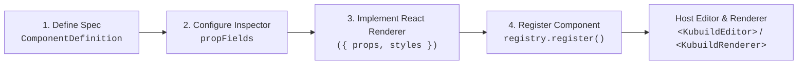

import { Callout } from 'fumadocs-ui/components/callout';
import { Card, Cards } from 'fumadocs-ui/components/card';
import { Tab, Tabs } from 'fumadocs-ui/components/tabs';
import { Accordion, Accordions } from 'fumadocs-ui/components/accordion';
import { TypeTable } from 'fumadocs-ui/components/type-table';
import { InteractiveRenderer } from '@/components/interactive-renderer';

Every web builder claims to be extensible, but most force developers into painful compromises: fragile `<iframe>` sandboxes that ruin page performance, hardcoded sidebar hacks that break on every update, or unmaintainable custom CSS patches.

**KUBUILD takes a radically different architectural approach.** Custom components in KUBUILD are first-class citizens built on a **fully decoupled architecture**:
1. **Schema & Contract Layer (`@kubuild/components`)**: Pure, framework-agnostic TypeScript definitions describing component types, inspector form controls, structural constraints, and validation rules—with zero React or DOM dependencies.
2. **Visual Runtime Layer (`@kubuild/renderer`)**: Native React components that execute inside your application's existing design system, sharing the exact same theme tokens, CSS variables, and context providers.
3. **Dynamic Editor Controls (`@kubuild/editor`)**: The inspector panel dynamically generates pixel-perfect UI controls directly from your `propFields` metadata—no manual editor form coding required.

Whether you need a specialized **Testimonial Card**, a **Pricing Matrix**, an interactive **Lottie Player**, or an enterprise **Stripe Checkout widget**, this guide will walk you through building, registering, validating, and packaging production-grade custom components.

---

## Interactive Live Demo

The live sandbox below demonstrates two custom components—a **Testimonial Card** (`custom.testimonial-card`) and a **Pricing Tier Card** (`custom.pricing-card`)—rendered directly within a native `.stora` page document. 

Test the responsive cascade across **Desktop**, **Tablet**, and **Mobile**, or switch to the **JSON Schema** tab to observe how custom components are stored as clean, portable JSON AST nodes:

<InteractiveRenderer
  title="Custom Component Showcase: Testimonial & Pricing Sandbox"
  height="560px"
  defaultViewport="desktop"
  showJsonToggle={true}
  document={{
    schema: "stora.page",
    version: "1.3.0",
    metadata: {
      title: "Custom Components Showcase",
      description: "Demonstrating custom.testimonial-card and custom.pricing-card runtime rendering in KUBUILD.",
      author: "KUBUILD Core Team",
      tags: ["custom-components", "plugins", "extensibility"],
      category: "guides",
      version: "1.0.0",
      createdAt: "2026-11-06T00:00:00.000Z",
      updatedAt: "2026-11-06T00:00:00.000Z"
    },
    document: {
      id: "root-custom-demo-page",
      type: "page",
      props: { title: "Custom Components Live Preview" },
      styles: {
        base: {
          backgroundColor: "#090d16",
          color: "#f8fafc",
          padding: "48px 24px",
          fontFamily: "Inter, system-ui, -apple-system, sans-serif",
          minHeight: "100%",
          boxSizing: "border-box"
        },
        tablet: {
          padding: "36px 20px"
        },
        mobile: {
          padding: "24px 16px"
        }
      },
      children: [
        {
          id: "header-section",
          type: "section",
          props: {},
          styles: {
            base: {
              display: "flex",
              flexDirection: "column",
              alignItems: "center",
              textAlign: "center",
              gap: "14px",
              maxWidth: "760px",
              margin: "0 auto 36px auto"
            }
          },
          children: [
            {
              id: "guide-pill",
              type: "badge",
              props: {
                text: "✨ EXTENSIBILITY ARCHITECTURE",
                variant: "outline"
              },
              styles: {
                base: {
                  backgroundColor: "rgba(99, 102, 241, 0.12)",
                  color: "#a5b4fc",
                  border: "1px solid rgba(99, 102, 241, 0.3)",
                  borderRadius: "9999px",
                  padding: "4px 12px",
                  fontSize: "11px",
                  fontWeight: "600",
                  letterSpacing: "0.06em"
                }
              }
            },
            {
              id: "guide-title",
              type: "heading",
              props: {
                level: 2,
                text: "First-Class Custom Widgets"
              },
              styles: {
                base: {
                  fontSize: "30px",
                  fontWeight: "800",
                  letterSpacing: "-0.03em",
                  color: "#ffffff",
                  margin: "0"
                },
                mobile: {
                  fontSize: "24px"
                }
              }
            },
            {
              id: "guide-subtitle",
              type: "paragraph",
              props: {
                text: "The cards below are registered as custom components via ComponentRegistry. They carry dynamic props, inspector fields, validation rules, and dedicated React renderers."
              },
              styles: {
                base: {
                  fontSize: "14px",
                  lineHeight: "1.6",
                  color: "#94a3b8",
                  margin: "0"
                }
              }
            }
          ]
        },
        {
          id: "showcase-grid",
          type: "container",
          props: {},
          styles: {
            base: {
              display: "grid",
              gridTemplateColumns: "repeat(2, minmax(0, 1fr))",
              gap: "24px",
              maxWidth: "960px",
              margin: "0 auto"
            },
            mobile: {
              gridTemplateColumns: "1fr",
              gap: "16px"
            }
          },
          children: [
            {
              id: "testimonial-node-1",
              type: "custom.testimonial-card",
              props: {
                quote: "KUBUILD decoupled schema validation from React runtime execution. Our team integrated 18 internal enterprise components into the canvas in under two days.",
                author: "Sarah Jenkins",
                role: "Staff Frontend Architect",
                company: "CloudScale Systems",
                avatarUrl: "https://images.unsplash.com/photo-1494790108377-be9c29b29330?w=160&auto=format&fit=crop&q=80",
                rating: 5,
                badge: "Verified Buyer",
                verified: true
              },
              styles: {
                base: {
                  backgroundColor: "#0f172a",
                  border: "1px solid #1e293b",
                  borderRadius: "16px",
                  padding: "28px",
                  boxShadow: "0 10px 25px -5px rgba(0, 0, 0, 0.4)",
                  color: "#f8fafc"
                }
              }
            },
            {
              id: "pricing-node-1",
              type: "custom.pricing-card",
              props: {
                planName: "Pro Builder Tier",
                price: "$49",
                period: "/ developer / month",
                description: "Complete visual editor SDK, custom component authoring, and unmetered .stora export pipeline.",
                badge: "Most Popular",
                ctaText: "Start 14-Day Free Trial",
                popular: true
              },
              styles: {
                base: {
                  backgroundColor: "#0f172a",
                  border: "1px solid rgba(99, 102, 241, 0.4)",
                  borderRadius: "16px",
                  padding: "28px",
                  boxShadow: "0 10px 25px -5px rgba(99, 102, 241, 0.15)",
                  color: "#f8fafc"
                }
              }
            }
          ]
        }
      ]
    }
  }}
/>

---

## Architectural Workflow

Building and integrating a custom component follows a clean **4-step lifecycle**:



### Why Decouple Definition from Rendering?

In traditional systems, components combine their validation logic, editor configuration, and visual rendering into a single monolithic bundle. This causes three major issues:
- **Bundle Bloat**: Importers, headless CMS services, and build tools must download heavy React dependencies just to validate a document structure.
- **Portability Loss**: Storing framework-specific callbacks or React virtual DOM trees in document files makes AST serialization brittle.
- **SSR Hydration Mismatch**: Inability to run node-level validations in isolated Node.js/Edge workers without polyfilling browser environments.

KUBUILD eliminates this by keeping `@kubuild/components` completely framework-agnostic. The definition describes *what the component is*, while the host application decides *how to render it*.

---

## Step 1: Defining the Component Specification

A `ComponentDefinition` is a standard TypeScript object specifying metadata, insertion constraints, default props, and validation rules:

```typescript
import { ComponentDefinition } from '@kubuild/components';

export const testimonialCardDefinition: ComponentDefinition = {
  // 1. Unique namespaced type identifier
  type: 'custom.testimonial-card',
  
  // 2. Human-readable label & categorization
  label: 'Testimonial Card',
  category: 'custom',
  description: 'Customer review showcase with rating stars, avatar, and verification badge.',
  icon: 'message-square-quote', // Lucide icon name or SVG string

  // 3. Structural containment contract
  acceptsChildren: false,
  allowedChildren: [],
  disallowedParents: ['button', 'custom.testimonial-card'],

  // 4. Initial props inserted when dropped on canvas
  defaultProps: {
    quote: 'KUBUILD decoupled schema validation from runtime rendering with zero layout shift.',
    author: 'Sarah Jenkins',
    role: 'Staff Frontend Architect',
    company: 'CloudScale Systems',
    avatarUrl: 'https://images.unsplash.com/photo-1494790108377-be9c29b29330?w=160&auto=format&fit=crop&q=80',
    rating: 5,
    badge: 'Enterprise Customer',
    verified: true,
  },

  // 5. Default responsive styles
  defaultStyles: {
    base: {
      backgroundColor: '#0f172a',
      border: '1px solid #1e293b',
      borderRadius: '16px',
      padding: '24px',
      boxShadow: '0 4px 12px rgba(0, 0, 0, 0.25)',
      color: '#f8fafc',
    },
    mobile: {
      padding: '16px',
    },
  },

  // 6. Schema validation hook
  validateProps: (props: Record<string, unknown>) => {
    const errors: string[] = [];
    if (!props.author || typeof props.author !== 'string' || props.author.trim() === '') {
      errors.push('Testimonial author name is required.');
    }
    if (!props.quote || typeof props.quote !== 'string' || props.quote.trim().length < 5) {
      errors.push('Quote text must be at least 5 characters long.');
    }
    if (props.rating !== undefined) {
      const r = Number(props.rating);
      if (isNaN(r) || r < 1 || r > 5) {
        errors.push('Rating must be a numeric value between 1 and 5.');
      }
    }
    return errors.length > 0 ? errors : true;
  },

  // 7. Functional traits (accessibility & semantic metadata)
  traits: [
    {
      name: 'ariaLabel',
      type: 'string',
      label: 'ARIA Label',
      description: 'Screen reader accessibility label for the card container.',
      defaultValue: 'Customer testimonial',
    },
  ],

  // 8. Required host capabilities for runtime compatibility checks
  capabilities: ['assetProvider'],
};
```

### ComponentDefinition Specification Reference

<TypeTable
  type={{
    type: {
      description: 'Unique identifier for the component. Best practice is namespacing with "custom." prefix (e.g. "custom.pricing-card").',
      type: 'string',
      required: true,
    },
    label: {
      description: 'Display name rendered in the component palette, layer tree, and breadcrumb bar.',
      type: 'string',
      required: true,
    },
    category: {
      description: 'Palette grouping. Always set to "custom" for host-provided widgets.',
      type: '"layout" | "typography" | "media" | "form" | "interactive" | "data" | "custom"',
      required: true,
    },
    acceptsChildren: {
      description: 'Whether other nodes can be dropped or nested inside this element.',
      type: 'boolean',
      default: 'false',
    },
    allowedChildren: {
      description: 'Whitelisted child types or categories. Use ["*"] to allow all children.',
      type: 'string[]',
    },
    disallowedParents: {
      description: 'Blacklist of parent node types where this component cannot be inserted.',
      type: 'string[]',
    },
    defaultProps: {
      description: 'Initial property values populated when a new node instance is instantiated.',
      type: 'Record<string, unknown>',
    },
    defaultStyles: {
      description: 'Initial responsive style overrides applied to the node.',
      type: 'ResponsiveStyles',
    },
    validateProps: {
      description: 'Validation function returning true, false, or an array of error messages.',
      type: '(props: Record<string, unknown>) => boolean | string[]',
    },
    propFields: {
      description: 'Field descriptors that tell the editor inspector how to render property inputs.',
      type: 'ComponentFieldDefinition[]',
    },
    capabilities: {
      description: 'Host capabilities required at runtime (e.g. "assetProvider", "actionRegistry").',
      type: 'string[]',
    },
  }}
/>

<Callout type="info" title="Namespacing Custom Types">
Always prefix custom component types with `custom.` (e.g., `custom.pricing-card`, `custom.testimonial-card`). The KUBUILD package exporter (`extractComponentRequirements`) automatically identifies `category: 'custom'` components and records them in the `.stora` package manifest to enforce compatibility during import.
</Callout>

---

## Step 2: Configuring Inspector Controls (`propFields`)

In KUBUILD, you **never** need to write custom React forms or UI dialogs to edit custom component props. The `@kubuild/editor` right-hand inspector inspects the `propFields` array on your definition and generates interactive input controls automatically.

### Supported Field Input Types

```typescript
export interface ComponentFieldDefinition {
  name: string;
  label: string;
  type: 
    | 'string'    // Single-line text input
    | 'textarea'  // Multi-line text field
    | 'number'    // Numeric input with arrows
    | 'boolean'   // Toggle switch
    | 'select'    // Dropdown selection menu
    | 'color'     // Hex/RGB color picker
    | 'image'     // Asset manager URL selector
    | 'action'    // Event trigger and action builder
    | 'datetime'  // Date and timestamp selector
    | 'json';     // Formatted JSON object editor
  defaultValue?: unknown;
  options?: Array<{ label: string; value: unknown }>;
  description?: string;
}
```

### Example: Comprehensive Inspector Controls

Here is how you configure controls for the **Testimonial Card**:

<Tabs items={["Testimonial Card Fields", "Pricing Card Fields"]}>
  <Tab value="Testimonial Card Fields">
```typescript
testimonialCardDefinition.propFields = [
  {
    name: 'quote',
    label: 'Quote Text',
    type: 'textarea',
    description: 'The testimonial content written by the customer.',
  },
  {
    name: 'author',
    label: 'Author Name',
    type: 'string',
    description: 'Full name of the reviewer.',
  },
  {
    name: 'role',
    label: 'Job Title',
    type: 'string',
    description: 'Professional role or position.',
  },
  {
    name: 'company',
    label: 'Company / Organization',
    type: 'string',
  },
  {
    name: 'avatarUrl',
    label: 'Avatar Photo',
    type: 'image',
    description: 'Select an image from the host asset library or enter an external URL.',
  },
  {
    name: 'rating',
    label: 'Star Rating',
    type: 'select',
    defaultValue: 5,
    options: [
      { label: '5 Stars (Exceptional)', value: 5 },
      { label: '4 Stars (Great)', value: 4 },
      { label: '3 Stars (Average)', value: 3 },
      { label: '2 Stars (Poor)', value: 2 },
      { label: '1 Star (Critical)', value: 1 },
    ],
  },
  {
    name: 'badge',
    label: 'Badge Pill',
    type: 'string',
    defaultValue: 'Verified Buyer',
  },
  {
    name: 'verified',
    label: 'Verified Customer',
    type: 'boolean',
    defaultValue: true,
    description: 'Displays a verified badge next to the author name.',
  },
];
```
  </Tab>

  <Tab value="Pricing Card Fields">
```typescript
export const pricingCardDefinition: ComponentDefinition = {
  type: 'custom.pricing-card',
  label: 'Pricing Tier Card',
  category: 'custom',
  acceptsChildren: false,
  propFields: [
    {
      name: 'planName',
      label: 'Plan Title',
      type: 'string',
      defaultValue: 'Pro Plan',
    },
    {
      name: 'price',
      label: 'Price Tag',
      type: 'string',
      defaultValue: '$49',
    },
    {
      name: 'period',
      label: 'Billing Interval',
      type: 'select',
      defaultValue: '/ month',
      options: [
        { label: 'Monthly', value: '/ month' },
        { label: 'Yearly (Save 20%)', value: '/ year' },
        { label: 'One-Time Lifetime', value: ' one-time' },
      ],
    },
    {
      name: 'description',
      label: 'Short Description',
      type: 'textarea',
    },
    {
      name: 'badge',
      label: 'Ribbon Badge',
      type: 'string',
      defaultValue: 'Most Popular',
    },
    {
      name: 'popular',
      label: 'Highlight Card',
      type: 'boolean',
      defaultValue: false,
      description: 'Applies prominent primary accent borders and glow styling.',
    },
    {
      name: 'ctaText',
      label: 'CTA Button Label',
      type: 'string',
      defaultValue: 'Get Started Now',
    },
  ],
};
```
  </Tab>
</Tabs>

<Callout type="tip" title="Dynamic Prop Interpolation">
Props configured via `propFields` automatically support KUBUILD's dynamic variable system. An author can type `Hello, {{ user.name }}!` into any string or textarea control, and `@kubuild/renderer` will resolve it at runtime.
</Callout>

---

## Step 3: Implementing the Visual React Renderer

Visual renderers are pure React components registered with the component definition. `@kubuild/renderer` passes an options object containing the current node, resolved props, responsive styles, and click handlers:

### Renderer Function Signature

```typescript
export type CustomComponentRenderer<TProps = Record<string, unknown>> = React.ComponentType<{
  /** The AST Node representation */
  node: Node;
  /** The root Stora PageDocument */
  document: PageDocument;
  /** Resolved props (variables already interpolated, assets resolved) */
  props: TProps;
  /** Compiled inline styles including active viewport and auto layout rules */
  styles: React.CSSProperties;
  /** Runtime execution context (auth state, variables, localization) */
  context?: RenderContext;
  /** Rendered children elements (if acceptsChildren is true) */
  children?: React.ReactNode;
  /** Selection and interactive click dispatcher */
  onClick?: (e: React.MouseEvent) => void;
}>;
```

### Full React Renderer Implementation

```tsx
import React from 'react';
import type { Node, PageDocument } from '@kubuild/schema';

interface TestimonialProps {
  quote?: string;
  author?: string;
  role?: string;
  company?: string;
  avatarUrl?: string;
  rating?: number;
  badge?: string;
  verified?: boolean;
}

export const TestimonialCardRenderer: React.FC<{
  node: Node;
  document: PageDocument;
  props: TestimonialProps;
  styles: React.CSSProperties;
  onClick?: (e: React.MouseEvent) => void;
}> = ({ props, styles, onClick, node }) => {
  const author = props.author || 'Anonymous';
  const role = props.role || '';
  const company = props.company || '';
  const quote = props.quote || '';
  const avatarUrl = props.avatarUrl;
  const rating = Math.min(5, Math.max(1, Number(props.rating) || 5));
  const verified = props.verified ?? true;
  const badge = props.badge;

  return (
    <div
      style={{
        boxSizing: 'border-box',
        display: 'flex',
        flexDirection: 'column',
        ...styles,
      }}
      onClick={onClick}
      data-kubuild-node={node.id}
    >
      {/* Header: Star Rating & Highlight Badge */}
      <div
        style={{
          display: 'flex',
          alignItems: 'center',
          justifyContent: 'space-between',
          marginBottom: '16px',
        }}
      >
        <div style={{ display: 'flex', gap: '3px' }}>
          {[1, 2, 3, 4, 5].map((star) => (
            <span
              key={star}
              style={{
                color: star <= rating ? '#fbbf24' : '#475569',
                fontSize: '18px',
                lineHeight: 1,
              }}
            >
              ★
            </span>
          ))}
        </div>

        {badge && (
          <span
            style={{
              fontSize: '11px',
              fontWeight: 600,
              letterSpacing: '0.04em',
              textTransform: 'uppercase',
              padding: '3px 8px',
              borderRadius: '9999px',
              backgroundColor: 'rgba(56, 189, 248, 0.15)',
              color: '#38bdf8',
              border: '1px solid rgba(56, 189, 248, 0.3)',
            }}
          >
            {badge}
          </span>
        )}
      </div>

      {/* Quote Content */}
      <blockquote
        style={{
          fontSize: '15px',
          lineHeight: '1.65',
          fontStyle: 'normal',
          margin: '0 0 20px 0',
          flex: 1,
          opacity: 0.95,
        }}
      >
        &ldquo;{quote}&rdquo;
      </blockquote>

      {/* Author Footer */}
      <div style={{ display: 'flex', alignItems: 'center', gap: '12px' }}>
        {avatarUrl ? (
          
        ) : (
          <div
            style={{
              width: '44px',
              height: '44px',
              borderRadius: '50%',
              background: 'linear-gradient(135deg, #6366f1, #a855f7)',
              color: '#ffffff',
              display: 'flex',
              alignItems: 'center',
              justifyContent: 'center',
              fontWeight: 700,
              fontSize: '15px',
            }}
          >
            {author.slice(0, 2).toUpperCase()}
          </div>
        )}

        <div style={{ display: 'flex', flexDirection: 'column' }}>
          <div style={{ display: 'flex', alignItems: 'center', gap: '6px' }}>
            <span style={{ fontWeight: 600, fontSize: '14px' }}>{author}</span>
            {verified && (
              <span
                title="Verified Customer"
                style={{
                  display: 'inline-flex',
                  alignItems: 'center',
                  justifyContent: 'center',
                  width: '16px',
                  height: '16px',
                  borderRadius: '50%',
                  backgroundColor: '#10b981',
                  color: '#ffffff',
                  fontSize: '10px',
                  fontWeight: 'bold',
                }}
              >
                ✓
              </span>
            )}
          </div>
          {(role || company) && (
            <span style={{ fontSize: '12px', opacity: 0.7, marginTop: '2px' }}>
              {role}
              {role && company ? ' • ' : ''}
              {company}
            </span>
          )}
        </div>
      </div>
    </div>
  );
};
```

---

## Step 4: Registering to the Host Application

Once your definition and renderer are created, attach the renderer to your definition's `.renderer` slot and register it with a `ComponentRegistry`:

```typescript
import { createDefaultComponentRegistry } from '@kubuild/components';
import { testimonialCardDefinition } from './testimonial-card.def';
import { TestimonialCardRenderer } from './testimonial-card.renderer';

export function createHostComponentRegistry() {
  // 1. Create a registry containing all core built-ins (heading, section, button, etc.)
  const registry = createDefaultComponentRegistry();

  // 2. Bind the visual React renderer to the schema definition
  const completeDefinition = {
    ...testimonialCardDefinition,
    renderer: TestimonialCardRenderer,
  };

  // 3. Register the component with safety checks
  registry.register(completeDefinition);

  return registry;
}
```

<Callout type="warn" title="Duplicate Registration Safety">
`registry.register(def)` throws an error if the component type is already registered. This prevents third-party plugins from accidentally clobbering built-in components or another plugin's widgets. If you deliberately intend to override a component, pass `registry.register(def, true)`.
</Callout>

### Injecting into the Editor and Renderer

Pass your configured registry to `<KubuildEditor />` in editing mode, and to `<KubuildRenderer />` in public runtime mode:

<Tabs items={["Editor Integration", "Runtime Renderer Integration"]}>
  <Tab value="Editor Integration">
```tsx
import React, { useMemo } from 'react';
import { KubuildEditor } from '@kubuild/editor';
import { createHostComponentRegistry } from './host-registry';

export function BuilderPage({ document, onSave }) {
  // Memoize registry so it is not re-instantiated across canvas re-renders
  const registry = useMemo(() => createHostComponentRegistry(), []);

  return (
    <div style={{ height: '100vh', width: '100vw' }}>
      <KubuildEditor
        initialDocument={document}
        registry={registry}
        onSave={onSave}
      />
    </div>
  );
}
```
  </Tab>

  <Tab value="Runtime Renderer Integration">
```tsx
import React, { useMemo } from 'react';
import { KubuildRenderer } from '@kubuild/renderer';
import { createHostComponentRegistry } from './host-registry';

export function PublishedLandingPage({ document }) {
  const registry = useMemo(() => createHostComponentRegistry(), []);

  return (
    <main>
      <KubuildRenderer
        document={document}
        registry={registry}
        mode="runtime"
        responsive="css"
      />
    </main>
  );
}
```
  </Tab>
</Tabs>

---

## Document Validation & Import/Export Portability

When importing `.stora` files from untrusted third parties or community templates, a host application must never assume that all component types exist.

### Validating Documents with Custom Components

Use `@kubuild/core`'s `validateDocument` with `strictComponentTypes: true` and your custom registry:

```typescript
import { validateDocument } from '@kubuild/core';
import { createHostComponentRegistry } from './host-registry';

const hostRegistry = createHostComponentRegistry();

const validation = validateDocument(untrustedDoc, {
  componentRegistry: hostRegistry,
  strictComponentTypes: true, // Rejects documents containing unknown component types
});

if (!validation.valid) {
  console.error('Document contains unsupported components or prop errors:');
  validation.errors.forEach((err) => console.error(`- ${err.message} (${err.code})`));
}
```

### Missing Component Fallback (`<Puzzle />` Alert)

If a page document contains a custom component whose plugin is **not** registered in the current registry:
- **Editor Mode**: `@kubuild/renderer` safely renders a dashed outline containing a puzzle badge: `Unknown Component: custom.testimonial-card` rather than crashing the canvas.
- **Runtime Mode**: The element gracefully renders its child nodes and container styles without executing arbitrary scripts.
- **Data Preservation**: Node attributes, custom props, and children are **never destroyed or mutated**. Saving the document preserves the uninstalled component intact.

### Extracting Manifest Requirements

When packaging a `.stora` document into a portable template archive, use `extractComponentRequirements` to generate the dependency manifest:

```typescript
import { extractComponentRequirements } from '@kubuild/components';
import { ManifestSchema } from '@kubuild/schema';

const { requiredComponents, requiredCapabilities } = extractComponentRequirements(
  doc.document,
  hostRegistry
);

console.log(requiredComponents);
// Output: ['custom.testimonial-card', 'custom.pricing-card']

console.log(requiredCapabilities);
// Output: ['assetProvider', 'actionRegistry']

// Generate portable manifest
const manifest = ManifestSchema.parse({
  version: '1.0.0',
  requiredComponents,
  requiredCapabilities,
  createdAt: new Date().toISOString(),
});
```

---

## Packaging Host Plugins

When distributing a suite of components, actions, and custom sidebar panels, bundle them into a **Kubuild Plugin**:

```typescript
export interface KubuildPlugin {
  name: string;
  version: string;
  description?: string;
  components?: ComponentDefinition[];
  actions?: Record<string, ActionHandler>;
  sidebarTabs?: Array<{
    id: string;
    label: string;
    icon: React.ReactNode;
    render: (context: PluginSidebarContext) => React.ReactNode;
  }>;
}

export function myCustomECommercePlugin(): KubuildPlugin {
  return {
    name: 'kubuild-plugin-ecommerce',
    version: '1.2.0',
    description: 'Product cards, cart actions, and checkout modals.',
    components: [
      productCardDefinition,
      pricingCardDefinition,
      cartDrawerDefinition,
    ],
    actions: {
      'ecommerce.checkout': async (payload, context) => {
        await initiateStripeCheckout(payload.cartId);
      },
    },
  };
}
```

---

## Best Practices & Authoring Checklist

<Cards>
  <Card title="Prefix with 'custom.'" description="Avoid collisions with future official KUBUILD core components by prefixing types with custom. (e.g. custom.hero-slider).">
    🧭 **Namespace Integrity**
  </Card>
  <Card title="Return Detailed Errors" description="In validateProps, return string[] of human-readable errors so authors know exactly what field to fix in the inspector.">
    🛡️ **Schema Validation**
  </Card>
  <Card title="Honor Passed Styles" description="Always merge the passed styles object into your root element's style prop so padding, margins, and layout rules work seamlessly.">
    🎨 **Style Inheritance**
  </Card>
  <Card title="Provide Default Props" description="Always define sensible defaultProps so the component looks complete immediately upon drag-and-drop.">
    ⚡ **Instant Visual Delight**
  </Card>
</Cards>

---

## Frequently Asked Questions

<Accordions>
  <Accordion title="Can custom components accept nested children (containers)?">
    Yes! Set `acceptsChildren: true` on your `ComponentDefinition`. In your React renderer, render `{children}` or `{childrenElements}` inside your layout markup. You can further restrict what types can be dropped inside using `allowedChildren: ['heading', 'paragraph', 'button']`.
  </Accordion>

  <Accordion title="How do custom components handle responsive styles?">
    The `styles` prop passed to your React renderer is already computed by KUBUILD's cascade engine for the active viewport (`Desktop` &rarr; `Tablet` &rarr; `Mobile`). By spreading `...styles` onto your root wrapper element, responsive overrides happen automatically with zero additional code.
  </Accordion>

  <Accordion title="Can I register a custom component without touching the core repository?">
    Absolutely. That is the fundamental purpose of `ComponentRegistry`. You import `@kubuild/components` and `@kubuild/renderer` into your Next.js, Remix, Vite, or Astro host application and call `registry.register()` before passing it into `<KubuildEditor />`.
  </Accordion>

  <Accordion title="How do I support older documents when renaming a prop?">
    Use the `deprecatedPropAliases` field on `ComponentDefinition`. For example:
    ```typescript
    deprecatedPropAliases: {
      'customerName': 'author',
      'reviewBody': 'quote',
    }
    ```
    The renderer will continue resolving the legacy property while the schema migrator upgrades the document automatically.
  </Accordion>
</Accordions>
