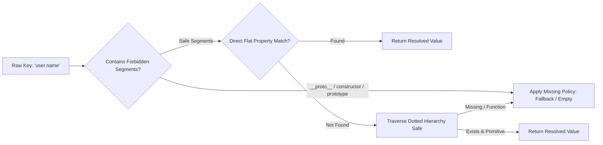

import { Callout } from 'fumadocs-ui/components/callout';
import { Card, Cards } from 'fumadocs-ui/components/card';
import { Tab, Tabs } from 'fumadocs-ui/components/tabs';
import { Accordion, Accordions } from 'fumadocs-ui/components/accordion';
import { TypeTable } from 'fumadocs-ui/components/type-table';
import { InteractiveRenderer } from '@/components/interactive-renderer';

Landing page modern dan situs pemasaran konversi tinggi membutuhkan **personalisasi tingkat lanjut**: menyapa pengunjung dengan namanya, menampilkan harga dalam mata uang lokal, menyisipkan nama merchant/afiliasi, hingga menghitung diskon secara *real-time*.

Namun, menyuntikkan data dinamis ke dalam visual page builder sering kali menjadi mimpi buruk keamanan dan arsitektur:
- **Pendekatan Naif**: Menggunakan fungsi berbahaya seperti `eval()` atau `new Function()` yang mengekspos aplikasi ke celah serangan Remote Code Execution (RCE) dan XSS.
- **Injeksi Tidak Terstruktur**: Template string liar yang mudah merusak validasi schema dokumen `.stora`.
- **Pengalaman Penulisan yang Buruk**: Author/marketer kebingungan mencari daftar variabel yang tersedia karena ketiadaan katalog terstruktur.

**KUBUILD mengatasi masalah ini melalui arsitektur decoupled dua lapis:**
1. **Host Variable Catalog (`@kubuild/core`)**: Kontrak tipe data datar (*flat array*) dengan metadata pengelompokan opsional (`group`), label ramah pengguna, dan nilai simulasi (*sample values*) untuk authoring di dalam editor.
2. **Deterministic Pure Resolver (`@kubuild/renderer`)**: Mesin resolusi dan interpolasi template murni yang terlindungi dari serangan *prototype pollution*, tanpa eksekusi kode dinamis, serta mendukung fallback bertingkat.

---

## Live Interactive Sandbox

Sandbox interaktif di bawah mendemonstrasikan bagaimana variabel dinamis seperti nama pelanggan, nama produk, dan diskon diinterpolasi langsung ke dalam teks komponen KUBUILD.

Ubah nilai input pada panel **Host Variable Simulator** di bawah untuk melihat teks pratinjau berubah secara seketika (*instant live update*):

<InteractiveRenderer
  title="Dynamic Variable Interpolation Sandbox"
  height="480px"
  defaultViewport="desktop"
  showJsonToggle={true}
  initialVariables={{
    "user.name": "Budi Santoso",
    "product.name": "Sepatu Sneaker Pro Ultra",
    "product.discount_price": "Rp 199.000",
    "product.savings": "Rp 100.000",
    "store.name": "Kustora Official Store"
  }}
  variableControls={[
    {
      key: "user.name",
      label: "Customer Name",
      defaultValue: "Budi Santoso",
      placeholder: "Masukkan nama pelanggan..."
    },
    {
      key: "product.name",
      label: "Product Name",
      defaultValue: "Sepatu Sneaker Pro Ultra",
      placeholder: "Nama produk..."
    },
    {
      key: "product.discount_price",
      label: "Special Price",
      defaultValue: "Rp 199.000",
      placeholder: "Harga diskon..."
    },
    {
      key: "product.savings",
      label: "Total Savings",
      defaultValue: "Rp 100.000",
      placeholder: "Nominal hemat..."
    }
  ]}
  document={{
    schema: "stora.page",
    version: "1.3.0",
    metadata: {
      title: "Personalized Product Offer",
      description: "Demonstrating Mustache dynamic template interpolation in KUBUILD.",
      author: "KUBUILD Core Team",
      tags: ["dynamic-variables", "personalization", "mustache"],
      category: "guides",
      version: "1.0.0",
      createdAt: "2026-11-06T00:00:00.000Z",
      updatedAt: "2026-11-06T00:00:00.000Z"
    },
    document: {
      id: "root-var-demo-page",
      type: "page",
      props: { title: "Personalized Offer" },
      styles: {
        base: {
          backgroundColor: "#0b0f19",
          color: "#f8fafc",
          padding: "48px 24px",
          fontFamily: "Inter, system-ui, -apple-system, sans-serif",
          minHeight: "100%",
          boxSizing: "border-box"
        },
        tablet: {
          padding: "32px 20px"
        },
        mobile: {
          padding: "24px 16px"
        }
      },
      children: [
        {
          id: "offer-container",
          type: "section",
          props: {},
          styles: {
            base: {
              display: "flex",
              flexDirection: "column",
              alignItems: "center",
              textAlign: "center",
              gap: "20px",
              maxWidth: "680px",
              margin: "0 auto",
              padding: "36px",
              borderRadius: "16px",
              backgroundColor: "rgba(255, 255, 255, 0.03)",
              border: "1px solid rgba(255, 255, 255, 0.08)",
              boxShadow: "0 20px 40px -15px rgba(0,0,0,0.5)"
            }
          },
          children: [
            {
              id: "merchant-badge",
              type: "badge",
              props: {
                text: "✨ Rekomendasi Eksklusif dari {{ store.name | Mitra Resmi }}",
                variant: "outline"
              },
              styles: {
                base: {
                  backgroundColor: "rgba(14, 165, 233, 0.12)",
                  color: "#38bdf8",
                  border: "1px solid rgba(14, 165, 233, 0.3)",
                  borderRadius: "9999px",
                  padding: "5px 14px",
                  fontSize: "12px",
                  fontWeight: "600",
                  letterSpacing: "0.02em"
                }
              }
            },
            {
              id: "greeting-heading",
              type: "heading",
              props: {
                level: 2,
                text: "Selamat datang, {{ user.name | Pelanggan Setia }}!"
              },
              styles: {
                base: {
                  fontSize: "28px",
                  fontWeight: "800",
                  letterSpacing: "-0.03em",
                  color: "#ffffff",
                  margin: "0",
                  lineHeight: "1.25"
                }
              }
            },
            {
              id: "promo-desc",
              type: "paragraph",
              props: {
                text: "Dapatkan diskon khusus untuk {{ product.name | Produk Pilihan }} hanya seharga {{ product.discount_price | Rp 199.000 }} (Hemat {{ product.savings | Rp 100.000 }}) khusus untuk transaksi hari ini."
              },
              styles: {
                base: {
                  fontSize: "16px",
                  lineHeight: "1.65",
                  color: "#94a3b8",
                  margin: "0"
                }
              }
            },
            {
              id: "cta-claim-button",
              type: "button",
              props: {
                label: "Klaim Diskon untuk {{ user.name | Anda }} Sekarang",
                variant: "solid"
              },
              styles: {
                base: {
                  backgroundColor: "#0284c7",
                  color: "#ffffff",
                  padding: "14px 28px",
                  borderRadius: "10px",
                  fontSize: "15px",
                  fontWeight: "700",
                  cursor: "pointer",
                  border: "none",
                  marginTop: "12px",
                  boxShadow: "0 10px 25px -5px rgba(2, 132, 199, 0.4)",
                  transition: "transform 0.15s ease, background-color 0.15s ease"
                }
              }
            }
          ]
        }
      ]
    }
  }}
/>

<Callout type="info" title="Pembaruan Real-Time">
  Perhatikan bahwa saat nilai pada input diubah, teks tombol dan paragraf langsung memperbarui teks yang berada di dalam sintaks `{{ ... }}` tanpa merusak struktur DOM maupun memicu mutasi dokumen JSON.
</Callout>

---

## Arsitektur Sistem Variabel di KUBUILD

Sistem variabel KUBUILD dirancang untuk dua tujuan utama: **keamanan mutlak** dan **kenyamanan penulisan konten**.

### Dua Pola Representasi Variabel

KUBUILD mendukung dua cara menyatakan variabel di dalam dokumen:

<Tabs items={["Inline Mustache Interpolation", "Structured VariableBinding"]}>
  <Tab value="Inline Mustache Interpolation">
    Digunakan pada teks bebas, heading, deskripsi, atau label tombol di mana teks statis dan variabel digabungkan secara alami:

    ```json
    {
      "id": "heading-1",
      "type": "heading",
      "props": {
        "text": "Selamat datang kembali, {{ user.name | Pelanggan Setia }}!"
      }
    }
    ```

    - Menggunakan tag kurung kurawal ganda (`{{ ... }}`).
    - Mendukung fallback langsung dengan pemisah pipa (`|`). Jika `user.name` tidak ditemukan di dalam runtime context, string fallback setelah tanda `|` akan langsung digunakan.
  </Tab>
  <Tab value="Structured VariableBinding">
    Digunakan ketika sebuah properti komponen terikat secara utuh pada objek variabel terstruktur (berdasarkan schema `VariableBindingSchema`):

    ```json
    {
      "id": "price-text",
      "type": "text",
      "props": {
        "content": {
          "type": "variable",
          "key": "product.discount_price",
          "fallback": "Rp 0"
        }
      }
    }
    ```

    - Memenuhi validasi schema Zod `VariableBindingSchema`.
    - Mempertahankan tipe data primitif asli (string, number, boolean) tanpa konversi paksa menjadi string jika komponen memerlukan tipe numerik.
  </Tab>
</Tabs>

### Keamanan: Zero Eval & Prototype Pollution Defense

Banyak library templating yang mengevaluasi ekspresi JavaScript menggunakan `eval()` atau `new Function()`. Pola tersebut sangat rentan terhadap eksploitasi Remote Code Execution (RCE) dan Cross-Site Scripting (XSS).

KUBUILD menerapkan **Pure Traversal Algorithm** yang sepenuhnya terisolasi:



> [!IMPORTANT]
> **Pencegahan Prototype Pollution:**
> Traversal pada `binding-resolver.ts` dan `interpolator.ts` secara eksplisit memeriksa segmen yang dilarang (`__proto__`, `constructor`, `prototype`) **sebelum** properti objek diakses. Upaya injeksi path seperti `{{ __proto__.polluted }}` atau `{{ constructor.prototype.isAdmin }}` akan langsung diblokir dan dialihkan ke fallback yang aman.

```ts title="packages/core/src/runtime/binding-resolver.ts"
const FORBIDDEN_KEY_SEGMENTS = new Set(['__proto__', 'constructor', 'prototype']);

export function resolveBinding(
  binding: Pick<VariableBinding, 'key' | 'fallback'>,
  context: RuntimeContext | undefined,
): ResolveOutcome {
  const segments = binding.key.split('.').filter(Boolean);
  
  // Guard ketat sebelum mengakses objek apapun
  if (segments.some((segment) => FORBIDDEN_KEY_SEGMENTS.has(segment))) {
    return applyMissingPolicy(binding);
  }
  
  // Resolusi data murni tanpa eval()
  // ...
}
```

---

## Host Variable Catalog

Host application (aplikasi induk Anda seperti Next.js, Laravel dashboard, atau sistem SaaS) mendeklarasikan variabel yang tersedia untuk visual editor menggunakan **Variable Catalog**.

### Struktur Flat Array dengan Pengelompokan Opsional

KUBUILD secara arsitektural menetapkan bahwa `VariableCatalog` adalah **flat array** dari objek `VariableDefinition`:

```ts title="types/variable-catalog.ts"
import type { VariableCatalog } from '@kubuild/core';

export const hostCatalog: VariableCatalog = [
  // Group: Customer Profile
  {
    key: 'user.name',
    label: 'Customer Name',
    type: 'string',
    group: 'Customer Profile',
    sampleValue: 'Budi Santoso',
    description: 'Nama lengkap pelanggan yang sedang masuk.'
  },
  {
    key: 'user.email',
    label: 'Customer Email',
    type: 'string',
    group: 'Customer Profile',
    sampleValue: 'budi@example.com'
  },

  // Group: E-Commerce & Pricing
  {
    key: 'product.name',
    label: 'Product Title',
    type: 'string',
    group: 'E-Commerce',
    sampleValue: 'Sepatu Sneaker Pro Ultra'
  },
  {
    key: 'product.discount_price',
    label: 'Discounted Price',
    type: 'string',
    group: 'E-Commerce',
    sampleValue: 'Rp 199.000'
  },
  {
    key: 'product.savings',
    label: 'Total Discount Amount',
    type: 'string',
    group: 'E-Commerce',
    sampleValue: 'Rp 100.000'
  },

  // Group: Store & Tenant
  {
    key: 'store.name',
    label: 'Merchant Store Name',
    type: 'string',
    group: 'Store & Tenant',
    sampleValue: 'Kustora Official Store'
  }
];
```

### Mengapa Flat Array, Bukan Nested Tree?

Keputusan arsitektur ini diambil secara sengaja berdasarkan pertimbangan teknis berikut:

<Cards>
  <Card title="Menghindari Breaking Changes" icon="ShieldCheck">
    Struktur flat array menjaga kompatibilitas API penuh sejak versi 0.8. Penambahan properti `group?: string` bersifat aditif (*non-breaking*).
  </Card>
  <Card title="Pencarian & Filter Cepat (O(N))" icon="Search">
    Editor dapat dengan mudah memfilter variabel berdasarkan tipe data primitif, misalnya `catalog.filter(v => v.type === 'string')`, tanpa perlu rekursi traversal pohon.
  </Card>
  <Card title="Komposisi Host Sangat Mudah" icon="Layers">
    Aplikasi induk dapat menggabungkan katalog dari berbagai modul hanya dengan *array spread*: `[...tenantVars, ...authVars, ...campaignVars]`.
  </Card>
  <Card title="Pengurutan Terjaga (Deterministic Order)" icon="ListOrdered">
    Kelompok dan entri variabel ditampilkan di editor mengikuti urutan kemunculan pertama pada array yang disediakan oleh host.
  </Card>
</Cards>

> [!NOTE]
> Properti `group` dan `sampleValue` hanya dimanfaatkan di tingkat editor (*editor-only*) untuk kebutuhan UI dan pratinjau canvas. Nilai-nilai ini **tidak pernah disimpan** ke dalam file dokumen `.stora` portabel guna menjaga ukuran file tetap minimal dan mencegah kebocoran data sensitif host.

### Auto-Grouping Fallback

Bagaimana jika host mendefinisikan variabel tanpa mengisi properti `group`?

KUBUILD menyediakan fallback cerdas melalui fungsi bawaan `getVariableGroup()` di `@kubuild/core`:
- Jika `entry.group` didefinisikan, editor menggunakan grup tersebut.
- Jika `entry.group` kosong, editor secara otomatis mengelompokkan variabel berdasarkan **segmen pertama dari dotted key**.
- Contoh: `store.address` otomatis masuk ke kelompok **"store"**, dan `affiliate.code` masuk ke kelompok **"affiliate"**.

```ts
import { getVariableGroup, groupVariableCatalog } from '@kubuild/core';

const entry = { key: 'store.address', label: 'Store Address', type: 'string', sampleValue: 'Jakarta' };
console.log(getVariableGroup(entry)); // Output: "store"
```

---

## Spesifikasi Tipe Data `VariableDefinition`

Berikut adalah referensi lengkap untuk setiap field pada antarmuka `VariableDefinition`:

<TypeTable
  type={{
    key: {
      description: 'Dotted string key unik untuk mengakses variabel (contoh: "user.name", "product.price"). Wajib diisi.',
      type: 'string',
      required: true,
    },
    label: {
      description: 'Label ramah pengguna yang ditampilkan pada dropdown picker visual editor.',
      type: 'string',
      required: true,
    },
    type: {
      description: 'Tipe data nilai primitif variabel yang diharapkan.',
      type: "'string' | 'number' | 'boolean' | 'array' | 'object'",
      required: true,
    },
    sampleValue: {
      description: 'Nilai tiruan (dummy data) yang digunakan saat authoring di visual editor canvas agar desainer melihat tampilan realistis. Tidak pernah disimpan ke dokumen .stora.',
      type: 'unknown',
      required: true,
    },
    description: {
      description: 'Petunjuk tambahan atau tooltip yang menjelaskan asal data variabel kepada author/desainer.',
      type: 'string',
      required: false,
    },
    group: {
      description: 'Label kategori/pengelompokan pada UI picker (contoh: "Customer Profile", "E-Commerce"). Jika dikosongkan, editor fallback ke segmen pertama key.',
      type: 'string',
      required: false,
    },
  }}
/>

---

## Pengalaman Authoring di Visual Editor

KUBUILD menyajikan dua cara intuitif bagi author dalam memanfaatkan variabel katalog di dalam visual editor:

### 1. Inline Text Toolbar & Dropdown Trigger

Saat author sedang mengedit teks langsung di canvas (*contentEditable*):
- Mengetik shortcut kurung kurawal ganda (`{{`) atau mengklik tombol variabel `{x}` pada floating text toolbar.
- Popover dropdown akan muncul menampilkan seluruh variabel yang tersedia, dikelompokkan berdasarkan kategori (`group`).
- Saat variabel dipilih, teks `{{ user.name }}` disisipkan secara mulus pada posisi kursor.

### 2. Inspector Property Binding

Untuk properti komponen di sidebar kanan (seperti URL gambar, nilai atribut link, atau teks tombol):
- Di samping field input inspector, terdapat tombol rantai / binding variabel.
- Mengklik tombol tersebut mengubah mode input dari teks literal menjadi **Variable Selector Dropdown**.
- Author dapat memilih variabel dari katalog dan mengisi kolom **Fallback Value** opsional.

---

## Perbedaan Scope: Bare Key vs Action Pipeline

Salah satu aspek desain penting di KUBUILD adalah perbedaan scope penulisan variabel antara properti komponen/teks biasa dengan Action Pipeline.

Perbedaan ini dirancang secara sengaja untuk memberikan pengalaman pengguna yang paling optimal pada masing-masing konteks:

| Konteks Penggunaan | Format Sintaks | Contoh Penulisan | Alasan Arsitektural |
| :--- | :--- | :--- | :--- |
| **Props & Text Nodes** | **Bare Key** | `{{ store.name }}` atau `{{ user.name }}` | Lingkup resolusi diarahkan langsung ke `context.variables`. Pengguna tidak perlu mengetik prefix redundan. |
| **Action Pipeline Payloads** | **Namespaced Key** | `{{ variables.store.name }}` | Pipeline executor beroperasi dalam multi-namespace terstruktur: `{ form, variables, response, state }`. |

<Callout type="warning" title="Perhatikan Namespace Action Pipeline">
  Saat mengonfigurasi langkah aksi (*Action Step*) seperti **API Request**, **Show Toast**, atau **Navigate URL**, selalu gunakan prefix `{{ variables.<key> }}` atau `{{ form.<fieldName> }}` agar pipeline evaluator mengetahui dari namespace mana nilai harus diambil.
</Callout>

### Contoh pada Action Step Payload

```json title="Action Pipeline Step Payload"
{
  "type": "api_request",
  "payload": {
    "url": "https://api.example.com/checkout",
    "method": "POST",
    "body": {
      "customer_email": "{{ form.email }}",
      "referrer": "{{ variables.store.name }}",
      "campaign_id": "{{ variables.campaign.id }}"
    }
  }
}
```

---

## Injeksi Runtime pada Production Renderer

Pada aplikasi produksi (production host), dokumen `.stora` dirender menggunakan komponen `<KubuildRenderer />`. 

Data variabel dinamis disuplai melalui runtime context dengan memanggil fungsi `createRenderContext()`:

### Contoh Integrasi SSR pada Next.js App Router

Di Next.js App Router, Anda dapat mengambil data pengguna dari database atau sesi server, lalu menyuntikkannya langsung ke renderer saat Server-Side Rendering (SSR) berlangsung:

```tsx title="app/offers/[slug]/page.tsx"
import { notFound } from 'next/navigation';
import { KubuildRenderer, createRenderContext } from '@kubuild/renderer';
import type { PageDocument } from '@kubuild/schema';
import { getDocumentFromDatabase, getAuthenticatedUser } from '@/lib/data';

interface PageProps {
  params: Promise<{ slug: string }>;
}

export default async function PersonalizedOfferPage({ params }: PageProps) {
  const { slug } = await params;
  
  // 1. Ambil dokumen .stora dari database / CMS
  const document: PageDocument | null = await getDocumentFromDatabase(slug);
  if (!document) {
    notFound();
  }

  // 2. Ambil data dinamis user & e-commerce dari sesi backend
  const user = await getAuthenticatedUser();
  const productOffer = {
    name: 'Paket Bundling Premium 2026',
    discount_price: 'Rp 450.000',
    savings: 'Rp 150.000'
  };

  // 3. Buat immutable render context dengan variabel runtime
  // Mendukung nested object maupun flat dotted string
  const context = createRenderContext({
    variables: {
      user: {
        name: user ? user.fullName : 'Pelanggan Setia',
        email: user ? user.email : '',
      },
      product: {
        name: productOffer.name,
        discount_price: productOffer.discount_price,
        savings: productOffer.savings,
      },
      store: {
        name: 'Kustora Flagship Store',
      }
    }
  });

  // 4. Render dokumen dengan context variabel yang sudah terisi
  return (
    <main className="min-h-screen bg-slate-950">
      <KubuildRenderer
        document={document}
        context={context}
        mode="runtime"
        responsive="css"
      />
    </main>
  );
}
```

### Fleksibilitas Struktur `context.variables`

Fungsi `resolveBinding()` pada runtime resolver mendukung dua format struktur data variabel:

1. **Nested Objects**:
   ```ts
   createRenderContext({
     variables: {
       user: {
         name: 'Budi Santoso',
         profile: { tier: 'Gold' }
       }
     }
   });
   ```
2. **Flat Dotted Keys**:
   ```ts
   createRenderContext({
     variables: {
       'user.name': 'Budi Santoso',
       'user.profile.tier': 'Gold'
     }
   });
   ```

Resolver secara cerdas akan memeriksa pencocokan properti langsung (*fast-path check*) sebelum melakukan pemecahan segmen titik, menghasilkan performa eksekusi berkecepatan tinggi tanpa overhead memori.

---

## Tanya Jawab & Solusi Masalah

<Accordions>
  <Accordion title="Apa yang terjadi jika variabel tidak ditemukan di context?">
    Jika sebuah variabel seperti `{{ user.points }}` tidak disediakan pada `context.variables`:
    1. Jika terdapat sintaks fallback seperti `{{ user.points | 0 }}`, maka nilai `0` yang akan ditampilkan.
    2. Jika tidak ada fallback, resolver akan mempertahankan tag asli `{{ user.points }}` agar memudahkan debugging saat development, atau mengembalikan string kosong sesuai konfigurasi missing policy dokumen.
  </Accordion>
  <Accordion title="Apakah data sampleValue tersimpan ke dalam database?">
    **Tidak.** Nilai `sampleValue` murni hidup pada memori browser saat visual editor sedang aktif. Ketika user menekan tombol Save atau memanggil `exportDocument()`, node pohon yang disimpan ke database hanya berisi key variabel, bukan data sample.
  </Accordion>
  <Accordion title="Apakah aman menyuntikkan HTML ke dalam variabel dinamis?">
    KUBUILD secara default memperlakukan seluruh hasil resolusi variabel teks sebagai **safe text string**. Ketika disisipkan ke dalam React Virtual DOM, karakter khusus seperti `<script>` atau `` akan otomatis di-escape secara aman oleh React, mencegah segala celah Cross-Site Scripting (XSS).
  </Accordion>
</Accordions>
