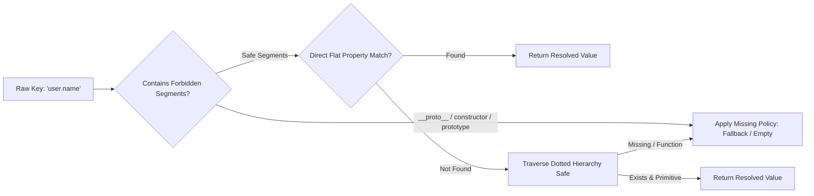

import { Callout } from 'fumadocs-ui/components/callout';
import { Card, Cards } from 'fumadocs-ui/components/card';
import { Tab, Tabs } from 'fumadocs-ui/components/tabs';
import { Accordion, Accordions } from 'fumadocs-ui/components/accordion';
import { TypeTable } from 'fumadocs-ui/components/type-table';
import { InteractiveRenderer } from '@/components/interactive-renderer';

Modern landing pages and high-converting marketing sites need **advanced personalization**: greeting visitors by name, showing prices in the local currency, inserting merchant/affiliate names, and calculating discounts in *real time*.

But injecting dynamic data into a visual page builder is often a security and architecture nightmare:
- **The naive approach**: dangerous functions like `eval()` or `new Function()` expose the app to Remote Code Execution (RCE) and XSS.
- **Unstructured injection**: ad-hoc template strings that easily break `.stora` schema validation.
- **Poor authoring experience**: authors and marketers can't find the available variables because there's no structured catalog.

**KUBUILD solves this with a decoupled two-layer architecture:**
1. **Host Variable Catalog (`@kubuild/core`)**: a flat array contract with optional grouping metadata (`group`), friendly labels, and *sample values* for authoring in the editor.
2. **Deterministic pure resolver (`@kubuild/core` runtime, used by `@kubuild/renderer`)**: a pure template resolution and interpolation engine protected against *prototype pollution*, with no dynamic code execution and multi-level fallbacks.

---

## Live Interactive Sandbox

The interactive sandbox below shows dynamic variables such as the customer name, product name, and discount being interpolated directly into KUBUILD component text.

Change the inputs in the **Host Variable Simulator** panel to see the preview text update instantly (*instant live update*):

<InteractiveRenderer
  title="Dynamic Variable Interpolation Sandbox"
  height="480px"
  defaultViewport="desktop"
  showJsonToggle={true}
  initialVariables={{
    "user.name": "Alex Morgan",
    "product.name": "Pro Ultra Running Sneakers",
    "product.discount_price": "$49",
    "product.savings": "$25",
    "store.name": "Kustora Official Store"
  }}
  variableControls={[
    {
      key: "user.name",
      label: "Customer Name",
      defaultValue: "Alex Morgan",
      placeholder: "Enter a customer name..."
    },
    {
      key: "product.name",
      label: "Product Name",
      defaultValue: "Pro Ultra Running Sneakers",
      placeholder: "Product name..."
    },
    {
      key: "product.discount_price",
      label: "Special Price",
      defaultValue: "$49",
      placeholder: "Discount price..."
    },
    {
      key: "product.savings",
      label: "Total Savings",
      defaultValue: "$25",
      placeholder: "Amount saved..."
    }
  ]}
  document={{
    schema: "stora.page",
    version: "1.3.0",
    metadata: {
      title: "Personalized Product Offer",
      description: "Demonstrating Mustache dynamic template interpolation in KUBUILD.",
      author: "KUBUILD Core Team",
      tags: ["dynamic-variables", "personalization", "mustache"],
      category: "guides",
      version: "1.0.0",
      createdAt: "2026-11-06T00:00:00.000Z",
      updatedAt: "2026-11-06T00:00:00.000Z"
    },
    document: {
      id: "root-var-demo-page",
      type: "page",
      props: { title: "Personalized Offer" },
      styles: {
        base: {
          backgroundColor: "#0b0f19",
          color: "#f8fafc",
          padding: "48px 24px",
          fontFamily: "Inter, system-ui, -apple-system, sans-serif",
          minHeight: "100%",
          boxSizing: "border-box"
        },
        tablet: {
          padding: "32px 20px"
        },
        mobile: {
          padding: "24px 16px"
        }
      },
      children: [
        {
          id: "offer-container",
          type: "section",
          props: {},
          styles: {
            base: {
              display: "flex",
              flexDirection: "column",
              alignItems: "center",
              textAlign: "center",
              gap: "20px",
              maxWidth: "680px",
              margin: "0 auto",
              padding: "36px",
              borderRadius: "16px",
              backgroundColor: "rgba(255, 255, 255, 0.03)",
              border: "1px solid rgba(255, 255, 255, 0.08)",
              boxShadow: "0 20px 40px -15px rgba(0,0,0,0.5)"
            }
          },
          children: [
            {
              id: "merchant-badge",
              type: "badge",
              props: {
                text: "✨ Exclusive Recommendation from {{ store.name | Official Partner }}",
                variant: "outline"
              },
              styles: {
                base: {
                  backgroundColor: "rgba(14, 165, 233, 0.12)",
                  color: "#38bdf8",
                  border: "1px solid rgba(14, 165, 233, 0.3)",
                  borderRadius: "9999px",
                  padding: "5px 14px",
                  fontSize: "12px",
                  fontWeight: "600",
                  letterSpacing: "0.02em"
                }
              }
            },
            {
              id: "greeting-heading",
              type: "heading",
              props: {
                level: 2,
                text: "Welcome, {{ user.name | Valued Customer }}!"
              },
              styles: {
                base: {
                  fontSize: "28px",
                  fontWeight: "800",
                  letterSpacing: "-0.03em",
                  color: "#ffffff",
                  margin: "0",
                  lineHeight: "1.25"
                }
              }
            },
            {
              id: "promo-desc",
              type: "paragraph",
              props: {
                text: "Get a special discount on {{ product.name | Featured Product }} for only {{ product.discount_price | $49 }} (save {{ product.savings | $25 }}) on orders placed today."
              },
              styles: {
                base: {
                  fontSize: "16px",
                  lineHeight: "1.65",
                  color: "#94a3b8",
                  margin: "0"
                }
              }
            },
            {
              id: "cta-claim-button",
              type: "button",
              props: {
                label: "Claim the Discount for {{ user.name | You }} Now",
                variant: "solid"
              },
              styles: {
                base: {
                  backgroundColor: "#0284c7",
                  color: "#ffffff",
                  padding: "14px 28px",
                  borderRadius: "10px",
                  fontSize: "15px",
                  fontWeight: "700",
                  cursor: "pointer",
                  border: "none",
                  marginTop: "12px",
                  boxShadow: "0 10px 25px -5px rgba(2, 132, 199, 0.4)",
                  transition: "transform 0.15s ease, background-color 0.15s ease"
                }
              }
            }
          ]
        }
      ]
    }
  }}
/>

<Callout type="info" title="Real-Time Updates">
  Notice that when an input changes, the button and paragraph text inside the `{{ ... }}` syntax update immediately without breaking the DOM structure or mutating the JSON document.
</Callout>

---

## Variable System Architecture in KUBUILD

The KUBUILD variable system is designed for two goals: **absolute safety** and **comfortable content authoring**.

### Two Ways to Represent Variables

KUBUILD supports two ways to express variables in a document:

<Tabs items={["Inline Mustache Interpolation", "Structured VariableBinding"]}>
  <Tab value="Inline Mustache Interpolation">
    Used in free text, headings, descriptions, or button labels where static text and variables mix naturally:

    ```json
    {
      "id": "heading-1",
      "type": "heading",
      "props": {
        "text": "Welcome back, {{ user.name | Valued Customer }}!"
      }
    }
    ```

    - Uses double curly braces (`{{ ... }}`).
    - Supports inline fallbacks with a pipe separator (`|`). If `user.name` isn't found in the runtime context, the fallback string after `|` is used.
  </Tab>
  <Tab value="Structured VariableBinding">
    Used when a component property is bound entirely to a structured variable object (per `VariableBindingSchema`):

    ```json
    {
      "id": "price-text",
      "type": "text",
      "props": {
        "content": {
          "type": "variable",
          "key": "product.discount_price",
          "fallback": "$0"
        }
      }
    }
    ```

    - Passes Zod `VariableBindingSchema` validation.
    - Keeps the original primitive type (string, number, boolean) instead of forcing it into a string when the component expects a number.
  </Tab>
</Tabs>

### Security: Zero Eval & Prototype Pollution Defense

Many templating libraries evaluate JavaScript expressions with `eval()` or `new Function()`. That pattern is highly vulnerable to Remote Code Execution (RCE) and Cross-Site Scripting (XSS).

KUBUILD uses a fully isolated **pure traversal algorithm**:



> [!IMPORTANT]
> **Preventing prototype pollution:**
> Traversal in `binding-resolver.ts` and `interpolator.ts` explicitly checks for forbidden segments (`__proto__`, `constructor`, `prototype`) **before** accessing any object property. Path injection attempts like `{{ __proto__.polluted }}` or `{{ constructor.prototype.isAdmin }}` are blocked and fall back safely.

```ts title="packages/core/src/runtime/binding-resolver.ts"
const FORBIDDEN_KEY_SEGMENTS = new Set(['__proto__', 'constructor', 'prototype']);

export function resolveBinding(
  binding: Pick<VariableBinding, 'key' | 'fallback'>,
  context: RuntimeContext | undefined,
): ResolveOutcome {
  const segments = binding.key.split('.').filter(Boolean);
  
  // Strict guard before touching any object
  if (segments.some((segment) => FORBIDDEN_KEY_SEGMENTS.has(segment))) {
    return applyMissingPolicy(binding);
  }
  
  // Pure data resolution without eval()
  // ...
}
```

---

## Host Variable Catalog

The host application (your Next.js app, Laravel dashboard, or SaaS system) declares the variables available to the visual editor through a **Variable Catalog**.

### Flat Array with Optional Grouping

Architecturally, KUBUILD defines `VariableCatalog` as a **flat array** of `VariableDefinition` objects:

```ts title="types/variable-catalog.ts"
import type { VariableCatalog } from '@kubuild/core';

export const hostCatalog: VariableCatalog = [
  // Group: Customer Profile
  {
    key: 'user.name',
    label: 'Customer Name',
    type: 'string',
    group: 'Customer Profile',
    sampleValue: 'Alex Morgan',
    description: 'Full name of the signed-in customer.'
  },
  {
    key: 'user.email',
    label: 'Customer Email',
    type: 'string',
    group: 'Customer Profile',
    sampleValue: 'alex@example.com'
  },

  // Group: E-Commerce & Pricing
  {
    key: 'product.name',
    label: 'Product Title',
    type: 'string',
    group: 'E-Commerce',
    sampleValue: 'Pro Ultra Running Sneakers'
  },
  {
    key: 'product.discount_price',
    label: 'Discounted Price',
    type: 'string',
    group: 'E-Commerce',
    sampleValue: '$49'
  },
  {
    key: 'product.savings',
    label: 'Total Discount Amount',
    type: 'string',
    group: 'E-Commerce',
    sampleValue: '$25'
  },

  // Group: Store & Tenant
  {
    key: 'store.name',
    label: 'Merchant Store Name',
    type: 'string',
    group: 'Store & Tenant',
    sampleValue: 'Kustora Official Store'
  }
];
```

### Why a Flat Array Instead of a Nested Tree?

This is a deliberate architectural decision for the following technical reasons:

<Cards>
  <Card title="Avoids Breaking Changes" icon="ShieldCheck">
    The flat array keeps full API compatibility with earlier versions. The `group?: string` property is purely additive (*non-breaking*).
  </Card>
  <Card title="Fast Search & Filtering (O(N))" icon="Search">
    The editor can filter variables by primitive type, e.g. `catalog.filter(v => v.type === 'string')`, without recursive tree traversal.
  </Card>
  <Card title="Easy Host Composition" icon="Layers">
    The host app can merge catalogs from different modules with an *array spread*: `[...tenantVars, ...authVars, ...campaignVars]`.
  </Card>
  <Card title="Deterministic Order" icon="ListOrdered">
    Groups and variable entries appear in the editor in the order they first occur in the array provided by the host.
  </Card>
</Cards>

> [!NOTE]
> The `group` and `sampleValue` properties are *editor-only*, used for the UI and canvas preview. They are **never stored** in the portable `.stora` document, which keeps files small and prevents leaking sensitive host data.

### Auto-Grouping Fallback

What if the host defines a variable without a `group`?

KUBUILD provides a smart fallback through the built-in `getVariableGroup()` function in `@kubuild/core`:
- If `entry.group` is set, the editor uses that group.
- If `entry.group` is empty, the editor groups the variable by the **first segment of its dotted key**.
- Example: `store.address` goes into the **"store"** group, and `affiliate.code` goes into **"affiliate"**.

```ts
import { getVariableGroup, groupVariableCatalog, type VariableDefinition } from '@kubuild/core';

const entry: VariableDefinition = {
  key: 'store.address',
  label: 'Store Address',
  type: 'string',
  sampleValue: 'Austin, TX',
};
console.log(getVariableGroup(entry)); // Output: "store"
```

---

## `VariableDefinition` Type Specification

Complete reference for every field of the `VariableDefinition` interface:

<TypeTable
  type={{
    key: {
      description: 'Unique dotted string key used to access the variable (e.g. "user.name", "product.price"). Required.',
      type: 'string',
      required: true,
    },
    label: {
      description: 'Friendly label shown in the visual editor picker dropdown.',
      type: 'string',
      required: true,
    },
    type: {
      description: 'Expected primitive value type of the variable.',
      type: "'string' | 'number' | 'boolean' | 'array' | 'object'",
      required: true,
    },
    sampleValue: {
      description: 'Mock (dummy) value used while authoring on the editor canvas so designers see a realistic preview. Never stored in the .stora document.',
      type: 'unknown',
      required: true,
    },
    description: {
      description: 'Extra hint or tooltip explaining where the variable data comes from.',
      type: 'string',
      required: false,
    },
    group: {
      description: 'Category/group label in the picker UI (e.g. "Customer Profile", "E-Commerce"). If empty, the editor falls back to the first key segment.',
      type: 'string',
      required: false,
    },
  }}
/>

---

## Authoring Experience in the Visual Editor

KUBUILD gives authors two intuitive ways to use catalog variables in the visual editor:

### 1. Inline Text Toolbar & Dropdown Trigger

While editing text directly on the canvas (*contentEditable*):
- Type the double-brace shortcut (`{{`) or click the `{x}` variable button in the floating text toolbar.
- A dropdown popover lists all available variables, grouped by category (`group`).
- Selecting a variable inserts `{{ user.name }}` at the cursor position.

### 2. Inspector Property Binding

For component properties in the right sidebar (such as image URLs, link attributes, or button text):
- Next to the inspector input there is a chain / variable binding button.
- Clicking it switches the input from literal text to a **Variable Selector Dropdown**.
- The author picks a variable from the catalog and can fill in an optional **Fallback Value**.

---

## Scope Differences: Bare Keys vs. Action Pipelines

An important design aspect of KUBUILD is the difference in variable scope between component props/text and action pipelines.

The difference is intentional, giving the best experience in each context:

| Context | Syntax | Example | Architectural Reason |
| :--- | :--- | :--- | :--- |
| **Props & Text Nodes** | **Bare key** | `{{ store.name }}` or `{{ user.name }}` | Resolution is scoped directly to `context.variables`, so authors don't type a redundant prefix. |
| **Action Pipeline Payloads** | **Namespaced key** | `{{ variables.store.name }}` | The pipeline executor works across structured namespaces: `{ form, variables, response, state }`. |

<Callout type="warning" title="Mind the Action Pipeline Namespace">
  When configuring an *action step* such as **API Request**, **Show Toast**, or **Navigate URL**, always use the `{{ variables.<key> }}` or `{{ form.<fieldName> }}` prefix so the pipeline evaluator knows which namespace to read from.
</Callout>

### Example: Action Step Payload

```json title="Action Pipeline Step Payload"
{
  "type": "api_request",
  "payload": {
    "url": "https://api.example.com/checkout",
    "method": "POST",
    "body": {
      "customer_email": "{{ form.email }}",
      "referrer": "{{ variables.store.name }}",
      "campaign_id": "{{ variables.campaign.id }}"
    }
  }
}
```

---

## Runtime Injection in the Production Renderer

In a production host, `.stora` documents are rendered with the `<KubuildRenderer />` component.

Dynamic variable data is supplied through the runtime context created with `createRenderContext()`:

### SSR Example with the Next.js App Router

In the Next.js App Router you can load user data from the database or server session and inject it into the renderer during Server-Side Rendering (SSR):

```tsx title="app/offers/[slug]/page.tsx"
import { notFound } from 'next/navigation';
import { KubuildRenderer, createRenderContext } from '@kubuild/renderer';
import type { PageDocument } from '@kubuild/schema';
import { getDocumentFromDatabase, getAuthenticatedUser } from '@/lib/data';

interface PageProps {
  params: Promise<{ slug: string }>;
}

export default async function PersonalizedOfferPage({ params }: PageProps) {
  const { slug } = await params;
  
  // 1. Load the .stora document from the database / CMS
  const document: PageDocument | null = await getDocumentFromDatabase(slug);
  if (!document) {
    notFound();
  }

  // 2. Load dynamic user & e-commerce data from the backend session
  const user = await getAuthenticatedUser();
  const productOffer = {
    name: 'Premium Bundle 2026',
    discount_price: '$45',
    savings: '$15'
  };

  // 3. Create an immutable render context with runtime variables
  // Supports nested objects as well as flat dotted strings
  const context = createRenderContext({
    variables: {
      user: {
        name: user ? user.fullName : 'Valued Customer',
        email: user ? user.email : '',
      },
      product: {
        name: productOffer.name,
        discount_price: productOffer.discount_price,
        savings: productOffer.savings,
      },
      store: {
        name: 'Kustora Flagship Store',
      }
    }
  });

  // 4. Render the document with the populated variable context
  return (
    <main className="min-h-screen bg-slate-950">
      <KubuildRenderer
        document={document}
        context={context}
        mode="runtime"
        responsive="css"
      />
    </main>
  );
}
```

### Flexible `context.variables` Structure

The runtime resolver's `resolveBinding()` supports two variable data shapes:

1. **Nested Objects**:
   ```ts
   createRenderContext({
     variables: {
       user: {
         name: 'Alex Morgan',
         profile: { tier: 'Gold' }
       }
     }
   });
   ```
2. **Flat Dotted Keys**:
   ```ts
   createRenderContext({
     variables: {
       'user.name': 'Alex Morgan',
       'user.profile.tier': 'Gold'
     }
   });
   ```

The resolver checks for a direct property match (*fast-path check*) before splitting on dots, so resolution stays fast with no memory overhead.

---

## FAQ & Troubleshooting

<Accordions>
  <Accordion title="What happens if a variable is missing from the context?">
    If a variable such as `{{ user.points }}` isn't provided in `context.variables`:
    1. With fallback syntax such as `{{ user.points | 0 }}`, the value `0` is shown.
    2. Without a fallback, the resolver keeps the original `{{ user.points }}` tag to make debugging easier in development, or returns an empty string depending on the document's missing-value policy.
  </Accordion>
  <Accordion title="Is sampleValue data stored in the database?">
    **No.** `sampleValue` only lives in browser memory while the visual editor is active. When the user saves or calls `exportStoraPackage()`, the stored node tree only contains variable keys, not sample data.
  </Accordion>
  <Accordion title="Is it safe to inject HTML into dynamic variables?">
    By default KUBUILD treats every resolved text variable as a **safe text string**. When it is inserted into the React virtual DOM, special characters such as `<script>` or `` are escaped by React, preventing Cross-Site Scripting (XSS).
  </Accordion>
</Accordions>
