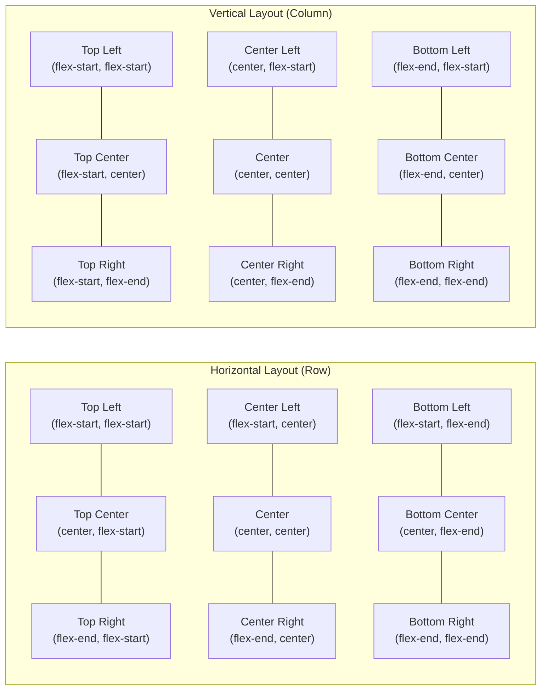
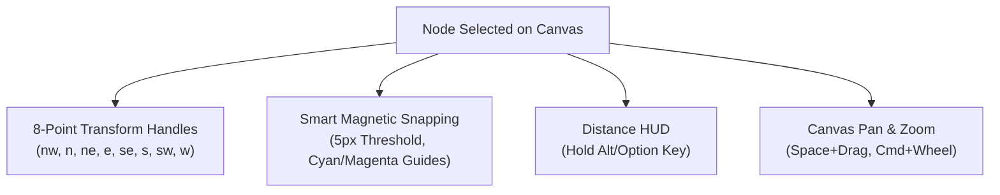

import { Callout } from 'fumadocs-ui/components/callout';
import { Card, Cards } from 'fumadocs-ui/components/card';
import { Tab, Tabs } from 'fumadocs-ui/components/tabs';
import { Accordion, Accordions } from 'fumadocs-ui/components/accordion';
import { InteractiveRenderer } from '@/components/interactive-renderer';

Web builders traditionally force designers and developers into an awkward compromise: either rigid, form-heavy sidebar panels that restrict creative freedom, or absolute "freeform" drag-and-drop canvases that generate unmaintainable, pixel-jittery spaghetti code.

**KUBUILD bridges this divide.** Built upon a **Figma-grade visual layout engine**, KUBUILD brings the fluid layout primitives that product designers cherish—**Auto Layout**, **9-box alignment matrix**, **Hug / Fill / Fixed sizing constraints**, **8-point transform handles**, and **smart magnetic snapping**—directly into a clean, deterministic CSS Flexbox and 2D CSS Grid runtime.

Every visual manipulation in KUBUILD compiles deterministically into the portable `.stora` JSON document format, guaranteeing pixel-perfect alignment in the editor and zero-overhead performance in production.

---

## Interactive Live Demo

Experience the layout engine in action. The live sandbox below features a modern Hero Section composed with **Auto Layout vertical stacking**, **horizontal button clusters**, and a **3-column responsive 2D Grid**. Switch between **Desktop**, **Tablet**, and **Mobile** viewports or inspect the compiled `.stora` AST via the **JSON** toggle:

<InteractiveRenderer
  title="Figma-Grade Layout: Hero & Feature Grid Sandbox"
  height="540px"
  defaultViewport="desktop"
  showJsonToggle={true}
  document={{
    schema: "stora.page",
    version: "1.3.0",
    metadata: {
      title: "Figma-Grade Layout Showcase",
      description: "Demonstrating Auto Layout, 2D Grid, and Hug/Fill constraints.",
      author: "KUBUILD Core Team",
      tags: ["layout", "auto-layout", "grid", "responsive"],
      category: "guides",
      version: "1.0.0",
      createdAt: "2026-11-06T00:00:00.000Z",
      updatedAt: "2026-11-06T00:00:00.000Z"
    },
    document: {
      id: "root-showcase-page",
      type: "page",
      props: { title: "Figma Layout Sandbox" },
      styles: {
        base: {
          backgroundColor: "#090d16",
          color: "#f8fafc",
          padding: "48px 24px",
          fontFamily: "Inter, system-ui, -apple-system, sans-serif",
          minHeight: "100%",
          boxSizing: "border-box"
        }
      },
      children: [
        {
          id: "hero-container",
          type: "section",
          props: {},
          styles: {
            base: {
              display: "flex",
              flexDirection: "column",
              alignItems: "center",
              textAlign: "center",
              gap: "20px",
              maxWidth: "880px",
              margin: "0 auto",
              padding: "24px 16px"
            }
          },
          children: [
            {
              id: "badge-top",
              type: "badge",
              props: {
                text: "⚡ FIGMA-GRADE ENGINE v1.3",
                variant: "outline"
              },
              styles: {
                base: {
                  backgroundColor: "rgba(59, 130, 246, 0.12)",
                  color: "#60a5fa",
                  border: "1px solid rgba(96, 165, 250, 0.3)",
                  borderRadius: "9999px",
                  padding: "6px 14px",
                  fontSize: "12px",
                  fontWeight: "700",
                  letterSpacing: "0.06em",
                  textTransform: "uppercase"
                }
              }
            },
            {
              id: "hero-headline",
              type: "heading",
              props: {
                level: 1,
                text: "Design Like Figma. Ship Production CSS."
              },
              styles: {
                base: {
                  fontSize: "36px",
                  fontWeight: "800",
                  lineHeight: "1.2",
                  letterSpacing: "-0.03em",
                  color: "#ffffff",
                  margin: "0"
                },
                mobile: {
                  fontSize: "26px"
                }
              }
            },
            {
              id: "hero-subheading",
              type: "paragraph",
              props: {
                text: "KUBUILD bridges the gap between design fluidity and enterprise code quality. Combine Auto Layout Flexbox, 2D CSS Grid, 8-point handles, and magnetic guides into clean .stora JSON."
              },
              styles: {
                base: {
                  fontSize: "16px",
                  lineHeight: "1.6",
                  color: "#94a3b8",
                  maxWidth: "640px",
                  margin: "0"
                }
              }
            },
            {
              id: "cta-cluster",
              type: "container",
              props: {},
              styles: {
                base: {
                  display: "flex",
                  flexDirection: "row",
                  alignItems: "center",
                  justifyContent: "center",
                  gap: "12px",
                  marginTop: "8px",
                  flexWrap: "wrap"
                }
              },
              children: [
                {
                  id: "btn-primary",
                  type: "button",
                  props: {
                    label: "Start Building Now",
                    variant: "solid"
                  },
                  styles: {
                    base: {
                      backgroundColor: "#3b82f6",
                      color: "#ffffff",
                      padding: "12px 24px",
                      borderRadius: "8px",
                      fontSize: "14px",
                      fontWeight: "600",
                      cursor: "pointer",
                      border: "none",
                      boxShadow: "0 10px 25px -5px rgba(59, 130, 246, 0.4)"
                    }
                  }
                },
                {
                  id: "btn-secondary",
                  type: "button",
                  props: {
                    label: "Explore Visual Grid",
                    variant: "outline"
                  },
                  styles: {
                    base: {
                      backgroundColor: "rgba(255, 255, 255, 0.05)",
                      color: "#e2e8f0",
                      padding: "12px 22px",
                      borderRadius: "8px",
                      fontSize: "14px",
                      fontWeight: "600",
                      cursor: "pointer",
                      border: "1px solid rgba(255, 255, 255, 0.15)"
                    }
                  }
                }
              ]
            }
          ]
        },
        {
          id: "features-grid-section",
          type: "section",
          props: {},
          styles: {
            base: {
              display: "grid",
              gridTemplateColumns: "repeat(3, minmax(0, 1fr))",
              gap: "20px",
              maxWidth: "960px",
              margin: "40px auto 0 auto"
            },
            tablet: {
              gridTemplateColumns: "repeat(2, minmax(0, 1fr))"
            },
            mobile: {
              gridTemplateColumns: "1fr"
            }
          },
          children: [
            {
              id: "card-1",
              type: "container",
              props: {},
              styles: {
                base: {
                  display: "flex",
                  flexDirection: "column",
                  alignItems: "flex-start",
                  gap: "12px",
                  padding: "24px",
                  borderRadius: "12px",
                  backgroundColor: "rgba(255, 255, 255, 0.03)",
                  border: "1px solid rgba(255, 255, 255, 0.08)",
                  boxSizing: "border-box"
                }
              },
              children: [
                {
                  id: "card-1-tag",
                  type: "badge",
                  props: { text: "FLEXBOX MATRIX", variant: "default" },
                  styles: {
                    base: {
                      backgroundColor: "#1e293b",
                      color: "#38bdf8",
                      fontSize: "11px",
                      fontWeight: "700",
                      padding: "4px 8px",
                      borderRadius: "6px"
                    }
                  }
                },
                {
                  id: "card-1-title",
                  type: "heading",
                  props: { level: 3, text: "Auto Layout Direction" },
                  styles: {
                    base: {
                      fontSize: "18px",
                      fontWeight: "700",
                      color: "#ffffff",
                      margin: "0"
                    }
                  }
                },
                {
                  id: "card-1-desc",
                  type: "paragraph",
                  props: {
                    text: "Switch between Horizontal and Vertical flow instantly. The 9-box alignment matrix maps 1:1 with CSS justifyContent and alignItems."
                  },
                  styles: {
                    base: {
                      fontSize: "13px",
                      lineHeight: "1.5",
                      color: "#94a3b8",
                      margin: "0"
                    }
                  }
                }
              ]
            },
            {
              id: "card-2",
              type: "container",
              props: {},
              styles: {
                base: {
                  display: "flex",
                  flexDirection: "column",
                  alignItems: "flex-start",
                  gap: "12px",
                  padding: "24px",
                  borderRadius: "12px",
                  backgroundColor: "rgba(255, 255, 255, 0.03)",
                  border: "1px solid rgba(255, 255, 255, 0.08)",
                  boxSizing: "border-box"
                }
              },
              children: [
                {
                  id: "card-2-tag",
                  type: "badge",
                  props: { text: "2D CSS GRID", variant: "default" },
                  styles: {
                    base: {
                      backgroundColor: "#1e293b",
                      color: "#a855f7",
                      fontSize: "11px",
                      fontWeight: "700",
                      padding: "4px 8px",
                      borderRadius: "6px"
                    }
                  }
                },
                {
                  id: "card-2-title",
                  type: "heading",
                  props: { level: 3, text: "Visual Column Builder" },
                  styles: {
                    base: {
                      fontSize: "18px",
                      fontWeight: "700",
                      color: "#ffffff",
                      margin: "0"
                    }
                  }
                },
                {
                  id: "card-2-desc",
                  type: "paragraph",
                  props: {
                    text: "Configure 1 to 12 column tracks with slider or presets (repeat(3, 1fr)). Span elements across colSpan and rowSpan visually."
                  },
                  styles: {
                    base: {
                      fontSize: "13px",
                      lineHeight: "1.5",
                      color: "#94a3b8",
                      margin: "0"
                    }
                  }
                }
              ]
            },
            {
              id: "card-3",
              type: "container",
              props: {},
              styles: {
                base: {
                  display: "flex",
                  flexDirection: "column",
                  alignItems: "flex-start",
                  gap: "12px",
                  padding: "24px",
                  borderRadius: "12px",
                  backgroundColor: "rgba(255, 255, 255, 0.03)",
                  border: "1px solid rgba(255, 255, 255, 0.08)",
                  boxSizing: "border-box"
                }
              },
              children: [
                {
                  id: "card-3-tag",
                  type: "badge",
                  props: { text: "CANVAS HUD", variant: "default" },
                  styles: {
                    base: {
                      backgroundColor: "#1e293b",
                      color: "#22c55e",
                      fontSize: "11px",
                      fontWeight: "700",
                      padding: "4px 8px",
                      borderRadius: "6px"
                    }
                  }
                },
                {
                  id: "card-3-title",
                  type: "heading",
                  props: { level: 3, text: "Magnetic Snapping & HUD" },
                  styles: {
                    base: {
                      fontSize: "18px",
                      fontWeight: "700",
                      color: "#ffffff",
                      margin: "0"
                    }
                  }
                },
                {
                  id: "card-3-desc",
                  type: "paragraph",
                  props: {
                    text: "8-point transform handles, 5px magnetic threshold snap guides, and hold Option/Alt to measure pixel distances to any node."
                  },
                  styles: {
                    base: {
                      fontSize: "13px",
                      lineHeight: "1.5",
                      color: "#94a3b8",
                      margin: "0"
                    }
                  }
                }
              ]
            }
          ]
        }
      ]
    }
  }}
/>

---

## Concept Equivalency: Figma vs CSS in KUBUILD

One of the greatest points of friction when moving from design to implementation is translating Figma concepts into CSS. KUBUILD eliminates this cognitive friction by designing the Style Manager and Canvas manipulation around exact Figma mental models:

| Figma Concept | KUBUILD Inspector / Canvas | Compiled CSS Output | AST Property (`styles.base`) |
| :--- | :--- | :--- | :--- |
| **Auto Layout Direction** | Horizontal / Vertical Toggle | `display: flex; flex-direction: row \| column` | `flexDirection: 'row' \| 'column'` |
| **Reverse Flow** | Reverse Toggle (⇄ / ⇅) | `flex-direction: row-reverse \| column-reverse` | `flexDirection: 'row-reverse' \| 'column-reverse'` |
| **Wrap Mode** | Wrap / No-Wrap Button | `flex-wrap: wrap \| nowrap` | `flexWrap: 'wrap' \| 'nowrap'` |
| **Alignment Matrix** | 9-Box Visual Matrix | `justify-content` & `align-items` mapping | `justifyContent`, `alignItems` |
| **Item Spacing (Gap)** | Gap Input / Canvas Slider | `gap: 16px` (`row-gap`, `column-gap`) | `gap: '16px'`, `rowGap`, `columnGap` |
| **Padding (Around)** | 4-Sided Box or Uniform Slider | `padding: 24px 16px` | `paddingTop`, `paddingRight`, etc. |
| **Hug Contents (Width)** | Sizing Dropdown: `Hug` | `width: fit-content` / `flex: 0 0 auto` | `width: 'fit-content'` |
| **Fill Container (Width)**| Sizing Dropdown: `Fill` | `flex-grow: 1; width: 100%` | `width: '100%'`, `flex: '1 1 0%'` |
| **Fixed Size (Width/Height)**| Sizing Dropdown: `Fixed` | `width: 320px; height: 48px` | `width: '320px'`, `height: '48px'` |
| **Distribute Evenly** | Space Between / Space Around | `justify-content: space-between` | `justifyContent: 'space-between'` |

<Callout type="info" title="Zero Runtime CSS-in-JS">
Unlike traditional React builders that inject bloated inline style tags or emotion runtime scripts, `@kubuild/renderer` aggregates all Auto Layout rules into clean, scoped CSS classes during compilation.
</Callout>

---

## Auto Layout Deep Dive (Flexbox)

Auto Layout in KUBUILD transforms any Container, Section, or Form into a responsive flexbox frame. 

### 1. Direction & Flow

You can select whether items stack horizontally or vertically with one click:
- **Horizontal (`flexDirection: row`)**: Ideal for navigation bars, button rows, badge pills, and inline metrics.
- **Vertical (`flexDirection: column`)**: The standard stacking order for page sections, form fields, card bodies, and article paragraphs.
- **Wrap (`flexWrap: wrap`)**: Automatically drops overflowing children to the next line—essential for tag clouds, responsive product filters, and mobile toolbars.

### 2. The 9-Box Alignment Matrix

In Figma, clicking a quadrant on the 3x3 alignment box sets both horizontal and vertical alignment simultaneously. KUBUILD mirrors this UX via `AutoLayoutControls` (`packages/editor/src/components/style-manager/auto-layout-controls.tsx`).

The matrix automatically translates the visual position based on the active flex direction:



<Tabs items={["Row Mapping", "Column Mapping", "AST JSON"]}>
  <Tab value="Row Mapping">
    When `flexDirection === 'row'`:
    - **Primary axis (`justifyContent`)**: controls horizontal positioning (`flex-start` = left, `center` = center, `flex-end` = right).
    - **Cross axis (`alignItems`)**: controls vertical positioning (`flex-start` = top, `center` = middle, `flex-end` = bottom).
  </Tab>
  <Tab value="Column Mapping">
    When `flexDirection === 'column'`:
    - **Primary axis (`justifyContent`)**: controls vertical distribution (`flex-start` = top, `center` = middle, `flex-end` = bottom).
    - **Cross axis (`alignItems`)**: controls horizontal positioning (`flex-start` = left, `center` = center, `flex-end` = right).
  </Tab>
  <Tab value="AST JSON">
    ```json
    {
      "styles": {
        "base": {
          "display": "flex",
          "flexDirection": "row",
          "justifyContent": "center",
          "alignItems": "center",
          "gap": "16px"
        }
      }
    }
    ```
  </Tab>
</Tabs>

### 3. Sizing Modes (Hug, Fill, Fixed)

Every node in KUBUILD operates under one of three sizing constraints, controlled through `DimensionSectorControls`:

<Cards>
  <Card title="Fixed (Explicit)" icon="📐">
    **CSS:** `width: 320px` or `height: 64px`  
    The element retains an exact geometric size regardless of content or parent frame changes. Best for fixed avatars, icons, and hero graphic containers.
  </Card>
  <Card title="Hug Contents" icon="📦">
    **CSS:** `width: fit-content` / `auto` (`flex: 0 0 auto`)  
    The boundary shrinks or expands to fit its child contents with padding. Best for buttons, tags, badges, and inline status chips.
  </Card>
  <Card title="Fill Container" icon="↔️">
    **CSS:** `flex-grow: 1; width: 100%`  
    The element expands to consume available space within its parent frame. Sibling elements set to `Fill` share remaining space proportionally.
  </Card>
</Cards>

---

## 2D Visual CSS Grid Engine

While Auto Layout (Flexbox) excels at 1-dimensional content flow (rows OR columns), modern web pages require true **2-dimensional positioning** for dashboards, photo galleries, and card grids.

KUBUILD provides a native **Visual CSS Grid Builder** that lets you manipulate columns, rows, and item spans without writing complex grid syntax.

```
┌─────────────────────────────────────────────────────────────┐
│ Visual Grid: repeat(3, minmax(0, 1fr))                      │
├──────────────────────────────┬──────────────────────────────┤
│ Column 1 (colSpan: 1)        │ Column 2 (colSpan: 2)        │
│ ┌──────────────────────────┐ │ ┌──────────────────────────┐ │
│ │ Profile Info             │ │ │ Analytics Graph Area     │ │
│ │ (1fr)                    │ │ │ (2fr - Spanning 2 cols)  │ │
│ └──────────────────────────┘ │ └──────────────────────────┘ │
├──────────────────────────────┴──────────────────────────────┤
│ Full Width Footer Action (colSpan: 3)                       │
│ ┌─────────────────────────────────────────────────────────┐ │
│ │ 3 Columns Wide Spanning Banner                          │ │
│ └─────────────────────────────────────────────────────────┘ │
└─────────────────────────────────────────────────────────────┘
```

### Visual Grid Controls & Presets

In the Style Manager (`packages/editor/src/components/style-manager/grid-controls.tsx`), selecting `display: grid` exposes:

1. **Columns Slider (1 to 12)**: Adjust the number of tracks interactively.
2. **Column Presets**: Instant buttons for 2, 3, 4, 6, and 12-column layouts.
3. **Custom Track Input**: Specify fractional units (`1fr 2fr 1fr`) or responsive auto-fill tracks (`repeat(auto-fit, minmax(280px, 1fr))`).
4. **Independent Gaps**: Separate row spacing (`rowGap`) from column spacing (`columnGap`).

### Grid Item Spanning

Child nodes inside a CSS Grid frame feature custom inspector controls for grid coordinate placement:

```json
{
  "id": "featured-banner",
  "type": "container",
  "styles": {
    "base": {
      "gridColumn": "span 2",
      "gridRow": "span 1",
      "justifySelf": "stretch",
      "alignSelf": "center"
    }
  }
}
```

- **`colSpan` (`gridColumn: span N`)**: Specifies how many columns the element spans across (from 1 to 12).
- **`rowSpan` (`gridRow: span N`)**: Specifies how many vertical rows the element occupies (from 1 to 6).
- **Self Alignment**: Override parent grid alignment for a single card with `justifySelf` and `alignSelf`.

---

## Direct Canvas Manipulation & Precision Snapping

KUBUILD features direct-on-canvas manipulation designed to replicate the fluidity of Figma's infinite viewport.



### 1. 8-Point Bounding Box Transform Handles

When a node is selected in `@kubuild/editor`, an interactive bounding box displays 8 resize handles:
- **Corner Handles (`nw`, `ne`, `se`, `sw`)**: Resizes both width and height simultaneously. Holding <kbd>Shift</kbd> locks the aspect ratio.
- **Edge Handles (`n`, `s`, `e`, `w`)**: Adjusts vertical height or horizontal width independently.
- **Real-Time HUD Tooltip**: While dragging, an on-canvas pill displays exact pixel dimensions: `W: 480px  H: 320px`.

### 2. Smart Magnetic Snapping

During element dragging or resizing, the snapping engine (`packages/editor/src/components/canvas/smart-guides.ts`) continuously scans surrounding candidate nodes within a **5px magnetic threshold**:
- **Edge-to-Edge Alignment**: Snaps when left, right, top, or bottom edges align with sibling nodes.
- **Center-to-Center Alignment**: Snaps to horizontal or vertical midpoints of neighboring elements or the parent container.
- **Parent Boundary Snapping**: Highlights cyan/magenta guide lines when touching the inner padding edges of parent frames.

### 3. Distance HUD (<kbd>Alt</kbd> / <kbd>Option</kbd> Hover)

Just like in Figma, hold the <kbd>Alt</kbd> (Windows) or <kbd>Option</kbd> (macOS) key while hovering over any node on the canvas:
- Shows red/magenta measurement arrows connecting the selected node to the hovered target.
- Displays pixel distance badges (e.g. `24px`, `16px`) indicating exact spacing between boundaries.
- If hovering over the parent frame, shows all four inner padding distances (`top`, `right`, `bottom`, `left`).

### 4. Canvas Pan & Zoom Engine

Navigate large landing page documents smoothly at 60 FPS:
- **Pan**: Hold <kbd>Space</kbd> + click & drag, or use middle mouse button.
- **Zoom**: Hold <kbd>Cmd</kbd> (macOS) or <kbd>Ctrl</kbd> (Windows) + scroll wheel, or use the zoom preset dropdown (`50%`, `75%`, `100%`, `150%`, `Fit to Screen`).
- **Fluid Viewport Handle**: Drag the right-side viewport resizer handle to observe continuous layout reflow from 320px up to 1920px.

---

## Step-by-Step Tutorial: Building a Modern Responsive Hero Section

Follow this step-by-step workflow to construct a production-ready, responsive hero section using KUBUILD's layout engine:

<Tabs items={["Step 1: Outer Frame", "Step 2: Content Stack", "Step 3: Action Cluster", "Step 4: Responsive Grid", "Step 5: Mobile Breakpoint"]}>
  <Tab value="Step 1: Outer Frame">
    ### 1. Create the Section Frame
    1. Drag a `section` component onto the canvas.
    2. Set `display: flex` and `flexDirection: column`.
    3. In the 9-box Alignment Matrix, click **Top Center** (`alignItems: center`).
    4. Set `padding: 64px 24px` and `gap: 24px`.
    5. Set `width: 100%` (`Fill Container`) and `maxWidth: 1200px`.
  </Tab>
  <Tab value="Step 2: Content Stack">
    ### 2. Assemble Title and Description
    1. Insert a `badge` node: set sizing to `Hug Contents`, background to transparent blue, text to `"NEW RELEASE"`.
    2. Insert a `heading` (H1): set sizing to `Hug Contents`, text alignment to `center`, `fontSize: 48px`, `fontWeight: 800`.
    3. Insert a `paragraph`: set `maxWidth: 680px`, `color: #64748b`, `fontSize: 18px`, `lineHeight: 1.6`.
  </Tab>
  <Tab value="Step 3: Action Cluster">
    ### 3. Create the Button Cluster Frame
    1. Insert a child `container` under the paragraph.
    2. Set `display: flex`, `flexDirection: row`, and `gap: 12px`.
    3. Set `justifyContent: center` and `alignItems: center`.
    4. Add a primary `button` (`Start Building`) and a secondary `button` (`Documentation`).
    5. Both buttons use `Hug Contents` so their padding dictates button width.
  </Tab>
  <Tab value="Step 4: Responsive Grid">
    ### 4. Add the 3-Column Feature Cards
    1. Insert a new `container` or `grid` below the button cluster.
    2. Set `display: grid` and `gridTemplateColumns: repeat(3, minmax(0, 1fr))`.
    3. Set `gap: 24px` and `width: 100%`.
    4. Insert 3 card containers, each configured with `padding: 24px`, background surface color, and `border-radius: 12px`.
  </Tab>
  <Tab value="Step 5: Mobile Breakpoint">
    ### 5. Configure Mobile Viewport Overrides
    1. In the top toolbar, switch to the **Mobile** viewport icon.
    2. Select the feature grid container: change `gridTemplateColumns` to `1fr` (single column stack).
    3. Select the hero section: adjust `padding: 32px 16px` and `heading` `fontSize: 32px`.
    4. Notice how desktop styles remain completely intact—only differential overrides are written into `styles.mobile`.
  </Tab>
</Tabs>

---

## Pro Tips & Edge Cases

<Accordions>
  <Accordion title="Preventing Flex Child Overflow with min-width: 0">
    In standard CSS Flexbox, flex items default to `min-width: auto`, which can cause elements containing long strings or code snippets to break outside their parent Auto Layout frame.  
    **Best Practice:** In KUBUILD, when setting a child node to `Fill Container` (`flex: 1 1 0%`), always ensure `minWidth: 0` is applied if it contains truncating text or dynamic variables.
  </Accordion>
  <Accordion title="When to use Visual Grid instead of Auto Layout">
    - **Use Auto Layout (Flexbox)** for 1D content: navbars, list items, card headers, button clusters, form fields, and vertical page stacks.
    - **Use Visual CSS Grid** for 2D content: multi-column feature sections, pricing tables, image galleries, and dashboard metric grids where column widths must align strictly across multiple rows.
  </Accordion>
  <Accordion title="Keyboard Shortcut: Group Selection into Auto Layout Frame">
    You can select multiple elements on the canvas by holding <kbd>Shift</kbd> or dragging a marquee selection box. Press <kbd>Cmd + G</kbd> (macOS) or <kbd>Ctrl + G</kbd> (Windows) to instantly wrap the selected nodes into a new Auto Layout container with default `row` direction and `16px` gap.
  </Accordion>
</Accordions>

---

## Next Steps

Now that you have mastered the layout engine, explore how responsive overrides cascade across breakpoints and how to build reusable custom components:

<Cards>
  <Card title="Responsive Cascade & Breakpoints" href="/docs/guides/responsive-cascade" icon="📱">
    Learn how style inheritance flows from Base to Tablet and Mobile, and how to inspect overrides.
  </Card>
  <Card title="Custom Components & Plugins" href="/docs/guides/custom-components" icon="🧩">
    Register custom React components and expose custom traits in the Figma-grade Style Inspector.
  </Card>
  <Card title="@kubuild/editor Deep Dive" href="/docs/packages/editor" icon="🛠️">
    Explore the internal architecture of the Canvas, Selection Store, and Style Manager.
  </Card>
</Cards>
