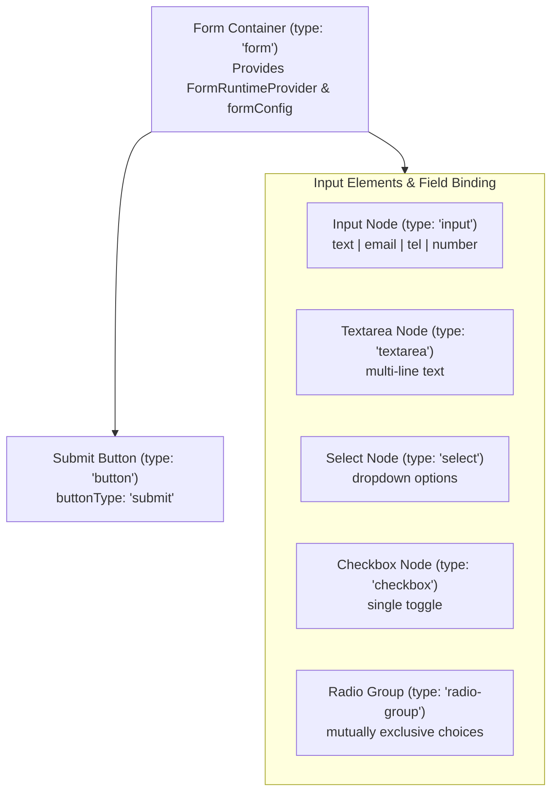
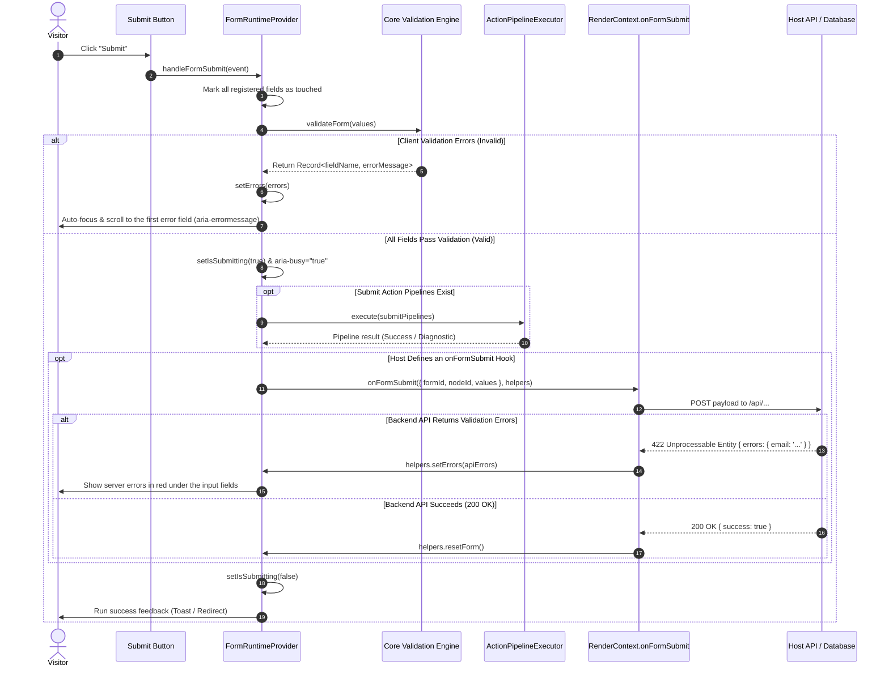
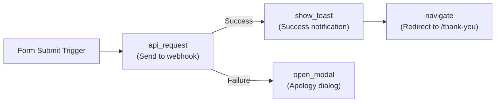

import { Callout } from 'fumadocs-ui/components/callout';
import { Card, Cards } from 'fumadocs-ui/components/card';
import { Tab, Tabs } from 'fumadocs-ui/components/tabs';
import { Accordion, Accordions } from 'fumadocs-ui/components/accordion';
import { TypeTable } from 'fumadocs-ui/components/type-table';
import { InteractiveRenderer } from '@/components/interactive-renderer';

*Forms* are the heart of conversion on landing pages, marketing sites, and modern SaaS apps: *lead capture*, newsletter signups, e-commerce checkout, and interactive surveys.

Forms in traditional visual page builders often end up *tightly coupled*: submission logic is locked to a specific third-party provider, server error messages are out of sync with the UI, and accessibility is neglected.

**KUBUILD follows a *decoupled, host-first* philosophy:**
1. **Portable document schema (`.stora`)**: defines the form hierarchy, declarative validation rules (*required*, *email*, *regex*, *min_length*), and data transforms without depending on a specific runtime.
2. **Reactive runtime engine (`@kubuild/renderer`)**: manages local form state (*values*, *errors*, *touched*, *isSubmitting*), evaluates validation automatically, handles accessibility (`aria-invalid`, `aria-errormessage`), and executes action pipelines.
3. **Host API contract (`RenderContext.onFormSubmit`)**: the *host application* fully controls backend routes, database sanitization, and authentication, and can send *server-side errors* back to be rendered under the related inputs.

---

## Live Interactive Sandbox

The interactive sandbox below shows a complete lead capture form with multi-field validation, blocking of invalid submits, server error handling, and automatic toast feedback.

<Callout type="info" title="Interactive Test Scenarios">
- **Test client-side validation**: click **Send Inquiry** while the form is empty. Red error messages appear immediately under every required field.
- **Test server rejection**: enter `error@example.com` with a valid name and phone number. The host `onFormSubmit` hook rejects this email and triggers server-side error feedback.
- **Test a successful submit**: enter your name, any valid email (e.g. `user@domain.com`), a valid phone number (8–15 digits), and a message of at least 10 characters. Watch the submit loading state and success notification.
</Callout>

<InteractiveRenderer
  title="Form Validation & onFormSubmit Pipeline Sandbox"
  height="620px"
  defaultViewport="desktop"
  showJsonToggle={true}
  document={{
    schema: "stora.page",
    version: "1.3.0",
    metadata: {
      title: "Interactive Lead Capture Form",
      description: "Interactive form with client-side validation, a host onFormSubmit hook, and an action pipeline.",
      author: "KUBUILD Core Team",
      tags: ["forms", "validation", "actions", "pipeline"],
      category: "guides",
      version: "1.0.0",
      createdAt: "2026-11-06T00:00:00.000Z",
      updatedAt: "2026-11-06T00:00:00.000Z"
    },
    document: {
      id: "root-lead-page",
      type: "page",
      props: { title: "Lead Form Demo" },
      styles: {
        base: {
          backgroundColor: "#0f172a",
          color: "#f8fafc",
          padding: "36px 20px",
          fontFamily: "Inter, system-ui, -apple-system, sans-serif",
          minHeight: "100%",
          boxSizing: "border-box"
        }
      },
      children: [
        {
          id: "form-container-card",
          type: "container",
          props: {},
          styles: {
            base: {
              maxWidth: "520px",
              margin: "0 auto",
              backgroundColor: "#1e293b",
              borderRadius: "14px",
              padding: "32px 28px",
              border: "1px solid #334155",
              boxShadow: "0 20px 25px -5px rgba(0, 0, 0, 0.4), 0 8px 10px -6px rgba(0, 0, 0, 0.3)"
            }
          },
          children: [
            {
              id: "form-header-heading",
              type: "heading",
              props: {
                level: 3,
                text: "Contact the Sales Team"
              },
              styles: {
                base: {
                  fontSize: "22px",
                  fontWeight: "700",
                  color: "#ffffff",
                  letterSpacing: "-0.01em",
                  margin: "0 0 8px 0"
                }
              }
            },
            {
              id: "form-header-desc",
              type: "paragraph",
              props: {
                text: "Fill in your contact details to schedule a KUBUILD enterprise architecture consultation."
              },
              styles: {
                base: {
                  fontSize: "13px",
                  color: "#94a3b8",
                  margin: "0 0 24px 0",
                  lineHeight: "1.5"
                }
              }
            },
            {
              id: "lead-capture-form",
              type: "form",
              props: {
                name: "enterprise_inquiry",
                resetOnSubmit: true,
                scrollToFirstError: true,
                validateOn: "blur"
              },
              styles: {
                base: {
                  display: "flex",
                  flexDirection: "column",
                  gap: "16px"
                }
              },
              children: [
                {
                  id: "name-group",
                  type: "container",
                  props: {},
                  styles: { "base": { "display": "flex", "flexDirection": "column", "gap": "6px" } },
                  children: [
                    {
                      id: "name-label",
                      type: "paragraph",
                      props: { "text": "Full Name *" },
                      styles: { "base": { "fontSize": "12px", "fontWeight": "600", "color": "#cbd5e1", "margin": "0" } }
                    },
                    {
                      id: "name-input",
                      type: "input",
                      props: {
                        name: "name",
                        type: "text",
                        placeholder: "e.g. Alex Morgan",
                        required: true,
                        transform: "trim",
                        rules: [
                          { "type": "required", "message": "Full name is required." },
                          { "type": "min_length", "value": 3, "message": "Name must be at least 3 characters." }
                        ]
                      },
                      styles: {
                        base: {
                          width: "100%",
                          padding: "10px 14px",
                          borderRadius: "8px",
                          border: "1px solid #475569",
                          backgroundColor: "#0f172a",
                          color: "#ffffff",
                          fontSize: "13px",
                          outline: "none",
                          boxSizing: "border-box"
                        }
                      }
                    }
                  ]
                },
                {
                  id: "email-group",
                  type: "container",
                  props: {},
                  styles: { "base": { "display": "flex", "flexDirection": "column", "gap": "6px" } },
                  children: [
                    {
                      id: "email-label",
                      type: "paragraph",
                      props: { "text": "Work Email Address *" },
                      styles: { "base": { "fontSize": "12px", "fontWeight": "600", "color": "#cbd5e1", "margin": "0" } }
                    },
                    {
                      id: "email-input",
                      type: "input",
                      props: {
                        name: "email",
                        type: "email",
                        placeholder: "name@company.com (try: error@example.com)",
                        required: true,
                        transform: "lowercase",
                        rules: [
                          { "type": "required", "message": "Email address is required." },
                          { "type": "email", "message": "Invalid email address format." }
                        ]
                      },
                      styles: {
                        base: {
                          width: "100%",
                          padding: "10px 14px",
                          borderRadius: "8px",
                          border: "1px solid #475569",
                          backgroundColor: "#0f172a",
                          color: "#ffffff",
                          fontSize: "13px",
                          outline: "none",
                          boxSizing: "border-box"
                        }
                      }
                    }
                  ]
                },
                {
                  id: "phone-group",
                  type: "container",
                  props: {},
                  styles: { "base": { "display": "flex", "flexDirection": "column", "gap": "6px" } },
                  children: [
                    {
                      id: "phone-label",
                      type: "paragraph",
                      props: { "text": "WhatsApp / Phone Number *" },
                      styles: { "base": { "fontSize": "12px", "fontWeight": "600", "color": "#cbd5e1", "margin": "0" } }
                    },
                    {
                      id: "phone-input",
                      type: "input",
                      props: {
                        name: "phone",
                        type: "tel",
                        placeholder: "+6281234567890",
                        required: true,
                        transform: "trim",
                        rules: [
                          { "type": "required", "message": "Phone number is required." },
                          { "type": "custom_regex", "value": "^\\+?[0-9]{8,15}$", "message": "Phone number must be 8–15 digits (optional + prefix)." }
                        ]
                      },
                      styles: {
                        base: {
                          width: "100%",
                          padding: "10px 14px",
                          borderRadius: "8px",
                          border: "1px solid #475569",
                          backgroundColor: "#0f172a",
                          color: "#ffffff",
                          fontSize: "13px",
                          outline: "none",
                          boxSizing: "border-box"
                        }
                      }
                    }
                  ]
                },
                {
                  id: "inquiry-group",
                  type: "container",
                  props: {},
                  styles: { "base": { "display": "flex", "flexDirection": "column", "gap": "6px" } },
                  children: [
                    {
                      id: "inquiry-label",
                      type: "paragraph",
                      props: { "text": "Project Needs / Message *" },
                      styles: { "base": { "fontSize": "12px", "fontWeight": "600", "color": "#cbd5e1", "margin": "0" } }
                    },
                    {
                      id: "inquiry-textarea",
                      type: "textarea",
                      props: {
                        name: "message",
                        placeholder: "Tell us about your expected traffic or the builder features you want to build...",
                        rows: 3,
                        required: true,
                        rules: [
                          { "type": "required", "message": "Please describe your needs." },
                          { "type": "min_length", "value": 10, "message": "Message must be at least 10 characters so our team understands the context." }
                        ]
                      },
                      styles: {
                        base: {
                          width: "100%",
                          padding: "10px 14px",
                          borderRadius: "8px",
                          border: "1px solid #475569",
                          backgroundColor: "#0f172a",
                          color: "#ffffff",
                          fontSize: "13px",
                          outline: "none",
                          fontFamily: "inherit",
                          resize: "vertical",
                          boxSizing: "border-box"
                        }
                      }
                    }
                  ]
                },
                {
                  id: "submit-btn",
                  type: "button",
                  props: {
                    label: "Send Inquiry",
                    buttonType: "submit"
                  },
                  styles: {
                    base: {
                      width: "100%",
                      padding: "12px 20px",
                      borderRadius: "8px",
                      border: "none",
                      backgroundColor: "#2563eb",
                      color: "#ffffff",
                      fontSize: "14px",
                      fontWeight: "600",
                      cursor: "pointer",
                      marginTop: "6px",
                      boxSizing: "border-box"
                    }
                  }
                }
              ]
            }
          ]
        }
      ]
    }
  }}
/>

---

## Form Architecture in KUBUILD

The KUBUILD form system is built on a clear *separation of concerns* between document structure, runtime execution, and host control.

### 1. Form Node Hierarchy

In the `.stora` schema, a form is built from a *nested node hierarchy*:



1. **Form Container (`type: 'form'`)**:
   - Wraps all input fields and the submit button.
   - Initializes `FormRuntimeProvider` (`packages/renderer/src/form-context.tsx`).
   - Stores the form configuration (`FormConfig`), such as `formId`, `resetOnSubmit`, `scrollToFirstError`, and `validateOn`.
2. **Registered input elements (`FormFieldBinding`)**:
   - Every input registers itself with the form runtime context through `registerField()`.
   - Binds *values*, *touched* state, validation *rules*, the validation trigger (*validateOn*), and *transform*.
3. **Submit Button (`type: 'button'`)**:
   - Configured with `props.buttonType: 'submit'`.
   - Prevents double submits while `isSubmitting: true` (`aria-busy="true"`).

---

### 2. Form Submission Pipeline Lifecycle

When a visitor presses submit, KUBUILD runs a deterministic, safe, staged pipeline:



---

## Field Validation Rules

KUBUILD ships a built-in validation engine (`@kubuild/core/src/validation/validation-engine.ts`) with no external runtime validation library in the browser.

### Built-in Rules

Every validation rule is a declarative object implementing the `ValidationRule` interface:

```ts
interface ValidationRule {
  type: ValidationRuleType;
  value?: unknown;
  message: string;
}
```

<Cards>
  <Card title="required" icon="CheckSquare">
    Ensures the field isn't empty (not `null`, `undefined`, an empty string `""`, an empty array `[]`, or boolean `false`).
  </Card>
  <Card title="email" icon="Mail">
    Validates a standard RFC email address with a ReDoS-safe regular expression.
  </Card>
  <Card title="url" icon="Globe">
    Ensures the value is a valid URL with a safe `http://` or `https://` protocol.
  </Card>
  <Card title="min_length & max_length" icon="Ruler">
    Limits the minimum or maximum character length of a string, or the number of items in an array input.
  </Card>
  <Card title="numeric_min & numeric_max" icon="Hash">
    Sets the lowest or highest numeric value for number inputs (`type: 'number'`).
  </Card>
  <Card title="custom_regex / pattern" icon="Code">
    Checks the value against a custom regular expression (e.g. phone numbers, national ID formats, postal codes).
  </Card>
  <Card title="match_field" icon="Layers">
    Checks that the value matches another field (ideal for **Confirm Password** inputs).
  </Card>
</Cards>

#### Example Rule Definitions in a Schema Node:

```json
{
  "id": "password-confirm-input",
  "type": "input",
  "props": {
    "name": "password_confirmation",
    "type": "password",
    "placeholder": "Repeat your password",
    "required": true,
    "rules": [
      {
        "type": "required",
        "message": "Please confirm your password."
      },
      {
        "type": "match_field",
        "value": "password",
        "message": "Passwords do not match."
      }
    ]
  }
}
```

---

### Validation Trigger (*validateOn* Timing)

Control when field validation runs with the `validateOn` property:

| `validateOn` Value | Evaluation Behavior | Recommended Use Case |
| :--- | :--- | :--- |
| `'blur'` *(default)* | Evaluated when the user moves focus out of the field. | Best for long forms (less noise while typing). |
| `'change'` | Evaluated on every *keystroke*. | Password strength meters or instant search. |
| `'submit'` | Evaluated only when submit is pressed. | Simple 1–2 field forms (such as a footer newsletter). |

---

### Field Value Transformation

Before validation and submission to the host, field values can be transformed automatically with the `transform` property:

```json
{
  "name": "email",
  "type": "input",
  "props": {
    "transform": "lowercase",
    "rules": [{ "type": "email", "message": "Invalid email" }]
  }
}
```

- `'trim'`: removes leading and trailing whitespace.
- `'lowercase'`: converts all letters to lowercase (e.g. email, username).
- `'uppercase'`: converts letters to uppercase (e.g. coupon codes, license plates).
- `'number'`: converts the input string into a plain number.

---

### Accessibility & Real-Time Error Display

KUBUILD implements WCAG 2.1 AA accessibility automatically:
- When a field has a validation error and has been touched (`touched: true`), the renderer adds these attributes:
  - `aria-invalid="true"`
  - `aria-errormessage="<fieldId>-error"`
- Directly below the input, the renderer injects an error message container:
  ```html
  <span id="email-input-error" role="alert" data-kubuild-field-error style="color: #dc2626; font-size: 12px;">
    Invalid email address format.
  </span>
  ```
- Screen readers announce the error immediately thanks to `role="alert"`.

---

## Host Integration via `RenderContext.onFormSubmit`

The *host application* connects KUBUILD forms to its backend (Next.js Server Actions, REST API routes, a Supabase/Prisma database, or a CRM webhook) through the `onFormSubmit` property of `RenderContext`.

### 1. Tipe Data & Signature Hook

```ts
import type { FormSubmission, FormSubmitHelpers } from '@kubuild/core';

export interface FormSubmission {
  /** Form ID (from formConfig.formId or node.id) */
  formId: string;
  /** Node ID of the form container in the document AST */
  nodeId?: string;
  /** Transformed values of every field */
  values: Record<string, unknown>;
}

export interface FormSubmitHelpers {
  /** Maps server validation errors directly onto input fields */
  setErrors: (errors: Record<string, string>) => void;
  /** Resets the form state to initialValues */
  resetForm: (nextInitialValues?: Record<string, unknown>) => void;
}
```

```ts
const context = createRenderContext({
  onFormSubmit: async (submission: FormSubmission, helpers: FormSubmitHelpers) => {
    // 1. Filter by formId if the page has more than one form
    if (submission.formId === 'checkout_form') {
      await handleCheckout(submission.values, helpers);
    } else {
      await handleLeadCapture(submission.values, helpers);
    }
  },
});
```

---

### 2. Server-Side Validation Feedback

Often validation can't be completed in the browser alone — for example checking whether an email is already registered, a coupon code has expired, or inventory is sufficient.

When the backend API returns *validation errors*, the host just calls `helpers.setErrors(apiErrors)`:

```ts
onFormSubmit: async (submission, { setErrors, resetForm }) => {
  const response = await fetch('/api/leads', {
    method: 'POST',
    headers: { 'Content-Type': 'application/json' },
    body: JSON.stringify(submission.values),
  });

  const data = await response.json();

  if (!response.ok && data.errors) {
    // apiErrors looks like: { email: "Email is already registered", phone: "Number is blocked" }
    setErrors(data.errors);
    return;
  }

  // Submitted successfully
  resetForm();
}
```

<Callout type="warn" title="Keep Field Names in Sync">
The keys of the `errors` object passed to `setErrors(errors)` **must exactly match** the `name` property of the corresponding input field in the `.stora` document (e.g. `{ email: 'Email already in use' }` for `<input name="email" />`).
</Callout>

---

## Action Pipelines on Submit

Besides host code hooks, you can declare **action pipelines** directly in the `.stora` document to run when the form passes client-side validation.

The submit pipeline supports modular *steps*:



### Supported Built-in Pipeline Steps:

1. **`api_request`**: sends an HTTP request (POST/GET) directly to a public webhook URL or external API with the form values (`context.form`).
2. **`show_toast`**: shows a notification banner (*success*, *error*, *warning*, *info*) with a custom duration.
3. **`open_modal` / `close_modal`**: shows a confirmation pop-up or an extra offer (*upsell*).
4. **`navigate`**: redirects (*URL redirect*) to a thank-you page or checkout gateway.
5. **`copy_clipboard`**: copies a referral or coupon code to the visitor's clipboard.
6. **`custom_event`**: dispatches a browser `CustomEvent` so third-party scripts (Google Tag Manager, Meta Pixel) can capture the conversion.

#### Example: Conditional Submit Action Pipeline JSON:

```json
{
  "id": "pipeline-lead-submit",
  "name": "Submit Lead & Feedback",
  "trigger": "submit",
  "steps": [
    {
      "id": "step-notify-toast",
      "type": "show_toast",
      "payload": {
        "title": "Request Received",
        "message": "Our sales team will contact you within 24 hours.",
        "type": "success",
        "duration": 5000
      }
    },
    {
      "id": "step-vip-redirect",
      "type": "navigate",
      "condition": {
        "field": "form.budget",
        "operator": "greater_than",
        "value": 50000000
      },
      "payload": {
        "url": "/enterprise-vip-schedule",
        "target": "_self"
      }
    }
  ]
}
```

---

## Full Integration Example: Next.js App Router

The complete architecture for KUBUILD forms on the Next.js App Router:

<Tabs items={["app/leads/page.tsx (Client Page)", "app/api/lead/route.ts (API Route)", "types/lead.ts (Zod Schema)"]}>
  <Tab value="app/leads/page.tsx (Client Page)">
```tsx
'use client';

import React, { useMemo } from 'react';
import { KubuildRenderer, createRenderContext, toastManager } from '@kubuild/renderer';
import type { PageDocument } from '@kubuild/schema';
import type { FormSubmission, FormSubmitHelpers } from '@kubuild/core';

interface LeadsPageProps {
  document: PageDocument;
}

export default function LeadsPage({ document }: LeadsPageProps) {
  const context = useMemo(() => {
    return createRenderContext({
      onFormSubmit: async (submission: FormSubmission, helpers: FormSubmitHelpers) => {
        try {
          // 1. Send the data to a Next.js API route
          const response = await fetch('/api/lead', {
            method: 'POST',
            headers: { 'Content-Type': 'application/json' },
            body: JSON.stringify({
              formId: submission.formId,
              nodeId: submission.nodeId,
              data: submission.values,
            }),
          });

          const result = await response.json();

          // 2. Evaluate the API response
          if (!response.ok) {
            if (result.fieldErrors) {
              // Feed server errors back to the related input fields
              helpers.setErrors(result.fieldErrors);
            }

            toastManager.showToast({
              type: 'error',
              title: 'Submission Failed',
              message: result.message || 'Please check the form and try again.',
            });
            return;
          }

          // 3. Success notification & form reset
          toastManager.showToast({
            type: 'success',
            title: 'Success!',
            message: 'Thank you, your details have been saved.',
          });

          helpers.resetForm();
        } catch (error) {
          toastManager.showToast({
            type: 'error',
            title: 'Network Error',
            message: 'Could not reach the server. Please try again in a moment.',
          });
        }
      },
    });
  }, []);

  return (
    <main className="min-h-screen bg-slate-950">
      <KubuildRenderer
        document={document}
        context={context}
        responsive="css"
        showToastContainer={true}
      />
    </main>
  );
}
```
  </Tab>

  <Tab value="app/api/lead/route.ts (API Route)">
```ts
import { NextResponse } from 'next/server';
import { z } from 'zod';

const LeadPayloadSchema = z.object({
  name: z.string().min(3, 'Name must be at least 3 characters'),
  email: z.string().email('Invalid email format'),
  phone: z.string().regex(/^\+?[0-9]{8,15}$/, 'Invalid phone number'),
  message: z.string().min(10, 'Message must be at least 10 characters'),
});

export async function POST(request: Request) {
  try {
    const body = await request.json();
    const { formId, data } = body;

    // 1. Server-side validation with Zod
    const validationResult = LeadPayloadSchema.safeParse(data);

    if (!validationResult.success) {
      const fieldErrors: Record<string, string> = {};
      for (const issue of validationResult.error.issues) {
        const fieldName = String(issue.path[0]);
        if (!fieldErrors[fieldName]) {
          fieldErrors[fieldName] = issue.message;
        }
      }

      return NextResponse.json(
        { message: 'Server validation failed', fieldErrors },
        { status: 422 }
      );
    }

    const validData = validationResult.data;

    // 2. Simulate a duplicate email check in the database
    if (validData.email === 'error@example.com') {
      return NextResponse.json(
        {
          message: 'Email is already registered',
          fieldErrors: {
            email: 'This email has already submitted an inquiry.',
          },
        },
        { status: 409 }
      );
    }

    // 3. Save to the database / CRM (e.g. Prisma, HubSpot, Supabase)
    // await db.lead.create({ data: validData });

    return NextResponse.json({
      success: true,
      leadId: `lead_${Date.now()}`,
      message: 'Lead saved successfully.',
    });
  } catch (error) {
    return NextResponse.json(
      { message: 'Internal server error' },
      { status: 500 }
    );
  }
}
```
  </Tab>

  <Tab value="types/lead.ts (Zod Schema)">
```ts
import { z } from 'zod';

export const LeadSchema = z.object({
  name: z.string().min(1, 'Full name is required').trim(),
  email: z.string().email('Invalid email format').toLowerCase(),
  phone: z.string().min(8, 'Phone number must be at least 8 digits').trim(),
  message: z.string().min(10, 'Message must be at least 10 characters').trim(),
});

export type LeadInput = z.infer<typeof LeadSchema>;
```
  </Tab>
</Tabs>

---

## API Reference & Type Specifications

### 1. `FormConfig`

Configuration at the form container level (`node.formConfig` or `node.props`):

<TypeTable
  type={{
    formId: {
      description: 'Unique form identifier. Used by the host onFormSubmit to tell forms apart.',
      type: 'string',
      required: true,
    },
    resetOnSubmit: {
      description: 'Whether the form inputs reset to their initial values after a successful submit.',
      type: 'boolean',
      default: 'false',
    },
    scrollToFirstError: {
      description: 'Whether the browser scrolls to and focuses the first invalid input when submit fails.',
      type: 'boolean',
      default: 'true',
    },
    validateOn: {
      description: 'Default validation trigger for every field in the form.',
      type: "'blur' | 'change' | 'submit'",
      default: "'blur'",
    },
    initialValues: {
      description: 'Initial value for each input, keyed by field name.',
      type: 'Record<string, unknown>',
      required: false,
    },
  }}
/>

---

### 2. `ValidationRule`

Validation rule specification for each input field:

<TypeTable
  type={{
    type: {
      description: 'Primitive validation type evaluated by the KUBUILD core validation engine.',
      type: "'required' | 'email' | 'url' | 'min_length' | 'max_length' | 'numeric_min' | 'numeric_max' | 'pattern' | 'custom_regex' | 'match_field'",
      required: true,
    },
    value: {
      description: 'Comparison parameter for the rule (e.g. a minimum number or a regex string).',
      type: 'string | number | boolean',
      required: false,
    },
    message: {
      description: 'Error message rendered directly under the input when the rule fails.',
      type: 'string',
      required: true,
    },
  }}
/>

---

### 3. `FormSubmission` & `FormSubmitHelpers`

Arguments received by the host callback `RenderContext.onFormSubmit`:

<TypeTable
  type={{
    formId: {
      description: 'ID of the form being submitted.',
      type: 'string',
      required: true,
    },
    nodeId: {
      description: 'Document AST node ID of the related form container.',
      type: 'string',
      required: false,
    },
    values: {
      description: 'Key-value map of the active, transformed input values.',
      type: 'Record<string, unknown>',
      required: true,
    },
    'helpers.setErrors': {
      description: 'Function that shows server-side errors directly on the related input fields.',
      type: '(errors: Record<string, string>) => void',
      required: true,
    },
    'helpers.resetForm': {
      description: 'Function that resets the form values and error state back to initialValues.',
      type: '(nextInitialValues?: Record<string, unknown>) => void',
      required: true,
    },
  }}
/>

---

## Best Practices

<Accordions>
  <Accordion title="1. Bot & Spam Protection (Honeypot Field)">
    To protect public forms from bots without hurting visitors (no annoying captcha), add a hidden *honeypot* field:
    ```json
    {
      "id": "hp-field",
      "type": "input",
      "props": { "name": "_gotcha", "type": "text" },
      "styles": { "base": { "display": "none", "tabIndex": -1 } }
    }
    ```
    On the host server, if `submission.values._gotcha` has any value, silently reject the request without touching the database.
  </Accordion>

  <Accordion title="2. XSS Sanitization & Payload Validation">
    Never trust client input without backend sanitization. Always verify data types and string lengths with a library such as **Zod** or **Valibot** on the server before writing to an SQL/NoSQL database.
  </Accordion>

  <Accordion title="3. Submitting State Feedback">
    While `isSubmitting` is `true`, the submit button automatically gets `aria-busy="true"` and `disabled`. Style it in the document CSS (e.g. opacity `0.7` and a `not-allowed` cursor) to prevent repeated clicks (*double submits*).
  </Accordion>
</Accordions>
