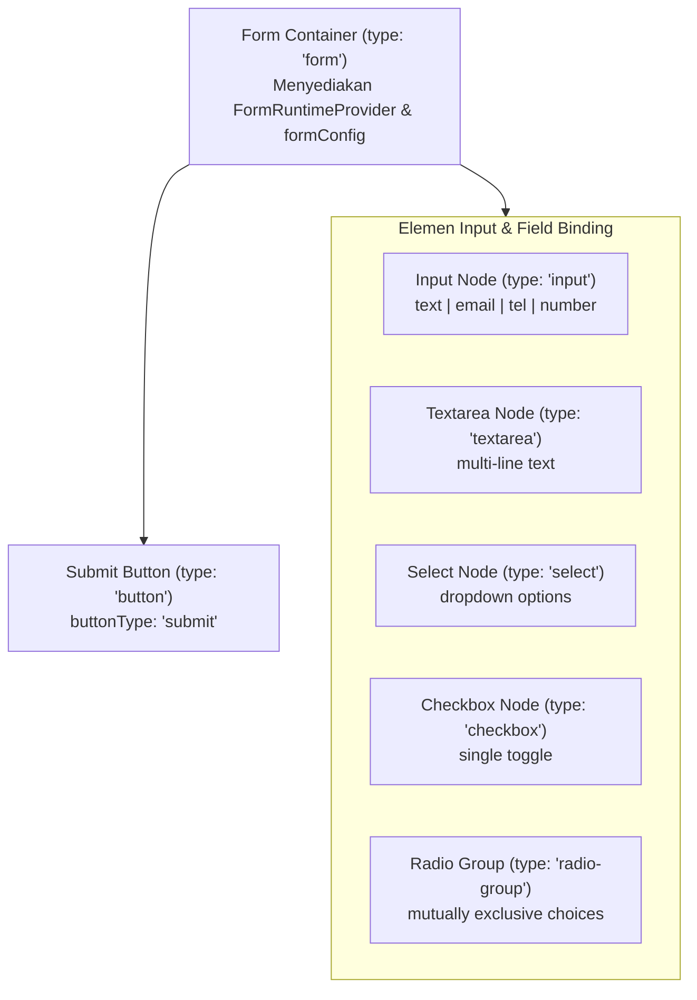
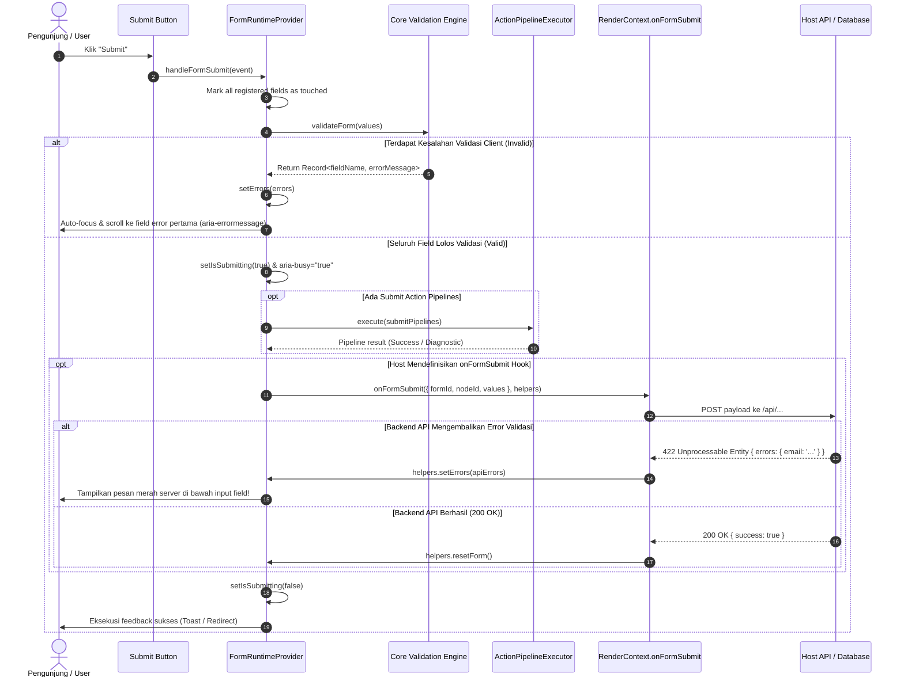
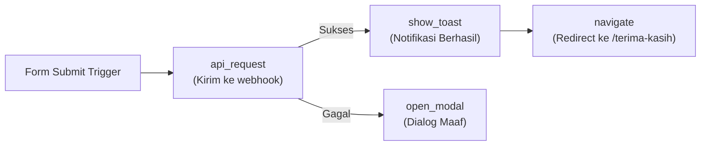

import { Callout } from 'fumadocs-ui/components/callout';
import { Card, Cards } from 'fumadocs-ui/components/card';
import { Tab, Tabs } from 'fumadocs-ui/components/tabs';
import { Accordion, Accordions } from 'fumadocs-ui/components/accordion';
import { TypeTable } from 'fumadocs-ui/components/type-table';
import { InteractiveRenderer } from '@/components/interactive-renderer';

Formulir (*forms*) adalah jantung dari konversi pada landing page, situs pemasaran, dan aplikasi SaaS modern: mulai dari penangkapan prospek (*lead capture*), pendaftaran newsletter, checkout pesanan e-commerce, hingga survei interaktif.

Membangun sistem formulir pada visual page builder tradisional sering kali menghasilkan arsitektur yang kaku (*tightly coupled*): logika pengiriman data terkunci ke penyedia pihak ketiga tertentu, pesan error server tidak sinkron dengan tampilan visual, dan aksesibilitas terabaikan.

**KUBUILD mengadopsi filosofi *decoupled host-first*:**
1. **Schema Dokumen Portabel (`.stora`)**: Mendefinisikan struktur hierarki formulir, aturan validasi deklaratif (*required*, *email*, *regex*, *min_length*), dan transformasi data tanpa ketergantungan pada runtime tertentu.
2. **Mesin Runtime Reaktif (`@kubuild/renderer`)**: Mengelola state formulir lokal (*values*, *errors*, *touched*, *isSubmitting*), mengevaluasi validasi otomatis, mengontrol aksesibilitas (`aria-invalid`, `aria-errormessage`), dan mengeksekusi pipeline action.
3. **Kontrak Host API (`RenderContext.onFormSubmit`)**: Aplikasi induk (*host application*) memiliki kendali penuh atas rute backend, sanitasi database, autentikasi, serta dapat mengirimkan kembali error validasi server (*server-side errors*) yang langsung dirender secara visual di bawah input terkait.

---

## Live Interactive Sandbox

Sandbox interaktif di bawah mendemonstrasikan implementasi formulir lead capture lengkap dengan validasi multi-field, pencegahan submit tidak valid, penanganan server error, dan feedback toast otomatis.

<Callout type="info" title="Skenario Pengujian Interaktif">
- **Uji Validasi Client-Side**: Klik tombol **Kirim Formulir Inquiry** saat form masih kosong. Perhatikan pesan error merah yang seketika muncul di bawah setiap field yang wajib diisi.
- **Uji Penolakan Server**: Masukkan email `error@example.com` bersama nama dan nomor telepon valid. Host hook `onFormSubmit` akan menolak email ini dan memicu feedback server-side error!
- **Uji Submit Berhasil**: Masukkan nama Anda, email valid apa pun (misal `user@domain.com`), nomor telepon valid (8-15 digit), dan pesan minimal 10 karakter. Perhatikan animasi loading submit dan notifikasi sukses.
</Callout>

<InteractiveRenderer
  title="Form Validation & onFormSubmit Pipeline Sandbox"
  height="620px"
  defaultViewport="desktop"
  showJsonToggle={true}
  document={{
    schema: "stora.page",
    version: "1.3.0",
    metadata: {
      title: "Interactive Lead Capture Form",
      description: "Formulir interaktif dengan validasi client-side, host onFormSubmit, dan action pipeline.",
      author: "KUBUILD Core Team",
      tags: ["forms", "validation", "actions", "pipeline"],
      category: "guides",
      version: "1.0.0",
      createdAt: "2026-11-06T00:00:00.000Z",
      updatedAt: "2026-11-06T00:00:00.000Z"
    },
    document: {
      id: "root-lead-page",
      type: "page",
      props: { title: "Lead Form Demo" },
      styles: {
        base: {
          backgroundColor: "#0f172a",
          color: "#f8fafc",
          padding: "36px 20px",
          fontFamily: "Inter, system-ui, -apple-system, sans-serif",
          minHeight: "100%",
          boxSizing: "border-box"
        }
      },
      children: [
        {
          id: "form-container-card",
          type: "container",
          props: {},
          styles: {
            base: {
              maxWidth: "520px",
              margin: "0 auto",
              backgroundColor: "#1e293b",
              borderRadius: "14px",
              padding: "32px 28px",
              border: "1px solid #334155",
              boxShadow: "0 20px 25px -5px rgba(0, 0, 0, 0.4), 0 8px 10px -6px rgba(0, 0, 0, 0.3)"
            }
          },
          children: [
            {
              id: "form-header-heading",
              type: "heading",
              props: {
                level: 3,
                text: "Hubungi Tim Penjualan"
              },
              styles: {
                base: {
                  fontSize: "22px",
                  fontWeight: "700",
                  color: "#ffffff",
                  letterSpacing: "-0.01em",
                  margin: "0 0 8px 0"
                }
              }
            },
            {
              id: "form-header-desc",
              type: "paragraph",
              props: {
                text: "Lengkapi data kontak Anda untuk menjadwalkan konsultasi arsitektur KUBUILD enterprise."
              },
              styles: {
                base: {
                  fontSize: "13px",
                  color: "#94a3b8",
                  margin: "0 0 24px 0",
                  lineHeight: "1.5"
                }
              }
            },
            {
              id: "lead-capture-form",
              type: "form",
              props: {
                name: "enterprise_inquiry",
                resetOnSubmit: true,
                scrollToFirstError: true,
                validateOn: "blur"
              },
              styles: {
                base: {
                  display: "flex",
                  flexDirection: "column",
                  gap: "16px"
                }
              },
              children: [
                {
                  id: "name-group",
                  type: "container",
                  props: {},
                  styles: { "base": { "display": "flex", "flexDirection": "column", "gap": "6px" } },
                  children: [
                    {
                      id: "name-label",
                      type: "paragraph",
                      props: { "text": "Nama Lengkap *" },
                      styles: { "base": { "fontSize": "12px", "fontWeight": "600", "color": "#cbd5e1", "margin": "0" } }
                    },
                    {
                      id: "name-input",
                      type: "input",
                      props: {
                        name: "name",
                        type: "text",
                        placeholder: "Contoh: Budi Santoso",
                        required: true,
                        transform: "trim",
                        rules: [
                          { "type": "required", "message": "Nama lengkap wajib diisi." },
                          { "type": "min_length", "value": 3, "message": "Nama minimal 3 karakter." }
                        ]
                      },
                      styles: {
                        base: {
                          width: "100%",
                          padding: "10px 14px",
                          borderRadius: "8px",
                          border: "1px solid #475569",
                          backgroundColor: "#0f172a",
                          color: "#ffffff",
                          fontSize: "13px",
                          outline: "none",
                          boxSizing: "border-box"
                        }
                      }
                    }
                  ]
                },
                {
                  id: "email-group",
                  type: "container",
                  props: {},
                  styles: { "base": { "display": "flex", "flexDirection": "column", "gap": "6px" } },
                  children: [
                    {
                      id: "email-label",
                      type: "paragraph",
                      props: { "text": "Alamat Email Kerja *" },
                      styles: { "base": { "fontSize": "12px", "fontWeight": "600", "color": "#cbd5e1", "margin": "0" } }
                    },
                    {
                      id: "email-input",
                      type: "input",
                      props: {
                        name: "email",
                        type: "email",
                        placeholder: "nama@perusahaan.com (coba: error@example.com)",
                        required: true,
                        transform: "lowercase",
                        rules: [
                          { "type": "required", "message": "Alamat email wajib diisi." },
                          { "type": "email", "message": "Format alamat email tidak valid." }
                        ]
                      },
                      styles: {
                        base: {
                          width: "100%",
                          padding: "10px 14px",
                          borderRadius: "8px",
                          border: "1px solid #475569",
                          backgroundColor: "#0f172a",
                          color: "#ffffff",
                          fontSize: "13px",
                          outline: "none",
                          boxSizing: "border-box"
                        }
                      }
                    }
                  ]
                },
                {
                  id: "phone-group",
                  type: "container",
                  props: {},
                  styles: { "base": { "display": "flex", "flexDirection": "column", "gap": "6px" } },
                  children: [
                    {
                      id: "phone-label",
                      type: "paragraph",
                      props: { "text": "Nomor WhatsApp / Telepon *" },
                      styles: { "base": { "fontSize": "12px", "fontWeight": "600", "color": "#cbd5e1", "margin": "0" } }
                    },
                    {
                      id: "phone-input",
                      type: "input",
                      props: {
                        name: "phone",
                        type: "tel",
                        placeholder: "+6281234567890",
                        required: true,
                        transform: "trim",
                        rules: [
                          { "type": "required", "message": "Nomor telepon wajib diisi." },
                          { "type": "custom_regex", "value": "^\\+?[0-9]{8,15}$", "message": "Nomor telepon harus 8-15 digit angka (opsional awalan +)." }
                        ]
                      },
                      styles: {
                        base: {
                          width: "100%",
                          padding: "10px 14px",
                          borderRadius: "8px",
                          border: "1px solid #475569",
                          backgroundColor: "#0f172a",
                          color: "#ffffff",
                          fontSize: "13px",
                          outline: "none",
                          boxSizing: "border-box"
                        }
                      }
                    }
                  ]
                },
                {
                  id: "inquiry-group",
                  type: "container",
                  props: {},
                  styles: { "base": { "display": "flex", "flexDirection": "column", "gap": "6px" } },
                  children: [
                    {
                      id: "inquiry-label",
                      type: "paragraph",
                      props: { "text": "Kebutuhan Proyek / Pesan *" },
                      styles: { "base": { "fontSize": "12px", "fontWeight": "600", "color": "#cbd5e1", "margin": "0" } }
                    },
                    {
                      id: "inquiry-textarea",
                      type: "textarea",
                      props: {
                        name: "message",
                        placeholder: "Ceritakan estimasi traffic atau fitur builder yang ingin Anda bangun...",
                        rows: 3,
                        required: true,
                        rules: [
                          { "type": "required", "message": "Pesan kebutuhan wajib diisi." },
                          { "type": "min_length", "value": 10, "message": "Pesan minimal 10 karakter agar tim kami memahami konteks." }
                        ]
                      },
                      styles: {
                        base: {
                          width: "100%",
                          padding: "10px 14px",
                          borderRadius: "8px",
                          border: "1px solid #475569",
                          backgroundColor: "#0f172a",
                          color: "#ffffff",
                          fontSize: "13px",
                          outline: "none",
                          fontFamily: "inherit",
                          resize: "vertical",
                          boxSizing: "border-box"
                        }
                      }
                    }
                  ]
                },
                {
                  id: "submit-btn",
                  type: "button",
                  props: {
                    label: "Kirim Formulir Inquiry",
                    buttonType: "submit"
                  },
                  styles: {
                    base: {
                      width: "100%",
                      padding: "12px 20px",
                      borderRadius: "8px",
                      border: "none",
                      backgroundColor: "#2563eb",
                      color: "#ffffff",
                      fontSize: "14px",
                      fontWeight: "600",
                      cursor: "pointer",
                      marginTop: "6px",
                      boxSizing: "border-box"
                    }
                  }
                }
              ]
            }
          ]
        }
      ]
    }
  }}
/>

---

## Arsitektur Formulir di KUBUILD

Sistem formulir KUBUILD dibangun di atas prinsip pembagian tanggung jawab (*separation of concerns*) yang jelas antara struktur dokumen, eksekusi runtime, dan kontrol host.

### 1. Hierarki Form Node

Dalam skema `.stora`, sebuah formulir dibentuk melalui hierarki node bersarang (*nested node hierarchy*):



1. **Form Container (`type: 'form'`)**:
   - Membungkus seluruh input fields dan submit button.
   - Menginisialisasi `FormRuntimeProvider` (`packages/renderer/src/form-context.tsx`).
   - Menyimpan konfigurasi formulir (`FormConfig`), seperti `formId`, `resetOnSubmit`, `scrollToFirstError`, dan `validateOn`.
2. **Elemen Input Terdaftar (`FormFieldBinding`)**:
   - Setiap elemen input meregistrasikan dirinya ke context form runtime melalui `registerField()`.
   - Mengikat nilai (*values*), status sentuh (*touched*), aturan validasi (*rules*), pemicu validasi (*validateOn*), dan transformasi (*transform*).
3. **Submit Button (`type: 'button'`)**:
   - Dikonfigurasikan dengan `props.buttonType: 'submit'`.
   - Menangani pencegahan submit ganda saat status `isSubmitting: true` (`aria-busy="true"`).

---

### 2. Siklus Hidup Form Submission Pipeline

Ketika pengunjung menekan tombol submit, KUBUILD mengeksekusi pipeline bertahap yang deterministik dan aman:



---

## Konfigurasi Field Validation Rules

KUBUILD menyediakan mesin validasi bawaan (`@kubuild/core/src/validation/validation-engine.ts`) tanpa dependensi pustaka validasi runtime eksternal di sisi browser client.

### Aturan Validasi Bawaan (*Built-in Rules*)

Setiap aturan validasi dinyatakan sebagai objek deklaratif dengan antarmuka `ValidationRule`:

```ts
interface ValidationRule {
  type: ValidationRuleType;
  value?: unknown;
  message: string;
}
```

<Cards>
  <Card title="required" icon="CheckSquare">
    Memastikan field tidak kosong (bukan `null`, `undefined`, string kosong `""`, array kosong `[]`, atau boolean `false`).
  </Card>
  <Card title="email" icon="Mail">
    Memvalidasi format alamat email standar RFC menggunakan regular expression yang aman dari serangan ReDoS.
  </Card>
  <Card title="url" icon="Globe">
    Memastikan nilai merupakan URL yang valid dengan protokol aman `http://` atau `https://`.
  </Card>
  <Card title="min_length & max_length" icon="Ruler">
    Membatasi panjang karakter minimum atau maksimum pada teks string atau jumlah item pada array input.
  </Card>
  <Card title="numeric_min & numeric_max" icon="Hash">
    Menentukan batas nilai numerik terendah atau tertinggi untuk input angka (`type: 'number'`).
  </Card>
  <Card title="custom_regex / pattern" icon="Code">
    Mengevaluasi nilai terhadap pola regular expression kustom (misalnya nomor telepon, format NIK, kode pos).
  </Card>
  <Card title="match_field" icon="Layers">
    Memvalidasi kesamaan nilai dengan field lain (sangat ideal untuk input **Konfirmasi Password**).
  </Card>
</Cards>

#### Contoh Definisi Rules dalam Schema Node:

```json
{
  "id": "password-confirm-input",
  "type": "input",
  "props": {
    "name": "password_confirmation",
    "type": "password",
    "placeholder": "Ulangi kata sandi Anda",
    "required": true,
    "rules": [
      {
        "type": "required",
        "message": "Konfirmasi password wajib diisi."
      },
      {
        "type": "match_field",
        "value": "password",
        "message": "Konfirmasi password tidak cocok dengan kata sandi."
      }
    ]
  }
}
```

---

### Pemicu Validasi (*validateOn Timing*)

Anda dapat mengontrol kapan evaluasi validasi field dijalankan melalui properti `validateOn`:

| Nilai `validateOn` | Perilaku Evaluasi | Rekomendasi Kasus Penggunaan |
| :--- | :--- | :--- |
| `'blur'` *(Default)* | Dievaluasi ketika pengguna memindahkan fokus keluar dari input field. | Pilihan terbaik untuk form panjang (mengurangi gangguan saat mengetik). |
| `'change'` | Dievaluasi seketika pada setiap ketukan tombol (*keystroke*). | Cocok untuk indikator kekuatan password atau pencarian instan. |
| `'submit'` | Hanya dievaluasi saat tombol submit ditekan. | Form sederhana 1-2 field (seperti newsletter footer). |

---

### Transformasi Nilai Field (*field transformation*)

Sebelum divalidasi dan dikirim ke host, nilai field dapat ditransformasi secara otomatis menggunakan properti `transform`:

```json
{
  "name": "email",
  "type": "input",
  "props": {
    "transform": "lowercase",
    "rules": [{ "type": "email", "message": "Email tidak valid" }]
  }
}
```

- `'trim'`: Menghapus spasi kosong di awal dan akhir teks.
- `'lowercase'`: Mengubah semua huruf menjadi huruf kecil (contoh: email, username).
- `'uppercase'`: Mengubah huruf menjadi huruf besar (contoh: kode promo kupon, plat nomor kendaraan).
- `'number'`: Mengonversi string input menjadi angka numerik murni.

---

### Aksesibilitas & Tampilan Error Real-Time

KUBUILD mengimplementasikan standar aksesibilitas WCAG 2.1 AA secara otomatis:
- Ketika suatu field memiliki error validasi dan telah disentuh (`touched: true`), renderer menambahkan atribut:
  - `aria-invalid="true"`
  - `aria-errormessage="<fieldId>-error"`
- Tepat di bawah elemen input, renderer menyuntikkan kontainer pesan error:
  ```html
  <span id="email-input-error" role="alert" data-kubuild-field-error style="color: #dc2626; font-size: 12px;">
    Format alamat email tidak valid.
  </span>
  ```
- Pembaca layar (*screen readers*) akan membacakan pesan error secara langsung berkat atribut `role="alert"`.

---

## Host Integration via `RenderContext.onFormSubmit`

Aplikasi induk (*host application*) menghubungkan formulir KUBUILD ke infrastruktur backend (seperti Next.js Server Actions, REST API route, database Supabase/Prisma, atau webhook CRM) menggunakan properti `onFormSubmit` pada `RenderContext`.

### 1. Tipe Data & Signature Hook

```ts
import type { FormSubmission, FormSubmitHelpers } from '@kubuild/core';

export interface FormSubmission {
  /** ID formulir (dari formConfig.formId atau node.id) */
  formId: string;
  /** ID node form container pada dokumen AST */
  nodeId?: string;
  /** Nilai seluruh field yang telah ditransformasi */
  values: Record<string, unknown>;
}

export interface FormSubmitHelpers {
  /** Memetakan error validasi server langsung ke field input */
  setErrors: (errors: Record<string, string>) => void;
  /** Mengembalikan state formulir ke initialValues */
  resetForm: (nextInitialValues?: Record<string, unknown>) => void;
}
```

```ts
const context = createRenderContext({
  onFormSubmit: async (submission: FormSubmission, helpers: FormSubmitHelpers) => {
    // 1. Filter form berdasarkan formId jika halaman memiliki lebih dari satu form
    if (submission.formId === 'checkout_form') {
      await handleCheckout(submission.values, helpers);
    } else {
      await handleLeadCapture(submission.values, helpers);
    }
  },
});
```

---

### 2. Server-Side Validation Feedback

Sering kali validasi tidak dapat diselesaikan hanya di sisi browser client—seperti memeriksa apakah email sudah terdaftar di database, apakah kode kupon diskon sudah kadaluwarsa, atau apakah stok inventaris mencukupi.

Ketika backend API mengembalikan pesan penolakan (*validation errors*), host cukup memanggil `helpers.setErrors(apiErrors)`:

```ts
onFormSubmit: async (submission, { setErrors, resetForm }) => {
  const response = await fetch('/api/leads', {
    method: 'POST',
    headers: { 'Content-Type': 'application/json' },
    body: JSON.stringify(submission.values),
  });

  const data = await response.json();

  if (!response.ok && data.errors) {
    // apiErrors berformat: { email: "Email sudah terdaftar", phone: "Nomor diblokir" }
    setErrors(data.errors);
    return;
  }

  // Pengiriman sukses
  resetForm();
}
```

<Callout type="warn" title="Sinkronisasi Nama Field">
Key pada objek `errors` yang dioper ke `setErrors(errors)` **harus cocok persis** dengan properti `name` dari input field yang bersangkutan pada dokumen `.stora` (contoh: `{ email: 'Email sudah dipakai' }` untuk `<input name="email" />`).
</Callout>

---

## Action Pipelines pada Submit

Selain hook kode host, Anda dapat mendeklarasikan **Action Pipelines** langsung di dalam dokumen `.stora` untuk dieksekusi saat form berhasil divalidasi client-side.

Pipeline submit mendukung langkah-langkah (*steps*) modular:



### Langkah Pipeline Bawaan yang Didukung:

1. **`api_request`**: Mengirimkan HTTP request (POST/GET) langsung ke URL endpoint webhook publik atau API eksternal dengan payload nilai form (`context.form`).
2. **`show_toast`**: Menampilkan notifikasi banner (*success*, *error*, *warning*, *info*) dengan durasi kustom.
3. **`open_modal` / `close_modal`**: Menampilkan modal pop-up konfirmasi atau penawaran tambahan (*upsell*).
4. **`navigate`**: Melakukan pengalihan halaman (*URL redirect*) ke halaman terima kasih atau checkout gateway.
5. **`copy_clipboard`**: Menyalin kode referal atau kupon ke papan klip pengunjung.
6. **`custom_event`**: Memicu `CustomEvent` browser agar skrip pihak ketiga (Google Tag Manager, Meta Pixel) dapat menangkap konversi.

#### Contoh JSON Action Pipeline Submit Bersyarat (*Conditional Steps*):

```json
{
  "id": "pipeline-lead-submit",
  "name": "Submit Lead & Feedback",
  "trigger": "submit",
  "steps": [
    {
      "id": "step-notify-toast",
      "type": "show_toast",
      "payload": {
        "title": "Permintaan Diterima",
        "message": "Tim sales kami akan menghubungi Anda dalam 1x24 jam.",
        "type": "success",
        "duration": 5000
      }
    },
    {
      "id": "step-vip-redirect",
      "type": "navigate",
      "condition": {
        "field": "form.budget",
        "operator": "greater_than",
        "value": 50000000
      },
      "payload": {
        "url": "/enterprise-vip-schedule",
        "target": "_self"
      }
    }
  ]
}
```

---

## Contoh Integrasi Penuh: Next.js App Router

Berikut adalah arsitektur lengkap integrasi formulir KUBUILD pada Next.js App Router:

<Tabs items={["app/leads/page.tsx (Client Page)", "app/api/lead/route.ts (API Route)", "types/lead.ts (Zod Schema)"]}>
  <Tab value="app/leads/page.tsx (Client Page)">
```tsx
'use client';

import React, { useMemo } from 'react';
import { KubuildRenderer, createRenderContext, toastManager } from '@kubuild/renderer';
import type { PageDocument } from '@kubuild/schema';
import type { FormSubmission, FormSubmitHelpers } from '@kubuild/core';

interface LeadsPageProps {
  document: PageDocument;
}

export default function LeadsPage({ document }: LeadsPageProps) {
  const context = useMemo(() => {
    return createRenderContext({
      onFormSubmit: async (submission: FormSubmission, helpers: FormSubmitHelpers) => {
        try {
          // 1. Kirim data ke Next.js API Route
          const response = await fetch('/api/lead', {
            method: 'POST',
            headers: { 'Content-Type': 'application/json' },
            body: JSON.stringify({
              formId: submission.formId,
              nodeId: submission.nodeId,
              data: submission.values,
            }),
          });

          const result = await response.json();

          // 2. Evaluasi respons API
          if (!response.ok) {
            if (result.fieldErrors) {
              // Umpan balik error server langsung ke input field terkait
              helpers.setErrors(result.fieldErrors);
            }

            toastManager.showToast({
              type: 'error',
              title: 'Pengiriman Gagal',
              message: result.message || 'Harap periksa kembali isian formulir Anda.',
            });
            return;
          }

          // 3. Notifikasi Sukses & Reset Form
          toastManager.showToast({
            type: 'success',
            title: 'Berhasil!',
            message: 'Terima kasih, data Anda telah berhasil kami simpan.',
          });

          helpers.resetForm();
        } catch (error) {
          toastManager.showToast({
            type: 'error',
            title: 'Kesalahan Jaringan',
            message: 'Gagal terhubung ke server. Silakan coba beberapa saat lagi.',
          });
        }
      },
    });
  }, []);

  return (
    <main className="min-h-screen bg-slate-950">
      <KubuildRenderer
        document={document}
        context={context}
        responsive="css"
        showToastContainer={true}
      />
    </main>
  );
}
```
  </Tab>

  <Tab value="app/api/lead/route.ts (API Route)">
```ts
import { NextResponse } from 'next/server';
import { z } from 'zod';

const LeadPayloadSchema = z.object({
  name: z.string().min(3, 'Nama minimal 3 karakter'),
  email: z.string().email('Format email tidak valid'),
  phone: z.string().regex(/^\+?[0-9]{8,15}$/, 'Nomor telepon tidak valid'),
  message: z.string().min(10, 'Pesan minimal 10 karakter'),
});

export async function POST(request: Request) {
  try {
    const body = await request.json();
    const { formId, data } = body;

    // 1. Validasi Server-Side menggunakan Zod
    const validationResult = LeadPayloadSchema.safeParse(data);

    if (!validationResult.success) {
      const fieldErrors: Record<string, string> = {};
      for (const issue of validationResult.error.issues) {
        const fieldName = String(issue.path[0]);
        if (!fieldErrors[fieldName]) {
          fieldErrors[fieldName] = issue.message;
        }
      }

      return NextResponse.json(
        { message: 'Validasi server gagal', fieldErrors },
        { status: 422 }
      );
    }

    const validData = validationResult.data;

    // 2. Simulasi Pengecekan Duplikasi Email di Database
    if (validData.email === 'error@example.com') {
      return NextResponse.json(
        {
          message: 'Email sudah terdaftar',
          fieldErrors: {
            email: 'Email ini sudah pernah mengajukan inquiry sebelumnya.',
          },
        },
        { status: 409 }
      );
    }

    // 3. Simpan ke database / CRM (misal: Prisma, HubSpot, Supabase)
    // await db.lead.create({ data: validData });

    return NextResponse.json({
      success: true,
      leadId: `lead_${Date.now()}`,
      message: 'Data lead berhasil disimpan.',
    });
  } catch (error) {
    return NextResponse.json(
      { message: 'Terjadi kesalahan internal server' },
      { status: 500 }
    );
  }
}
```
  </Tab>

  <Tab value="types/lead.ts (Zod Schema)">
```ts
import { z } from 'zod';

export const LeadSchema = z.object({
  name: z.string().min(1, 'Nama lengkap wajib diisi').trim(),
  email: z.string().email('Format email tidak valid').toLowerCase(),
  phone: z.string().min(8, 'Nomor telepon minimal 8 digit').trim(),
  message: z.string().min(10, 'Pesan minimal 10 karakter').trim(),
});

export type LeadInput = z.infer<typeof LeadSchema>;
```
  </Tab>
</Tabs>

---

## Referensi API & Spesifikasi Tipe Data

### 1. `FormConfig`

Spesifikasi konfigurasi pada level kontainer form (`node.formConfig` atau `node.props`):

<TypeTable
  type={{
    formId: {
      description: 'Pengidentifikasi unik formulir. Digunakan oleh host onFormSubmit untuk membedakan target formulir.',
      type: 'string',
      required: true,
    },
    resetOnSubmit: {
      description: 'Apakah state input form harus di-reset kembali ke nilai awal setelah submit berhasil.',
      type: 'boolean',
      default: 'false',
    },
    scrollToFirstError: {
      description: 'Apakah viewport browser otomatis menggulir dan memfokuskan input invalid pertama jika submit gagal.',
      type: 'boolean',
      default: 'true',
    },
    validateOn: {
      description: 'Waktu pemicu default evaluasi validasi untuk semua field di dalam form.',
      type: "'blur' | 'change' | 'submit'",
      default: "'blur'",
    },
    initialValues: {
      description: 'Nilai awal untuk setiap field input yang dipetakan berdasarkan field name.',
      type: 'Record<string, unknown>',
      required: false,
    },
  }}
/>

---

### 2. `ValidationRule`

Spesifikasi aturan validasi individual untuk setiap field input:

<TypeTable
  type={{
    type: {
      description: 'Tipe validasi primitif yang akan dievaluasi oleh mesin validasi core KUBUILD.',
      type: "'required' | 'email' | 'url' | 'min_length' | 'max_length' | 'numeric_min' | 'numeric_max' | 'pattern' | 'custom_regex' | 'match_field'",
      required: true,
    },
    value: {
      description: 'Nilai parameter pembanding untuk aturan validasi (misal angka batas minimum atau string regex).',
      type: 'string | number | boolean',
      required: false,
    },
    message: {
      description: 'Pesan kesalahan yang akan dirender tepat di bawah input field jika evaluasi aturan bernilai salah (invalid).',
      type: 'string',
      required: true,
    },
  }}
/>

---

### 3. `FormSubmission` & `FormSubmitHelpers`

Argumen yang diterima oleh host callback `RenderContext.onFormSubmit`:

<TypeTable
  type={{
    formId: {
      description: 'ID dari formulir yang sedang disubmit.',
      type: 'string',
      required: true,
    },
    nodeId: {
      description: 'Node ID dokumen AST dari Form Container terkait.',
      type: 'string',
      required: false,
    },
    values: {
      description: 'Key-value map berisi nilai input aktif yang telah ditransformasikan.',
      type: 'Record<string, unknown>',
      required: true,
    },
    'helpers.setErrors': {
      description: 'Fungsi untuk menampilkan error server-side langsung pada UI input field terkait.',
      type: '(errors: Record<string, string>) => void',
      required: true,
    },
    'helpers.resetForm': {
      description: 'Fungsi untuk me-reset nilai dan error state form kembali ke initialValues.',
      type: '(nextInitialValues?: Record<string, unknown>) => void',
      required: true,
    },
  }}
/>

---

## Praktik Terbaik (*Best Practices*)

<Accordions>
  <Accordion title="1. Bot & Spam Protection (Honeypot Field)">
    Untuk melindungi formulir publik dari bot otomatis tanpa mengorbankan kenyamanan pengunjung (tanpa captcha yang mengganggu), sertakan field tersembunyi (*honeypot*):
    ```json
    {
      "id": "hp-field",
      "type": "input",
      "props": { "name": "_gotcha", "type": "text" },
      "styles": { "base": { "display": "none", "tabIndex": -1 } }
    }
    ```
    Pada server host, jika `submission.values._gotcha` terisi nilai apa pun, tolak request secara diam-diam tanpa memproses database.
  </Accordion>

  <Accordion title="2. Sanitasi XSS & Payload Validation">
    Jangan pernah mempercayai input klien tanpa sanitasi backend. Selalu verifikasi tipe data dan panjang string menggunakan library seperti **Zod** atau **Valibot** di sisi server API sebelum memasukkan data ke dalam database SQL/NoSQL.
  </Accordion>

  <Accordion title="3. Umpan Balik Status Submitting">
    Ketika `isSubmitting` bernilai `true`, submit button secara otomatis mendapatkan atribut `aria-busy="true"` dan `disabled`. Berikan styling visual pada CSS dokumen (misalnya opacity `0.7` dan kursor `not-allowed`) untuk mencegah pengguna menekan tombol secara berulang (*double-submit*).
  </Accordion>
</Accordions>
