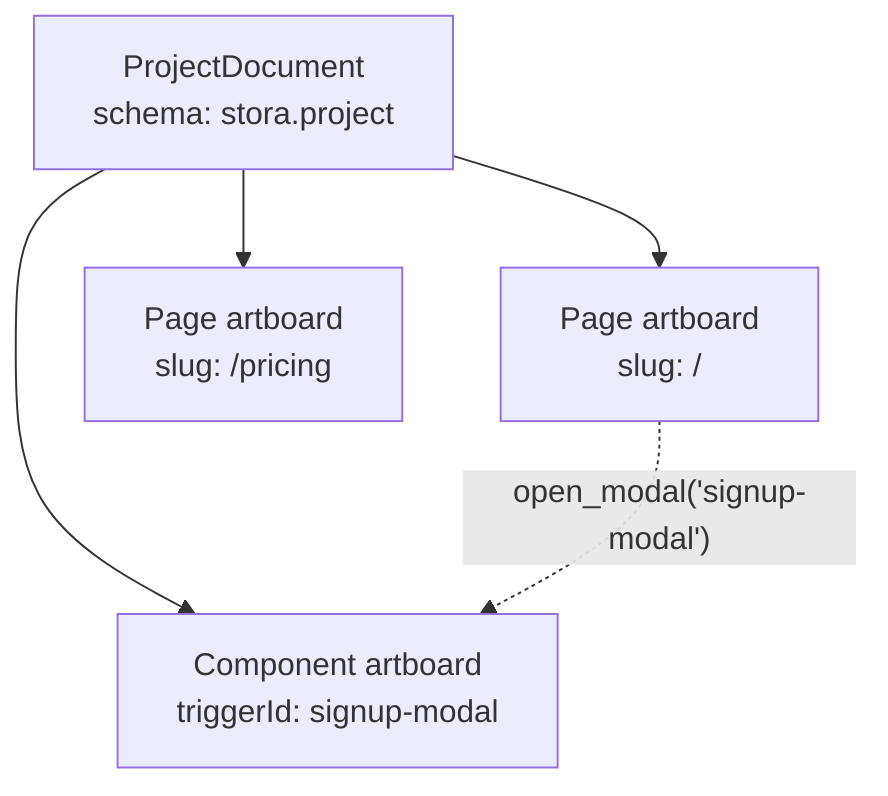

import { Callout } from 'fumadocs-ui/components/callout';

A `PageDocument` (`schema: "stora.page"`) describes **one** page. When a site needs several pages, or a page opens modals and drawers that are designed separately, KUBUILD groups them in a **`ProjectDocument`** (`schema: "stora.project"`). Each entry in a project is an **artboard**.



## The Data Model

```ts
// From @kubuild/schema
type ArtboardType = 'page' | 'component';

interface Artboard {
  id: string;
  name: string;
  artboardType: ArtboardType;
  slug?: string; // page artboards: the route, e.g. "/pricing"
  triggerId?: string; // component artboards: the id open_modal / close_modal target
  viewport?: 'desktop' | 'tablet' | 'mobile';
  width?: number;
  position?: { x: number; y: number }; // position on the editor's infinite canvas
  document: PageDocument; // every artboard holds a complete, valid PageDocument
}

interface ProjectDocument {
  schema: 'stora.project';
  version: string;
  metadata?: DocumentMetadata;
  tracking?: TrackingConfig;
  artboards: Artboard[];
  activeArtboardId?: string;
}
```

Two kinds of artboard exist:

- **Page artboards** (`artboardType: 'page'`) are routable pages with a `slug`.
- **Component artboards** (`artboardType: 'component'`) hold content that is shown on top of a page, such as a modal or drawer. A trigger on any page opens it by its `triggerId`.

Because every artboard wraps a full `PageDocument`, all node commands, validators, and the history engine keep working on one artboard at a time without knowing that projects exist.

<Callout type="info" title="Node IDs are unique per project">
  Node IDs must be unique across the whole project, not only within one artboard, so content can move between artboards without colliding. `collectProjectNodeIds(project)` returns every ID in use.
</Callout>

## Creating and Editing a Project

Project-level commands live in `@kubuild/core`. Like node commands, they never mutate their input: each returns a new `project` plus a change `event`.

```ts
import {
  addArtboard,
  createBlankProject,
  createPageArtboard,
  extractNodeToArtboard,
  getComponentArtboards,
  getPageArtboards,
  renameArtboard,
  setActiveArtboard,
} from '@kubuild/core';

// A project with one blank page artboard
let project = createBlankProject('Acme Website');

// Add a second page
const pricing = createPageArtboard('Pricing', { slug: '/pricing' });
({ project } = addArtboard(project, { artboard: pricing }));

// Rename and activate
({ project } = renameArtboard(project, { artboardId: pricing.id, name: 'Pricing & Plans' }));
({ project } = setActiveArtboard(project, { artboardId: pricing.id }));

// Detach a modal that lives inline on the pricing page into its own component artboard.
// An `artboard-reference` stub stays at the original position.
const result = extractNodeToArtboard(project, {
  artboardId: pricing.id,
  nodeId: 'signup-modal',
  name: 'Signup Modal',
});
project = result.project;
console.log(result.event.type); // 'NODE_EXTRACTED_TO_ARTBOARD'

console.log(getPageArtboards(project).map((a) => a.slug)); // ['/', '/pricing']
console.log(getComponentArtboards(project).map((a) => a.triggerId));
```

| Function | Purpose |
| :--- | :--- |
| `createBlankProject(title?)` | New project with one blank page artboard. |
| `createPageArtboard(name?, options?)` | Page artboard around a fresh blank document. |
| `createComponentArtboard(node, options?)` | Component artboard wrapping an existing node. |
| `addArtboard` / `removeArtboard` / `renameArtboard` / `setActiveArtboard` | Project commands returning `{ project, event }`. |
| `extractNodeToArtboard(project, params)` | Detach a node subtree into a component artboard, leaving an `artboard-reference` stub. |
| `updateArtboardDocument(project, artboardId, document)` | Replace one artboard's document (e.g. after editing it). |
| `findArtboardById` / `findArtboardByTriggerId` / `getActiveArtboard` | Lookups. |
| `getPageArtboards` / `getComponentArtboards` | Filter by artboard type. |

### Editing one artboard with node commands

Edit an artboard's document with the regular node commands, then write it back:

```ts
import { findArtboardById, updateProps, updateArtboardDocument } from '@kubuild/core';
import type { ProjectDocument } from '@kubuild/schema';

function renameHeroHeading(project: ProjectDocument, artboardId: string): ProjectDocument {
  const artboard = findArtboardById(project, artboardId);
  if (!artboard) return project;

  const { document } = updateProps(artboard.document, {
    nodeId: 'hero-heading',
    props: { text: 'Ship pages faster' },
  });
  return updateArtboardDocument(project, artboardId, document);
}
```

## Loading Stored Documents

Older data may be a single `PageDocument`. `loadProjectDocument` accepts either shape: a project is validated as-is, and a page is migrated to the current schema and wrapped in a one-artboard project.

```ts
import { loadProjectDocument } from '@kubuild/core';

const result = loadProjectDocument(JSON.parse(rawJson));

if (!result.success || !result.project) {
  console.error(result.errors); // [{ code: 'PROJECT_SCHEMA_INVALID', message, details }]
} else {
  if (result.wrappedFromLegacyPage) {
    console.info('Loaded a legacy single page; save it back as a project.');
  }
  const project = result.project;
}
```

`wrapPageDocumentAsProject(document, options?)` does the wrapping step on its own when you already hold a valid `PageDocument`. Inline modals in legacy pages are **not** extracted automatically, so existing documents keep rendering the same way until an author detaches them.

## Rendering a Project

Render one page artboard with `KubuildProjectRenderer` and pass the project's component artboards. When a trigger on the page runs `open_modal` with a component artboard's `triggerId`, that artboard is portal-rendered on top of the page.

```tsx
import { KubuildProjectRenderer } from '@kubuild/renderer';
import { getComponentArtboards, getPageArtboards } from '@kubuild/core';
import type { ProjectDocument } from '@kubuild/schema';

export function ProjectPage({ project, slug }: { project: ProjectDocument; slug: string }) {
  const page = getPageArtboards(project).find((a) => a.slug === slug);
  if (!page) return null;

  return (
    <KubuildProjectRenderer
      document={page.document}
      componentArtboards={getComponentArtboards(project)}
      responsive="css"
    />
  );
}
```

`KubuildProjectRenderer` accepts every `KubuildRenderer` prop. Use plain `KubuildRenderer` when a page never opens detached artboards.

## In the Editor

`<KubuildEditor />` shows page artboards (from the `pages` prop) and component artboards side by side on its canvas. Authors can detach an inline modal or drawer into a component artboard and edit it on its own surface. Detaching spans two artboards, so it is recorded as one atomic project-level step rather than in each artboard's own undo stack.

## Related

- [`.stora` Document Format](/docs/getting-started/stora-document)
- [`@kubuild/core` commands](/docs/packages/core)
- [`@kubuild/renderer`](/docs/packages/renderer)
