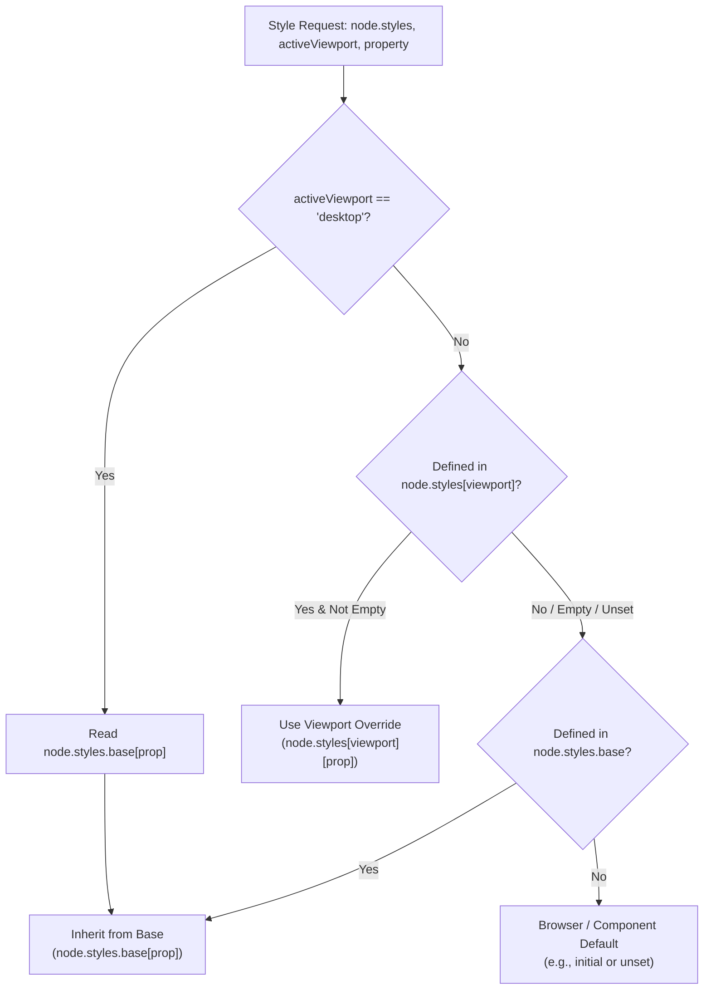

import { Callout } from 'fumadocs-ui/components/callout';
import { Card, Cards } from 'fumadocs-ui/components/card';
import { Tab, Tabs } from 'fumadocs-ui/components/tabs';
import { Accordion, Accordions } from 'fumadocs-ui/components/accordion';
import { InteractiveRenderer } from '@/components/interactive-renderer';

Responsive design in traditional visual site builders is notorious for fragile complexity. Some builders duplicate entire component trees for mobile and desktop, resulting in content divergence and bloated DOMs. Others maintain separate, disconnected style sheets where altering a padding value on desktop silently breaks a tablet layout or leaves "ghost" overrides that are impossible to trace.

**KUBUILD solves this with a unified, sparse-delta responsive architecture.** Built upon the **Desktop (Base) &rarr; Tablet &rarr; Mobile** downward cascade, KUBUILD maintains a **Single Source of Truth** in the `.stora` document tree. Base styles provide the canonical foundation, while tablet and mobile viewports store only explicit property deltas.

In the editor, visual indicators clearly distinguish between inherited values and local overrides, with one-click reset controls. In production, `@kubuild/renderer` compiles these overrides into scoped native CSS `@media` queries with zero JavaScript runtime overhead, zero user-agent sniffing, and **Cumulative Layout Shift (CLS) = 0**.

---

## Interactive Live Demo

Switch between **Desktop**, **Tablet**, and **Mobile** viewports in the interactive sandbox below. Observe how:
- The **Feature Grid** seamlessly transitions from **3 columns on Desktop** to **2 columns on Tablet**, and folds into a **1-column vertical stack on Mobile**.
- The **Hero Heading** and container padding scale down proportionally across viewports.
- The **Button Group** stays horizontal on desktop/tablet but stacks vertically on mobile for thumb-friendly interaction.
- Click **JSON** to inspect the live `.stora` AST and observe how overrides are stored sparsely under `node.styles.tablet` and `node.styles.mobile`.

<InteractiveRenderer
  title="Responsive Cascade: Multi-Device Layout Sandbox"
  height="540px"
  defaultViewport="desktop"
  showJsonToggle={true}
  document={{
    schema: "stora.page",
    version: "1.3.0",
    metadata: {
      title: "Responsive Cascade Showcase",
      description: "Demonstrating Desktop -> Tablet -> Mobile style inheritance and per-viewport overrides.",
      author: "KUBUILD Core Team",
      tags: ["responsive", "cascade", "breakpoints", "overrides"],
      category: "guides",
      version: "1.0.0",
      createdAt: "2026-11-06T00:00:00.000Z",
      updatedAt: "2026-11-06T00:00:00.000Z"
    },
    document: {
      id: "root-cascade-page",
      type: "page",
      props: { title: "Responsive Cascade Sandbox" },
      styles: {
        base: {
          backgroundColor: "#0b0f19",
          color: "#f8fafc",
          padding: "48px 24px",
          fontFamily: "Inter, system-ui, -apple-system, sans-serif",
          minHeight: "100%",
          boxSizing: "border-box"
        },
        tablet: {
          padding: "36px 20px"
        },
        mobile: {
          padding: "24px 16px"
        }
      },
      children: [
        {
          id: "hero-section",
          type: "section",
          props: {},
          styles: {
            base: {
              display: "flex",
              flexDirection: "column",
              alignItems: "center",
              textAlign: "center",
              gap: "16px",
              maxWidth: "800px",
              margin: "0 auto",
              paddingBottom: "32px"
            },
            mobile: {
              gap: "12px",
              paddingBottom: "24px"
            }
          },
          children: [
            {
              id: "status-pill",
              type: "badge",
              props: {
                text: "⚡ RESPONSIVE ENGINE ACTIVE",
                variant: "outline"
              },
              styles: {
                base: {
                  backgroundColor: "rgba(14, 165, 233, 0.12)",
                  color: "#38bdf8",
                  border: "1px solid rgba(56, 189, 248, 0.3)",
                  borderRadius: "9999px",
                  padding: "5px 12px",
                  fontSize: "11px",
                  fontWeight: "700",
                  letterSpacing: "0.06em",
                  textTransform: "uppercase"
                }
              }
            },
            {
              id: "hero-heading",
              type: "heading",
              props: {
                level: 1,
                text: "Fluid Cascade. Deterministic CSS."
              },
              styles: {
                base: {
                  fontSize: "36px",
                  fontWeight: "800",
                  lineHeight: "1.2",
                  letterSpacing: "-0.03em",
                  color: "#ffffff",
                  margin: "0"
                },
                tablet: {
                  fontSize: "28px"
                },
                mobile: {
                  fontSize: "22px",
                  lineHeight: "1.25"
                }
              }
            },
            {
              id: "hero-desc",
              type: "paragraph",
              props: {
                text: "Define style defaults once on Desktop. Tablet and Mobile inherit every property automatically unless an explicit override is committed."
              },
              styles: {
                base: {
                  fontSize: "15px",
                  lineHeight: "1.6",
                  color: "#94a3b8",
                  maxWidth: "580px",
                  margin: "0"
                },
                mobile: {
                  fontSize: "13px"
                }
              }
            },
            {
              id: "cta-group",
              type: "container",
              props: {},
              styles: {
                base: {
                  display: "flex",
                  flexDirection: "row",
                  alignItems: "center",
                  justifyContent: "center",
                  gap: "12px",
                  marginTop: "8px",
                  width: "100%"
                },
                mobile: {
                  flexDirection: "column",
                  width: "100%",
                  gap: "10px"
                }
              },
              children: [
                {
                  id: "btn-primary",
                  type: "button",
                  props: {
                    label: "Deploy to Production",
                    variant: "solid"
                  },
                  styles: {
                    base: {
                      backgroundColor: "#0284c7",
                      color: "#ffffff",
                      padding: "11px 22px",
                      borderRadius: "8px",
                      fontSize: "13px",
                      fontWeight: "600",
                      cursor: "pointer",
                      border: "none",
                      boxShadow: "0 4px 14px 0 rgba(2, 132, 199, 0.39)"
                    },
                    mobile: {
                      width: "100%",
                      textAlign: "center"
                    }
                  }
                },
                {
                  id: "btn-secondary",
                  type: "button",
                  props: {
                    label: "Inspect Media Rules",
                    variant: "outline"
                  },
                  styles: {
                    base: {
                      backgroundColor: "rgba(255, 255, 255, 0.04)",
                      color: "#e2e8f0",
                      padding: "11px 20px",
                      borderRadius: "8px",
                      fontSize: "13px",
                      fontWeight: "600",
                      cursor: "pointer",
                      border: "1px solid rgba(255, 255, 255, 0.15)"
                    },
                    mobile: {
                      width: "100%",
                      textAlign: "center"
                    }
                  }
                }
              ]
            }
          ]
        },
        {
          id: "features-grid",
          type: "section",
          props: {},
          styles: {
            base: {
              display: "grid",
              gridTemplateColumns: "repeat(3, minmax(0, 1fr))",
              gap: "20px",
              maxWidth: "920px",
              margin: "0 auto",
              width: "100%",
              boxSizing: "border-box"
            },
            tablet: {
              gridTemplateColumns: "repeat(2, minmax(0, 1fr))",
              gap: "16px"
            },
            mobile: {
              gridTemplateColumns: "1fr",
              gap: "14px"
            }
          },
          children: [
            {
              id: "card-1",
              type: "container",
              props: {},
              styles: {
                base: {
                  display: "flex",
                  flexDirection: "column",
                  gap: "12px",
                  padding: "20px",
                  borderRadius: "12px",
                  backgroundColor: "rgba(255, 255, 255, 0.03)",
                  border: "1px solid rgba(255, 255, 255, 0.08)",
                  boxSizing: "border-box"
                },
                mobile: {
                  padding: "16px"
                }
              },
              children: [
                {
                  id: "card-1-tag",
                  type: "badge",
                  props: { text: "CASCADE TIER 1", variant: "default" },
                  styles: {
                    base: {
                      backgroundColor: "#1e293b",
                      color: "#38bdf8",
                      fontSize: "10px",
                      fontWeight: "700",
                      padding: "4px 8px",
                      borderRadius: "6px",
                      alignSelf: "flex-start"
                    }
                  }
                },
                {
                  id: "card-1-title",
                  type: "heading",
                  props: { level: 3, text: "Desktop Canonical Base" },
                  styles: {
                    base: {
                      fontSize: "16px",
                      fontWeight: "700",
                      color: "#ffffff",
                      margin: "0"
                    }
                  }
                },
                {
                  id: "card-1-body",
                  type: "paragraph",
                  props: {
                    text: "Base styles apply globally across all viewports. Properties defined here cascade seamlessly into tablet and mobile layers."
                  },
                  styles: {
                    base: {
                      fontSize: "13px",
                      lineHeight: "1.5",
                      color: "#94a3b8",
                      margin: "0"
                    }
                  }
                }
              ]
            },
            {
              id: "card-2",
              type: "container",
              props: {},
              styles: {
                base: {
                  display: "flex",
                  flexDirection: "column",
                  gap: "12px",
                  padding: "20px",
                  borderRadius: "12px",
                  backgroundColor: "rgba(255, 255, 255, 0.03)",
                  border: "1px solid rgba(255, 255, 255, 0.08)",
                  boxSizing: "border-box"
                },
                mobile: {
                  padding: "16px"
                }
              },
              children: [
                {
                  id: "card-2-tag",
                  type: "badge",
                  props: { text: "CASCADE TIER 2", variant: "default" },
                  styles: {
                    base: {
                      backgroundColor: "#1e293b",
                      color: "#fbbf24",
                      fontSize: "10px",
                      fontWeight: "700",
                      padding: "4px 8px",
                      borderRadius: "6px",
                      alignSelf: "flex-start"
                    }
                  }
                },
                {
                  id: "card-2-title",
                  type: "heading",
                  props: { level: 3, text: "Tablet Sparse Overrides" },
                  styles: {
                    base: {
                      fontSize: "16px",
                      fontWeight: "700",
                      color: "#ffffff",
                      margin: "0"
                    }
                  }
                },
                {
                  id: "card-2-body",
                  type: "paragraph",
                  props: {
                    text: "Only properties that deviate from base are stored. Grid columns drop from 3 to 2, maintaining all color and typography inheritance."
                  },
                  styles: {
                    base: {
                      fontSize: "13px",
                      lineHeight: "1.5",
                      color: "#94a3b8",
                      margin: "0"
                    }
                  }
                }
              ]
            },
            {
              id: "card-3",
              type: "container",
              props: {},
              styles: {
                base: {
                  display: "flex",
                  flexDirection: "column",
                  gap: "12px",
                  padding: "20px",
                  borderRadius: "12px",
                  backgroundColor: "rgba(255, 255, 255, 0.03)",
                  border: "1px solid rgba(255, 255, 255, 0.08)",
                  boxSizing: "border-box"
                },
                mobile: {
                  padding: "16px"
                }
              },
              children: [
                {
                  id: "card-3-tag",
                  type: "badge",
                  props: { text: "CASCADE TIER 3", variant: "default" },
                  styles: {
                    base: {
                      backgroundColor: "#1e293b",
                      color: "#a855f7",
                      fontSize: "10px",
                      fontWeight: "700",
                      padding: "4px 8px",
                      borderRadius: "6px",
                      alignSelf: "flex-start"
                    }
                  }
                },
                {
                  id: "card-3-title",
                  type: "heading",
                  props: { level: 3, text: "Mobile Compact Stack" },
                  styles: {
                    base: {
                      fontSize: "16px",
                      fontWeight: "700",
                      color: "#ffffff",
                      margin: "0"
                    }
                  }
                },
                {
                  id: "card-3-body",
                  type: "paragraph",
                  props: {
                    text: "Folds into a single vertical column. Buttons expand to full touch targets while typography adjusts for optimal hand-held readability."
                  },
                  styles: {
                    base: {
                      fontSize: "13px",
                      lineHeight: "1.5",
                      color: "#94a3b8",
                      margin: "0"
                    }
                  }
                }
              ]
            }
          ]
        }
      ]
    }
  }}
/>

---

## Architecture & Cascade Inheritance Rules

The core principle of KUBUILD's responsive engine is: **Mobile and Tablet override; Desktop inherits nothing.**

### Breakpoint Specifications

Breakpoints are defined in `@kubuild/schema` as the single source of truth across the editor, preview adapters, code generators, and runtime renderer:

```typescript
// packages/schema/src/breakpoints.ts
export const BREAKPOINTS = {
  mobile:  { minWidth: 0,    maxWidth: 767 },
  tablet:  { minWidth: 768,  maxWidth: 1023 },
  desktop: { minWidth: 1024, maxWidth: null },
} as const;
```

<Callout type="info" title="High-DPI Fractional Pixel Precision">
To eliminate rendering artifacts and subpixel gaps on high-DPI displays or browser zoom levels (e.g., 125% or 150%), the renderer emits upper bounds as `maxWidth + 0.98px` (e.g. `(max-width: 767.98px)` and `(max-width: 1023.98px)`). No viewport width ever falls between ranges.
</Callout>

### The Three Breakpoint Tiers

<Cards>
  <Card title="Desktop / Base (>= 1024px)" icon="Monitor">
    The foundational style layer stored in `node.styles.base`. Every style property set here is automatically inherited by tablet and mobile unless specifically overridden.
  </Card>
  <Card title="Tablet (768px - 1023.98px)" icon="Tablet">
    Represents portrait tablets and smaller laptops. Stored in `node.styles.tablet` as a sparse delta. If a property is unset, it resolves to `styles.base`.
  </Card>
  <Card title="Mobile (< 768px)" icon="Smartphone">
    Represents smartphones and compact handheld screens. Stored in `node.styles.mobile`. If a property is unset, it resolves directly to `styles.base`.
  </Card>
</Cards>

### Cascade Resolution Flow

When `@kubuild/renderer` or the Style Inspector computes the active style for any element at a given viewport, it executes the following deterministic fallback resolution:



<Callout type="warn" title="Disjoint Layer Isolation">
In KUBUILD, each device layer (`tablet` and `mobile`) overrides directly against the canonical `base` layer. Mobile does **not** inherit tablet overrides, and tablet never leaks into mobile. This prevents the classic CSS cascade trap where fixing a tablet layout unintentionally breaks a mobile view.
</Callout>

---

## Per-Device Overrides in the Visual Editor

Creating responsive designs in KUBUILD requires zero manual media query coding. The workflow is entirely visual and guided by clear UI feedback.

### 1. Selecting the Active Viewport

At the top of the canvas, the **Viewport Switcher** allows you to toggle between:
- **Desktop (100% Canvas)** &mdash; All inspector inputs commit directly to `node.styles.base`.
- **Tablet (768px Frame)** &mdash; Style inputs commit to `node.styles.tablet`.
- **Mobile (375px Frame)** &mdash; Style inputs commit to `node.styles.mobile`.

```tsx
// Document AST Representation
{
  "id": "features-grid",
  "type": "section",
  "styles": {
    "base": {
      "display": "grid",
      "gridTemplateColumns": "repeat(3, minmax(0, 1fr))",
      "gap": "20px"
    },
    "tablet": {
      "gridTemplateColumns": "repeat(2, minmax(0, 1fr))"
    },
    "mobile": {
      "gridTemplateColumns": "1fr",
      "gap": "14px"
    }
  }
}
```

### 2. Visual Override Indicators in the Inspector

When inspecting an element while **Tablet** or **Mobile** viewport is active, the Style Inspector provides distinct visual cues to communicate inheritance status (implemented in `InheritanceIndicator`):

<Tabs items={["Overridden Property", "Inherited Property", "Base Desktop Mode"]}>
  <Tab value="Overridden Property">
    When a property has been customized specifically for the active viewport:
    - **Accent Blue Dot Indicator**: A prominent `w-2 h-2 rounded-full bg-blue-600` dot appears next to the property name.
    - **"OVERRIDE" Badge**: An uppercase badge confirms the property exists as a local override.
    - **Reset Button (`RotateCcw`)**: A micro-action appears allowing you to reset the property with a single click.

    ```tsx
    // Visual appearance in DOM
    <div data-testid="inheritance-indicator-fontSize" data-status="overridden">
      <span className="w-2 h-2 rounded-full bg-blue-600 ring-2 ring-blue-100" />
      <span className="text-[9px] font-semibold text-blue-600 bg-blue-50">OVERRIDE</span>
      <button title="Reset fontSize to inherited value">Reset</button>
    </div>
    ```
  </Tab>

  <Tab value="Inherited Property">
    When a property has not been modified on the active viewport:
    - **Neutral Gray Dot Indicator**: A subtle `w-1.5 h-1.5 bg-slate-300` dot indicates the property is cascading from base.
    - **Italic Watermark**: The control field renders an italic placeholder showing the value being inherited (e.g. *Inherited: 36px* or *Inherited: repeat(3, 1fr)*).
    - If you type a new value into the field, the indicator instantly shifts to **Override**.
  </Tab>

  <Tab value="Base Desktop Mode">
    When the active viewport is **Desktop**, the canvas is in the canonical base mode:
    - Indicators remain neutral because all edits establish the primary foundation.
    - The top bar displays a subtle `base` badge.
  </Tab>
</Tabs>

### 3. Active Viewport Inheritance Summary Bar

When any non-base viewport is active, the Style Manager renders an **Inheritance Summary Bar** at the top of the inspector panel:

```
┌─────────────────────────────────────────────────────────────┐
│ 📱 Mobile Viewport: 3 overrides active        [Reset All]   │
└─────────────────────────────────────────────────────────────┘
```

- Displays the exact count of properties overridden in the active breakpoint.
- Provides a one-click **Reset All** action to instantly strip all overrides on this node and restore complete inheritance from Desktop.

---

## Reset Overrides & Clean Deletion

Overrides are never permanent. KUBUILD provides granular reset controls at three distinct levels:

<Accordions>
  <Accordion title="1. Individual Property Reset">
    Hovering over any overridden property in the inspector reveals the reset icon (`RotateCcw`). Clicking it invokes `onResetProperty(property)`, which:
    1. Removes the key from `node.styles[viewport]` (e.g. `delete node.styles.mobile.fontSize`).
    2. Immediately triggers a re-render.
    3. The property instantly snaps back to the value defined in `node.styles.base`.
  </Accordion>

  <Accordion title="2. Sector-Level Reset">
    Each accordion section header (Size, Spacing, Typography, Decorations, Flex/Layout, Motion) features a contextual Reset icon:
    - If you modified `paddingTop`, `paddingBottom`, and `marginTop` on Mobile, clicking the **Spacing Sector Reset** button clears all three overrides simultaneously while preserving overrides in Typography or Size.
  </Accordion>

  <Accordion title="3. Full Viewport Overrides Purge">
    Clicking **Reset All Overrides** in the Inheritance Summary Bar clears all keys in `node.styles[viewport]`, resetting the entire node to its Desktop appearance on that device.
  </Accordion>
</Accordions>

### Hydration Button Nesting Fix

In early web builder implementations, placing a reset button inside an accordion header often caused React hydration warnings:

```html
<!-- INVALID HTML & REACT HYDRATION ERROR -->
<button class="accordion-toggle">
  <span>Spacing</span>
  <button class="reset-btn">Reset</button> <!-- Error: <button> cannot appear as descendant of <button> -->
</button>
```

In KUBUILD's `StyleManagerAccordion`, the sector reset button is positioned absolutely on the outer wrapper header `div`, completely decoupled from the accordion toggle `<button>`:

```tsx
// packages/editor/src/components/style-manager/style-manager-accordion.tsx
<div className="relative w-full flex items-center bg-slate-50/70">
  {/* Accordion Toggle: Clean single button */}
  <button
    type="button"
    onClick={() => toggleSector(sector.id)}
    className="w-full flex items-center justify-between px-3 py-2"
  >
    <span>{sector.label}</span>
  </button>

  {/* Reset Button: Absolute sibling, outside the toggle button */}
  {activeCount > 0 && (
    <div className="absolute right-[29px] top-1/2 -translate-y-1/2">
      <button
        type="button"
        onClick={(e) => handleResetSector(e, sector)}
        className="p-1 text-slate-400 hover:text-red-600"
      >
        <ComponentIcon iconOrType="reset" size={11} />
      </button>
    </div>
  )}
</div>
```

This guarantees 100% compliant HTML, zero React hydration mismatches, and seamless keyboard navigation.

---

## Runtime Compilation & SSR Delivery

The ultimate test of a responsive engine is how it renders in production. KUBUILD uses a dual-mode compilation strategy via `@kubuild/renderer`:

| Environment | Mode | How Styles Are Applied |
| :--- | :--- | :--- |
| **Visual Editor Canvas** | `'viewport'` | Inline styles merged dynamically based on active device frame: `base + styles[viewport]`. |
| **Production SSR & Client** | `'css'` | `base` rendered inline; breakpoint overrides compiled into native CSS `@media` rules. |

### How `collectResponsiveStylesCss()` Works

During Server-Side Rendering (Next.js App Router, Astro, or static HTML generation), `@kubuild/renderer` walks the document AST once and calls `collectResponsiveStylesCss(pageDocument)`:

```typescript
import { collectResponsiveStylesCss } from '@kubuild/renderer';

const css = collectResponsiveStylesCss(pageDocument);
```

#### Step 1: Normalization and Diffing
For each node, `resolveResponsiveStyleLayers()` computes the exact delta between `base` and each breakpoint layer. If a property in `base` is dropped in the override (for example, switching from `width: fill` to `width: hug`), the engine emits an explicit `unset`:

```typescript
// Computed delta for Tablet:
{
  "gridTemplateColumns": "repeat(2, minmax(0, 1fr))"
}
```

#### Step 2: Media Rule Generation
The engine groups deltas by breakpoint and outputs scoped CSS rules targeting the node's unique `[data-kubuild-node="..."]` attribute:

```css
/* Production Compiled Responsive Stylesheet */
@media (min-width: 768px) and (max-width: 1023.98px) {
  [data-kubuild-node="root-cascade-page"] { padding: 36px 20px !important; }
  [data-kubuild-node="hero-heading"] { font-size: 28px !important; }
  [data-kubuild-node="features-grid"] {
    grid-template-columns: repeat(2, minmax(0, 1fr)) !important;
    gap: 16px !important;
  }
}

@media (max-width: 767.98px) {
  [data-kubuild-node="root-cascade-page"] { padding: 24px 16px !important; }
  [data-kubuild-node="hero-section"] { gap: 12px !important; padding-bottom: 24px !important; }
  [data-kubuild-node="hero-heading"] { font-size: 22px !important; line-height: 1.25 !important; }
  [data-kubuild-node="cta-group"] { flex-direction: column !important; width: 100% !important; gap: 10px !important; }
  [data-kubuild-node="btn-primary"] { width: 100% !important; text-align: center !important; }
  [data-kubuild-node="btn-secondary"] { width: 100% !important; text-align: center !important; }
  [data-kubuild-node="features-grid"] {
    grid-template-columns: 1fr !important;
    gap: 14px !important;
  }
}
```

### Why `!important` Is Utilized

In KUBUILD's HTML output, component defaults and `base` styles are rendered directly in the element's `style="..."` attribute. According to CSS Specificity rules, an inline style beats standard stylesheet rules. 

By appending `!important` to `@media` override declarations:
1. The media query overrides the inline `base` style predictably on smaller viewports.
2. Active interactive states (such as `:hover` or `:active` emitted by `collectStateStylesCss`) remain more specific and continue to function seamlessly across all viewports.

### Zero Layout Shift (CLS = 0) & Zero User-Agent Sniffing

Traditional client-side responsive systems rely on `window.innerWidth` or JavaScript `matchMedia` listeners to decide what markup to mount. This causes:
- Flash of Desktop layout on mobile devices before client JavaScript boots.
- Costly Cumulative Layout Shift (CLS) penalties in Google Core Web Vitals.
- Hydration mismatches between SSR HTML and client DOM.

In KUBUILD:
- The compiled `<style>` tag is embedded directly into the initial SSR HTML payload `<head>`.
- The browser's native C++ CSS layout engine evaluates media queries before the first frame is painted.
- **Result:** Instant, layout-shift-free rendering (CLS = 0) with zero JavaScript client overhead.

---

## Best Practices for Responsive Design in KUBUILD

Follow these battle-tested practices when structuring responsive layouts:

<Cards>
  <Card title="1. Establish the Desktop Baseline First" icon="Layers">
    Always design your layout and configure typography and colors in **Desktop** mode first. This guarantees that all downstream viewports have a complete, cohesive inheritance foundation.
  </Card>
  <Card title="2. Let Auto Layout Do the Heavy Lifting" icon="Layout">
    Use `flexWrap: "wrap"` and fluid sizing constraints (`width: "fill"`, `minWidth: "280px"`) before creating explicit overrides. Often, a well-configured Flexbox or Grid layout responds naturally without any manual overrides.
  </Card>
  <Card title="3. Override Only What Changes" icon="Filter">
    Do not touch controls in Tablet or Mobile unless the property truly needs to deviate from Desktop. Keeping overrides sparse makes future redesigns effortless.
  </Card>
  <Card title="4. Audit With the Inheritance Summary Bar" icon="CheckCircle">
    Before publishing a page, switch to Tablet and Mobile viewports and glance at the Inheritance Summary Bar. If an unexpected property count appears, use the individual reset buttons to clean up accidental overrides.
  </Card>
</Cards>

---

## Schema Reference

The TypeScript schema for responsive styles in `@kubuild/schema`:

```typescript
import { BreakpointName, BREAKPOINTS } from '@kubuild/schema';

export interface ResponsiveStyles {
  /** Canonical base styles applied globally across all viewports */
  base?: Record<string, unknown>;
  /** Sparse overrides applied when 1024px <= width */
  desktop?: Record<string, unknown>;
  /** Sparse overrides applied when 768px <= width < 1024px */
  tablet?: Record<string, unknown>;
  /** Sparse overrides applied when width < 768px */
  mobile?: Record<string, unknown>;
}
```

### Next Steps

Continue exploring KUBUILD's styling and layout capabilities:

<Cards>
  <Card title="Figma-Grade Layout Engine" href="/docs/guides/figma-layout">
    Master Auto Layout Flexbox, 2D CSS Grid, Hug/Fill constraints, and magnetic snapping.
  </Card>
  <Card title="Custom Components Guide" href="/docs/guides/custom-components">
    Learn how to build and register custom interactive components with responsive inspector controls.
  </Card>
</Cards>
