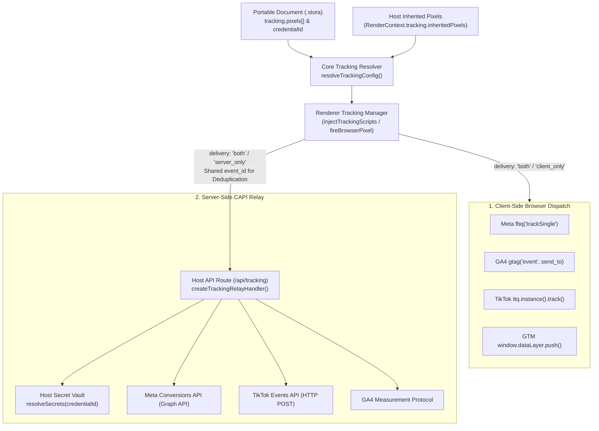
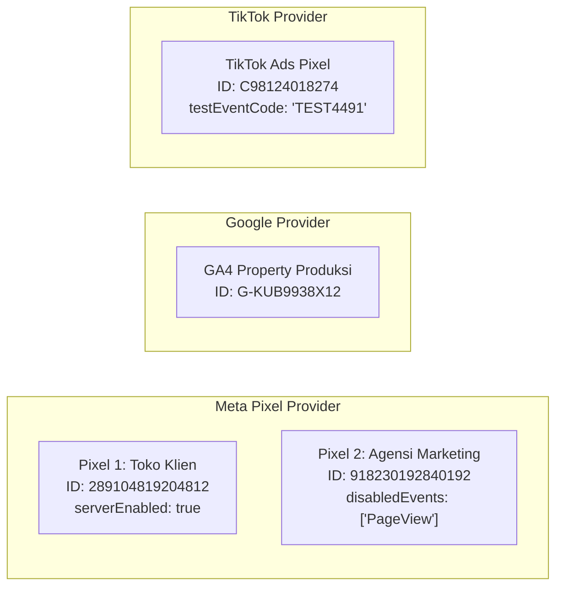
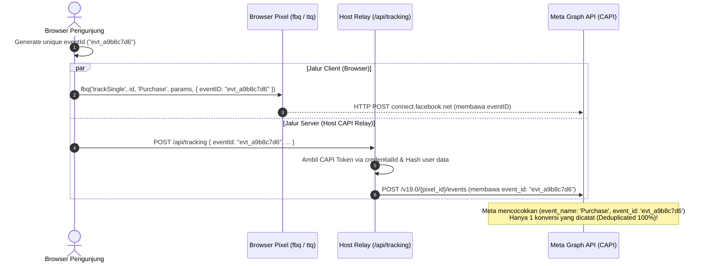

import { Callout } from 'fumadocs-ui/components/callout';
import { Card, Cards } from 'fumadocs-ui/components/card';
import { Tab, Tabs } from 'fumadocs-ui/components/tabs';
import { Accordion, Accordions } from 'fumadocs-ui/components/accordion';
import { TypeTable } from 'fumadocs-ui/components/type-table';
import { InteractiveRenderer } from '@/components/interactive-renderer';

Dalam industri *growth marketing*, e-commerce, dan periklanan digital modern, akurasi pelacakan konversi (*conversion tracking*) adalah faktor penentu efektivitas kampanye, optimalisasi ROAS (*Return on Ad Spend*), serta penurunan CPA (*Cost per Acquisition*).

Namun, arsitektur pelacakan tradisional di web saat ini menghadapi tantangan besar:
1. **Penyusutan Cookie Pihak Ketiga & Ad-Blockers**: Mekanisme privasi browser seperti Apple iOS Safari ITP (*Intelligent Tracking Prevention*), Firefox ETP, serta ekstensi ad-blocker memblokir script tracking client-side hingga 30%–45% dari total traffic.
2. **Double-Counting (Penghitungan Ganda)**: Mengirimkan event secara serentak dari browser dan server tanpa ID deduplikasi yang sinkron menyebabkan platform iklan (seperti Meta dan Google) mencatat konversi dua kali lipat.
3. **Kebocoran Kunci Rahasia (*Secret Leaks*)**: Builder konvensional sering kali menyimpan token API rahasia (seperti Meta Conversions API Access Token atau TikTok Access Token) langsung di dalam dokumen JSON halaman yang diekspor atau dikirim ke browser pengunjung.
4. **Keterbatasan Single-Pixel**: Sebagian besar visual builder hanya mengizinkan 1 Pixel ID per platform, menyulitkan skenario agensi digital marketing yang membutuhkan pixel milik agensi berjalan beriringan dengan pixel milik klien.

**KUBUILD mengatasi seluruh tantangan tersebut melalui arsitektur tracking generasi baru (Stora Schema v1.3.0):**
- **Zero-Secret Security Model**: Dokumen `.stora` bersifat portabel dan bebas rahasia (*zero-secret*). Token CAPI server-side 100% tersimpan di host backend dan diakses via identifier referensi (`credentialId`).
- **Multi-Pixel per Provider**: Mendukung banyak pixel sekaligus per platform (misal 2 Meta Pixel + 1 GA4 + 1 TikTok Pixel pada halaman yang sama).
- **Inherited Pixels dari Host**: Host application (funnel platform / e-commerce SaaS) dapat menurunkan pixel tingkat akun/organisasi ke setiap halaman, dengan opsi pengecualian per-halaman.
- **Unified Hybrid Delivery & Deduplication**: Event browser dan server dikirimkan dengan pasangan `eventId` deterministik yang sama, memastikan deduplikasi akurat di sisi Meta, Google, dan TikTok.

---

## Live Interactive Sandbox

Di bawah ini adalah live sandbox interaktif yang mendemonstrasikan implementasi **Multi-Pixel Tracking** dan **Server CAPI Relay Emulator** langsung di dalam runtime KUBUILD.

<Callout type="info" title="Skenario Pengujian Tracking Emulator">
- **Uji Event AddToCart**: Klik tombol **Beli Sekarang (AddToCart)** pada kartu produk. Perhatikan console log emulator di bawah: event `AddToCart` akan ditembakkan ke **Meta Pixel (Client & Agency)**, **Google Analytics 4**, dan **TikTok Pixel**, serta dikirimkan ke **Server CAPI Relay** dengan `event_id` yang identik!
- **Uji Event Lead dengan Form Data**: Isi formulir **Daftar Webinar Gratis** lalu tekan tombol submit. Perhatikan bahwa event `Lead` otomatis mengekstrak nilai form (`email` dan `phone`) ke dalam payload `userData` yang siap di-hash untuk CAPI.
- **Uji Filter Provider**: Gunakan tombol filter di console (*Meta*, *Google*, *TikTok*, *GTM*, *Server CAPI*) untuk memeriksa detail payload dan snippet fungsi masing-masing provider.
</Callout>

<InteractiveRenderer
  title="Multi-Pixel & CAPI Relay Tracking Emulator"
  height="640px"
  defaultViewport="desktop"
  showJsonToggle={true}
  enableTrackingEmulator={true}
  document={{
    schema: "stora.page",
    version: "1.3.0",
    metadata: {
      title: "Interactive Multi-Pixel Tracking Demo",
      description: "Demonstrasi pelacakan konversi multi-pixel Meta, GA4, TikTok, dan Server CAPI Relay.",
      author: "KUBUILD Core Team",
      tags: ["tracking", "pixel", "capi", "analytics", "meta", "ga4", "tiktok"],
      category: "guides",
      version: "1.0.0",
      createdAt: "2026-11-06T00:00:00.000Z",
      updatedAt: "2026-11-06T00:00:00.000Z"
    },
    tracking: {
      enabled: true,
      debugMode: true,
      autoPageView: true,
      defaultDelivery: "both",
      inherit: {
        enabled: true,
        excludedPixelIds: []
      },
      pixels: [
        {
          id: "px_meta_store",
          provider: "meta",
          label: "Meta Pixel - Toko Utama",
          pixelId: "289104819204812",
          enabled: true,
          serverEnabled: true,
          credentialId: "cred_meta_store_secret",
          testEventCode: "TEST88412",
          disabledEvents: []
        },
        {
          id: "px_meta_agency",
          provider: "meta",
          label: "Meta Pixel - Agensi Growth",
          pixelId: "918230192840192",
          enabled: true,
          serverEnabled: true,
          credentialId: "cred_meta_agency_secret",
          testEventCode: "TEST99201",
          disabledEvents: ["PageView"]
        },
        {
          id: "px_ga4_prod",
          provider: "google",
          label: "Google Analytics 4 Property",
          pixelId: "G-KUB9938X12",
          enabled: true,
          serverEnabled: true,
          credentialId: "cred_ga4_measurement_secret"
        },
        {
          id: "px_gtm_container",
          provider: "gtm",
          label: "GTM Web Container",
          pixelId: "GTM-KB8823V",
          enabled: true
        },
        {
          id: "px_tiktok_ads",
          provider: "tiktok",
          label: "TikTok Performance Pixel",
          pixelId: "C98124018274",
          enabled: true,
          serverEnabled: true,
          credentialId: "cred_tiktok_events_secret",
          testEventCode: "TEST4491"
        }
      ]
    },
    document: {
      id: "root-tracking-demo",
      type: "page",
      props: { title: "Tracking Demo" },
      styles: {
        base: {
          backgroundColor: "#090d16",
          color: "#f1f5f9",
          padding: "32px 20px",
          fontFamily: "Inter, system-ui, -apple-system, sans-serif",
          minHeight: "100%",
          boxSizing: "border-box"
        }
      },
      children: [
        {
          id: "header-container",
          type: "container",
          props: {},
          styles: {
            base: {
              maxWidth: "680px",
              margin: "0 auto 28px auto",
              textAlign: "center"
            }
          },
          children: [
            {
              id: "badge-tag",
              type: "paragraph",
              props: { text: "LIVE EVENT DISPATCH & DEDUPLICATION" },
              styles: {
                base: {
                  fontSize: "11px",
                  fontWeight: "700",
                  letterSpacing: "0.08em",
                  color: "#38bdf8",
                  backgroundColor: "rgba(56, 189, 248, 0.12)",
                  border: "1px solid rgba(56, 189, 248, 0.3)",
                  padding: "4px 12px",
                  borderRadius: "9999px",
                  display: "inline-block",
                  margin: "0 0 12px 0"
                }
              }
            },
            {
              id: "header-title",
              type: "heading",
              props: { level: 2, text: "Uji Coba Tracking Multi-Pixel KUBUILD" },
              styles: {
                base: {
                  fontSize: "24px",
                  fontWeight: "800",
                  color: "#ffffff",
                  letterSpacing: "-0.02em",
                  margin: "0 0 8px 0"
                }
              }
            },
            {
              id: "header-desc",
              type: "paragraph",
              props: { text: "Interaksi tombol dan formulir di bawah ini dikonfigurasikan dengan action runner track_event yang mengirimkan event ke browser pixel dan server relay secara serentak." },
              styles: {
                base: {
                  fontSize: "13px",
                  color: "#94a3b8",
                  lineHeight: "1.5",
                  margin: "0"
                }
              }
            }
          ]
        },
        {
          id: "grid-cards",
          type: "container",
          props: {},
          styles: {
            base: {
              maxWidth: "840px",
              margin: "0 auto",
              display: "grid",
              gridTemplateColumns: "repeat(auto-fit, minmax(320px, 1fr))",
              gap: "20px",
              boxSizing: "border-box"
            }
          },
          children: [
            {
              id: "product-card",
              type: "container",
              props: {},
              styles: {
                base: {
                  backgroundColor: "#131b2e",
                  borderRadius: "14px",
                  padding: "24px",
                  border: "1px solid #1e293b",
                  display: "flex",
                  flexDirection: "column",
                  justifyContent: "space-between",
                  boxShadow: "0 10px 25px -5px rgba(0, 0, 0, 0.3)"
                }
              },
              children: [
                {
                  id: "product-info",
                  type: "container",
                  props: {},
                  styles: { base: { margin: "0 0 20px 0" } },
                  children: [
                    {
                      id: "prod-tag",
                      type: "paragraph",
                      props: { text: "E-COMMERCE ACTION" },
                      styles: { base: { fontSize: "10px", fontWeight: "700", color: "#f59e0b", margin: "0 0 6px 0", letterSpacing: "0.06em" } }
                    },
                    {
                      id: "prod-title",
                      type: "heading",
                      props: { level: 3, text: "Lisensi KUBUILD Pro Enterprise" },
                      styles: { base: { fontSize: "18px", fontWeight: "700", color: "#ffffff", margin: "0 0 6px 0" } }
                    },
                    {
                      id: "prod-price",
                      type: "paragraph",
                      props: { text: "Rp 499.000 / lisensi tahunan" },
                      styles: { base: { fontSize: "15px", fontWeight: "600", color: "#10b981", margin: "0 0 12px 0" } }
                    },
                    {
                      id: "prod-desc",
                      type: "paragraph",
                      props: { text: "Klik tombol AddToCart di bawah untuk menembakkan event keranjang belanja dengan parameter value: 499000, currency: 'IDR', dan content_name." },
                      styles: { base: { fontSize: "12px", color: "#94a3b8", lineHeight: "1.5", margin: "0" } }
                    }
                  ]
                },
                {
                  id: "btn-cart-track",
                  type: "button",
                  props: {
                    label: "Beli Sekarang (AddToCart)"
                  },
                  styles: {
                    base: {
                      width: "100%",
                      padding: "12px 18px",
                      borderRadius: "8px",
                      border: "none",
                      backgroundColor: "#0284c7",
                      color: "#ffffff",
                      fontSize: "13px",
                      fontWeight: "600",
                      cursor: "pointer",
                      textAlign: "center",
                      transition: "background-color 0.15s ease"
                    }
                  },
                  actions: [
                    {
                      id: "act-cart-pipeline",
                      trigger: "click",
                      steps: [
                        {
                          id: "step-track-cart",
                          type: "track_event",
                          payload: {
                            eventName: "AddToCart",
                            provider: "all",
                            delivery: "both",
                            params: {
                              content_name: "Lisensi KUBUILD Pro Enterprise",
                              content_category: "Software Licenses",
                              content_type: "product",
                              value: 499000,
                              currency: "IDR",
                              quantity: 1
                            }
                          }
                        },
                        {
                          id: "step-toast-cart",
                          type: "show_toast",
                          payload: {
                            type: "success",
                            title: "Event AddToCart Terkirim!",
                            message: "Event berhasil dikirim ke Meta, GA4, TikTok & CAPI Relay."
                          }
                        }
                      ]
                    }
                  ]
                }
              ]
            },
            {
              id: "webinar-lead-card",
              type: "container",
              props: {},
              styles: {
                base: {
                  backgroundColor: "#131b2e",
                  borderRadius: "14px",
                  padding: "24px",
                  border: "1px solid #1e293b",
                  boxShadow: "0 10px 25px -5px rgba(0, 0, 0, 0.3)"
                }
              },
              children: [
                {
                  id: "lead-header",
                  type: "container",
                  props: {},
                  styles: { base: { margin: "0 0 16px 0" } },
                  children: [
                    {
                      id: "lead-tag",
                      type: "paragraph",
                      props: { text: "LEAD GENERATION FORM" },
                      styles: { base: { fontSize: "10px", fontWeight: "700", color: "#a855f7", margin: "0 0 6px 0", letterSpacing: "0.06em" } }
                    },
                    {
                      id: "lead-title",
                      type: "heading",
                      props: { level: 3, text: "Daftar Webinar Arsitektur CAPI" },
                      styles: { base: { fontSize: "18px", fontWeight: "700", color: "#ffffff", margin: "0 0 6px 0" } }
                    },
                    {
                      id: "lead-desc",
                      type: "paragraph",
                      props: { text: "Form ini mengikat field input ke payload userData yang dikirim ke CAPI Relay." },
                      styles: { base: { fontSize: "12px", color: "#94a3b8", margin: "0" } }
                    }
                  ]
                },
                {
                  id: "lead-form-node",
                  type: "form",
                  props: {
                    formId: "webinar-lead-form",
                    resetOnSubmit: true
                  },
                  children: [
                    {
                      id: "field-name-group",
                      type: "container",
                      props: {},
                      styles: { base: { margin: "0 0 10px 0" } },
                      children: [
                        {
                          id: "input-name",
                          type: "input",
                          props: {
                            name: "name",
                            type: "text",
                            placeholder: "Nama Lengkap Anda",
                            required: true,
                            rules: [{ type: "required", message: "Nama wajib diisi." }]
                          },
                          styles: {
                            base: {
                              width: "100%",
                              padding: "9px 12px",
                              borderRadius: "6px",
                              border: "1px solid #334155",
                              backgroundColor: "#090d16",
                              color: "#ffffff",
                              fontSize: "12px",
                              outline: "none",
                              boxSizing: "border-box"
                            }
                          }
                        }
                      ]
                    },
                    {
                      id: "field-email-group",
                      type: "container",
                      props: {},
                      styles: { base: { margin: "0 0 14px 0" } },
                      children: [
                        {
                          id: "input-email",
                          type: "input",
                          props: {
                            name: "email",
                            type: "email",
                            placeholder: "nama@perusahaan.com",
                            required: true,
                            rules: [
                              { type: "required", message: "Email wajib diisi." },
                              { type: "email", message: "Format email tidak valid." }
                            ]
                          },
                          styles: {
                            base: {
                              width: "100%",
                              padding: "9px 12px",
                              borderRadius: "6px",
                              border: "1px solid #334155",
                              backgroundColor: "#090d16",
                              color: "#ffffff",
                              fontSize: "12px",
                              outline: "none",
                              boxSizing: "border-box"
                            }
                          }
                        }
                      ]
                    },
                    {
                      id: "btn-submit-lead",
                      type: "button",
                      props: {
                        label: "Daftar Webinar (Lead)",
                        buttonType: "submit"
                      },
                      styles: {
                        base: {
                          width: "100%",
                          padding: "11px 16px",
                          borderRadius: "8px",
                          border: "none",
                          backgroundColor: "#9333ea",
                          color: "#ffffff",
                          fontSize: "13px",
                          fontWeight: "600",
                          cursor: "pointer",
                          textAlign: "center"
                        }
                      },
                      actions: [
                        {
                          id: "act-lead-pipeline",
                          trigger: "click",
                          steps: [
                            {
                              id: "step-track-lead",
                              type: "track_event",
                              payload: {
                                eventName: "Lead",
                                provider: "all",
                                delivery: "both",
                                params: {
                                  content_name: "Webinar Arsitektur Tracking CAPI",
                                  value: 0,
                                  currency: "IDR"
                                },
                                userData: {
                                  email: "{{ form.email }}"
                                }
                              }
                            }
                          ]
                        }
                      ]
                    }
                  ]
                }
              ]
            }
          ]
        }
      ]
    }
  }}
/>

---

## Arsitektur Tracking di KUBUILD

Sistem tracking di KUBUILD dirancang dengan model **desentralisasi keamanan** (*decoupled security*) dan **kemandirian host** (*host-agnostic*). Struktur dokumen `.stora` tidak pernah terikat langsung dengan SDK pihak ketiga tertentu, melainkan mendefinisikan intent pelacakan secara deklaratif.



### 1. Empat Provider Utama yang Didukung

KUBUILD mengintegrasikan 4 provider analitik dan periklanan digital secara *first-class*:

<Cards>
  <Card title="Meta Pixel & Conversions API (CAPI)" icon="Zap">
    Mendukung tracking browser via `fbq('trackSingle', ...)` untuk multi-pixel dan sinkronisasi server-to-server ke Meta Graph API. Mendukung standard events (`AddToCart`, `Purchase`, `Lead`, `CompleteRegistration`, dll.), custom events, dan parameter `testEventCode`.
  </Card>
  <Card title="Google Analytics 4 (GA4)" icon="Activity">
    Mendukung streaming data Google Analytics 4 via `gtag.js` client library (`send_to: 'G-XXXXX'`) dan GA4 Measurement Protocol untuk pencatatan transaksi server-side.
  </Card>
  <Card title="Google Tag Manager (GTM)" icon="Layers">
    Menyuntikkan GTM Container script (`GTM-XXXXXXX`) dan mem-push event ke `window.dataLayer`. GTM beroperasi secara murni di sisi client browser untuk distribusi data ke ribuan tag pihak ketiga.
  </Card>
  <Card title="TikTok Pixel & Events API" icon="Globe">
    Mendukung tracking video ads via `ttq.instance(id).track(...)` multi-instance di browser serta pengiriman transaksi e-commerce langsung ke TikTok Events API v1.3.
  </Card>
</Cards>

---

### 2. Zero-Secret Security Model

Salah satu kerentanan terbesar pada visual web builder adalah penyimpanan rahasia (*secret material*) di dalam file layout. File template `.stora` dirancang agar dapat diekspor, dibagikan sebagai open-source starter, atau disimpan di CDN publik tanpa risiko kebocoran data.

<Callout type="warn" title="Prinsip Keamanan Zero-Secret">
Dokumen `.stora` **HANYA** menyimpan public identifier (`pixelId`, `measurementId`, `containerId`, `credentialId`, `testEventCode`). Kunci rahasia seperti **Meta CAPI Access Token**, **TikTok Access Token**, atau **GA4 API Secret** 100% **TIDAK PERNAH** disimpan di dokumen `.stora` dan **TIDAK PERNAH** dikirimkan ke browser client!
</Callout>

| Data Field | Lokasi Penyimpanan | Boleh Ada di Dokumen `.stora`? | Boleh Dikirim ke Browser? |
| :--- | :--- | :---: | :---: |
| **Pixel ID / Measurement ID / GTM ID** | Public Document | ✅ Ya (Public ID) | ✅ Ya (Diperlukan oleh script tag) |
| **Credential ID (`credentialId`)** | Public Document | ✅ Ya (Opaque Pointer) | ✅ Ya (Hanya ID referensi acak) |
| **Test Event Code (`testEventCode`)** | Public Document | ✅ Ya (Non-secret debug code) | ✅ Ya (Untuk testing di Event Manager) |
| **Meta CAPI System User Access Token** | Host Server Database / KMS | ❌ **DILARANG KERAS** | ❌ **DILARANG KERAS** |
| **TikTok Events API Access Token** | Host Server Database / KMS | ❌ **DILARANG KERAS** | ❌ **DILARANG KERAS** |
| **GA4 Measurement Protocol Secret** | Host Server Environment | ❌ **DILARANG KERAS** | ❌ **DILARANG KERAS** |

Ketika dokumen versi lama (`<= 1.0.0`) yang sempat memuat token rahasia dibaca oleh parser KUBUILD modern, skema Zod `LEGACY_TRACKING_SECRET_KEYS` secara otomatis menghapus (*strip*) token tersebut demi melindungi privasi pengguna.

---

## Setup Pixel di Editor

Penulis halaman (*authors*) dan pemasar dapat mengonfigurasi pixel melalui antarmuka visual terpadu pada **Page Settings -> Tracking Settings Modal**.

### 1. Panel Pengaturan Umum (*General Policies*)

- **Master Toggle (`tracking.enabled`)**: Mengaktifkan atau mematikan seluruh operasi tracking di halaman secara instan tanpa perlu menghapus ID pixel yang sudah terpasang.
- **Debug Mode (`tracking.debugMode`)**: Mencetak log seluruh event yang tertembak ke browser console (`[KUBUILD Tracking]`), mempermudah proses audit sebelum halaman dipublikasikan.
- **Auto PageView (`tracking.autoPageView`)**: Mengaktifkan pelacakan impresi halaman awal secara otomatis saat dokumen dimuat.
- **Default Delivery (`tracking.defaultDelivery`)**: Menentukan kanal default untuk setiap step event: `'both'` (Browser + CAPI), `'client_only'`, atau `'server_only'`.

### 2. Multi-Pixel per Provider (v1.3.0+)

Mulai schema versi `1.3.0`, array `tracking.pixels` mengizinkan jumlah pixel tanpa batas per provider:



Di dalam modal editor:
1. **Saved Pixels Picker (`trackingCredentials`)**: Host aplikasi dapat meneruskan daftar pixel tersimpan milik organisasi ke prop editor `<KubuildEditor trackingCredentials={credentials} />`. Penulis cukup memilih pixel yang diinginkan dari menu dropdown tanpa perlu mengetik ulang ID.
2. **Manual Entry**: Penulis tetap dapat menambahkan pixel baru secara manual jika memiliki ID publik tersendiri.
3. **Per-Pixel Configuration**:
   - `label`: Nama alias yang mudah dikenali (misal: "Pixel Toko Cabang Surabaya").
   - `serverEnabled`: Mengaktifkan pengiriman server-side CAPI untuk pixel ini.
   - `disabledEvents`: Mematikan event tertentu khusus untuk pixel ini (contoh: pixel agensi hanya ingin menerima event `Purchase`, tetapi mengecualikan event `PageView`).

### 3. Inherited Pixels dari Host

Pada aplikasi SaaS multi-tenant (seperti Funnel Builder atau E-commerce Platform), admin workspace sering kali menetapkan pixel global yang harus berlaku di seluruh halaman:

```tsx
// Host meneruskan inheritedPixels ke runtime context
<KubuildRenderer
  document={pageDoc}
  context={createRenderContext({
    tracking: {
      relayUrl: '/api/tracking',
      inheritedPixels: [
        {
          id: 'global-meta-pixel',
          provider: 'meta',
          label: 'Global Funnel Pixel',
          pixelId: '112233445566778',
          enabled: true,
          serverEnabled: true,
          credentialId: 'cred-workspace-global',
        },
      ],
    },
  })}
/>
```

Penulis halaman dapat melihat pixel turunan ini di dalam Tracking Modal dengan label **"Pixels from Workspace"**, dan dapat menonaktifkan pixel tertentu secara spesifik untuk halaman tersebut melalui sakelar *"Use on this page"* (disimpan ke `tracking.inherit.excludedPixelIds`).

---

## Event Triggers & Node Bindings

KUBUILD menyediakan integrasi tracking deklaratif melalui sistem **Action Pipelines**:

### 1. Auto PageView pada Initial Load

Ketika halaman pertama kali dibuka, `@kubuild/renderer` otomatis menginisialisasi pustaka SDK dan menembakkan event `PageView`:
- **Meta**: Memanggil `fbq('trackSingle', pixelId, 'PageView')` ke setiap Meta Pixel aktif.
- **TikTok**: Memanggil `ttq.instance(pixelId).page()` untuk setiap TikTok Pixel.
- **GA4**: Memanggil `gtag('event', 'page_view', { send_to: pixelId })`.
- **GTM**: Ditangani otomatis oleh GTM Container yang disuntikkan.

Jika pixel tertentu mencantumkan `'PageView'` di dalam `disabledEvents`, event initial load untuk pixel tersebut akan dilewati secara otomatis.

---

### 2. Node Click Events (AddToCart / Purchase)

Untuk menembakkan tracking saat tombol diklik, sematkan action step bertipe `track_event` pada node tombol:

<Tabs items={["JSON Action Schema", "Inspector Preview"]}>
  <Tab value="JSON Action Schema">
```json
{
  "id": "btn-checkout",
  "type": "button",
  "props": { "label": "Beli Sekarang (Checkout)" },
  "actions": [
    {
      "id": "act-checkout-click",
      "trigger": "click",
      "steps": [
        {
          "id": "step-track-purchase",
          "type": "track_event",
          "payload": {
            "eventName": "Purchase",
            "provider": "all",
            "delivery": "both",
            "params": {
              "content_name": "Paket Belajar Frontend",
              "content_type": "product",
              "value": 750000,
              "currency": "IDR",
              "num_items": 1
            }
          }
        },
        {
          "id": "step-toast-feedback",
          "type": "show_toast",
          "payload": {
            "type": "success",
            "title": "Pesanan Diproses",
            "message": "Mengarahkan Anda ke gateway pembayaran..."
          }
        }
      ]
    }
  ]
}
```
  </Tab>
  <Tab value="Inspector Preview">
    Di panel kanan editor (**Action Settings**):
    - **Trigger**: Click
    - **Step Type**: Track Event (`track_event`)
    - **Event Name**: `Purchase` (Standard Event)
    - **Provider**: All Providers (`all`)
    - **Delivery Channel**: Both (`both` — Browser Pixel + Server CAPI Relay)
    - **Parameters Table**:
      - `content_name` -> `"Paket Belajar Frontend"`
      - `value` -> `750000`
      - `currency` -> `"IDR"`
  </Tab>
</Tabs>

---

### 3. Form Submit Events (Lead & Interpolasi Data)

Pada formulir penangkapan prospek (*lead capture*), event tracking dapat mengekstrak nilai field input form secara dinamis menggunakan sintaks interpolasi `{{ form.<fieldName> }}`:

```json
{
  "id": "step-track-lead",
  "type": "track_event",
  "payload": {
    "eventName": "Lead",
    "provider": "meta",
    "delivery": "both",
    "params": {
      "content_name": "Pendaftaran E-Book Gratis",
      "value": 0,
      "currency": "IDR"
    },
    "userData": {
      "email": "{{ form.email }}",
      "phone": "{{ form.phone }}"
    }
  }
}
```

Saat user menekan tombol submit:
1. Validator memeriksa keabsahan seluruh field input.
2. `trackEventRunner` mengevaluasi variabel `{{ form.email }}` menjadi email riil pengunjung (misal: `andi@gmail.com`).
3. Browser pixel menembakkan `fbq('trackSingle', pixelId, 'Lead', params, { eventID })`.
4. Server relay menerima payload `userData` dan secara aman melakukan hashing **SHA256** sebelum meneruskannya ke Meta CAPI (*Advanced Matching*), meningkatkan *Event Quality Score* hingga 9.0+/10!

---

## Server-Side CAPI Relay & Event Deduplication

### 1. Mengapa Butuh Server-Side CAPI?

Pelacakan hanya melalui browser (*client-only*) kini tidak lagi mencukupi untuk bisnis yang mengandalkan iklan berbayar:

<Accordions>
  <Accordion title="1. Menembus Ad-Blockers & Ekstensi Anti-Pelacak">
    Ekstensi seperti uBlock Origin atau browser seperti Brave memblokir DNS dan script `connect.facebook.net` secara total. Dengan Server-Side Relay, browser mengirimkan data ke endpoint domain sendiri (misal `https://yourdomain.com/api/tracking`), yang kemudian diteruskan server-to-server ke Meta/TikTok tanpa terhalang ad-blocker.
  </Accordion>
  <Accordion title="2. Mengatasi Pembatasan Apple iOS Safari ITP">
    Apple Safari membatasi masa aktif cookie pihak pertama (*client-side cookie*) hingga maksimal 24 jam–7 hari jika berasal dari klik iklan (mengandung parameter URL `fbclid` atau `ttclid`). Relay server-side menjaga identifikasi visitor tetap persisten.
  </Accordion>
  <Accordion title="3. Melindungi Kunci API Rahasia">
    Panggilan ke Meta Graph API membutuhkan Access Token jangka panjang. Mengirimkan token ini ke browser pengunjung adalah celah keamanan fatal. Relay bertindak sebagai gerbang terisolasi yang menginjeksi token rahasia secara aman di backend.
  </Accordion>
</Accordions>

---

### 2. Mekanisme Event Deduplication

Ketika sebuah event dikonfigurasikan dengan `delivery: 'both'`, event tersebut ditembakkan melalui dua jalur:
1. **Jalur Client**: Browser memanggil `fbq('trackSingle', ..., { eventID: 'evt_123' })`.
2. **Jalur Server Relay**: Browser mengirimkan HTTP POST ke `/api/tracking` dengan payload `{ eventId: 'evt_123', ... }`.



Algoritma deduplikasi KUBUILD:
- Runner mengevaluasi `generateTrackingEventId()` untuk menghasilkan ID alfanumerik acak berbasis timestamp jika author tidak menyediakan custom `eventId`.
- ID ini dibagikan secara bersamaan ke `fireBrowserPixel` dan payload HTTP relay.
- Meta dan TikTok menyimpan jendela deduplikasi selama **48 jam**. Jika kedua event tiba dalam rentang waktu tersebut dengan `event_name` dan `event_id` yang sama, platform iklan akan menggabungkannya menjadi 1 konversi terverifikasi!

---

### 3. Implementasi Host Relay Route (`app/api/tracking/route.ts`)

KUBUILD menyediakan helper Web-standard `createTrackingRelayHandler` di dalam package `@kubuild/core`. Helper ini dapat langsung digunakan pada Next.js App Router, Hono, Bun, Cloudflare Workers, atau framework Node.js lainnya:

```ts title="app/api/tracking/route.ts"
import { createTrackingRelayHandler } from '@kubuild/core';
import { db } from '@/lib/db'; // Database host Anda
import { decryptToken } from '@/lib/crypto'; // Enkripsi KMS host Anda

export const dynamic = 'force-dynamic';

const handler = createTrackingRelayHandler({
  // 1. Muat tracking config terpercaya dari database host (jangan percaya body client!)
  getConfig: async (ctx) => {
    if (!ctx.documentId) return null;
    const page = await db.pages.findUnique({
      where: { id: ctx.documentId },
      select: { trackingConfig: true },
    });
    return page?.trackingConfig ?? null;
  },

  // 2. Resolusi token rahasia server-side via credentialId
  resolveSecrets: async (credentialId, provider) => {
    const cred = await db.credentials.findUnique({
      where: { id: credentialId },
    });
    if (!cred) return null;

    if (provider === 'meta') {
      return {
        capiAccessToken: decryptToken(cred.encryptedAccessToken),
      };
    }
    if (provider === 'tiktok') {
      return {
        accessToken: decryptToken(cred.encryptedAccessToken),
      };
    }
    if (provider === 'google') {
      return {
        measurementProtocolSecret: cred.apiSecret,
      };
    }
    return null;
  },

  // 3. Kebijakan Keamanan: Tolak event Purchase jika hanya ditembak dari browser nakal
  isEventAllowed: (event, ctx) => {
    // Contoh: Cegah manipulasi transaksi palsu dari console browser
    if (event.eventName === 'Purchase' && !event.params?.orderId) {
      return false; // Mengembalikan 403 EVENT_NOT_ALLOWED
    }
    return true;
  },

  // 4. Batasi asal domain pemanggil (CORS)
  allowedOrigins: ['https://tokosaya.com', 'https://app.tokosaya.com'],
});

export { handler as POST, handler as OPTIONS };
```

---

## Privacy, Consent Mode v2 & CSP Whitelist

### 1. Google Consent Mode v2

Untuk mematuhi regulasi privasi global (GDPR di Uni Eropa dan regulasi privasi data internasional), KUBUILD kompatibel dengan **Google Consent Mode v2**.

Sebelum user memberikan persetujuan, tetapkan consent default pada script head aplikasi induk:

```html
<script>
  window.dataLayer = window.dataLayer || [];
  function gtag(){dataLayer.push(arguments);}
  gtag('consent', 'default', {
    'ad_storage': 'denied',
    'ad_user_data': 'denied',
    'ad_personalization': 'denied',
    'analytics_storage': 'denied'
  });
</script>
```

Saat pengunjung menyetujui Cookie Banner (misal mengklik tombol *"Terima Semua Cookie"* pada modal persetujuan):

```ts
// Update status consent secara dinamis
window.gtag?.('consent', 'update', {
  'ad_storage': 'granted',
  'ad_user_data': 'granted',
  'ad_personalization': 'granted',
  'analytics_storage': 'granted',
});
```

SDK Google Analytics 4 dan GTM yang diinjeksi oleh KUBUILD akan otomatis menyesuaikan transmisi cookie sesuai status persetujuan tersebut.

---

### 2. Content Security Policy (CSP) Whitelist

Jika host application menggunakan header keamanan HTTP `Content-Security-Policy`, tambahkan domain resmi berikut agar script tracking dan koneksi CAPI tidak diblokir oleh browser:

```http title="Content-Security-Policy Header Rekomendasi"
Content-Security-Policy:
  default-src 'self';
  script-src 'self' 'unsafe-inline'
    https://connect.facebook.net
    https://www.googletagmanager.com
    https://analytics.tiktok.com;
  connect-src 'self'
    https://connect.facebook.net
    https://www.google-analytics.com
    https://analytics.tiktok.com;
  img-src 'self' data:
    https://www.facebook.com
    https://www.google-analytics.com
    https://analytics.tiktok.com;
```

---

## TypeScript Type Reference

<TypeTable
  type={{
    "TrackingPixel": {
      description: "Objek konfigurasi untuk 1 pixel tracking (v1.3.0+).",
      type: "object",
      properties: {
        id: { description: "ID unik pixel dalam config dokumen.", type: "string" },
        provider: { description: "Penyedia tracking: 'meta' | 'google' | 'gtm' | 'tiktok' | 'custom'.", type: "string" },
        label: { description: "Label deskriptif yang tampil di antarmuka editor.", type: "string?" },
        enabled: { description: "Menyalakan atau mematikan pixel ini secara individual.", type: "boolean" },
        pixelId: { description: "Public identifier: Meta Pixel ID, TikTok ID, GA4 Measurement ID, atau GTM Container ID.", type: "string" },
        credentialId: { description: "ID referensi kredensial host untuk resolusi secret CAPI di backend.", type: "string?" },
        serverEnabled: { description: "Apakah event pixel ini diteruskan ke Server CAPI Relay.", type: "boolean" },
        testEventCode: { description: "Kode uji coba event Meta/TikTok dari Events Manager.", type: "string?" },
        disabledEvents: { description: "Daftar event yang dikecualikan dari pixel ini (misal ['PageView']).", type: "string[]?" }
      }
    },
    "TrackingConfig": {
      description: "Konfigurasi tracking global pada level Dokumen Stora.",
      type: "object",
      properties: {
        enabled: { description: "Master switch untuk seluruh operasi tracking.", type: "boolean" },
        debugMode: { description: "Aktifkan logging verbose ke console browser.", type: "boolean?" },
        autoPageView: { description: "Otomatis menembak PageView saat halaman dimuat.", type: "boolean?" },
        defaultDelivery: { description: "Metode default: 'both' | 'client_only' | 'server_only'.", type: "string?" },
        pixels: { description: "Array daftar pixel aktif pada dokumen.", type: "TrackingPixel[]" },
        inherit: { description: "Aturan pewarisan pixel dari host (enabled & excludedPixelIds).", type: "TrackingInheritConfig?" }
      }
    },
    "TrackEventStepPayload": {
      description: "Payload konfigurasi action step bertipe track_event.",
      type: "object",
      properties: {
        eventName: { description: "Nama event tracking (misal 'AddToCart', 'Purchase', 'Lead').", type: "string" },
        provider: { description: "Target provider: 'all' | 'meta' | 'google' | 'gtm' | 'tiktok'.", type: "string?" },
        delivery: { description: "Kanal pengiriman: 'both' | 'client_only' | 'server_only'.", type: "string?" },
        eventId: { description: "ID deduplikasi kustom opsional. Jika kosong, digenerate otomatis.", type: "string?" },
        pixelIds: { description: "Target pixel ID tertentu (mempersempit cakupan).", type: "string[]?" },
        params: { description: "Parameter event (value, currency, content_name, dll.). Mendukung {{ variables }}.", type: "Record<string, unknown>?" },
        userData: { description: "Data user untuk Advanced Matching CAPI (email, phone, dll.).", type: "Record<string, unknown>?" }
      }
    }
  }}
/>
