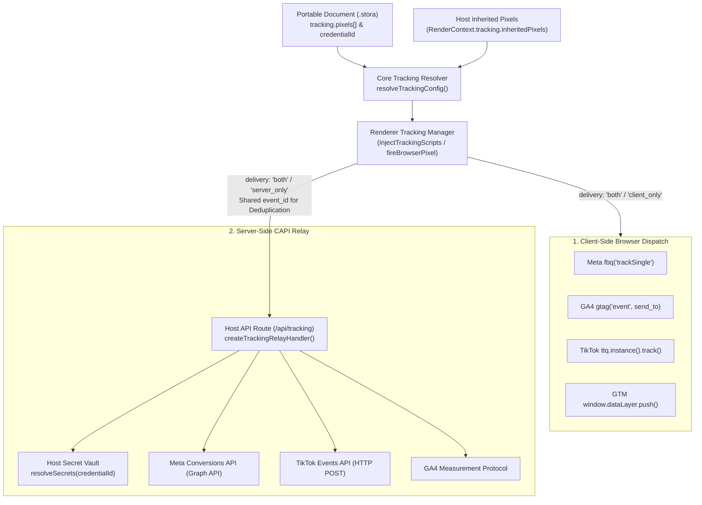
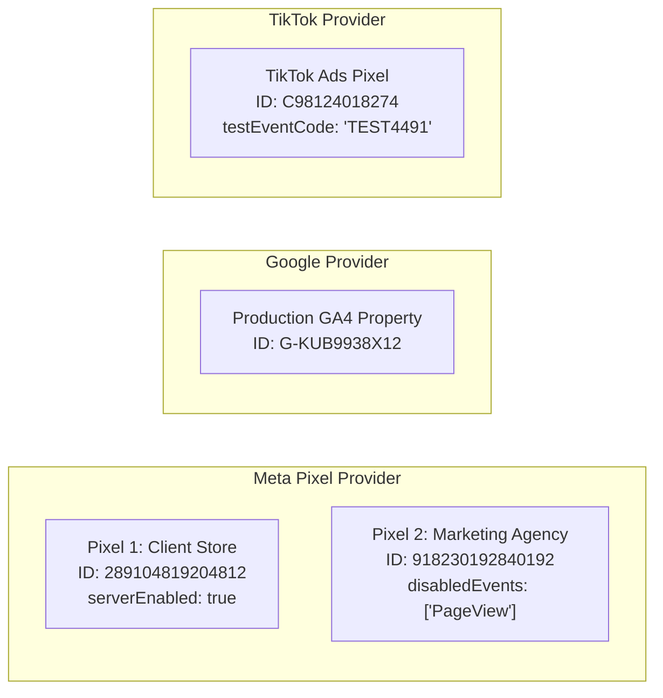
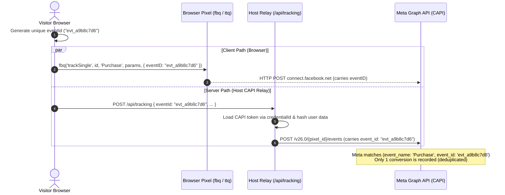

import { Callout } from 'fumadocs-ui/components/callout';
import { Card, Cards } from 'fumadocs-ui/components/card';
import { Tab, Tabs } from 'fumadocs-ui/components/tabs';
import { Accordion, Accordions } from 'fumadocs-ui/components/accordion';
import { TypeTable } from 'fumadocs-ui/components/type-table';
import { InteractiveRenderer } from '@/components/interactive-renderer';

In *growth marketing*, e-commerce, and modern digital advertising, *conversion tracking* accuracy determines campaign effectiveness, ROAS (*Return on Ad Spend*) optimization, and lower CPA (*Cost per Acquisition*).

But traditional web tracking architectures face major challenges:
1. **Shrinking third-party cookies & ad blockers**: browser privacy features such as Apple iOS Safari ITP (*Intelligent Tracking Prevention*), Firefox ETP, and ad-blocker extensions block client-side tracking scripts for 30%–45% of traffic.
2. **Double counting**: sending events from both the browser and the server without synchronized deduplication IDs makes ad platforms (such as Meta and Google) record conversions twice.
3. **Secret leaks**: conventional builders often store secret API tokens (such as the Meta Conversions API access token or TikTok access token) directly in the page JSON that is exported or sent to visitors' browsers.
4. **Single-pixel limits**: most visual builders allow only one pixel ID per platform, which breaks agency scenarios where the agency's pixel must run alongside the client's pixel.

**KUBUILD solves all of these with a new-generation tracking architecture (Stora schema v1.3.0):**
- **Zero-secret security model**: `.stora` documents are portable and *zero-secret*. Server-side CAPI tokens live 100% in the host backend and are referenced by an identifier (`credentialId`).
- **Multiple pixels per provider**: run many pixels per platform at once (e.g. 2 Meta Pixels + 1 GA4 + 1 TikTok Pixel on the same page).
- **Pixels inherited from the host**: the host application (a funnel platform or e-commerce SaaS) can pass account/organization-level pixels down to every page, with per-page exclusions.
- **Unified hybrid delivery & deduplication**: browser and server events share the same deterministic `eventId`, so Meta, Google, and TikTok deduplicate accurately.

---

## Live Interactive Sandbox

Below is an interactive live sandbox that demonstrates **multi-pixel tracking** and a **server CAPI relay emulator** directly inside the KUBUILD runtime.

<Callout type="info" title="Tracking Emulator Test Scenarios">
- **Test the AddToCart event**: click **Buy Now (AddToCart)** on the product card. In the emulator console below, the `AddToCart` event fires to **Meta Pixel (client & agency)**, **Google Analytics 4**, and **TikTok Pixel**, and is sent to the **server CAPI relay** with an identical `event_id`.
- **Test the Lead event with form data**: fill in the **Free Webinar Registration** form and submit it. The `Lead` event automatically extracts the form values (`email` and `phone`) into a `userData` payload ready to be hashed for CAPI.
- **Test provider filters**: use the console filter buttons (*Meta*, *Google*, *TikTok*, *GTM*, *Server CAPI*) to inspect each provider's payload and function snippet.
</Callout>

<InteractiveRenderer
  title="Multi-Pixel & CAPI Relay Tracking Emulator"
  height="640px"
  defaultViewport="desktop"
  showJsonToggle={true}
  enableTrackingEmulator={true}
  document={{
    schema: "stora.page",
    version: "1.3.0",
    metadata: {
      title: "Interactive Multi-Pixel Tracking Demo",
      description: "Multi-pixel conversion tracking demo for Meta, GA4, TikTok, and the server CAPI relay.",
      author: "KUBUILD Core Team",
      tags: ["tracking", "pixel", "capi", "analytics", "meta", "ga4", "tiktok"],
      category: "guides",
      version: "1.0.0",
      createdAt: "2026-11-06T00:00:00.000Z",
      updatedAt: "2026-11-06T00:00:00.000Z"
    },
    tracking: {
      enabled: true,
      debugMode: true,
      autoPageView: true,
      defaultDelivery: "both",
      inherit: {
        enabled: true,
        excludedPixelIds: []
      },
      pixels: [
        {
          id: "px_meta_store",
          provider: "meta",
          label: "Meta Pixel - Main Store",
          pixelId: "289104819204812",
          enabled: true,
          serverEnabled: true,
          credentialId: "cred_meta_store_secret",
          testEventCode: "TEST88412",
          disabledEvents: []
        },
        {
          id: "px_meta_agency",
          provider: "meta",
          label: "Meta Pixel - Growth Agency",
          pixelId: "918230192840192",
          enabled: true,
          serverEnabled: true,
          credentialId: "cred_meta_agency_secret",
          testEventCode: "TEST99201",
          disabledEvents: ["PageView"]
        },
        {
          id: "px_ga4_prod",
          provider: "google",
          label: "Google Analytics 4 Property",
          pixelId: "G-KUB9938X12",
          enabled: true,
          serverEnabled: true,
          credentialId: "cred_ga4_measurement_secret"
        },
        {
          id: "px_gtm_container",
          provider: "gtm",
          label: "GTM Web Container",
          pixelId: "GTM-KB8823V",
          enabled: true
        },
        {
          id: "px_tiktok_ads",
          provider: "tiktok",
          label: "TikTok Performance Pixel",
          pixelId: "C98124018274",
          enabled: true,
          serverEnabled: true,
          credentialId: "cred_tiktok_events_secret",
          testEventCode: "TEST4491"
        }
      ]
    },
    document: {
      id: "root-tracking-demo",
      type: "page",
      props: { title: "Tracking Demo" },
      styles: {
        base: {
          backgroundColor: "#090d16",
          color: "#f1f5f9",
          padding: "32px 20px",
          fontFamily: "Inter, system-ui, -apple-system, sans-serif",
          minHeight: "100%",
          boxSizing: "border-box"
        }
      },
      children: [
        {
          id: "header-container",
          type: "container",
          props: {},
          styles: {
            base: {
              maxWidth: "680px",
              margin: "0 auto 28px auto",
              textAlign: "center"
            }
          },
          children: [
            {
              id: "badge-tag",
              type: "paragraph",
              props: { text: "LIVE EVENT DISPATCH & DEDUPLICATION" },
              styles: {
                base: {
                  fontSize: "11px",
                  fontWeight: "700",
                  letterSpacing: "0.08em",
                  color: "#38bdf8",
                  backgroundColor: "rgba(56, 189, 248, 0.12)",
                  border: "1px solid rgba(56, 189, 248, 0.3)",
                  padding: "4px 12px",
                  borderRadius: "9999px",
                  display: "inline-block",
                  margin: "0 0 12px 0"
                }
              }
            },
            {
              id: "header-title",
              type: "heading",
              props: { level: 2, text: "KUBUILD Multi-Pixel Tracking Test" },
              styles: {
                base: {
                  fontSize: "24px",
                  fontWeight: "800",
                  color: "#ffffff",
                  letterSpacing: "-0.02em",
                  margin: "0 0 8px 0"
                }
              }
            },
            {
              id: "header-desc",
              type: "paragraph",
              props: { text: "The button and form below use the track_event action runner, which sends events to the browser pixels and the server relay at the same time." },
              styles: {
                base: {
                  fontSize: "13px",
                  color: "#94a3b8",
                  lineHeight: "1.5",
                  margin: "0"
                }
              }
            }
          ]
        },
        {
          id: "grid-cards",
          type: "container",
          props: {},
          styles: {
            base: {
              maxWidth: "840px",
              margin: "0 auto",
              display: "grid",
              gridTemplateColumns: "repeat(auto-fit, minmax(320px, 1fr))",
              gap: "20px",
              boxSizing: "border-box"
            }
          },
          children: [
            {
              id: "product-card",
              type: "container",
              props: {},
              styles: {
                base: {
                  backgroundColor: "#131b2e",
                  borderRadius: "14px",
                  padding: "24px",
                  border: "1px solid #1e293b",
                  display: "flex",
                  flexDirection: "column",
                  justifyContent: "space-between",
                  boxShadow: "0 10px 25px -5px rgba(0, 0, 0, 0.3)"
                }
              },
              children: [
                {
                  id: "product-info",
                  type: "container",
                  props: {},
                  styles: { base: { margin: "0 0 20px 0" } },
                  children: [
                    {
                      id: "prod-tag",
                      type: "paragraph",
                      props: { text: "E-COMMERCE ACTION" },
                      styles: { base: { fontSize: "10px", fontWeight: "700", color: "#f59e0b", margin: "0 0 6px 0", letterSpacing: "0.06em" } }
                    },
                    {
                      id: "prod-title",
                      type: "heading",
                      props: { level: 3, text: "KUBUILD Pro Enterprise License" },
                      styles: { base: { fontSize: "18px", fontWeight: "700", color: "#ffffff", margin: "0 0 6px 0" } }
                    },
                    {
                      id: "prod-price",
                      type: "paragraph",
                      props: { text: "$29 / annual license" },
                      styles: { base: { fontSize: "15px", fontWeight: "600", color: "#10b981", margin: "0 0 12px 0" } }
                    },
                    {
                      id: "prod-desc",
                      type: "paragraph",
                      props: { text: "Click the AddToCart button below to fire a cart event with value: 29, currency: 'USD', and content_name." },
                      styles: { base: { fontSize: "12px", color: "#94a3b8", lineHeight: "1.5", margin: "0" } }
                    }
                  ]
                },
                {
                  id: "btn-cart-track",
                  type: "button",
                  props: {
                    label: "Buy Now (AddToCart)"
                  },
                  styles: {
                    base: {
                      width: "100%",
                      padding: "12px 18px",
                      borderRadius: "8px",
                      border: "none",
                      backgroundColor: "#0284c7",
                      color: "#ffffff",
                      fontSize: "13px",
                      fontWeight: "600",
                      cursor: "pointer",
                      textAlign: "center",
                      transition: "background-color 0.15s ease"
                    }
                  },
                  actions: [
                    {
                      id: "act-cart-pipeline",
                      trigger: "click",
                      steps: [
                        {
                          id: "step-track-cart",
                          type: "track_event",
                          payload: {
                            eventName: "AddToCart",
                            provider: "all",
                            delivery: "both",
                            params: {
                              content_name: "KUBUILD Pro Enterprise License",
                              content_category: "Software Licenses",
                              content_type: "product",
                              value: 29,
                              currency: "USD",
                              quantity: 1
                            }
                          }
                        },
                        {
                          id: "step-toast-cart",
                          type: "show_toast",
                          payload: {
                            type: "success",
                            title: "AddToCart Event Sent!",
                            message: "The event was sent to Meta, GA4, TikTok & the CAPI relay."
                          }
                        }
                      ]
                    }
                  ]
                }
              ]
            },
            {
              id: "webinar-lead-card",
              type: "container",
              props: {},
              styles: {
                base: {
                  backgroundColor: "#131b2e",
                  borderRadius: "14px",
                  padding: "24px",
                  border: "1px solid #1e293b",
                  boxShadow: "0 10px 25px -5px rgba(0, 0, 0, 0.3)"
                }
              },
              children: [
                {
                  id: "lead-header",
                  type: "container",
                  props: {},
                  styles: { base: { margin: "0 0 16px 0" } },
                  children: [
                    {
                      id: "lead-tag",
                      type: "paragraph",
                      props: { text: "LEAD GENERATION FORM" },
                      styles: { base: { fontSize: "10px", fontWeight: "700", color: "#a855f7", margin: "0 0 6px 0", letterSpacing: "0.06em" } }
                    },
                    {
                      id: "lead-title",
                      type: "heading",
                      props: { level: 3, text: "CAPI Architecture Webinar Registration" },
                      styles: { base: { fontSize: "18px", fontWeight: "700", color: "#ffffff", margin: "0 0 6px 0" } }
                    },
                    {
                      id: "lead-desc",
                      type: "paragraph",
                      props: { text: "This form binds its input fields to the userData payload sent to the CAPI relay." },
                      styles: { base: { fontSize: "12px", color: "#94a3b8", margin: "0" } }
                    }
                  ]
                },
                {
                  id: "lead-form-node",
                  type: "form",
                  props: {
                    formId: "webinar-lead-form",
                    resetOnSubmit: true
                  },
                  children: [
                    {
                      id: "field-name-group",
                      type: "container",
                      props: {},
                      styles: { base: { margin: "0 0 10px 0" } },
                      children: [
                        {
                          id: "input-name",
                          type: "input",
                          props: {
                            name: "name",
                            type: "text",
                            placeholder: "Your full name",
                            required: true,
                            rules: [{ type: "required", message: "Name is required." }]
                          },
                          styles: {
                            base: {
                              width: "100%",
                              padding: "9px 12px",
                              borderRadius: "6px",
                              border: "1px solid #334155",
                              backgroundColor: "#090d16",
                              color: "#ffffff",
                              fontSize: "12px",
                              outline: "none",
                              boxSizing: "border-box"
                            }
                          }
                        }
                      ]
                    },
                    {
                      id: "field-email-group",
                      type: "container",
                      props: {},
                      styles: { base: { margin: "0 0 14px 0" } },
                      children: [
                        {
                          id: "input-email",
                          type: "input",
                          props: {
                            name: "email",
                            type: "email",
                            placeholder: "nama@perusahaan.com",
                            required: true,
                            rules: [
                              { type: "required", message: "Email is required." },
                              { type: "email", message: "Invalid email format." }
                            ]
                          },
                          styles: {
                            base: {
                              width: "100%",
                              padding: "9px 12px",
                              borderRadius: "6px",
                              border: "1px solid #334155",
                              backgroundColor: "#090d16",
                              color: "#ffffff",
                              fontSize: "12px",
                              outline: "none",
                              boxSizing: "border-box"
                            }
                          }
                        }
                      ]
                    },
                    {
                      id: "btn-submit-lead",
                      type: "button",
                      props: {
                        label: "Register for the Webinar (Lead)",
                        buttonType: "submit"
                      },
                      styles: {
                        base: {
                          width: "100%",
                          padding: "11px 16px",
                          borderRadius: "8px",
                          border: "none",
                          backgroundColor: "#9333ea",
                          color: "#ffffff",
                          fontSize: "13px",
                          fontWeight: "600",
                          cursor: "pointer",
                          textAlign: "center"
                        }
                      },
                      actions: [
                        {
                          id: "act-lead-pipeline",
                          trigger: "click",
                          steps: [
                            {
                              id: "step-track-lead",
                              type: "track_event",
                              payload: {
                                eventName: "Lead",
                                provider: "all",
                                delivery: "both",
                                params: {
                                  content_name: "CAPI Tracking Architecture Webinar",
                                  value: 0,
                                  currency: "USD"
                                },
                                userData: {
                                  email: "{{ form.email }}"
                                }
                              }
                            }
                          ]
                        }
                      ]
                    }
                  ]
                }
              ]
            }
          ]
        }
      ]
    }
  }}
/>

---

## Tracking Architecture in KUBUILD

KUBUILD tracking is designed around *decoupled security* and *host-agnostic* principles. The `.stora` document is never tied to a specific third-party SDK; it declares tracking intent declaratively.



### 1. Four First-Class Providers

KUBUILD integrates four analytics and digital advertising providers *first-class*:

<Cards>
  <Card title="Meta Pixel & Conversions API (CAPI)" icon="Zap">
    Browser tracking via `fbq('trackSingle', ...)` for multi-pixel setups and server-to-server sync with the Meta Graph API. Supports standard events (`AddToCart`, `Purchase`, `Lead`, `CompleteRegistration`, etc.), custom events, and the `testEventCode` parameter.
  </Card>
  <Card title="Google Analytics 4 (GA4)" icon="Activity">
    Streams Google Analytics 4 data via the `gtag.js` client library (`send_to: 'G-XXXXX'`) and the GA4 Measurement Protocol for server-side transaction recording.
  </Card>
  <Card title="Google Tag Manager (GTM)" icon="Layers">
    Injects the GTM container script (`GTM-XXXXXXX`) and pushes events to `window.dataLayer`. GTM runs purely in the browser and distributes data to thousands of third-party tags.
  </Card>
  <Card title="TikTok Pixel & Events API" icon="Globe">
    Tracks video ads via multi-instance `ttq.instance(id).track(...)` in the browser and sends e-commerce transactions directly to TikTok Events API v1.3.
  </Card>
</Cards>

---

### 2. Zero-Secret Security Model

One of the biggest weaknesses of visual web builders is storing *secret material* in layout files. `.stora` templates are designed to be exported, shared as open-source starters, or stored on a public CDN without any risk of leaking data.

<Callout type="warn" title="Zero-Secret Security Principle">
`.stora` documents store **ONLY** public identifiers (`pixelId`, `measurementId`, `containerId`, `credentialId`, `testEventCode`). Secrets such as the **Meta CAPI access token**, **TikTok access token**, or **GA4 API secret** are **NEVER** stored in `.stora` documents and **NEVER** sent to the browser.
</Callout>

| Data Field | Storage Location | Allowed in the `.stora` Document? | Allowed in the Browser? |
| :--- | :--- | :---: | :---: |
| **Pixel ID / Measurement ID / GTM ID** | Public document | ✅ Yes (public ID) | ✅ Yes (required by the script tag) |
| **Credential ID (`credentialId`)** | Public document | ✅ Yes (opaque pointer) | ✅ Yes (random reference ID only) |
| **Test Event Code (`testEventCode`)** | Public document | ✅ Yes (non-secret debug code) | ✅ Yes (for testing in Events Manager) |
| **Meta CAPI System User Access Token** | Host server database / KMS | ❌ **STRICTLY FORBIDDEN** | ❌ **STRICTLY FORBIDDEN** |
| **TikTok Events API Access Token** | Host server database / KMS | ❌ **STRICTLY FORBIDDEN** | ❌ **STRICTLY FORBIDDEN** |
| **GA4 Measurement Protocol Secret** | Host server environment | ❌ **STRICTLY FORBIDDEN** | ❌ **STRICTLY FORBIDDEN** |

When an older document (`<= 1.0.0`) that contained secret tokens is read by a modern KUBUILD parser, the importer's tracking sanitizer strips every key listed in `LEGACY_TRACKING_SECRET_KEYS` to protect users.

---

## Setup Pixel di Editor

Page authors and marketers configure pixels through a unified visual interface in **Page Settings → Tracking Settings modal**.

### 1. General Policies Panel

- **Master toggle (`tracking.enabled`)**: turns all tracking on the page on or off instantly without deleting configured pixel IDs.
- **Debug mode (`tracking.debugMode`)**: logs every fired event to the browser console (`[KUBUILD Tracking]`), making audits before publishing easier.
- **Auto PageView (`tracking.autoPageView`)**: automatically tracks the initial page impression when the document loads.
- **Default delivery (`tracking.defaultDelivery`)**: the default channel for every event step: `'both'` (browser + CAPI), `'client_only'`, or `'server_only'`.

### 2. Multi-Pixel per Provider (v1.3.0+)

Since schema version `1.3.0`, the `tracking.pixels` array allows any number of pixels per provider:



In the editor modal:
1. **Saved pixels picker (`trackingCredentials`)**: the host app can pass the organization's saved pixels to the editor prop `<KubuildEditor trackingCredentials={credentials} />`. Authors pick a pixel from the dropdown without retyping IDs.
2. **Manual entry**: authors can still add a new pixel manually if they have their own public ID.
3. **Per-Pixel Configuration**:
   - `label`: an easy-to-recognize alias (e.g. "Downtown Branch Store Pixel").
   - `serverEnabled`: enables server-side CAPI delivery for this pixel.
   - `disabledEvents`: turns off specific events for this pixel only (e.g. an agency pixel that wants `Purchase` but not `PageView`).

### 3. Pixels Inherited from the Host

In multi-tenant SaaS apps (such as funnel builders or e-commerce platforms), workspace admins often set global pixels that must apply to every page:

```tsx
// The host passes inheritedPixels to the runtime context
<KubuildRenderer
  document={pageDoc}
  context={createRenderContext({
    tracking: {
      relayUrl: '/api/tracking',
      inheritedPixels: [
        {
          id: 'global-meta-pixel',
          provider: 'meta',
          label: 'Global Funnel Pixel',
          pixelId: '112233445566778',
          enabled: true,
          serverEnabled: true,
          credentialId: 'cred-workspace-global',
        },
      ],
    },
  })}
/>
```

Authors see these inherited pixels in the Tracking modal labeled **"Pixels from Workspace"**, and can turn a specific pixel off for one page with the *"Use on this page"* switch (stored in `tracking.inherit.excludedPixelIds`).

---

## Event Triggers & Node Bindings

KUBUILD provides declarative tracking through the **action pipeline** system:

### 1. Auto PageView on Initial Load

When the page first opens, `@kubuild/renderer` automatically initializes the SDKs and fires a `PageView` event:
- **Meta**: calls `fbq('trackSingle', pixelId, 'PageView')` for every active Meta Pixel.
- **TikTok**: calls `ttq.instance(pixelId).page()` for every TikTok Pixel.
- **GA4**: calls `gtag('event', 'page_view', { send_to: pixelId })`.
- **GTM**: handled automatically by the injected GTM container.

If a pixel lists `'PageView'` in `disabledEvents`, the initial-load event is skipped for that pixel.

---

### 2. Node Click Events (AddToCart / Purchase)

To track a button click, add a `track_event` action step to the button node:

<Tabs items={["JSON Action Schema", "Inspector Preview"]}>
  <Tab value="JSON Action Schema">
```json
{
  "id": "btn-checkout",
  "type": "button",
  "props": { "label": "Buy Now (Checkout)" },
  "actions": [
    {
      "id": "act-checkout-click",
      "trigger": "click",
      "steps": [
        {
          "id": "step-track-purchase",
          "type": "track_event",
          "payload": {
            "eventName": "Purchase",
            "provider": "all",
            "delivery": "both",
            "params": {
              "content_name": "Frontend Learning Bundle",
              "content_type": "product",
              "value": 49,
              "currency": "USD",
              "num_items": 1
            }
          }
        },
        {
          "id": "step-toast-feedback",
          "type": "show_toast",
          "payload": {
            "type": "success",
            "title": "Processing Your Order",
            "message": "Redirecting you to the payment gateway..."
          }
        }
      ]
    }
  ]
}
```
  </Tab>
  <Tab value="Inspector Preview">
    In the editor's right panel (**Action Settings**):
    - **Trigger**: Click
    - **Step Type**: Track Event (`track_event`)
    - **Event Name**: `Purchase` (Standard Event)
    - **Provider**: All Providers (`all`)
    - **Delivery Channel**: Both (`both` — Browser Pixel + Server CAPI Relay)
    - **Parameters Table**:
      - `content_name` -> `"Frontend Learning Bundle"`
      - `value` -> `49`
      - `currency` -> `"USD"`
  </Tab>
</Tabs>

---

### 3. Form Submit Events (Lead & Data Interpolation)

On *lead capture* forms, tracking events can extract form field values dynamically with the `{{ form.<fieldName> }}` interpolation syntax:

```json
{
  "id": "step-track-lead",
  "type": "track_event",
  "payload": {
    "eventName": "Lead",
    "provider": "meta",
    "delivery": "both",
    "params": {
      "content_name": "Free E-Book Signup",
      "value": 0,
      "currency": "USD"
    },
    "userData": {
      "email": "{{ form.email }}",
      "phone": "{{ form.phone }}"
    }
  }
}
```

When the user submits:
1. The validator checks every input field.
2. `trackEventRunner` resolves `{{ form.email }}` to the visitor's real email (e.g. `jordan@example.com`).
3. The browser pixel fires `fbq('trackSingle', pixelId, 'Lead', params, { eventID })`.
4. The server relay receives the `userData` payload and hashes it with **SHA-256** before forwarding it to Meta CAPI (*Advanced Matching*), which improves the *Event Match Quality* score.

---

## Server-Side CAPI Relay & Event Deduplication

### 1. Why Server-Side CAPI?

Browser-only (*client-only*) tracking is no longer enough for businesses that depend on paid ads:

<Accordions>
  <Accordion title="1. Getting Past Ad Blockers & Anti-Tracking Extensions">
    Extensions like uBlock Origin or browsers like Brave block the `connect.facebook.net` DNS and scripts entirely. With a server-side relay, the browser sends data to your own domain (e.g. `https://yourdomain.com/api/tracking`), which forwards it server-to-server to Meta/TikTok without being blocked.
  </Accordion>
  <Accordion title="2. Working Around Apple iOS Safari ITP">
    Apple Safari limits first-party (*client-side*) cookie lifetime to 24 hours–7 days when the visit comes from an ad click (URLs with `fbclid` or `ttclid`). A server-side relay keeps visitor identification persistent.
  </Accordion>
  <Accordion title="3. Protecting Secret API Keys">
    Calls to the Meta Graph API need a long-lived access token. Sending that token to visitors' browsers is a fatal security hole. The relay acts as an isolated gateway that injects the secret token safely on the backend.
  </Accordion>
</Accordions>

---

### 2. Event Deduplication

When an event is configured with `delivery: 'both'`, it is fired through two paths:
1. **Client path**: the browser calls `fbq('trackSingle', ..., { eventID: 'evt_123' })`.
2. **Server relay path**: the browser sends an HTTP POST to `/api/tracking` with the payload `{ eventId: 'evt_123', ... }`.



KUBUILD's deduplication algorithm:
- The runner calls `generateTrackingEventId()` to produce a random timestamp-based alphanumeric ID when the author doesn't provide a custom `eventId`.
- The same ID is shared with `fireBrowserPixel` and the HTTP relay payload.
- Meta and TikTok keep a **48-hour** deduplication window. If both events arrive within that window with the same `event_name` and `event_id`, the ad platform merges them into one verified conversion.

---

### 3. Host Relay Route (`app/api/tracking/route.ts`)

KUBUILD provides the Web-standard `createTrackingRelayHandler` helper in `@kubuild/core`. It works directly with the Next.js App Router, Hono, Bun, Cloudflare Workers, or any other Node.js framework:

```ts title="app/api/tracking/route.ts"
import { createTrackingRelayHandler } from '@kubuild/core';
import { db } from '@/lib/db'; // Your host database
import { decryptToken } from '@/lib/crypto'; // Your host KMS decryption

export const dynamic = 'force-dynamic';

const handler = createTrackingRelayHandler({
  // 1. Load the trusted tracking config from the host database (never trust the client body!)
  getConfig: async (ctx) => {
    if (!ctx.documentId) return null;
    const page = await db.pages.findUnique({
      where: { id: ctx.documentId },
      select: { trackingConfig: true },
    });
    return page?.trackingConfig ?? null;
  },

  // 2. Resolve server-side secrets via credentialId
  resolveSecrets: async ({ credentialId, provider }) => {
    if (!credentialId) return null;
    const cred = await db.credentials.findUnique({
      where: { id: credentialId },
    });
    if (!cred) return null;

    if (provider === 'meta') {
      return {
        capiAccessToken: decryptToken(cred.encryptedAccessToken),
      };
    }
    if (provider === 'tiktok') {
      return {
        accessToken: decryptToken(cred.encryptedAccessToken),
      };
    }
    if (provider === 'google') {
      return {
        measurementProtocolSecret: cred.apiSecret,
      };
    }
    return null;
  },

  // 3. Security policy: reject Purchase events fired only from a tampered browser
  isEventAllowed: (event, ctx) => {
    // Example: prevent fake transactions injected from the browser console
    if (event.eventName === 'Purchase' && !event.params?.orderId) {
      return false; // Returns 403 EVENT_NOT_ALLOWED
    }
    return true;
  },

  // 4. Restrict allowed caller origins (CORS)
  allowedOrigins: ['https://tokosaya.com', 'https://app.tokosaya.com'],
});

export { handler as POST, handler as OPTIONS };
```

---

## Privacy, Consent Mode v2 & CSP Whitelist

### 1. Google Consent Mode v2

To comply with global privacy regulations (the EU's GDPR and international data privacy rules), KUBUILD is compatible with **Google Consent Mode v2**.

Before the user gives consent, set the default consent in the host app's head script:

```html
<script>
  window.dataLayer = window.dataLayer || [];
  function gtag(){dataLayer.push(arguments);}
  gtag('consent', 'default', {
    'ad_storage': 'denied',
    'ad_user_data': 'denied',
    'ad_personalization': 'denied',
    'analytics_storage': 'denied'
  });
</script>
```

When the visitor accepts the cookie banner (e.g. by clicking *"Accept All Cookies"* in the consent modal):

```ts
// Update the consent status dynamically
window.gtag?.('consent', 'update', {
  'ad_storage': 'granted',
  'ad_user_data': 'granted',
  'ad_personalization': 'granted',
  'analytics_storage': 'granted',
});
```

The Google Analytics 4 and GTM SDKs injected by KUBUILD automatically adjust cookie transmission to match the consent status.

---

### 2. Content Security Policy (CSP) Whitelist

If the host application uses an HTTP `Content-Security-Policy` header, add these official domains so tracking scripts and CAPI connections aren't blocked:

```http title="Content-Security-Policy Header Rekomendasi"
Content-Security-Policy:
  default-src 'self';
  script-src 'self' 'unsafe-inline'
    https://connect.facebook.net
    https://www.googletagmanager.com
    https://analytics.tiktok.com;
  connect-src 'self'
    https://connect.facebook.net
    https://www.google-analytics.com
    https://analytics.tiktok.com;
  img-src 'self' data:
    https://www.facebook.com
    https://www.google-analytics.com
    https://analytics.tiktok.com;
```

---

## TypeScript Type Reference

<TypeTable
  type={{
    "TrackingPixel": {
      description: "Configuration object for one tracking pixel (v1.3.0+).",
      type: "object",
      properties: {
        id: { description: "Unique pixel ID within the document config.", type: "string" },
        provider: { description: "Tracking provider: 'meta' | 'google' | 'gtm' | 'tiktok' | 'custom'.", type: "string" },
        label: { description: "Descriptive label shown in the editor UI.", type: "string?" },
        enabled: { description: "Turns this pixel on or off individually.", type: "boolean" },
        pixelId: { description: "Public identifier: Meta Pixel ID, TikTok ID, GA4 Measurement ID, or GTM Container ID.", type: "string" },
        credentialId: { description: "Host credential reference ID used to resolve CAPI secrets on the backend.", type: "string?" },
        serverEnabled: { description: "Whether this pixel's events are forwarded to the server CAPI relay.", type: "boolean" },
        testEventCode: { description: "Meta/TikTok test event code from Events Manager.", type: "string?" },
        disabledEvents: { description: "Events excluded for this pixel (e.g. ['PageView']).", type: "string[]?" }
      }
    },
    "TrackingConfig": {
      description: "Document-level global tracking configuration.",
      type: "object",
      properties: {
        enabled: { description: "Master switch for all tracking.", type: "boolean" },
        debugMode: { description: "Enable verbose logging to the browser console.", type: "boolean?" },
        autoPageView: { description: "Automatically fire PageView when the page loads.", type: "boolean?" },
        defaultDelivery: { description: "Default delivery: 'both' | 'client_only' | 'server_only'.", type: "string?" },
        pixels: { description: "Array of active pixels in the document.", type: "TrackingPixel[]" },
        inherit: { description: "Rules for inheriting host pixels (enabled & excludedPixelIds).", type: "TrackingInheritConfig?" }
      }
    },
    "TrackEventStepPayload": {
      description: "Payload configuration for a track_event action step.",
      type: "object",
      properties: {
        eventName: { description: "Tracking event name (e.g. 'AddToCart', 'Purchase', 'Lead').", type: "string" },
        provider: { description: "Target provider: 'all' | 'meta' | 'google' | 'gtm' | 'tiktok'.", type: "string?" },
        delivery: { description: "Delivery channel: 'both' | 'client_only' | 'server_only'.", type: "string?" },
        eventId: { description: "Optional custom deduplication ID. Generated automatically when empty.", type: "string?" },
        pixelIds: { description: "Target specific pixel IDs (narrows the scope).", type: "string[]?" },
        params: { description: "Event parameters (value, currency, content_name, etc.). Supports {{ variables }}.", type: "Record<string, unknown>?" },
        userData: { description: "User data for CAPI Advanced Matching (email, phone, etc.).", type: "Record<string, unknown>?" }
      }
    }
  }}
/>
