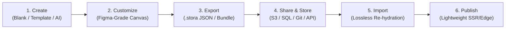

import { Callout } from 'fumadocs-ui/components/callout';
import { Card, Cards } from 'fumadocs-ui/components/card';
import { Tab, Tabs } from 'fumadocs-ui/components/tabs';
import { Accordion, Accordions } from 'fumadocs-ui/components/accordion';

## What is KUBUILD?

**KUBUILD is an open-source, MIT-licensed page builder engine that you embed in your own React app.** It gives your users a visual drag-and-drop editor, saves every page as a portable, Zod-validated JSON document (the `.stora` format) in *your* database, and renders that document on the server with a lightweight React renderer. It is built and maintained by [Kustora](https://github.com/kustora).

### KUBUILD at a glance

| | |
| :--- | :--- |
| **What it is** | An embeddable page builder engine (library), not a hosted website builder |
| **License** | MIT, free and open source |
| **Language** | TypeScript |
| **Framework** | React 18+ for the editor and renderer; `@kubuild/schema` and `@kubuild/core` run without React |
| **Page format** | `.stora`: plain JSON validated by Zod schemas, versioned with built-in migrations |
| **Storage** | Any: PostgreSQL, MongoDB, S3, Cloudflare R2, Git, or the filesystem |
| **Packages** | `@kubuild/react`, `schema`, `core`, `components`, `renderer`, `editor`, `ai` (7 total) |
| **Best for** | SaaS apps, internal marketing portals, ecommerce stores, and headless CMSs that need a page builder they control |

## Introduction

**KUBUILD** is an open, modular, and backend-agnostic web page builder and visual layout engine designed for the modern web. It provides everything developers and product teams need to build, edit, preview, and distribute rich visual web documents without locking their architecture into proprietary CMS backends, monolithic databases, or rigid hosting platforms.

At the core of KUBUILD is a simple, uncompromising ethos:

> **"Build once, render anywhere, portable `.stora` format."**

Every page, layout, block, and style created with KUBUILD is compiled into a deterministic, strictly-typed Abstract Syntax Tree (AST) known as the **`.stora` document format**. Because `.stora` documents are pure JSON data validated against robust Zod schemas, they can be stored anywhere (PostgreSQL, SQLite, S3, Cloudflare R2, Redis, or Git), transmitted over any protocol, edited via browser visual editors, and rendered headlessly on any server or edge runtime.

<Screenshot
  src="/screenshots/editor/editor-inspector.webp"
  alt="The KUBUILD visual editor with a selected heading"
  caption="The KUBUILD editor: drag components onto the canvas, select a node, and edit it in the inspector."
/>

<Callout type="info" title="Portable by Design">
  KUBUILD is intentionally decoupled from Stora.page, arbitrary backend APIs, and specific databases. Stora.page is simply one consumer of KUBUILD. You can embed KUBUILD into your own SaaS, internal marketing portal, ecommerce store, or headless CMS.
</Callout>

---

## The Document Lifecycle

KUBUILD treats web pages as **portable document assets** rather than transient database rows or hardcoded markup. The entire lifecycle is designed to be frictionless, reproducible, and lossless:



<div className="grid grid-cols-1 md:grid-cols-2 lg:grid-cols-3 gap-4 my-6">
  <div className="p-4 rounded-xl border border-border/80 bg-card/50">
    <div className="text-xs font-semibold text-primary uppercase tracking-wider mb-1">Step 1</div>
    <div className="text-base font-semibold text-foreground mb-1">Create</div>
    <p className="text-sm text-muted-foreground">
      Bootstrap new pages from a blank slate, pre-built responsive marketing templates, or AI generative prompts via `@kubuild/ai`.
    </p>
  </div>
  <div className="p-4 rounded-xl border border-border/80 bg-card/50">
    <div className="text-xs font-semibold text-primary uppercase tracking-wider mb-1">Step 2</div>
    <div className="text-base font-semibold text-foreground mb-1">Customize</div>
    <p className="text-sm text-muted-foreground">
      Design visually with Auto Layout (Flexbox), CSS Grid, 8-point handles, intelligent snapping, and responsive viewport cascading.
    </p>
  </div>
  <div className="p-4 rounded-xl border border-border/80 bg-card/50">
    <div className="text-xs font-semibold text-primary uppercase tracking-wider mb-1">Step 3</div>
    <div className="text-base font-semibold text-foreground mb-1">Export</div>
    <p className="text-sm text-muted-foreground">
      Serialize the live document into a versioned, portable `.stora` JSON format with zero runtime artifacts or vendor baggage.
    </p>
  </div>
  <div className="p-4 rounded-xl border border-border/80 bg-card/50">
    <div className="text-xs font-semibold text-primary uppercase tracking-wider mb-1">Step 4</div>
    <div className="text-base font-semibold text-foreground mb-1">Share & Store</div>
    <p className="text-sm text-muted-foreground">
      Store the document in your preferred persistence layer: PostgreSQL JSONB, MongoDB, Redis, AWS S3, Cloudflare R2, or disk.
    </p>
  </div>
  <div className="p-4 rounded-xl border border-border/80 bg-card/50">
    <div className="text-xs font-semibold text-primary uppercase tracking-wider mb-1">Step 5</div>
    <div className="text-base font-semibold text-foreground mb-1">Import</div>
    <p className="text-sm text-muted-foreground">
      Hydrate `.stora` documents into any KUBUILD editor instance. Editability is 100% preserved with full schema migration guarantees.
    </p>
  </div>
  <div className="p-4 rounded-xl border border-border/80 bg-card/50">
    <div className="text-xs font-semibold text-primary uppercase tracking-wider mb-1">Step 6</div>
    <div className="text-base font-semibold text-foreground mb-1">Publish</div>
    <p className="text-sm text-muted-foreground">
      Render pages using `@kubuild/renderer` on Edge Workers, Next.js SSR, or static site generators with zero visual editor overhead.
    </p>
  </div>
</div>

---

## Why KUBUILD? Architectural Comparison

Traditional web page builders force a painful compromise between **developer freedom** and **visual authoring speed**. KUBUILD was built from the ground up to eliminate that tradeoff.

| Dimension | Traditional CMS (WordPress, Webflow) | Monolithic Builders (GrapesJS) | KUBUILD |
| :--- | :--- | :--- | :--- |
| **Data Format** | Proprietary SQL tables, shortcodes, or vendor cloud | Raw, unvalidated HTML string & CSS dumps | **Strict `.stora` JSON AST** validated by Zod schemas |
| **Vendor Lock-in** | High (tied to vendor hosting, PHP runtime, or SaaS cloud) | Low-to-Medium (locked to browser DOM mutations) | **Zero Lock-in** (runs in any storage, cloud, or edge) |
| **Core Decoupling** | Monolithic (backend, DB, and UI tightly bound) | DOM-coupled (cannot easily execute headless in Node.js) | **Pure TypeScript Core** with zero UI/DOM dependencies |
| **Production Bundle** | Heavy CMS runtime & database query overhead | Heavy bundle containing canvas & editor artifacts | **Ultra-lightweight Renderer** (~30-40 KB gzipped) |
| **Layout Mechanics** | Legacy float/block or rigid proprietary grids | Basic drag-and-drop with absolute/block styles | **Figma-grade Auto Layout & Visual CSS Grid** |
| **Dynamic Data** | Vendor plugins, shortcodes, or database hooks | Custom DOM string replacements | **First-class dynamic variables, catalog, & forms** |
| **AI Integration** | Proprietary add-on or generic copy-paste | External plugin scripts | **Native `@kubuild/ai` streaming AST generation** |

### The Problem with Traditional Solutions
1. **CMS Lock-In**: WordPress, Webflow, and Shopify tie page layouts directly to their database schemas and hosting infrastructure. Migrating a landing page to a new tech stack requires manual reconstruction.
2. **Monolithic Editor Bloat**: Traditional embeddable builders bundle the visual canvas, drag-and-drop event listeners, property inspectors, and toolbar UI into a single monolithic package. Including the builder in a public-facing website ruins Core Web Vitals and Lighthouse scores.
3. **Fragile HTML String Dumps**: Builders that export raw HTML/CSS strings make programmatic analysis, security sanitization, and responsive refactoring nearly impossible.

### The KUBUILD Approach
KUBUILD separates **Document Schema**, **Pure Core Logic**, **Runtime Rendering**, and **Visual Canvas Authoring** into independent, modular packages. You ship only what each environment actually needs.

---

## The Four Architectural Pillars

KUBUILD's architecture is anchored on four foundational pillars designed to ensure long-term stability, performance, and developer ergonomics:

```
                      ┌──────────────────────────────────────┐
                      │    1. Document Schema (.stora)       │
                      │  Zod Validated • Strict Single Source│
                      └──────────────────┬───────────────────┘
                                         │
                      ┌──────────────────┴───────────────────┐
                      │       2. Pure TypeScript Core        │
                      │   Headless • Zero UI/DOM Dependencies │
                      └─────────┬──────────────────┬─────────┘
                                │                  │
         ┌──────────────────────┴────────┐  ┌──────┴────────────────────────┐
         │     3. Runtime Renderer       │  │    4. Figma-Grade Editor      │
         │ Ultra-lightweight • Dynamic Variables │ Visual Auto Layout • Dual Mode │
         └───────────────────────────────┘  └───────────────────────────────┘
```

### 1. Document Schema (`.stora`) as Single Source of Truth
The `.stora` schema (`@kubuild/schema`) defines every node, component, style rule, variable binding, form action, and responsive breakpoint in your layout.
- **Strict Zod Validation**: Every document is validated at runtime before editing or rendering. Malformed structures are caught immediately.
- **Deterministic AST**: Nodes are organized as a predictable tree (`root -> sections -> containers -> elements`).
- **Semantic Versioning & Migrations**: Built-in migration pipelines ensure that documents authored in earlier schema versions (`v1.0.0`) seamlessly upgrade to newer specs without breaking existing production pages.

### 2. Pure TypeScript Core (Headless & Platform-Agnostic)
The `@kubuild/core` package contains **zero React, zero Vue, zero Tailwind, and zero DOM dependencies**.
- **Headless Document Operations**: Insert, move, duplicate, delete, and re-order nodes using clean functional commands.
- **Transactional History (Undo / Redo)**: Robust command pattern with transaction grouping (e.g. batching slider drag operations or text input bursts into coherent history checkpoints).
- **Universal Execution**: Runs natively on Node.js, Cloudflare Workers, Deno, Bun, and browser web workers.

### 3. Ultra-Lightweight Runtime Renderer
The `@kubuild/renderer` package has one single job: convert `.stora` AST nodes into blazing-fast, semantic, accessible HTML and React elements.
- **Zero Editor Baggage**: The production renderer contains no drag handles, no hover overlays, no color pickers, and no editor Zustand stores. Your public visitors download only what is necessary to render the page.
- **Server-Side Rendering (SSR) Ready**: Fully compatible with Next.js App Router (Server Components), Remix, and static site generation (SSG).
- **Dynamic Variable Injection**: Interpolates catalog data, user attributes, or context variables (e.g. `{{ product.title }}`) at render time.
- **Multi-Pixel Analytics Pipeline**: Dispatches tracking events to Meta Pixel, Google Tag (GA4), and TikTok Pixel directly through declarative node attributes.

### 4. Figma-Grade Visual Editor
The `@kubuild/editor` package gives content creators and designers the exact mental model they love in Figma:
- **Auto Layout (Flexbox)**: Direction (`horizontal` / `vertical`), alignment, distribution, wrap, and gap controls mirroring Figma's Auto Layout.
- **Visual CSS Grid**: Interactive grid builder supporting custom columns (`repeat(12, 1fr)`), rows, gaps, and cell placement.
- **Canvas Precision**: 8-point resize handles, magnetic snapping guides, and pan/zoom canvas controls.
- **Dual Mode Progressive Disclosure**:
  - **Simple Mode**: A clean, distraction-free inspector for marketers and copywriters (content text, image swap, basic colors, spacing presets).
  - **Advance Mode**: Full CSS control for developers and designers (custom CSS styles, variable bindings, tracking pixels, layout mechanics, responsive overrides).

---

## Package Ecosystem: Unified vs. Modular

KUBUILD is distributed as a suite of modular npm packages under the `@kubuild/*` namespace. You can choose between using the **unified convenience package** or picking **individual modular packages** based on your architecture.

<Tabs items={['Unified Integration', 'Modular Architecture']}>
  <Tab value="Unified Integration">
    ### `@kubuild/react` (All-in-One Entrypoint)

    For teams building internal tools, CMS admin panels, or standard React applications where both editing and rendering live side-by-side, `@kubuild/react` provides a single batteries-included entrypoint:

    ```bash
    pnpm add @kubuild/react @kubuild/schema
    ```

    ```tsx title="AdminPageBuilder.tsx"
    import { KubuildEditor, KubuildRenderer, createBlankDocument } from '@kubuild/react';
    import { useState } from 'react';

    export function PageBuilder() {
      const [document, setDocument] = useState(() => createBlankDocument('My Page'));
      const [isPreview, setIsPreview] = useState(false);

      if (isPreview) {
        return <KubuildRenderer document={document} />;
      }

      return (
        <KubuildEditor
          initialDocument={document}
          onChange={setDocument}
          mode="advance"
        />
      );
    }
    ```
  </Tab>

  <Tab value="Modular Architecture">
    ### Individual Granular Packages

    For high-scale enterprise applications, separating the authoring dashboard from the consumer-facing rendering pipeline saves hundreds of kilobytes of JavaScript:

    ```
    ┌─────────────────────────────────┐        ┌──────────────────────────────────┐
    │     Admin CMS / Creator Portal  │        │   Public Marketing App / Store   │
    │  (Next.js Dashboard / Vite SPA) │        │   (Next.js App Router / Edge)    │
    ├─────────────────────────────────┤        ├──────────────────────────────────┤
    │  Uses:                          │        │  Uses:                           │
    │  • @kubuild/editor              │        │  • @kubuild/renderer             │
    │  • @kubuild/components          │        │  • @kubuild/components           │
    │  • @kubuild/schema              │        │  • @kubuild/schema               │
    │  (Authoring & Canvas Bundle)    │        │  (Lean ~35KB Production Bundle)  │
    └─────────────────────────────────┘        └──────────────────────────────────┘
    ```

    #### When to use individual packages:
    - **`@kubuild/renderer`**: Install in public-facing Next.js or Remix apps where bundle size and Core Web Vitals are paramount.
    - **`@kubuild/editor`**: Install in authenticated admin dashboards or creator suites.
    - **`@kubuild/schema`**: Install in backend API services (NestJS, Express, Fastify) or database workers to validate `.stora` documents before saving to Postgres or S3.
    - **`@kubuild/core`**: Install in Node.js / Bun CLI tools, automated site generators, or headless migration scripts.
    - **`@kubuild/ai`**: Install in AI backend services for streaming document generation via OpenAI, Anthropic, or Gemini.
  </Tab>
</Tabs>

---

## Architectural Guardrails & Principles

When developing with or extending KUBUILD, always keep these core rules in mind:

<Callout type="warn" title="Rule 1: Inward Dependency Direction">
  Dependencies flow strictly inward toward `@kubuild/core` and `@kubuild/schema`. Core must NEVER depend on or import from `@kubuild/editor`, `@kubuild/renderer`, or `@kubuild/react`.
</Callout>

<Callout type="info" title="Rule 2: Schema is the Single Truth">
  Components must never maintain private, untracked visual state. If a visual property can be edited, it must exist as a typed property inside the node's schema definition.
</Callout>

---

## Next Steps

Explore the following guides to get started with KUBUILD in your application:

<Cards>
  <Card title="5-Minute Quickstart" href="/docs/getting-started/quickstart">
    Learn how to install KUBUILD, create your first document, and render it in React.
  </Card>
  <Card title="Monorepo Architecture" href="/docs/getting-started/architecture">
    Deep-dive into package boundaries, dependency flow, and internal design patterns.
  </Card>
  <Card title=".stora Document Anatomy" href="/docs/getting-started/stora-document">
    Examine the JSON schema specification, node tree hierarchy, and styling models.
  </Card>
  <Card title="Interactive Playground" href="/docs/playground">
    Try live component previews and explore syntax-highlighted code examples.
  </Card>
</Cards>
