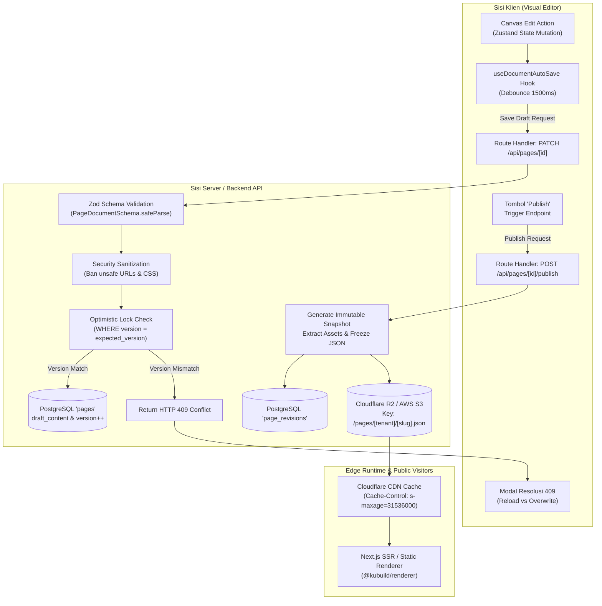
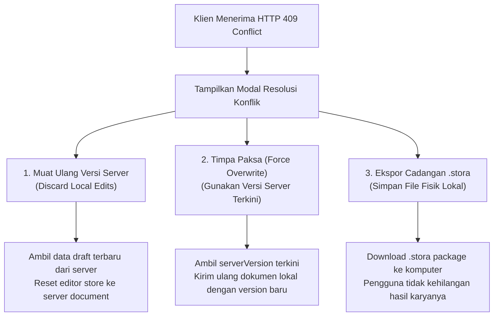

import { Callout } from 'fumadocs-ui/components/callout';
import { Card, Cards } from 'fumadocs-ui/components/card';
import { Tab, Tabs } from 'fumadocs-ui/components/tabs';
import { Accordion, Accordions } from 'fumadocs-ui/components/accordion';
import { Step, Steps } from 'fumadocs-ui/components/steps';

Menyimpan dokumen visual page builder ke backend pada lingkungan *production* skala enterprise memerlukan pendekatan arsitektur yang cermat. Dokumen KUBUILD (`.stora`) bukan sekadar teks biasa, melainkan pohon hierarki komponen (*Component Tree*) bertipe data kuat yang mencakup konfigurasi tema (*theme tokens*), *tracking pixels*, alur aksi interaktif (*action pipelines*), dan relasi aset media.

Tantangan utama persistensi dokumen visual builder meliputi:
1. **Pemisahan Draft vs Published**: Memastikan tim desainer atau marketing dapat mengedit, bereksperimen, dan mempratinjau perubahan (*drafting*) tanpa merusak tampilan halaman yang sedang diakses pengunjung publik secara *live*.
2. **Integritas Skema & Validasi Keamanan**: Menginspeksi payload JSON sebelum disimpan guna mencegah *XSS injection*, manipulasi protokol URL berbahaya (`javascript:`), atau skema usang.
3. **Optimistic Locking & Race Conditions**: Mencegah insiden *lost updates* ketika dua tab browser atau dua kolaborator mengedit halaman yang sama secara simultan.
4. **Debounced Auto-Save di Sisi Klien**: Mengurangi beban I/O server dengan mengumpulkan mutasi kanvas (*canvas changes*) dalam jeda waktu tertentu, disertai proteksi saat tab ditutup (*beforeunload*).
5. **Skalabilitas Distribusi Publik**: Memisahkan beban kerja authoring (database relasional) dari konsumsi publik masif (Object Storage Cloudflare R2 / AWS S3 + Edge CDN Caching).

---

## Arsitektur Lifecycle Dokumen `.stora`

Siklus hidup dokumen KUBUILD mengadopsi prinsip *Staged Document Lifecycle*. Dokumen berpindah dari fase draf lokal, validasi ketat di sisi server, persistensi basis data, hingga publikasi snapshot statis ke CDN global.



### Pola Draft vs Published

Dalam arsitektur KUBUILD, satu entitas halaman memiliki dua representasi isi (*content representation*) yang terisolasi di dalam tabel basis data:

- `draft_content`: JSON dokumen aktif yang terhubung ke visual builder. Setiap ketukan teks, pergeseran margin, atau penambahan blok oleh editor langsung diperbarui ke kolom ini melalui auto-save. Perubahan di sini **tidak pernah** terlihat oleh pengunjung publik.
- `published_content`: Snapshot JSON dokumen yang telah diverifikasi dan disetujui. Kolom ini hanya diperbarui saat pengguna menekan tombol **"Publish"**. Pengunjung publik dan crawler mesin pencari hanya membaca representasi ini.

<Callout type="info" title="Spesifikasi .stora & Arsitektur Modul">
Format `.stora` (lihat dokumentasi arsitektur §27–§31) adalah format arsip mandiri (*self-contained package*) yang berisi `manifest.json`, `page.json`, `metadata.json`, dan direktori `assets/`. Di tingkat database operasional, backend menyimpan struktur pohon `page.json` di dalam kolom JSONB, dan mengekspor atau mengimpor paket fisik `.stora` saat pengguna melakukan migrasi antar lingkungan atau membuat template.
</Callout>

### Empat Fase Status Dokumen

Dokumen KUBUILD bergerak melalui empat status siklus hidup yang dapat dinyatakan dengan enum `PageStatus`:

<Cards>
  <Card title="1. Draft" icon="Pencil">
    Halaman baru dibuat atau sedang mengalami perubahan desain. Pengunjung publik menerima status 404 atau versi lama sebelum halaman pertama kali dipublikasikan.
  </Card>
  <Card title="2. Staging / Review" icon="Eye">
    Tautan pratinjau rahasia (*preview token*) dibuat agar *stakeholder* atau tim QA dapat melihat hasil draf di lingkungan terisolasi sebelum go-live.
  </Card>
  <Card title="3. Published" icon="Globe">
    Snapshot dokumen disalin ke `published_content`, diarsipkan ke `page_revisions`, dan didistribusikan ke Edge CDN / Object Storage dengan performa tinggi.
  </Card>
  <Card title="4. Archived" icon="Archive">
    Halaman dinonaktifkan dari akses publik tanpa menghapus riwayat revisi dan data historis analitik di database.
  </Card>
</Cards>

---

## Skema Database Produksi (PostgreSQL & Prisma)

PostgreSQL adalah pilihan basis data relasional standar industri untuk menyimpan dokumen KUBUILD. Berkat tipe data `JSONB`, PostgreSQL menyediakan fleksibilitas penyimpanan struktur dokumen pohon (*NoSQL tree flexibility*) dipadukan dengan integritas relasional, transaksi ACID, dan pengindeksan biner berkecepatan tinggi.

### 1. Skema SQL PostgreSQL

Berikut adalah struktur DDL (*Data Definition Language*) PostgreSQL lengkap untuk tabel `pages` dan `page_revisions`:

```sql
-- Aktifkan ekstensi UUID jika belum tersedia
CREATE EXTENSION IF NOT EXISTS "uuid-ossp";

-- Enum status halaman
CREATE TYPE page_status_enum AS ENUM ('draft', 'published', 'archived');

-- 1. Tabel Utama: pages
CREATE TABLE pages (
    id UUID PRIMARY KEY DEFAULT gen_random_uuid(),
    tenant_id UUID NOT NULL,
    slug VARCHAR(255) NOT NULL,
    title VARCHAR(255) NOT NULL,
    status page_status_enum NOT NULL DEFAULT 'draft',
    
    -- Dokumen KUBUILD (PageDocument)
    draft_content JSONB NOT NULL,
    published_content JSONB,
    
    -- Optimistic Locking & Schema Tracking
    version INT NOT NULL DEFAULT 1,
    schema_version VARCHAR(32) NOT NULL DEFAULT '1.3.0',
    
    -- Timestamps
    created_at TIMESTAMPTZ NOT NULL DEFAULT NOW(),
    updated_at TIMESTAMPTZ NOT NULL DEFAULT NOW(),
    published_at TIMESTAMPTZ
);

-- Indeks unik komposit: satu tenant tidak boleh memiliki dua halaman dengan slug yang sama
CREATE UNIQUE INDEX idx_pages_tenant_slug ON pages (tenant_id, slug);

-- Indeks status dan tenant untuk pencarian cepat di dashboard admin
CREATE INDEX idx_pages_tenant_status ON pages (tenant_id, status);

-- GIN Index untuk pencarian JSONB (misal: mencari halaman yang menggunakan komponen tertentu)
CREATE INDEX idx_pages_draft_content_gin ON pages USING GIN (draft_content);
CREATE INDEX idx_pages_published_content_gin ON pages USING GIN (published_content);


-- 2. Tabel Riwayat Revisi: page_revisions
CREATE TABLE page_revisions (
    id UUID PRIMARY KEY DEFAULT gen_random_uuid(),
    page_id UUID NOT NULL REFERENCES pages(id) ON DELETE CASCADE,
    revision_number INT NOT NULL,
    snapshot_content JSONB NOT NULL,
    schema_version VARCHAR(32) NOT NULL DEFAULT '1.3.0',
    created_by UUID,
    change_summary VARCHAR(500),
    created_at TIMESTAMPTZ NOT NULL DEFAULT NOW()
);

-- Indeks riwayat halaman terurut menurun berdasarkan nomor revisi
CREATE INDEX idx_page_revisions_lookup ON page_revisions (page_id, revision_number DESC);
```

### 2. Skema ORM Prisma (`schema.prisma`)

Jika aplikasi Anda menggunakan **Prisma ORM**, definisikan model berikut di file `prisma/schema.prisma`:

```prisma
datasource db {
  provider = "postgresql"
  url      = env("DATABASE_URL")
}

generator client {
  provider = "prisma-client-js"
}

enum PageStatus {
  draft
  published
  archived
}

model Page {
  id               String         @id @default(uuid()) @db.Uuid
  tenantId         String         @map("tenant_id") @db.Uuid
  slug             String         @db.VarChar(255)
  title            String         @db.VarChar(255)
  status           PageStatus     @default(draft)
  
  // Format dokumen JSONB @kubuild/schema PageDocument
  draftContent     Json           @map("draft_content") @db.JsonB
  publishedContent Json?          @map("published_content") @db.JsonB
  
  // Optimistic Locking & Versioning
  version          Int            @default(1)
  schemaVersion    String         @default("1.3.0") @map("schema_version") @db.VarChar(32)
  
  createdAt        DateTime       @default(now()) @map("created_at") @db.Timestamptz
  updatedAt        DateTime       @updatedAt @map("updated_at") @db.Timestamptz
  publishedAt      DateTime?      @map("published_at") @db.Timestamptz

  revisions        PageRevision[]

  @@unique([tenantId, slug], name: "tenantId_slug")
  @@index([tenantId, status], name: "idx_pages_tenant_status")
  @@map("pages")
}

model PageRevision {
  id              String   @id @default(uuid()) @db.Uuid
  pageId          String   @map("page_id") @db.Uuid
  page            Page     @relation(fields: [pageId], references: [id], onDelete: Cascade)
  
  revisionNumber  Int      @map("revision_number")
  snapshotContent Json     @map("snapshot_content") @db.JsonB
  schemaVersion   String   @default("1.3.0") @map("schema_version") @db.VarChar(32)
  
  createdBy       String?  @map("created_by") @db.Uuid
  changeSummary   String?  @map("change_summary") @db.VarChar(500)
  createdAt       DateTime @default(now()) @map("created_at") @db.Timestamptz

  @@index([pageId, revisionNumber(sort: Desc)], name: "idx_page_revisions_lookup")
  @@map("page_revisions")
}
```

---

## Optimistic Locking & Conflict Resolution

Pada aplikasi visual builder kolaboratif, risiko penimpaan data (*race condition*) sangat nyata. Misalnya:
- Desainer A membuka tab halaman pada pukul 10:00 (memuat versi 5).
- Desainer B membuka tab halaman yang sama pada pukul 10:05 (memuat versi 5).
- Desainer B mengubah warna tombol dan sistem auto-save menyimpan dokumen sebagai versi 6 pada pukul 10:07.
- Desainer A mengubah susunan layout hero section pada pukul 10:08. Tanpa *optimistic locking*, draf milik Desainer A akan menimpa pekerjaan Desainer B kembali ke versi lama (*Lost Update Problem*).

### Mekanisme SQL Optimistic Concurrency Control

KUBUILD menerapkan *Optimistic Locking* berbasis kolom bilangan bulat inkremental (`version INT`):

Setiap mutasi simpan dari klien wajib menyertakan versi dokumen yang sedang diedit (`currentVersion`). Database mengeksekusi operasi `UPDATE` hanya jika versi saat ini cocok dengan versi di database:

```sql
UPDATE pages
SET 
    draft_content = $1,
    version = version + 1,
    updated_at = NOW()
WHERE 
    id = $2 
    AND version = $3
RETURNING version, updated_at;
```

Jika query di atas menghasilkan **0 baris terpengaruh** (`rowCount === 0`), berarti telah terjadi modifikasi oleh sesi lain. Server langsung menolak pembaruan dan mengembalikan respons HTTP `409 Conflict`.

### Implementasi Route Handler Server (Next.js / Express)

Berikut adalah contoh implementasi endpoint API Next.js App Router (`app/api/pages/[id]/draft/route.ts`) yang aman dengan validasi Zod dari `@kubuild/schema`:

```typescript
import { NextRequest, NextResponse } from 'next/server';
import { z } from 'zod';
import { PageDocumentSchema } from '@kubuild/schema';
import prisma from '@/lib/prisma';

// Skema payload request simpan draf
const SaveDraftPayloadSchema = z.object({
  version: z.number().int().positive(),
  document: PageDocumentSchema,
});

export async function PATCH(
  request: NextRequest,
  { params }: { params: Promise<{ id: string }> }
) {
  try {
    const { id } = await params;
    const json = await request.json();

    // 1. Validasi struktur dokumen dengan Zod
    const parsed = SaveDraftPayloadSchema.safeParse(json);
    if (!parsed.success) {
      return NextResponse.json(
        { error: 'Dokumen tidak valid', details: parsed.error.format() },
        { status: 400 }
      );
    }

    const { version, document } = parsed.data;

    // 2. Eksekusi conditional update untuk optimistic locking
    const updateResult = await prisma.page.updateMany({
      where: {
        id,
        version: version, // Kunci: harus cocok persis dengan versi yang dipegang klien
      },
      data: {
        draftContent: document as unknown as object,
        version: { increment: 1 },
        title: document.metadata?.title || 'Untitled Page',
        schemaVersion: document.version,
      },
    });

    // 3. Deteksi konflik jika tidak ada baris yang terupdate
    if (updateResult.count === 0) {
      const currentPage = await prisma.page.findUnique({
        where: { id },
        select: { version: true, updatedAt: true },
      });

      return NextResponse.json(
        {
          error: 'Conflict: Dokumen telah diubah oleh sesi lain.',
          serverVersion: currentPage?.version ?? null,
          lastUpdatedAt: currentPage?.updatedAt ?? null,
        },
        { status: 409 }
      );
    }

    // 4. Sukses: kembalikan nomor versi baru ke klien
    return NextResponse.json({
      success: true,
      newVersion: version + 1,
      savedAt: new Date().toISOString(),
    });
  } catch (error) {
    console.error('Failed to save draft:', error);
    return NextResponse.json(
      { error: 'Internal Server Error' },
      { status: 500 }
    );
  }
}
```

### Strategi Penanganan Konflik di Sisi Klien (Frontend UX)

Ketika klien menerima respons HTTP 409, jangan panik dan jangan menghapus state visual editor. Tampilkan dialog resolusi konflik interaktif dengan tiga opsi mitigasi:



<Callout type="warning" title="Pencegahan Kehilangan Data">
Selalu sediakan tombol **"Download .stora Backup"** di dalam modal konflik 409. Hal ini menjamin pengguna tidak akan pernah kehilangan pekerjaan berharga mereka bahkan jika mereka ragu memilih antara Reload atau Overwrite.
</Callout>

---

## Pola Debounced Auto-Save di Client

Mengirim request jaringan pada setiap ketukan keyboard atau saat menyeret *slider* margin akan membanjiri server dengan ratusan panggilan API yang tidak perlu. Pola yang benar adalah menggunakan teknik **debounced auto-save** dengan interval 1000–2000 milidetik.

### Siklus State Machine Auto-Save

Sistem auto-save di klien dikelola oleh mesin status (*finite state machine*) dengan lima status:

| Status | Deskripsi | Aksi UI |
| :--- | :--- | :--- |
| `idle` | Tidak ada perubahan baru sejak simpanan terakhir. | Menampilkan badge *"Semua perubahan tersimpan"*. |
| `dirty` | Pengguna mengubah kanvas; timer debounce sedang berjalan. | Menampilkan indikator *"Menunggu jeda edit..."*. |
| `saving` | Request HTTP PATCH sedang dalam perjalanan ke server. | Menampilkan spinner animasi *"Menyimpan draf..."*. |
| `saved` | Data sukses diterima dan versi database telah naik. | Menampilkan centang hijau *"Tersimpan"*. |
| `error` | Gagal jaringan atau HTTP 409 Conflict. | Menampilkan tanda seru merah dan tombol *"Coba Lagi"*. |

### Implementasi React Hook: `useDocumentAutoSave`

Berikut adalah implementasi custom hook produksi yang dilengkapi integrasi listener `window.onbeforeunload` untuk mencegah tab tertutup saat perubahan belum tersimpan:

```typescript
import { useState, useEffect, useRef, useCallback } from 'react';
import type { PageDocument } from '@kubuild/schema';

export type AutoSaveStatus = 'idle' | 'dirty' | 'saving' | 'saved' | 'error' | 'conflict';

interface UseDocumentAutoSaveOptions {
  pageId: string;
  document: PageDocument;
  initialVersion: number;
  debounceMs?: number;
  onConflict?: (serverVersion: number) => void;
  onSaved?: (newVersion: number) => void;
}

export function useDocumentAutoSave({
  pageId,
  document,
  initialVersion,
  debounceMs = 1500,
  onConflict,
  onSaved,
}: UseDocumentAutoSaveOptions) {
  const [status, setStatus] = useState<AutoSaveStatus>('idle');
  const [currentVersion, setCurrentVersion] = useState<number>(initialVersion);
  const [lastSavedAt, setLastSavedAt] = useState<Date | null>(null);
  const [errorMessage, setErrorMessage] = useState<string | null>(null);

  const timerRef = useRef<NodeJS.Timeout | null>(null);
  const isMountedRef = useRef<boolean>(true);
  const latestDocRef = useRef<PageDocument>(document);
  const latestVersionRef = useRef<number>(currentVersion);

  // Perbarui referensi dokumen dan versi terkini
  useEffect(() => {
    latestDocRef.current = document;
  }, [document]);

  useEffect(() => {
    latestVersionRef.current = currentVersion;
  }, [currentVersion]);

  // Fungsi pengiriman request simpan ke server
  const saveToServer = useCallback(async () => {
    if (status === 'saving') return;

    setStatus('saving');
    setErrorMessage(null);

    try {
      const response = await fetch(`/api/pages/${pageId}/draft`, {
        method: 'PATCH',
        headers: { 'Content-Type': 'application/json' },
        body: JSON.stringify({
          version: latestVersionRef.current,
          document: latestDocRef.current,
        }),
      });

      if (response.status === 409) {
        const errorData = await response.json();
        setStatus('conflict');
        setErrorMessage('Konflik: Dokumen telah diperbarui oleh pengguna lain.');
        onConflict?.(errorData.serverVersion);
        return;
      }

      if (!response.ok) {
        throw new Error(`HTTP error ${response.status}`);
      }

      const data = await response.json();
      setCurrentVersion(data.newVersion);
      setLastSavedAt(new Date());
      setStatus('saved');
      onSaved?.(data.newVersion);

      // Kembalikan ke idle setelah beberapa detik
      setTimeout(() => {
        if (isMountedRef.current) {
          setStatus((prev) => (prev === 'saved' ? 'idle' : prev));
        }
      }, 3000);
    } catch (err) {
      console.error('Auto-save failed:', err);
      setStatus('error');
      setErrorMessage(err instanceof Error ? err.message : 'Gagal menyimpan draf');
    }
  }, [pageId, status, onConflict, onSaved]);

  // Panggil fungsi ini setiap kali ada event onChange dari editor
  const markDirty = useCallback(() => {
    setStatus('dirty');

    if (timerRef.current) {
      clearTimeout(timerRef.current);
    }

    timerRef.current = setTimeout(() => {
      saveToServer();
    }, debounceMs);
  }, [debounceMs, saveToServer]);

  // Proteksi beforeunload: Cegah user menutup tab saat draf belum tersimpan
  useEffect(() => {
    const handleBeforeUnload = (event: BeforeUnloadEvent) => {
      if (status === 'dirty' || status === 'saving') {
        event.preventDefault();
        event.returnValue = ''; // Standar browser untuk memicu konfirmasi keluar
      }
    };

    window.addEventListener('beforeunload', handleBeforeUnload);
    return () => {
      window.removeEventListener('beforeunload', handleBeforeUnload);
      if (timerRef.current) clearTimeout(timerRef.current);
    };
  }, [status]);

  return {
    status,
    currentVersion,
    lastSavedAt,
    errorMessage,
    markDirty,
    saveImmediately: saveToServer,
  };
}
```

### Komponen UI: Status Pill Auto-Save

Sematkan komponen visual pada toolbar atas editor untuk memberi transparansi penuh kepada pengguna:

```tsx
import React from 'react';
import type { AutoSaveStatus } from './useDocumentAutoSave';

interface SaveStatusIndicatorProps {
  status: AutoSaveStatus;
  lastSavedAt: Date | null;
  onRetry: () => void;
}

export function SaveStatusIndicator({ status, lastSavedAt, onRetry }: SaveStatusIndicatorProps) {
  switch (status) {
    case 'saving':
      return (
        <span className="flex items-center gap-1.5 text-xs text-amber-500 font-medium">
          <span className="h-2 w-2 rounded-full bg-amber-500 animate-ping" />
          Menyimpan draf...
        </span>
      );
    case 'dirty':
      return (
        <span className="flex items-center gap-1.5 text-xs text-muted-foreground">
          <span className="h-2 w-2 rounded-full bg-amber-400" />
          Perubahan belum tersimpan
        </span>
      );
    case 'saved':
    case 'idle':
      return (
        <span className="flex items-center gap-1.5 text-xs text-emerald-600 font-medium">
          <span className="h-2 w-2 rounded-full bg-emerald-500" />
          {lastSavedAt
            ? `Tersimpan ${lastSavedAt.toLocaleTimeString([], { hour: '2-digit', minute: '2-digit' })}`
            : 'Tersimpan'}
        </span>
      );
    case 'conflict':
      return (
        <button
          onClick={onRetry}
          className="flex items-center gap-1 text-xs text-destructive font-semibold underline"
        >
          Konflik terdeteksi (Klik untuk resolusi)
        </button>
      );
    case 'error':
      return (
        <button
          onClick={onRetry}
          className="flex items-center gap-1 text-xs text-red-500 font-semibold underline"
        >
          Gagal simpan (Klik untuk coba lagi)
        </button>
      );
  }
}
```

---

## Object Storage & Edge Caching (Cloudflare R2 / AWS S3)

Meskipun PostgreSQL sangat unggul untuk operasi penulisan *authoring*, melayani jutaan *request* pengunjung publik langsung dari database relasional dapat menghabiskan koneksi database (*connection pool exhaustion*) dan meningkatkan biaya operasional.

### Perbandingan: Database vs Object Storage

<Tabs items={['Perbandingan Arsitektur', 'Kapan Menggunakan R2/S3', 'Kapan Menggunakan Postgres']}>
  <Tab value="Perbandingan Arsitektur">
    | Dimensi | PostgreSQL JSONB | Cloudflare R2 / AWS S3 |
    | :--- | :--- | :--- |
    | **Fokus Penggunaan** | Authoring, editing, kueri analitik, multi-tenant RBAC | Pengiriman publik skala tinggi (*High-throughput public runtime*) |
    | **Latensi Respons** | ~20–80 ms (tergantung jarak ke server DB) | ~5–20 ms (Edge CDN cache hit di kota terdekat) |
    | **Biaya Skalabilitas** | Meningkat seiring kebutuhan CPU/RAM database | Sangat murah (tanpa biaya egress di Cloudflare R2) |
    | **Konkurensi** | Dibatasi *connection pool* (e.g. 50–200 pooling) | Nyaris tak terbatas (dikelola oleh CDN Edge) |
  </Tab>

  <Tab value="Kapan Menggunakan R2/S3">
    - **Situs Berkecepatan Tinggi**: Landing page kampanye iklan, toko online Black Friday, atau portal berita dengan lonjakan trafik ekstrem.
    - **Global Edge Delivery**: Pengunjung tersebar di seluruh dunia dan membutuhkan TTFB (*Time to First Byte*) di bawah 50ms.
    - **Zero-Egress Cost**: Memanfaatkan Cloudflare R2 untuk menyajikan file dokumen `.stora` dan aset media tanpa biaya transfer data keluar.
  </Tab>

  <Tab value="Kapan Menggunakan Postgres">
    - **Draf Internal & Kolaborasi**: Dokumen yang sedang aktif diedit dan membutuhkan validasi skema serta optimistic locking.
    - **Pencarian & Filtering**: Kueri pencarian halaman berdasarkan nama, tanggal, pembuat, atau token komponen di kolom JSONB.
    - **Riwayat Revisi Terstruktur**: Rollback dan audit log perubahan melalui relasi kunci asing `page_id`.
  </Tab>
</Tabs>

### Alur Kerja Penerbitan Dokumen (Publishing Pipeline)

Ketika pengguna mengklik tombol **"Publish"**, backend mengeksekusi pipeline otomatis berikut:

<Steps>
  <Step>
    **Validasi Skema Dokumen Lengkap**  
    Backend memvalidasi draf dengan `PageDocumentSchema.safeParse` dan menjalankan audit keamanan (`validateDocumentSecurity`).
  </Step>
  <Step>
    **Persistensi Database & Riwayat Revisi**  
    Salin `draft_content` ke `published_content`, naikkan nomor revisi di tabel `page_revisions`, dan set status halaman menjadi `published`.
  </Step>
  <Step>
    **Upload Snapshot ke S3 / Cloudflare R2**  
    Serialize dokumen menjadi string JSON atau HTML statis, kemudian simpan ke bucket dengan *object key* yang deterministik: `pages/${tenantId}/${slug}.json`.
  </Step>
  <Step>
    **Invalidasi Cache Edge (CDN Purge)**  
    Kirim panggilan API ke Cloudflare Purge Cache untuk menghapus cache URL publik lama di seluruh server edge global.
  </Step>
</Steps>

### Contoh Implementasi Publishing API dengan AWS SDK v3 / R2

Berikut adalah contoh rute API Next.js yang mempublikasikan dokumen ke Cloudflare R2 menggunakan `@aws-sdk/client-s3`:

```typescript
import { NextRequest, NextResponse } from 'next/server';
import { S3Client, PutObjectCommand } from '@aws-sdk/client-s3';
import { PageDocumentSchema } from '@kubuild/schema';
import prisma from '@/lib/prisma';

// Inisialisasi klien S3 yang kompatibel dengan Cloudflare R2 / AWS S3
const s3Client = new S3Client({
  region: 'auto',
  endpoint: `https://${process.env.R2_ACCOUNT_ID}.r2.cloudflarestorage.com`,
  credentials: {
    accessKeyId: process.env.R2_ACCESS_KEY_ID || '',
    secretAccessKey: process.env.R2_SECRET_ACCESS_KEY || '',
  },
});

export async function POST(
  request: NextRequest,
  { params }: { params: Promise<{ id: string }> }
) {
  try {
    const { id } = await params;

    // 1. Ambil data draf halaman dari database
    const page = await prisma.page.findUnique({
      where: { id },
    });

    if (!page) {
      return NextResponse.json({ error: 'Halaman tidak ditemukan' }, { status: 404 });
    }

    // 2. Validasi integritas dokumen draf
    const validation = PageDocumentSchema.safeParse(page.draftContent);
    if (!validation.success) {
      return NextResponse.json(
        { error: 'Gagal publish: draf korup atau tidak valid', details: validation.error.format() },
        { status: 422 }
      );
    }

    const documentData = validation.data;

    // 3. Simpan revisi baru dan perbarui published_content dalam satu transaksi database
    const latestRevision = await prisma.pageRevision.findFirst({
      where: { pageId: id },
      orderBy: { revisionNumber: 'desc' },
      select: { revisionNumber: true },
    });
    const nextRevisionNumber = (latestRevision?.revisionNumber ?? 0) + 1;

    const [updatedPage] = await prisma.$transaction([
      prisma.page.update({
        where: { id },
        data: {
          publishedContent: page.draftContent as unknown as object,
          status: 'published',
          publishedAt: new Date(),
        },
      }),
      prisma.pageRevision.create({
        data: {
          pageId: id,
          revisionNumber: nextRevisionNumber,
          snapshotContent: page.draftContent as unknown as object,
          schemaVersion: documentData.version,
          changeSummary: `Published revision #${nextRevisionNumber}`,
        },
      }),
    ]);

    // 4. Upload snapshot JSON ke Cloudflare R2 dengan Cache Headers Produksi
    const s3Key = `tenants/${page.tenantId}/pages/${page.slug}.json`;
    const jsonString = JSON.stringify(documentData);

    await s3Client.send(
      new PutObjectCommand({
        Bucket: process.env.R2_BUCKET_NAME,
        Key: s3Key,
        Body: jsonString,
        ContentType: 'application/json; charset=utf-8',
        // Strategi Cache CDN: Cache di edge hingga 1 tahun, revalidate di background
        CacheControl: 'public, max-age=60, s-maxage=31536000, stale-while-revalidate=86400',
        Metadata: {
          schemaVersion: documentData.version,
          pageId: page.id,
          revision: String(nextRevisionNumber),
        },
      })
    );

    return NextResponse.json({
      success: true,
      publishedAt: updatedPage.publishedAt,
      revisionNumber: nextRevisionNumber,
      cdnKey: s3Key,
    });
  } catch (error) {
    console.error('Publishing failed:', error);
    return NextResponse.json({ error: 'Gagal menerbitkan halaman' }, { status: 500 });
  }
}
```

---

## Praktik Terbaik & Rekomendasi Keamanan

<Accordions>
  <Accordion title="Bagaimana Menangani Migrasi Versi Skema Dokumen Lama?">
    Dokumen KUBUILD menyertakan atribut `version` (misalnya `'1.3.0'`). Jika Anda memperbarui aplikasi builder ke versi mayor baru, gunakan pipeline migrasi deterministik di sisi server sebelum menyimpan dokumen ke database. Jika schema dokumen lawas (`'1.0.0'`) dibaca dari database, jalankan fungsi transformasi migrasi (`migrateDocument`) agar strukturnya sesuai dengan skema terbaru tanpa merusak data pengguna.
  </Accordion>

  <Accordion title="Bagaimana Menghindari Serangan DoS pada Endpoint Auto-Save?">
    Terapkan *Rate Limiting* (misalnya menggunakan Redis Upstash atau `@upstash/ratelimit`) pada endpoint `PATCH /api/pages/[id]/draft`. Batasi maksimal 30 request per menit per ID pengguna terautentikasi. Karena auto-save di sisi klien telah menerapkan debounce 1.5 detik, 30 request per menit sudah sangat mencukupi untuk penulisan normal.
  </Accordion>

  <Accordion title="Apakah Perlu Menyimpan Aset Gambar Langsung di Kolom JSONB?">
    **Tidak disarankan.** Gambar base64 berukuran megabyte akan membengkakkan ukuran tabel database dan memperlambat waktu respons query. Selalu unggah aset gambar ke bucket S3/R2 terlebih dahulu, lalu simpan referensi aset URL atau `assetId` di dalam node pohon dokumen KUBUILD (`AssetReferenceSchema`).
  </Accordion>
</Accordions>
