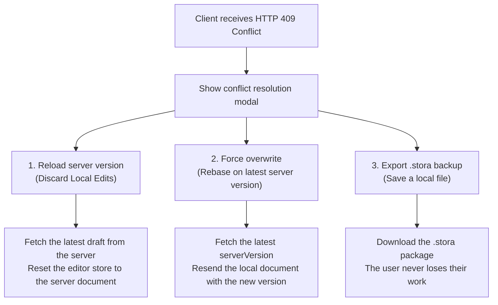

import { Callout } from 'fumadocs-ui/components/callout';
import { Card, Cards } from 'fumadocs-ui/components/card';
import { Tab, Tabs } from 'fumadocs-ui/components/tabs';
import { Accordion, Accordions } from 'fumadocs-ui/components/accordion';
import { Step, Steps } from 'fumadocs-ui/components/steps';

Storing visual page builder documents in an enterprise *production* backend needs a careful architecture. A KUBUILD document (`.stora`) is not plain text: it is a strongly typed *component tree* that also carries theme tokens, *tracking pixels*, interactive *action pipelines*, and media asset references.

The main persistence challenges for visual builder documents are:
1. **Draft vs. published separation**: designers and marketers must be able to edit, experiment, and preview changes (*drafting*) without breaking the page that public visitors see *live*.
2. **Schema integrity & security validation**: inspect the JSON payload before saving to prevent *XSS injection*, dangerous URL protocols (`javascript:`), or outdated schemas.
3. **Optimistic locking & race conditions**: prevent *lost updates* when two browser tabs or two collaborators edit the same page at the same time.
4. **Client-side debounced auto-save**: reduce server I/O by batching *canvas changes* over a short window, with protection when the tab closes (*beforeunload*).
5. **Scalable public delivery**: separate the authoring workload (relational database) from high-volume public reads (Cloudflare R2 / AWS S3 object storage + edge CDN caching).

---

## `.stora` Document Lifecycle Architecture

The KUBUILD document lifecycle follows a *staged document lifecycle*: a document moves from a local draft, through strict server-side validation and database persistence, to a static snapshot published on a global CDN.


### Draft vs. Published Pattern

In a KUBUILD architecture, one page entity has two isolated *content representations* in the database table:

- `draft_content`: the active document JSON connected to the visual builder. Every keystroke, margin tweak, or added block is written to this column through auto-save. Changes here are **never** visible to public visitors.
- `published_content`: a verified, approved JSON snapshot of the document. This column only changes when the user clicks **"Publish"**. Public visitors and search crawlers only read this representation.

<Callout type="info" title=".stora Specification & Module Architecture">
The `.stora` format (see the architecture spec §27–§31) is a *self-contained package* holding `manifest.json`, `page.json`, `metadata.json`, and an `assets/` directory. In the operational database the backend stores the `page.json` tree in a JSONB column, and exports or imports physical `.stora` packages when users migrate between environments or create templates.
</Callout>

### Four Document Status Phases

A KUBUILD document moves through four lifecycle statuses, which can be expressed as a `PageStatus` enum:

<Cards>
  <Card title="1. Draft" icon="Pencil">
    A new page is being created or redesigned. Before the first publish, public visitors receive a 404 (or the previous version afterwards).
  </Card>
  <Card title="2. Staging / Review" icon="Eye">
    A secret *preview token* link lets stakeholders or QA review the draft in an isolated environment before go-live.
  </Card>
  <Card title="3. Published" icon="Globe">
    The document snapshot is copied to `published_content`, archived in `page_revisions`, and distributed to the edge CDN / object storage for high performance.
  </Card>
  <Card title="4. Archived" icon="Archive">
    The page is removed from public access without deleting its revision history or historical analytics data.
  </Card>
</Cards>

---

## Production Database Schema (PostgreSQL & Prisma)

PostgreSQL is the industry-standard relational database for storing KUBUILD documents. With the `JSONB` type it combines *NoSQL tree flexibility* for the document structure with relational integrity, ACID transactions, and fast binary indexing.

### 1. PostgreSQL SQL Schema

The complete PostgreSQL DDL (*Data Definition Language*) for the `pages` and `page_revisions` tables:

```sql
-- Enable the UUID extension if it isn't available yet
CREATE EXTENSION IF NOT EXISTS "uuid-ossp";

-- Page status enum
CREATE TYPE page_status_enum AS ENUM ('draft', 'published', 'archived');

-- 1. Main table: pages
CREATE TABLE pages (
    id UUID PRIMARY KEY DEFAULT gen_random_uuid(),
    tenant_id UUID NOT NULL,
    slug VARCHAR(255) NOT NULL,
    title VARCHAR(255) NOT NULL,
    status page_status_enum NOT NULL DEFAULT 'draft',
    
    -- Dokumen KUBUILD (PageDocument)
    draft_content JSONB NOT NULL,
    published_content JSONB,
    
    -- Optimistic Locking & Schema Tracking
    version INT NOT NULL DEFAULT 1,
    schema_version VARCHAR(32) NOT NULL DEFAULT '1.3.0',
    
    -- Timestamps
    created_at TIMESTAMPTZ NOT NULL DEFAULT NOW(),
    updated_at TIMESTAMPTZ NOT NULL DEFAULT NOW(),
    published_at TIMESTAMPTZ
);

-- Composite unique index: a tenant can't have two pages with the same slug
CREATE UNIQUE INDEX idx_pages_tenant_slug ON pages (tenant_id, slug);

-- Status and tenant index for fast admin dashboard lookups
CREATE INDEX idx_pages_tenant_status ON pages (tenant_id, status);

-- GIN index for JSONB search (e.g. finding pages that use a given component)
CREATE INDEX idx_pages_draft_content_gin ON pages USING GIN (draft_content);
CREATE INDEX idx_pages_published_content_gin ON pages USING GIN (published_content);


-- 2. Revision history table: page_revisions
CREATE TABLE page_revisions (
    id UUID PRIMARY KEY DEFAULT gen_random_uuid(),
    page_id UUID NOT NULL REFERENCES pages(id) ON DELETE CASCADE,
    revision_number INT NOT NULL,
    snapshot_content JSONB NOT NULL,
    schema_version VARCHAR(32) NOT NULL DEFAULT '1.3.0',
    created_by UUID,
    change_summary VARCHAR(500),
    created_at TIMESTAMPTZ NOT NULL DEFAULT NOW()
);

-- Page history index ordered by revision number, descending
CREATE INDEX idx_page_revisions_lookup ON page_revisions (page_id, revision_number DESC);
```

### 2. Prisma ORM Schema (`schema.prisma`)

If your app uses **Prisma ORM**, define these models in `prisma/schema.prisma`:

```prisma
datasource db {
  provider = "postgresql"
  url      = env("DATABASE_URL")
}

generator client {
  provider = "prisma-client-js"
}

enum PageStatus {
  draft
  published
  archived
}

model Page {
  id               String         @id @default(uuid()) @db.Uuid
  tenantId         String         @map("tenant_id") @db.Uuid
  slug             String         @db.VarChar(255)
  title            String         @db.VarChar(255)
  status           PageStatus     @default(draft)
  
  // @kubuild/schema PageDocument stored as JSONB
  draftContent     Json           @map("draft_content") @db.JsonB
  publishedContent Json?          @map("published_content") @db.JsonB
  
  // Optimistic Locking & Versioning
  version          Int            @default(1)
  schemaVersion    String         @default("1.3.0") @map("schema_version") @db.VarChar(32)
  
  createdAt        DateTime       @default(now()) @map("created_at") @db.Timestamptz
  updatedAt        DateTime       @updatedAt @map("updated_at") @db.Timestamptz
  publishedAt      DateTime?      @map("published_at") @db.Timestamptz

  revisions        PageRevision[]

  @@unique([tenantId, slug], name: "tenantId_slug")
  @@index([tenantId, status], name: "idx_pages_tenant_status")
  @@map("pages")
}

model PageRevision {
  id              String   @id @default(uuid()) @db.Uuid
  pageId          String   @map("page_id") @db.Uuid
  page            Page     @relation(fields: [pageId], references: [id], onDelete: Cascade)
  
  revisionNumber  Int      @map("revision_number")
  snapshotContent Json     @map("snapshot_content") @db.JsonB
  schemaVersion   String   @default("1.3.0") @map("schema_version") @db.VarChar(32)
  
  createdBy       String?  @map("created_by") @db.Uuid
  changeSummary   String?  @map("change_summary") @db.VarChar(500)
  createdAt       DateTime @default(now()) @map("created_at") @db.Timestamptz

  @@index([pageId, revisionNumber(sort: Desc)], name: "idx_page_revisions_lookup")
  @@map("page_revisions")
}
```

---

## Optimistic Locking & Conflict Resolution

In a collaborative visual builder, the risk of overwriting data (*race conditions*) is real. For example:
- Designer A opens the page at 10:00 (loads version 5).
- Designer B opens the same page at 10:05 (loads version 5).
- Designer B changes a button color and auto-save stores the document as version 6 at 10:07.
- Designer A rearranges the hero section at 10:08. Without *optimistic locking*, Designer A's draft overwrites Designer B's work with an older base (*lost update problem*).

### SQL Optimistic Concurrency Control

KUBUILD uses *optimistic locking* based on an incrementing integer column (`version INT`):

Every save from the client must include the version it is editing (`currentVersion`). The database only runs the `UPDATE` when that version matches the stored one:

```sql
UPDATE pages
SET 
    draft_content = $1,
    version = version + 1,
    updated_at = NOW()
WHERE 
    id = $2 
    AND version = $3
RETURNING version, updated_at;
```

If the query above affects **0 rows** (`rowCount === 0`), another session has modified the page. The server rejects the update and returns HTTP `409 Conflict`.

### Server Route Handler (Next.js / Express)

A secure Next.js App Router endpoint (`app/api/pages/[id]/draft/route.ts`) with Zod validation from `@kubuild/schema`:

```typescript
import { NextRequest, NextResponse } from 'next/server';
import { z } from 'zod';
import { PageDocumentSchema } from '@kubuild/schema';
import prisma from '@/lib/prisma';

// Request payload schema for saving a draft
const SaveDraftPayloadSchema = z.object({
  version: z.number().int().positive(),
  document: PageDocumentSchema,
});

export async function PATCH(
  request: NextRequest,
  { params }: { params: Promise<{ id: string }> }
) {
  try {
    const { id } = await params;
    const json = await request.json();

    // 1. Validate the document structure with Zod
    const parsed = SaveDraftPayloadSchema.safeParse(json);
    if (!parsed.success) {
      return NextResponse.json(
        { error: 'Invalid document', details: parsed.error.format() },
        { status: 400 }
      );
    }

    const { version, document } = parsed.data;

    // 2. Conditional update for optimistic locking
    const updateResult = await prisma.page.updateMany({
      where: {
        id,
        version: version, // Key: must exactly match the version held by the client
      },
      data: {
        draftContent: document as unknown as object,
        version: { increment: 1 },
        title: document.metadata?.title || 'Untitled Page',
        schemaVersion: document.version,
      },
    });

    // 3. Detect a conflict when no row was updated
    if (updateResult.count === 0) {
      const currentPage = await prisma.page.findUnique({
        where: { id },
        select: { version: true, updatedAt: true },
      });

      return NextResponse.json(
        {
          error: 'Conflict: the document was modified by another session.',
          serverVersion: currentPage?.version ?? null,
          lastUpdatedAt: currentPage?.updatedAt ?? null,
        },
        { status: 409 }
      );
    }

    // 4. Success: return the new version number to the client
    return NextResponse.json({
      success: true,
      newVersion: version + 1,
      savedAt: new Date().toISOString(),
    });
  } catch (error) {
    console.error('Failed to save draft:', error);
    return NextResponse.json(
      { error: 'Internal Server Error' },
      { status: 500 }
    );
  }
}
```

### Client-Side Conflict Handling (Frontend UX)

When the client receives HTTP 409, don't panic and don't discard the editor state. Show an interactive conflict-resolution dialog with three options:



<Callout type="warning" title="Preventing Data Loss">
Always offer a **"Download .stora Backup"** button in the 409 conflict modal. Users then never lose valuable work, even when they're unsure whether to reload or overwrite.
</Callout>

---

## Client-Side Debounced Auto-Save

Sending a network request on every keystroke or margin-slider drag floods the server with hundreds of unnecessary API calls. Use **debounced auto-save** with a 1000–2000 ms interval instead.

### Auto-Save State Machine

Client auto-save is managed by a *finite state machine* with five states:

| Status | Description | UI Action |
| :--- | :--- | :--- |
| `idle` | No new changes since the last save. | Show an *"All changes saved"* badge. |
| `dirty` | The user changed the canvas; the debounce timer is running. | Show *"Waiting for edits to settle..."*. |
| `saving` | An HTTP PATCH request is in flight. | Show a *"Saving draft..."* spinner. |
| `saved` | The server accepted the data and the database version increased. | Show a green *"Saved"* check. |
| `error` | Network failure or HTTP 409 Conflict. | Show a red warning and a *"Retry"* button. |

### React Hook: `useDocumentAutoSave`

A production custom hook with a `window.onbeforeunload` listener that keeps the tab from closing while changes are unsaved:

```typescript
import { useState, useEffect, useRef, useCallback } from 'react';
import type { PageDocument } from '@kubuild/schema';

export type AutoSaveStatus = 'idle' | 'dirty' | 'saving' | 'saved' | 'error' | 'conflict';

interface UseDocumentAutoSaveOptions {
  pageId: string;
  document: PageDocument;
  initialVersion: number;
  debounceMs?: number;
  onConflict?: (serverVersion: number) => void;
  onSaved?: (newVersion: number) => void;
}

export function useDocumentAutoSave({
  pageId,
  document,
  initialVersion,
  debounceMs = 1500,
  onConflict,
  onSaved,
}: UseDocumentAutoSaveOptions) {
  const [status, setStatus] = useState<AutoSaveStatus>('idle');
  const [currentVersion, setCurrentVersion] = useState<number>(initialVersion);
  const [lastSavedAt, setLastSavedAt] = useState<Date | null>(null);
  const [errorMessage, setErrorMessage] = useState<string | null>(null);

  const timerRef = useRef<NodeJS.Timeout | null>(null);
  const isMountedRef = useRef<boolean>(true);
  const latestDocRef = useRef<PageDocument>(document);
  const latestVersionRef = useRef<number>(currentVersion);

  // Keep the latest document and version in refs
  useEffect(() => {
    latestDocRef.current = document;
  }, [document]);

  useEffect(() => {
    latestVersionRef.current = currentVersion;
  }, [currentVersion]);

  // Send the save request to the server
  const saveToServer = useCallback(async () => {
    if (status === 'saving') return;

    setStatus('saving');
    setErrorMessage(null);

    try {
      const response = await fetch(`/api/pages/${pageId}/draft`, {
        method: 'PATCH',
        headers: { 'Content-Type': 'application/json' },
        body: JSON.stringify({
          version: latestVersionRef.current,
          document: latestDocRef.current,
        }),
      });

      if (response.status === 409) {
        const errorData = await response.json();
        setStatus('conflict');
        setErrorMessage('Conflict: the document was updated by another user.');
        onConflict?.(errorData.serverVersion);
        return;
      }

      if (!response.ok) {
        throw new Error(`HTTP error ${response.status}`);
      }

      const data = await response.json();
      setCurrentVersion(data.newVersion);
      setLastSavedAt(new Date());
      setStatus('saved');
      onSaved?.(data.newVersion);

      // Return to idle after a few seconds
      setTimeout(() => {
        if (isMountedRef.current) {
          setStatus((prev) => (prev === 'saved' ? 'idle' : prev));
        }
      }, 3000);
    } catch (err) {
      console.error('Auto-save failed:', err);
      setStatus('error');
      setErrorMessage(err instanceof Error ? err.message : 'Failed to save draft');
    }
  }, [pageId, status, onConflict, onSaved]);

  // Call this on every onChange event from the editor
  const markDirty = useCallback(() => {
    setStatus('dirty');

    if (timerRef.current) {
      clearTimeout(timerRef.current);
    }

    timerRef.current = setTimeout(() => {
      saveToServer();
    }, debounceMs);
  }, [debounceMs, saveToServer]);

  // beforeunload guard: stop the user from closing the tab with an unsaved draft
  useEffect(() => {
    const handleBeforeUnload = (event: BeforeUnloadEvent) => {
      if (status === 'dirty' || status === 'saving') {
        event.preventDefault();
        event.returnValue = ''; // Browser standard for triggering the leave confirmation
      }
    };

    window.addEventListener('beforeunload', handleBeforeUnload);
    return () => {
      window.removeEventListener('beforeunload', handleBeforeUnload);
      if (timerRef.current) clearTimeout(timerRef.current);
    };
  }, [status]);

  return {
    status,
    currentVersion,
    lastSavedAt,
    errorMessage,
    markDirty,
    saveImmediately: saveToServer,
  };
}
```

### UI Component: Auto-Save Status Pill

Put a visual indicator in the editor's top toolbar so users always know the save state:

```tsx
import React from 'react';
import type { AutoSaveStatus } from './useDocumentAutoSave';

interface SaveStatusIndicatorProps {
  status: AutoSaveStatus;
  lastSavedAt: Date | null;
  onRetry: () => void;
}

export function SaveStatusIndicator({ status, lastSavedAt, onRetry }: SaveStatusIndicatorProps) {
  switch (status) {
    case 'saving':
      return (
        <span className="flex items-center gap-1.5 text-xs text-amber-500 font-medium">
          <span className="h-2 w-2 rounded-full bg-amber-500 animate-ping" />
          Saving draft...
        </span>
      );
    case 'dirty':
      return (
        <span className="flex items-center gap-1.5 text-xs text-muted-foreground">
          <span className="h-2 w-2 rounded-full bg-amber-400" />
          Unsaved changes
        </span>
      );
    case 'saved':
    case 'idle':
      return (
        <span className="flex items-center gap-1.5 text-xs text-emerald-600 font-medium">
          <span className="h-2 w-2 rounded-full bg-emerald-500" />
          {lastSavedAt
            ? `Saved ${lastSavedAt.toLocaleTimeString([], { hour: '2-digit', minute: '2-digit' })}`
            : 'Saved'}
        </span>
      );
    case 'conflict':
      return (
        <button
          onClick={onRetry}
          className="flex items-center gap-1 text-xs text-destructive font-semibold underline"
        >
          Conflict detected (click to resolve)
        </button>
      );
    case 'error':
      return (
        <button
          onClick={onRetry}
          className="flex items-center gap-1 text-xs text-red-500 font-semibold underline"
        >
          Save failed (click to retry)
        </button>
      );
  }
}
```

---

## Object Storage & Edge Caching (Cloudflare R2 / AWS S3)

PostgreSQL is excellent for *authoring* writes, but serving millions of public visitor requests straight from a relational database can exhaust the connection pool (*connection pool exhaustion*) and raise operating costs.

### Comparison: Database vs. Object Storage

<Tabs items={['Architecture Comparison', 'When to Use R2/S3', 'When to Use Postgres']}>
  <Tab value="Architecture Comparison">
    | Dimension | PostgreSQL JSONB | Cloudflare R2 / AWS S3 |
    | :--- | :--- | :--- |
    | **Primary use** | Authoring, editing, analytic queries, multi-tenant RBAC | High-throughput public runtime delivery |
    | **Response latency** | ~20–80 ms (depends on distance to the DB) | ~5–20 ms (edge CDN cache hit in the nearest city) |
    | **Scaling cost** | Grows with database CPU/RAM | Very cheap (no egress fees on Cloudflare R2) |
    | **Concurrency** | Limited by the *connection pool* (e.g. 50–200 connections) | Practically unlimited (handled by the CDN edge) |
  </Tab>

  <Tab value="When to Use R2/S3">
    - **High-traffic sites**: ad campaign landing pages, Black Friday stores, or news portals with extreme traffic spikes.
    - **Global edge delivery**: visitors worldwide who need a TTFB (*Time to First Byte*) under 50ms.
    - **Zero egress cost**: use Cloudflare R2 to serve `.stora` documents and media assets without data-transfer fees.
  </Tab>

  <Tab value="When to Use Postgres">
    - **Internal drafts & collaboration**: documents under active editing that need schema validation and optimistic locking.
    - **Search & filtering**: query pages by name, date, author, or component tokens inside the JSONB column.
    - **Structured revision history**: rollbacks and change audit logs through the `page_id` foreign key.
  </Tab>
</Tabs>

### Publishing Pipeline

When the user clicks **"Publish"**, the backend runs this automated pipeline:

<Steps>
  <Step>
    **Full document schema validation**  
    The backend validates the draft with `PageDocumentSchema.safeParse` and runs a security audit (`validateDocumentSecurity`).
  </Step>
  <Step>
    **Database persistence & revision history**  
    Copy `draft_content` to `published_content`, bump the revision number in `page_revisions`, and set the page status to `published`.
  </Step>
  <Step>
    **Upload Snapshot ke S3 / Cloudflare R2**  
    Serialize the document to a JSON string or static HTML, then store it in the bucket under a deterministic *object key*: `pages/${tenantId}/${slug}.json`.
  </Step>
  <Step>
    **Edge cache invalidation (CDN purge)**  
    Call the Cloudflare Purge Cache API to remove the old public URL from every edge server worldwide.
  </Step>
</Steps>

### Publishing API Example with AWS SDK v3 / R2

A Next.js API route that publishes a document to Cloudflare R2 with `@aws-sdk/client-s3`:

```typescript
import { NextRequest, NextResponse } from 'next/server';
import { S3Client, PutObjectCommand } from '@aws-sdk/client-s3';
import { PageDocumentSchema } from '@kubuild/schema';
import prisma from '@/lib/prisma';

// Initialize an S3 client compatible with Cloudflare R2 / AWS S3
const s3Client = new S3Client({
  region: 'auto',
  endpoint: `https://${process.env.R2_ACCOUNT_ID}.r2.cloudflarestorage.com`,
  credentials: {
    accessKeyId: process.env.R2_ACCESS_KEY_ID || '',
    secretAccessKey: process.env.R2_SECRET_ACCESS_KEY || '',
  },
});

export async function POST(
  request: NextRequest,
  { params }: { params: Promise<{ id: string }> }
) {
  try {
    const { id } = await params;

    // 1. Load the page draft from the database
    const page = await prisma.page.findUnique({
      where: { id },
    });

    if (!page) {
      return NextResponse.json({ error: 'Page not found' }, { status: 404 });
    }

    // 2. Validate the draft document's integrity
    const validation = PageDocumentSchema.safeParse(page.draftContent);
    if (!validation.success) {
      return NextResponse.json(
        { error: 'Publish failed: the draft is corrupted or invalid', details: validation.error.format() },
        { status: 422 }
      );
    }

    const documentData = validation.data;

    // 3. Save a new revision and update published_content in one database transaction
    const latestRevision = await prisma.pageRevision.findFirst({
      where: { pageId: id },
      orderBy: { revisionNumber: 'desc' },
      select: { revisionNumber: true },
    });
    const nextRevisionNumber = (latestRevision?.revisionNumber ?? 0) + 1;

    const [updatedPage] = await prisma.$transaction([
      prisma.page.update({
        where: { id },
        data: {
          publishedContent: page.draftContent as unknown as object,
          status: 'published',
          publishedAt: new Date(),
        },
      }),
      prisma.pageRevision.create({
        data: {
          pageId: id,
          revisionNumber: nextRevisionNumber,
          snapshotContent: page.draftContent as unknown as object,
          schemaVersion: documentData.version,
          changeSummary: `Published revision #${nextRevisionNumber}`,
        },
      }),
    ]);

    // 4. Upload the JSON snapshot to Cloudflare R2 with production cache headers
    const s3Key = `tenants/${page.tenantId}/pages/${page.slug}.json`;
    const jsonString = JSON.stringify(documentData);

    await s3Client.send(
      new PutObjectCommand({
        Bucket: process.env.R2_BUCKET_NAME,
        Key: s3Key,
        Body: jsonString,
        ContentType: 'application/json; charset=utf-8',
        // CDN cache strategy: cache at the edge for up to 1 year, revalidate in the background
        CacheControl: 'public, max-age=60, s-maxage=31536000, stale-while-revalidate=86400',
        Metadata: {
          schemaVersion: documentData.version,
          pageId: page.id,
          revision: String(nextRevisionNumber),
        },
      })
    );

    return NextResponse.json({
      success: true,
      publishedAt: updatedPage.publishedAt,
      revisionNumber: nextRevisionNumber,
      cdnKey: s3Key,
    });
  } catch (error) {
    console.error('Publishing failed:', error);
    return NextResponse.json({ error: 'Failed to publish the page' }, { status: 500 });
  }
}
```

---

## Best Practices & Security Recommendations

<Accordions>
  <Accordion title="How do I migrate documents with an older schema version?">
    KUBUILD documents carry a `version` field (e.g. `'1.3.0'`). When you upgrade the builder to a new major version, run a deterministic server-side migration before saving documents to the database. If a legacy document (`'1.0.0'`) is read from the database, run `migrateDocument` so its structure matches the latest schema without damaging user data.
  </Accordion>

  <Accordion title="How do I protect the auto-save endpoint from DoS attacks?">
    Apply *rate limiting* (for example with Upstash Redis or `@upstash/ratelimit`) on `PATCH /api/pages/[id]/draft`. Allow at most 30 requests per minute per authenticated user. Since client auto-save is already debounced by 1.5 seconds, 30 requests per minute is plenty for normal editing.
  </Accordion>

  <Accordion title="Should I store image assets directly in the JSONB column?">
    **No.** Megabyte-sized base64 images bloat the database tables and slow down queries. Always upload images to an S3/R2 bucket first, then store the asset URL or `assetId` reference in the KUBUILD document tree (`AssetReferenceSchema`).
  </Accordion>
</Accordions>
