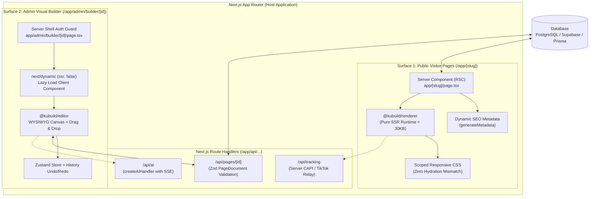

import { Callout } from 'fumadocs-ui/components/callout';
import { Card, Cards } from 'fumadocs-ui/components/card';
import { Tab, Tabs } from 'fumadocs-ui/components/tabs';
import { Accordion, Accordions } from 'fumadocs-ui/components/accordion';
import { Step, Steps } from 'fumadocs-ui/components/steps';
import { File, Folder, Files } from 'fumadocs-ui/components/files';
import { InteractiveRenderer } from '@/components/interactive-renderer';

Embedding a visual page builder into an enterprise-scale web app usually creates a performance dilemma: how do you give designers and admins a rich drag-and-drop canvas without sacrificing load speed (*Core Web Vitals*), bundle size, and SEO on public pages visited by millions of users?

Conventional visual builders ship the editor canvas and the viewer runtime together in one monolithic client-side bundle. As a result:
1. **Bloated bundles**: Every visitor downloads hundreds of kilobytes of editor code (Zustand store, drag handles, property inspectors, color pickers, modal dialogs) they never use.
2. **Hydration mismatches**: Differences in screen size between the server and the browser trigger *"Text content does not match server-rendered HTML"* errors or flickering layouts (*FOUC — Flash of Unstyled Content*).
3. **Poor SEO and social previews**: Search crawlers and social bots (Facebook Open Graph, Twitter Cards, WhatsApp previews) receive an empty page that needs heavy JavaScript before any content appears.

**KUBUILD solves this with a dual-surface architecture on the Next.js App Router.**

---

## Dual-Surface Architecture

KUBUILD splits a Next.js host app into two independent surfaces that are strictly isolated at the module and runtime level:



<Cards>
  <Card title="Surface 1: Public Visitor Pages" icon="Globe">
    Runs 100% as a **React Server Component (RSC)** using the lightweight `@kubuild/renderer` package. It produces plain static HTML on the server with scoped breakpoint CSS (`responsive="css"`), an ultra-light bundle, and top Lighthouse scores.
  </Card>
  <Card title="Surface 2: Admin Visual Builder" icon="Layout">
    Runs as a **Client Component** loaded dynamically through `next/dynamic({ ssr: false })`. All drag-and-drop dependencies, the Zustand state machine, the AI assistant, and inspector panels are isolated to admin users who have access.
  </Card>
</Cards>

---

## Live Interactive Preview

Below is a live `@kubuild/renderer` demo that simulates the server-side output in Next.js. Switch the device viewport to see responsive CSS apply instantly without a *hydration mismatch*:

<InteractiveRenderer
  title="Next.js SSR Runtime Preview"
  height="460px"
  defaultViewport="desktop"
  showJsonToggle={true}
  document={{
    schema: "stora.page",
    version: "1.3.0",
    metadata: {
      title: "Enterprise Cloud Hosting",
      description: "High-performance Next.js landing page built with KUBUILD.",
      category: "hosting",
      tags: ["nextjs", "server-components", "rsc", "performance"]
    },
    document: {
      id: "root-nextjs",
      type: "page",
      props: {},
      styles: {
        base: {
          backgroundColor: "#09090b",
          color: "#fafafa",
          minHeight: "100vh",
          padding: "48px 24px",
          fontFamily: "system-ui, -apple-system, sans-serif"
        }
      },
      children: [
        {
          id: "hero-section",
          type: "section",
          props: {},
          styles: {
            base: {
              maxWidth: "1000px",
              margin: "0 auto",
              textAlign: "center"
            }
          },
          children: [
            {
              id: "badge",
              type: "badge",
              props: {
                text: "🚀 Next.js App Router Ready"
              },
              styles: {
                base: {
                  display: "inline-block",
                  padding: "6px 14px",
                  borderRadius: "9999px",
                  fontSize: "13px",
                  fontWeight: "600",
                  backgroundColor: "#27272a",
                  color: "#38bdf8",
                  marginBottom: "20px"
                }
              }
            },
            {
              id: "hero-title",
              type: "typography",
              props: {
                text: "Build Faster. Scale Infinitely.",
                variant: "h1"
              },
              styles: {
                base: {
                  fontSize: "44px",
                  fontWeight: "800",
                  lineHeight: "1.15",
                  marginBottom: "16px",
                  letterSpacing: "-0.03em"
                },
                mobile: {
                  fontSize: "28px"
                }
              }
            },
            {
              id: "hero-desc",
              type: "typography",
              props: {
                text: "Render portable .stora pages inside Next.js Server Components with zero layout shift, automated SEO metadata, and sub-30KB client bundle.",
                variant: "paragraph"
              },
              styles: {
                base: {
                  fontSize: "18px",
                  color: "#a1a1aa",
                  lineHeight: "1.6",
                  maxWidth: "680px",
                  margin: "0 auto 32px auto"
                },
                mobile: {
                  fontSize: "15px"
                }
              }
            },
            {
              id: "cta-btn",
              type: "button",
              props: {
                text: "Deploy in 5 Minutes →"
              },
              styles: {
                base: {
                  backgroundColor: "#0284c7",
                  color: "#ffffff",
                  padding: "12px 28px",
                  borderRadius: "8px",
                  fontWeight: "600",
                  fontSize: "15px",
                  display: "inline-block",
                  cursor: "pointer",
                  border: "none"
                }
              }
            }
          ]
        }
      ]
    }
  }}
/>

---

## Recommended Directory Structure

A production-ready directory layout for a Next.js (App Router) app that integrates KUBUILD:

<Files>
  <Folder name="app" defaultOpen>
    <Folder name="(public)" defaultOpen>
      <Folder name="[slug]" defaultOpen>
        <File name="page.tsx" />
        <File name="opengraph-image.tsx" />
      </Folder>
    </Folder>
    <Folder name="admin" defaultOpen>
      <Folder name="builder" defaultOpen>
        <Folder name="[id]" defaultOpen>
          <File name="page.tsx" />
          <File name="builder-client.tsx" />
          <File name="loading.tsx" />
        </Folder>
      </Folder>
    </Folder>
    <Folder name="api" defaultOpen>
      <Folder name="pages" defaultOpen>
        <Folder name="[id]" defaultOpen>
          <File name="route.ts" />
        </Folder>
      </Folder>
      <Folder name="tracking" defaultOpen>
        <File name="route.ts" />
      </Folder>
      <Folder name="ai" defaultOpen>
        <File name="route.ts" />
      </Folder>
    </Folder>
    <File name="layout.tsx" />
  </Folder>
  <Folder name="lib" defaultOpen>
    <File name="kubuild.ts" />
    <File name="db.ts" />
  </Folder>
</Files>

---

## Surface 1: Public Visitor Pages (`app/[slug]/page.tsx`)

Public visitor pages use **React Server Components (RSC)**. The `.stora` data is loaded straight from the database on the server, SEO metadata is extracted automatically, and `<KubuildRenderer />` renders the complete HTML markup before it is sent to the browser.

### 1. Dynamic SEO Metadata Generation

The Next.js App Router provides `generateMetadata`. Because `.stora` documents store semantic information in their `metadata` property, we can map it deterministically to Open Graph, Twitter Cards, and canonical tags:

```tsx
import type { Metadata } from 'next';
import { notFound } from 'next/navigation';
import { getPageBySlug } from '@/lib/db';

export async function generateMetadata({
  params,
}: {
  params: Promise<{ slug: string }>;
}): Promise<Metadata> {
  const { slug } = await params;
  const page = await getPageBySlug(slug);

  if (!page || !page.document) {
    return {
      title: 'Page Not Found',
    };
  }

  const { metadata } = page.document;

  return {
    title: metadata?.title ?? page.title,
    description: metadata?.description ?? '',
    keywords: metadata?.tags ?? [],
    openGraph: {
      title: metadata?.title ?? page.title,
      description: metadata?.description ?? '',
      type: 'website',
      images: metadata?.thumbnailUrl ? [{ url: metadata.thumbnailUrl }] : [],
    },
    twitter: {
      card: 'summary_large_image',
      title: metadata?.title ?? page.title,
      description: metadata?.description ?? '',
      images: metadata?.thumbnailUrl ? [metadata.thumbnailUrl] : [],
    },
    robots: {
      index: metadata?.published !== false,
      follow: metadata?.published !== false,
    },
  };
}
```

### 2. Full Server Component Implementation

<Callout type="info" title="Important: CSS Responsive Mode">
Always use the `responsive="css"` prop on `<KubuildRenderer />` inside Server Components. This mode compiles breakpoint styles (`desktop`, `tablet`, `mobile`) into a scoped `<style>` tag with `@media` queries, so the layout adapts to the device width immediately — no user-agent sniffing or client JavaScript required.
</Callout>

```tsx
// app/(public)/[slug]/page.tsx
import { notFound } from 'next/navigation';
import { KubuildRenderer } from '@kubuild/renderer';
import { createDefaultComponentRegistry } from '@kubuild/components';
import { getPageBySlug, getAllPublishedSlugs } from '@/lib/db';
import type { RenderContext } from '@kubuild/renderer';

// Optional: enable Incremental Static Regeneration (ISR)
export const revalidate = 60; // Revalidate every 60 seconds

export async function generateStaticParams() {
  const slugs = await getAllPublishedSlugs();
  return slugs.map((slug) => ({ slug }));
}

interface PageProps {
  params: Promise<{ slug: string }>;
  searchParams: Promise<Record<string, string | string[] | undefined>>;
}

export default async function PublicPage({ params, searchParams }: PageProps) {
  const { slug } = await params;
  const rawSearchParams = await searchParams;
  
  // 1. Load the .stora document from the database
  const pageRecord = await getPageBySlug(slug);
  if (!pageRecord || !pageRecord.document) {
    notFound();
  }

  // 2. Prepare the runtime context (URL params, host env, user auth)
  const context: RenderContext = {
    variables: {
      ...pageRecord.customVariables,
      // Pass query parameters such as UTM tags or referral codes
      utm_source: typeof rawSearchParams.utm_source === 'string' ? rawSearchParams.utm_source : '',
      utm_campaign: typeof rawSearchParams.utm_campaign === 'string' ? rawSearchParams.utm_campaign : '',
    },
    tracking: {
      // Pixels inherited from the host organization (optional)
      inheritedPixels: [
        {
          id: 'org-meta-pixel',
          provider: 'meta',
          pixelId: process.env.NEXT_PUBLIC_DEFAULT_META_PIXEL_ID || '',
          enabled: true,
        },
      ],
      // Server-side tracking relay endpoint (CAPI)
      relayUrl: '/api/tracking',
      documentId: page.id,
    },
  };

  // 3. Render deterministically on the server
  return (
    <main className="min-h-screen w-full bg-white dark:bg-zinc-950">
      <KubuildRenderer
        document={pageRecord.document}
        responsive="css"
        context={context}
        showToastContainer={true}
      />
    </main>
  );
}
```

---

## Surface 2: Admin Visual Builder (`app/admin/builder/[id]`)

The admin builder page needs an interactive canvas, drag-and-drop, inline text editing, and the Zustand store. This page **must** be isolated in a Client Component.

### Why is `ssr: false` required for the WYSIWYG canvas?

Rendering the editor canvas on the server causes *severe hydration mismatches* for these technical reasons:

<Accordions>
  <Accordion title="1. Real-Time Viewport Dimensions & Bounding Rects">
    The editor canvas computes pixel coordinates, bounding-box selection, snapping guides, and smart alignment with browser APIs such as `window.innerWidth`, `getBoundingClientRect()`, and `ResizeObserver`. On a Node.js server these values are `0` or `undefined`.
  </Accordion>
  <Accordion title="2. DOM Caret & Selection Range">
    Inline typography editing turns on `contentEditable` for the element the designer has selected. The server cannot know which element currently has cursor focus (`window.getSelection()`).
  </Accordion>
  <Accordion title="3. HTML5 Drag & Drop API & Zustand State Hydration">
    Drag-and-drop relies on native browser events (`onDragOver`, `DataTransfer`), and the editor store keeps the undo/redo history in browser memory. Rendering it on the server only wastes CPU cycles.
  </Accordion>
  <Accordion title="4. Keeping the Editor Bundle Away from Visitors">
    Wrapping the editor in `next/dynamic({ ssr: false })` lets Webpack/Turbopack split `@kubuild/editor` into a separate chunk that only loads when the `/admin/builder/*` route is visited.
  </Accordion>
</Accordions>

### Dynamic Wrapper & Debounced Auto-Save

Split the Server Component shell (`page.tsx`) from the Client Component editor (`builder-client.tsx`):

<Tabs items={["app/admin/builder/[id]/page.tsx", "app/admin/builder/[id]/builder-client.tsx"]}>
  <Tab value="app/admin/builder/[id]/page.tsx">
```tsx
// app/admin/builder/[id]/page.tsx
import { notFound, redirect } from 'next/navigation';
import { getPageById } from '@/lib/db';
import { getCurrentUser } from '@/lib/auth';
import { BuilderClientWrapper } from './builder-client';

interface BuilderPageProps {
  params: Promise<{ id: string }>;
}

export default async function BuilderPage({ params }: BuilderPageProps) {
  // 1. Authenticate the user on the server
  const user = await getCurrentUser();
  if (!user || user.role !== 'admin') {
    redirect('/login?from=/admin/builder');
  }

  const { id } = await params;
  const pageRecord = await getPageById(id);

  if (!pageRecord) {
    notFound();
  }

  return (
    <div className="h-screen w-screen overflow-hidden bg-zinc-900">
      <BuilderClientWrapper pageId={id} initialDocument={pageRecord.document} />
    </div>
  );
}
```
  </Tab>
  <Tab value="app/admin/builder/[id]/builder-client.tsx">
```tsx
'use client';

import dynamic from 'next/dynamic';
import React, { useCallback, useRef } from 'react';
import type { PageDocument } from '@kubuild/schema';
import { Loader2 } from 'lucide-react';

// 1. Loading skeleton shown while the editor bundle downloads
function EditorSkeleton() {
  return (
    <div className="flex h-screen w-screen flex-col items-center justify-center bg-zinc-950 text-zinc-400">
      <Loader2 className="mb-4 h-8 w-8 animate-spin text-sky-500" />
      <h3 className="text-sm font-semibold tracking-wide text-zinc-200">
        Loading KUBUILD Visual Studio...
      </h3>
      <p className="mt-1 text-xs text-zinc-500">
        Preparing the drag-and-drop canvas and design components.
      </p>
    </div>
  );
}

// 2. Dynamic import with ssr: false
const DynamicEditor = dynamic(
  () => import('@kubuild/editor').then((mod) => mod.KubuildEditor),
  {
    ssr: false,
    loading: () => <EditorSkeleton />,
  }
);

interface BuilderClientWrapperProps {
  pageId: string;
  initialDocument: PageDocument;
}

export function BuilderClientWrapper({ pageId, initialDocument }: BuilderClientWrapperProps) {
  const saveTimeoutRef = useRef<NodeJS.Timeout | null>(null);

  // 3. Auto-save handler with a 1500ms debounce
  const handleSave = useCallback(
    async (updatedDocument: PageDocument) => {
      if (saveTimeoutRef.current) {
        clearTimeout(saveTimeoutRef.current);
      }

      saveTimeoutRef.current = setTimeout(async () => {
        try {
          const res = await fetch(`/api/pages/${pageId}`, {
            method: 'PUT',
            headers: {
              'Content-Type': 'application/json',
            },
            body: JSON.stringify(updatedDocument),
          });

          if (!res.ok) {
            const errorData = await res.json();
            console.error('Failed to save document:', errorData);
          }
        } catch (err) {
          console.error('Network error while saving:', err);
        }
      }, 1500);
    },
    [pageId]
  );

  return (
    <DynamicEditor
      initialDocument={initialDocument}
      onSave={handleSave}
      config={{
        enableAiCopilot: true,
        aiEndpoint: '/api/ai',
        enableMultiDevicePreview: true,
      }}
    />
  );
}
```
  </Tab>
</Tabs>

---

## Next.js API Route Handlers

To support document storage, server-side conversion tracking (*Meta CAPI & TikTok relay*), and the AI assistant, the Next.js App Router provides Route Handlers built on the standard Web `Request` and `Response` APIs.

<Steps>
  <Step>
    ### Document CRUD API (`/api/pages/[id]/route.ts`)
    
    This handler serves reads (GET) and updates (PUT) of `.stora` documents. Zod validation with `PageDocumentSchema` from `@kubuild/schema` makes sure incoming data is not corrupted before it is written to the database:

    ```ts
    // app/api/pages/[id]/route.ts
    import { NextRequest, NextResponse } from 'next/server';
    import { PageDocumentSchema } from '@kubuild/schema';
    import { getPageById, updatePageDocument } from '@/lib/db';
    import { getCurrentUser } from '@/lib/auth';

    interface RouteParams {
      params: Promise<{ id: string }>;
    }

    // GET /api/pages/[id] - load a .stora document
    export async function GET(request: NextRequest, { params }: RouteParams) {
      const { id } = await params;
      const page = await getPageById(id);

      if (!page) {
        return NextResponse.json({ error: 'Page not found' }, { status: 404 });
      }

      return NextResponse.json(page.document);
    }

    // PUT /api/pages/[id] - save an updated .stora document
    export async function PUT(request: NextRequest, { params }: RouteParams) {
      const user = await getCurrentUser();
      if (!user) {
        return NextResponse.json({ error: 'Unauthorized' }, { status: 401 });
      }

      const { id } = await params;
      const body = await request.json().catch(() => null);

      // 1. Strict validation with Zod PageDocumentSchema
      const parseResult = PageDocumentSchema.safeParse(body);
      if (!parseResult.success) {
        return NextResponse.json(
          {
            error: 'Invalid .stora document structure',
            details: parseResult.error.format(),
          },
          { status: 400 }
        );
      }

      // 2. Save the valid document to the database
      const updatedPage = await updatePageDocument(id, parseResult.data);

      return NextResponse.json({
        success: true,
        version: updatedPage.document.version,
        updatedAt: new Date().toISOString(),
      });
    }
    ```
  </Step>

  <Step>
    ### Server Tracking Relay Handler (`/api/tracking/route.ts`)
    
    This handler receives event payloads from the browser (such as `AddToCart`, `Purchase`, or `Lead`) and forwards them to the **Meta Conversions API (CAPI)** and **TikTok Events API** with secret credentials kept safely on the server:

    ```ts
    // app/api/tracking/route.ts
    import { NextRequest, NextResponse } from 'next/server';

    export async function POST(request: NextRequest) {
      try {
        const payload = await request.json();
        const { eventName, eventId, userData, customData, provider, pixelId } = payload;

        // Collect the visitor's request data to improve CAPI match quality
        const clientIp = request.headers.get('x-forwarded-for')?.split(',')[0] || '127.0.0.1';
        const userAgent = request.headers.get('user-agent') || '';

        if (provider === 'meta') {
          const metaToken = process.env.META_CAPI_ACCESS_TOKEN;
          if (!metaToken) {
            return NextResponse.json({ error: 'Meta CAPI token missing' }, { status: 500 });
          }

          // Send to the Meta Graph API
          await fetch(`https://graph.facebook.com/v26.0/${pixelId}/events?access_token=${metaToken}`, {
            method: 'POST',
            headers: { 'Content-Type': 'application/json' },
            body: JSON.stringify({
              data: [
                {
                  event_name: eventName,
                  event_time: Math.floor(Date.now() / 1000),
                  event_id: eventId, // Same deduplication ID as the client event
                  user_data: {
                    client_ip_address: clientIp,
                    client_user_agent: userAgent,
                    em: userData?.emailHash,
                    ph: userData?.phoneHash,
                  },
                  custom_data: customData,
                  action_source: 'website',
                },
              ],
            }),
          });
        }

        return NextResponse.json({ success: true, eventId });
      } catch (err: unknown) {
        return NextResponse.json(
          { error: 'Tracking relay failed', message: String(err) },
          { status: 500 }
        );
      }
    }
    ```
  </Step>

  <Step>
    ### AI Copilot Route Handler (`/api/ai/route.ts`)
    
    The AI handler uses the `createAiHandler()` helper from `@kubuild/ai/server`. It supports *Server-Sent Events (SSE)* streaming for generating pages or sections on the fly:

    ```ts
    // app/api/ai/route.ts
    import { NextRequest } from 'next/server';
    import {
      createAiHandler,
      KubuildAiEngine,
      OpenAiAdapter,
    } from '@kubuild/ai/server';
    import { getCurrentUser } from '@/lib/auth';

    // 1. Initialize the AI adapter & engine
    const adapter = new OpenAiAdapter({
      apiKey: process.env.OPENAI_API_KEY || '',
      model: 'gpt-4o',
    });

    const engine = new KubuildAiEngine({ adapter });

    // 2. Create the integrated handler
    const aiHandler = createAiHandler(engine, {
      beforeRequest: async (req: Request) => {
        // Check authentication before calling the AI provider
        const user = await getCurrentUser();
        if (!user) {
          return new Response(JSON.stringify({ error: 'Unauthorized' }), {
            status: 401,
            headers: { 'Content-Type': 'application/json' },
          });
        }
      },
    });

    export async function POST(request: NextRequest) {
      return aiHandler(request);
    }
    ```
  </Step>
</Steps>

---

## Shared Database & Storage Helper (`lib/kubuild.ts`)

To keep code modular and reusable across your Next.js app, define `.stora` document helpers in `lib/kubuild.ts`:

```ts
// lib/kubuild.ts
import { PageDocument, PageDocumentSchema } from '@kubuild/schema';

/**
 * Normalize and validate a raw .stora document from the database
 */
export function validateDocument(data: unknown): PageDocument {
  const result = PageDocumentSchema.safeParse(data);
  if (!result.success) {
    throw new Error(`Invalid .stora document: ${result.error.message}`);
  }
  return result.data;
}

/**
 * Create a new document from the standard starter template
 */
export function createEmptyDocument(title: string): PageDocument {
  return {
    schema: 'stora.page',
    version: '1.3.0',
    metadata: {
      title,
      description: '',
      author: '',
      tags: [],
      category: 'general',
      version: '1.0.0',
      createdAt: new Date().toISOString(),
      updatedAt: new Date().toISOString(),
    },
    document: {
      id: 'root',
      type: 'page',
      props: {},
      styles: {
        base: {
          minHeight: '100vh',
          backgroundColor: '#ffffff',
        },
      },
      children: [],
    },
  };
}
```

---

## Production Checklist & Best Practices

Use this checklist before deploying a KUBUILD Next.js app to a cloud platform (Vercel, AWS ECS, Railway, or a Docker VPS):

| Criteria | Production Recommendation | Why It Matters |
| :--- | :--- | :--- |
| **Rendering Mode** | Use `responsive="css"` on public pages | Prevents layout shift (CLS) and FOUC on page load. |
| **Editor Isolation** | Always wrap the editor in `next/dynamic({ ssr: false })` | Keeps the public bundle small and avoids hydration errors. |
| **ISR Caching** | Use `revalidate = 60` or on-demand tags | Server response time (TTFB) under 50ms for thousands of concurrent visitors. |
| **Schema Validation** | Validate `PUT /api/pages/[id]` with Zod | Prevents corrupted JSON node trees in the database. |
| **Secret Management** | Keep AI and CAPI tokens in server-side `.env` only | Keeps paid API keys out of browser DevTools. |

---

## FAQ & Troubleshooting

<Accordions>
  <Accordion title="How do I refresh the static page cache after an admin saves a page?">
    Next.js provides `revalidatePath` and `revalidateTag`. Call them in the `PUT /api/pages/[id]` Route Handler after the document is updated:
    ```ts
    import { revalidatePath } from 'next/cache';

    // After a successful database update:
    revalidatePath(`/${pageRecord.slug}`);
    ```
    The next visitor then receives the latest version immediately, without waiting for the revalidation window to expire.
  </Accordion>

  <Accordion title="Can I add my own custom components in Next.js?">
    Yes. Create a registry with `createDefaultComponentRegistry()`, register your React components, then pass it to the `registry` prop of `<KubuildRenderer />` and `<KubuildEditor />`. Custom components that use client-side hooks (`useState`, `useEffect`) must have the `'use client'` directive at the top of their file.
  </Accordion>

  <Accordion title="Can I use Tailwind CSS inside KUBUILD documents?">
    KUBUILD supports Tailwind utility classes through `props.className` or style configuration. Make sure your Tailwind content sources include the `@kubuild/*` package paths so these classes are not purged:
    ```js
    // tailwind.config.js
    module.exports = {
      content: [
        './app/**/*.{js,ts,jsx,tsx}',
        './components/**/*.{js,ts,jsx,tsx}',
        './node_modules/@kubuild/**/*.{js,mjs}',
      ],
    };
    ```
  </Accordion>
</Accordions>
