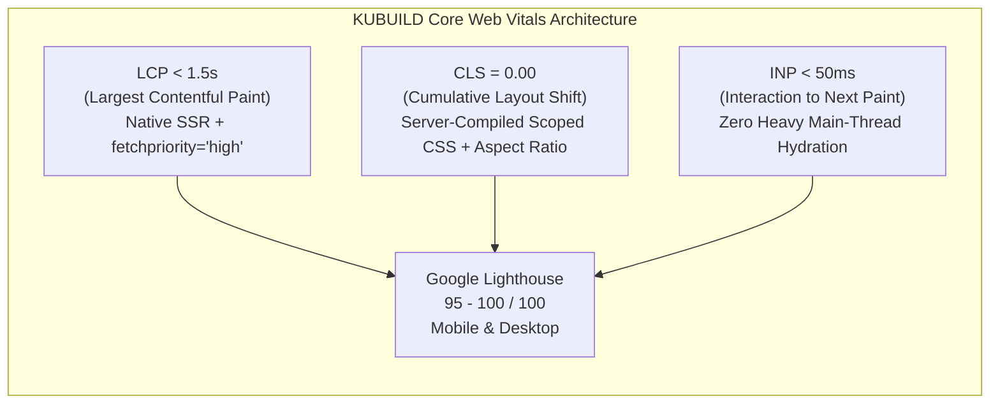
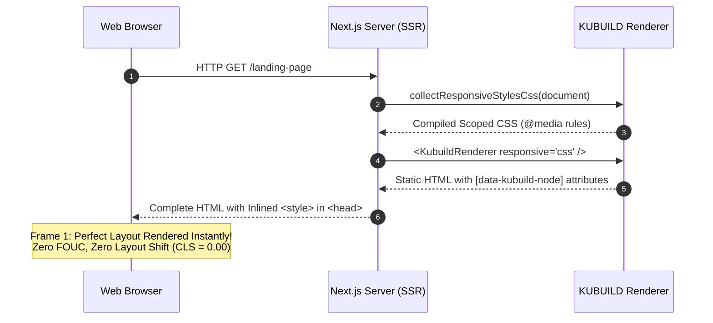
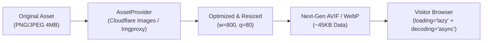

import { Callout } from 'fumadocs-ui/components/callout';
import { Card, Cards } from 'fumadocs-ui/components/card';
import { Tab, Tabs } from 'fumadocs-ui/components/tabs';
import { Accordion, Accordions } from 'fumadocs-ui/components/accordion';
import { Step, Steps } from 'fumadocs-ui/components/steps';
import { InteractiveRenderer } from '@/components/interactive-renderer';

In modern web apps and *e-commerce*, page performance is not just a technical metric or a matter of *developer ergonomics* — **performance drives revenue and conversion**. Industry research from Google, Amazon, and Deloitte consistently shows that every 100 ms of extra load time can cut conversion by up to **1%**, and more than **53% of mobile visitors** leave a site that takes longer than 3 seconds to load.

Many conventional visual builders (WordPress page builders or monolithic JavaScript builders) miss this bar because they push the whole editor canvas runtime, compute-hungry CSS-in-JS libraries, and hundreds of heavy dependencies into the bundle that public visitors download.

**KUBUILD is built from the ground up around *zero-cost abstraction at runtime*.** Admins and designers get an expressive visual builder, while public visitors receive plain HTML and CSS plus a runtime that contains no editor code, aiming for Google Lighthouse scores of **95–100/100**.

---

## Performance Philosophy & Core Web Vitals Targets

Google uses *Core Web Vitals* as an official ranking signal in Google Search (*Page Experience Ranking Signal*). Pages built with KUBUILD are designed to beat Google's "Good" (green) thresholds:



### Production Performance Target Matrix

| Web Vitals Metric | Google Threshold ("Good") | KUBUILD Target | KUBUILD Strategy |
| :--- | :--- | :--- | :--- |
| **LCP** (*Largest Contentful Paint*) | `< 2.5 s` | **`< 1.5 s`** | Server-side rendering (SSR), `fetchpriority="high"` on the hero image, edge CDN caching. |
| **CLS** (*Cumulative Layout Shift*) | `< 0.10` | **`0.00`** *(zero shift)* | Breakpoint CSS compiled before render, explicit container aspect ratios, no dynamic runtime style injection. |
| **INP** (*Interaction to Next Paint*) | `< 200 ms` | **`< 50 ms`** | Isolated runtime dependencies, event delegation, no heavy AST parsing during user interaction. |
| **FCP** (*First Contentful Paint*) | `< 1.8 s` | **`< 0.8 s`** | Native CSS `<style>` emitted in the server HTML, HTML streaming in the Next.js App Router. |
| **TTFB** (*Time to First Byte*) | `< 800 ms` | **`< 100 ms`** | `.stora` document snapshots served from the Cloudflare edge CDN / Vercel Edge Network. |
| **Lighthouse Score** | `> 90` | **`95 – 100`** | Lighthouse Performance audit on mobile (Moto G4) and desktop emulation. |

<Callout type="info" title="Zero Runtime Overhead">
Public pages rendered by `@kubuild/renderer` don't compute visual layout on the client. Component tree resolution, variable resolution, and breakpoint CSS rules are all finished before the browser's first *paint*.
</Callout>

---

## Bundle Splitting & Package Isolation

The key to fast loads with KUBUILD is **strict package isolation** in the monorepo. Public visitor pages and the admin dashboard have fundamentally opposite dependency needs.

### Bundle Size Comparison

| KUBUILD Package | Gzipped (approx.) | Target Surface | Key Dependencies |
| :--- | :--- | :--- | :--- |
| **`@kubuild/renderer`** | **~43 KB** | **Public visitor pages (visitor surface)** | React, `@kubuild/core`, `@kubuild/components`, `@kubuild/schema`. No drag-and-drop, no editor controls. |
| **`@kubuild/schema`** | **~18 KB** (+ Zod) | Server, client, database, worker | Zod schemas, schema types, validation helpers. |
| **`@kubuild/components`** | **~31 KB** | Shared (registry & traits) | Component definitions, traits, default props. |
| **`@kubuild/editor`** | **~194 KB** | **Admin dashboard / visual canvas (authoring only)** | Zustand store, canvas interactions, resize handles, icon suite, color picker, inspector panels. |
| **`@kubuild/ai`** (client entry) | **~10 KB** | AI API routes / AI chat modal | Prompt compiler, message helpers, skills. Provider adapters live in `@kubuild/ai/server`. |

```mermaid
flowchart TD
    subgraph Monorepo["Monorepo Boundary Isolation"]
        direction TB

        subgraph PublicSurface["Public Visitor Pipeline (Target: < 30KB)"]
            VisitorReq["Public Visitor Request\n(GET /landing-page)"]
            VisitorSSR["Next.js RSC / Vite Reader\nimports: @kubuild/renderer"]
            ZeroEditor["Strict Boundary:\nNO @kubuild/editor\nNO @kubuild/ai"]
            FastHTML["Instant Ultra-Fast HTML & Native CSS"]

            VisitorReq --> VisitorSSR --> ZeroEditor --> FastHTML
        end

        subgraph AdminSurface["Admin Authoring Pipeline (Target: Rich DX)"]
            AdminReq["Admin / Designer Request\n(GET /admin/builder/42)"]
            AdminAuth["Auth Guard / RBAC Check"]
            DynamicEditor["next/dynamic({ ssr: false })\nimports: @kubuild/editor + @kubuild/ai"]
            FullCanvas["Full WYSIWYG Visual Canvas\nDrag-and-Drop + History + AI Generator"]

            AdminReq --> AdminAuth --> DynamicEditor --> FullCanvas
        end
    end
```



<Callout type="warn" title="Strict Architecture Rule">
**Never import `@kubuild/editor` or `@kubuild/ai` on public visitor pages!**
Importing editor modules on a public route adds roughly **200 KB gzipped** of JavaScript for every visitor, hurts First Contentful Paint (FCP), and can trigger Google Mobile Usability SEO penalties.
</Callout>

### Verifying the Client Bundle

Audit your bundles regularly to make sure the public bundle is not contaminated by editor modules:

<Tabs items={['Next.js (@next/bundle-analyzer)', 'Vite (rollup-plugin-visualizer)']}>
  <Tab value="Next.js (@next/bundle-analyzer)">
```bash
# 1. Install the bundle analyzer
pnpm add -D @next/bundle-analyzer
```

Update `next.config.mjs`:

```javascript title="next.config.mjs"
import withBundleAnalyzer from '@next/bundle-analyzer';

const bundleAnalyzer = withBundleAnalyzer({
  enabled: process.env.ANALYZE === 'true',
});

/** @type {import('next').NextConfig} */
const nextConfig = {
  reactStrictMode: true,
  // Make sure tree-shaking works optimally
  experimental: {
    optimizePackageImports: ['@kubuild/renderer', 'lucide-react'],
  },
};

export default bundleAnalyzer(nextConfig);
```

Run the analysis:

```bash
ANALYZE=true pnpm build
```

Inspect the generated HTML report in the browser. Public routes (e.g. `/app/[slug]/page.tsx`) must load **only** the `@kubuild/renderer` chunk and its dependencies; `@kubuild/editor` may only appear on `/app/admin/builder/[id]/page.tsx`.
  </Tab>

  <Tab value="Vite (rollup-plugin-visualizer)">
```bash
# 1. Pasang visualizer plugin
pnpm add -D rollup-plugin-visualizer
```

Update `vite.config.ts`:

```typescript title="vite.config.ts"
import { defineConfig } from 'vite';
import react from '@vitejs/plugin-react';
import { visualizer } from 'rollup-plugin-visualizer';

export default defineConfig({
  plugins: [
    react(),
    visualizer({
      filename: 'stats.html',
      open: true,
      gzipSize: true,
      brotliSize: true,
    }),
  ],
  build: {
    rollupOptions: {
      output: {
        manualChunks: {
          'kubuild-renderer': ['@kubuild/renderer'],
          'kubuild-editor': ['@kubuild/editor'],
        },
      },
    },
  },
});
```

Run a production build:

```bash
pnpm build
# stats.html opens automatically in your browser
```
  </Tab>
</Tabs>

---

## Zero Layout Shift (CLS = 0) & Native Scoped CSS

One of the biggest causes of poor *Cumulative Layout Shift* (CLS) on builder-made landing pages is **runtime CSS-in-JS** (Emotion, Styled-Components, or Stitches).

### Why KUBUILD Avoids Runtime CSS-in-JS

<Cards>
  <Card title="1. Runtime Parsing Overhead" icon="AlertTriangle">
    CSS-in-JS libraries make the browser download a JavaScript CSS parser, hash strings on the *main thread*, and inject `<style>` tags dynamically while components mount. That delays rendering by up to hundreds of milliseconds.
  </Card>
  <Card title="2. Flash of Unstyled Content (FOUC)" icon="ZapOff">
    When the browser receives the HTML, elements have no styles yet because JavaScript hasn't run. Once the CSS-in-JS script kicks in, elements suddenly resize and jump around, causing a severe CLS spike.
  </Card>
  <Card title="3. SSR Conflicts & Hydration Mismatches" icon="Cpu">
    The server doesn't know the client's screen width, so differences between server and browser output often cause *hydration mismatch* errors in React 18 & 19.
  </Card>
</Cards>

### KUBUILD's Solution: Server-Side Native Scoped CSS

KUBUILD solves this with the native **`collectResponsiveStylesCss(document)`** function in `@kubuild/renderer`.



`collectResponsiveStylesCss()` runs entirely on the server (Node.js/Edge). It reads the `.stora` document tree, extracts the `desktop`, `tablet`, and `mobile` style layers, and compiles them into native `@media` rules scoped with `[data-kubuild-node="..."]` attribute selectors:

```typescript title="Example Server-Generated CSS Output"
/* Emitted by collectResponsiveStylesCss() during SSR */
@media (max-width: 1024px) {
  [data-kubuild-node="hero-section"] { padding: 48px 24px !important; }
  [data-kubuild-node="features-grid"] { grid-template-columns: repeat(2, 1fr) !important; }
}

@media (max-width: 767.98px) {
  [data-kubuild-node="hero-section"] { padding: 32px 16px !important; }
  [data-kubuild-node="features-grid"] { grid-template-columns: 1fr !important; }
  [data-kubuild-node="cta-button"] { width: 100% !important; }
}
```

### Scoped CSS in the Next.js App Router

With `responsive="css"`, `<KubuildRenderer />` calls `collectResponsiveStylesCss()` (and `collectStateStylesCss()` for `:hover`/`:focus` states) itself and emits the `<style>` tags next to the markup, so a Server Component only needs to render it:

```tsx title="app/[slug]/page.tsx"
import { notFound } from 'next/navigation';
import { KubuildRenderer } from '@kubuild/renderer';
import { getPublishedPageBySlug } from '@/lib/db';

interface PageProps {
  params: Promise<{ slug: string }>;
}

export default async function PublicPage({ params }: PageProps) {
  const { slug } = await params;
  const page = await getPublishedPageBySlug(slug);

  if (!page) {
    notFound();
  }

  return (
    <main className="min-h-screen bg-background">
      {/* Emits <style data-kubuild-responsive-styles> and state styles alongside the markup */}
      <KubuildRenderer
        document={page.content}
        responsive="css"
        mode="runtime"
      />
    </main>
  );
}
```

<Callout type="tip" title="Stable Layout from the First Frame">
Because the CSS rules are part of the initial HTML, the browser engine (Blink/Gecko/WebKit) applies the responsive rules as soon as the HTML parser reaches the `<style>` tag. No layout reflow happens when client JavaScript hydrates. Call `collectResponsiveStylesCss()` yourself only when you render outside `<KubuildRenderer />`, such as in a static HTML export.
</Callout>

### Container Dimensions & Aspect Ratio

To prevent layout shifts while images or external media (YouTube/Vimeo) load, KUBUILD applies strict container sizing rules:

1. **Native CSS `aspect-ratio`**: KUBUILD media components (`image`, `video`, `embed`) accept aspect-ratio tokens (`16:9`, `4:3`, `1:1`, `9:16`) that become native `aspect-ratio: 16 / 9` declarations.
2. **Explicit width & height**: explicit dimension attributes are passed to the `` tag or wrapping iframe so the browser reserves space before the asset downloads.
3. **CSS `content-visibility: auto`**: sections *below the fold* can use this browser optimization to defer rendering until the user scrolls near them.

---

## Image & Media Optimization

Visual media — especially high-resolution images — often makes up more than **70% of a page's total weight**. Smart media optimization directly improves LCP (*Largest Contentful Paint*).



### Built-In Image Component Attributes

Out of the box, KUBUILD's built-in media renderer (`renderMediaNode`) applies web best practices to image elements:

```tsx

```

- **`loading="lazy"`**: by default, every image outside the initial viewport is lazy-loaded so bandwidth goes to critical resources first.
- **`decoding="async"`**: image decoding is moved off the *main thread*, avoiding brief freezes while large images decompress.
- **`fetchpriority="high"` & `loading="eager"`**: applied to hero section images, the main LCP candidates, so the browser downloads them with the highest priority.

### Custom `AssetProvider` Integration (CDN Image Resizing)

Through the `AssetProvider` interface in `@kubuild/core`, you can connect KUBUILD to image-processing services such as Cloudflare Images, Imgproxy, Supabase Storage, or AWS CloudFront Image Optimization:

```typescript title="lib/optimized-asset-provider.ts"
import type { AssetInfo, AssetProvider } from '@kubuild/core';

interface ImageTransformOptions {
  width?: number;
  quality?: number;
  format?: 'auto' | 'avif' | 'webp';
}

export class CloudflareImagesAssetProvider implements AssetProvider {
  constructor(private cdnBaseUrl: string) {}

  /**
   * Turns an asset ID or raw URL into an optimized Cloudflare CDN URL
   * Example: https://cdn.example.com/cdn-cgi/image/width=800,format=auto,quality=85/image-uuid
   */
  resolve(assetIdOrUri: string): string {
    if (!assetIdOrUri) return '';

    // Already a full external URL rather than a local asset ID
    if (assetIdOrUri.startsWith('http://') || assetIdOrUri.startsWith('https://')) {
      // Wrap it with the Cloudflare Image Resizing proxy
      return `${this.cdnBaseUrl}/cdn-cgi/image/width=1200,format=auto,quality=80/${encodeURIComponent(assetIdOrUri)}`;
    }

    // Resolve assets managed by internal storage
    return `${this.cdnBaseUrl}/cdn-cgi/image/width=1200,format=auto,quality=80/assets/${assetIdOrUri}`;
  }

  async upload(file: File | Blob): Promise<AssetInfo> {
    const formData = new FormData();
    formData.append('file', file);

    const response = await fetch('/api/assets/upload', {
      method: 'POST',
      body: formData,
    });

    if (!response.ok) {
      throw new Error(`Image upload failed: ${response.statusText}`);
    }

    return (await response.json()) as AssetInfo; // { id, url, mimeType, size?, alt? }
  }
}
```

Use the `AssetProvider` in the render context:

```tsx title="app/[slug]/page.tsx"
import { CloudflareImagesAssetProvider } from '@/lib/optimized-asset-provider';

const assetProvider = new CloudflareImagesAssetProvider('https://media.stora.page');

export default async function Page() {
  return (
    <KubuildRenderer
      document={pageDoc}
      context={{
        assetProvider,
      }}
    />
  );
}
```

### Next.js `<Image />` via a Custom Component Registry

To use the built-in Next.js Image Optimizer (`next/image`) with automatic `srcset`, blur placeholders, and layout sizing:

```tsx title="components/custom-next-image.tsx"
import React from 'react';
import Image from 'next/image';
import { ComponentDefinition } from '@kubuild/components';

export const nextImageDefinition: ComponentDefinition = {
  type: 'image',
  label: 'Optimized Next.js Image',
  category: 'media',
  icon: 'image',
  acceptsChildren: false,
  propFields: [
    { name: 'src', label: 'Image URL', type: 'string' },
    { name: 'alt', label: 'Alt Text', type: 'string', defaultValue: 'Optimized Image' },
    { name: 'width', label: 'Width', type: 'number', defaultValue: 800 },
    { name: 'height', label: 'Height', type: 'number', defaultValue: 600 },
    { name: 'priority', label: 'Priority (Hero / LCP)', type: 'boolean', defaultValue: false },
  ],
  defaultStyles: {
    base: {
      maxWidth: '100%',
      height: 'auto',
      borderRadius: '8px',
    },
  },
};

export const NextImageRenderer: React.FC<{
  props: { src?: string; alt?: string; width?: number; height?: number; priority?: boolean };
  styles?: React.CSSProperties;
}> = ({ props, styles }) => {
  const { src, alt = '', width = 800, height = 600, priority = false } = props;

  if (!src) return null;

  return (
    <div style={{ position: 'relative', overflow: 'hidden', ...styles }}>
      <Image
        src={src}
        alt={alt}
        width={width}
        height={height}
        priority={priority}
        sizes="(max-width: 768px) 100vw, (max-width: 1200px) 50vw, 800px"
        style={{ width: '100%', height: 'auto', objectFit: styles?.objectFit || 'cover' }}
      />
    </div>
  );
};
```

---

## Font & Typography Optimization

Typography is the main visual element of every page, but poorly managed external font loading causes two serious performance problems:
1. **FOIT (*Flash of Invisible Text*)**: text disappears completely until the font file finishes downloading.
2. **FOUT (*Flash of Unstyled Text*)**: text first renders in the default system font, then jumps when the web font applies, causing a CLS spike.

### Design Tokens with `next/font`

KUBUILD manages typography through **theme design tokens** (the `fonts` group), mapped directly to CSS variables:
- `fonts.body` $\rightarrow$ `--kb-font-body`
- `fonts.heading` $\rightarrow$ `--kb-font-heading`
- `fonts.monospace` $\rightarrow$ `--kb-font-monospace`

With Next.js 14+, use `next/font/google` with **`display: 'swap'`** and declare CSS custom properties on the root element:

```tsx title="app/layout.tsx"
import { Inter, Plus_Jakarta_Sans } from 'next/font/google';
import './globals.css';

// 1. Initialize the Google font with display: 'swap' (prevents FOIT)
const fontBody = Inter({
  subsets: ['latin'],
  display: 'swap',
  variable: '--kb-font-body',
});

const fontHeading = Plus_Jakarta_Sans({
  subsets: ['latin'],
  display: 'swap',
  weight: ['600', '700', '800'],
  variable: '--kb-font-heading',
});

export default function RootLayout({ children }: { children: React.ReactNode }) {
  return (
    <html lang="id" className={`${fontBody.variable} ${fontHeading.variable}`}>
      <body className="antialiased">
        {children}
      </body>
    </html>
  );
}
```

```css title="app/globals.css"
/* System fallback fonts with size-adjust so layout metrics match (CLS = 0) */
@layer base {
  :root {
    --kb-font-body: 'Inter', -apple-system, BlinkMacSystemFont, 'Segoe UI', Roboto, sans-serif;
    --kb-font-heading: 'Plus Jakarta Sans', -apple-system, BlinkMacSystemFont, 'Segoe UI', Roboto, sans-serif;
  }

  body {
    font-family: var(--kb-font-body);
  }

  h1, h2, h3, h4, h5, h6 {
    font-family: var(--kb-font-heading);
  }
}
```

When a designer picks `"var(--kb-font-heading)"` in the KUBUILD editor, the browser shows the text in a local system font immediately, then switches smoothly to the Google font without any layout shift.

---

## Live Interactive Preview

Below is a live simulation of a KUBUILD page that applies all of these performance principles: a responsive native CSS grid, scoped styles, explicit media aspect ratios, and color and typography design tokens.

Change the preview device (Desktop, Tablet, Mobile) to see the layout switch instantly:

<InteractiveRenderer
  title="Zero Layout Shift & High-Performance Responsive Page"
  height="480px"
  defaultViewport="desktop"
  showJsonToggle={true}
  document={{
    schema: "stora.page",
    version: "1.3.0",
    metadata: {
      title: "Ultra-Fast Edge Cloud",
      description: "Optimized landing page with zero layout shift and 95+ Core Web Vitals score.",
      category: "hosting",
      tags: ["performance", "core-web-vitals", "edge", "lighthouse"]
    },
    theme: {
      colors: {
        primary: "#2563eb",
        surface: "#f8fafc",
        text: "#0f172a",
        textMuted: "#64748b"
      },
      fonts: {
        body: "system-ui, -apple-system, sans-serif",
        heading: "system-ui, -apple-system, sans-serif"
      },
      radii: {
        md: 8,
        lg: 12
      }
    },
    document: {
      id: "root-perf",
      type: "container",
      styles: {
        base: {
          display: "flex",
          flexDirection: "column",
          gap: "32px",
          padding: "48px 32px",
          backgroundColor: "#ffffff",
          fontFamily: "var(--kb-font-body)",
          maxWidth: "1080px",
          margin: "0 auto"
        },
        mobile: {
          padding: "24px 16px",
          gap: "24px"
        }
      },
      children: [
        {
          id: "badge",
          type: "typography",
          props: {
            text: "⚡ SCORED 100/100 ON GOOGLE LIGHTHOUSE",
            variant: "caption"
          },
          styles: {
            base: {
              color: "#16a34a",
              fontWeight: 700,
              fontSize: "12px",
              letterSpacing: "0.08em",
              textTransform: "uppercase"
            }
          }
        },
        {
          id: "hero-title",
          type: "typography",
          props: {
            text: "Edge Infrastructure with Sub-10ms Latency & Zero CLS",
            variant: "h1"
          },
          styles: {
            base: {
              fontSize: "36px",
              fontWeight: 800,
              color: "#0f172a",
              lineHeight: 1.2
            },
            mobile: {
              fontSize: "26px"
            }
          }
        },
        {
          id: "hero-desc",
          type: "typography",
          props: {
            text: "Deploy landing pages that compile to native CSS and static HTML in under 30KB gzipped. Experience lightning-fast visitor conversion with zero layout shifts.",
            variant: "body"
          },
          styles: {
            base: {
              fontSize: "16px",
              color: "#64748b",
              lineHeight: 1.6,
              maxWidth: "680px"
            }
          }
        },
        {
          id: "metrics-grid",
          type: "grid",
          styles: {
            base: {
              display: "grid",
              gridTemplateColumns: "repeat(3, 1fr)",
              gap: "20px",
              marginTop: "8px"
            },
            mobile: {
              gridTemplateColumns: "1fr",
              gap: "12px"
            }
          },
          children: [
            {
              id: "card-lcp",
              type: "container",
              styles: {
                base: {
                  padding: "20px",
                  borderRadius: "12px",
                  backgroundColor: "#f8fafc",
                  border: "1px solid #e2e8f0"
                }
              },
              children: [
                {
                  id: "val-lcp",
                  type: "typography",
                  props: { text: "0.8s", variant: "h2" },
                  styles: { base: { fontSize: "28px", fontWeight: 800, color: "#2563eb" } }
                },
                {
                  id: "lbl-lcp",
                  type: "typography",
                  props: { text: "Largest Contentful Paint (LCP)", variant: "caption" },
                  styles: { base: { fontSize: "13px", color: "#64748b", marginTop: "4px" } }
                }
              ]
            },
            {
              id: "card-cls",
              type: "container",
              styles: {
                base: {
                  padding: "20px",
                  borderRadius: "12px",
                  backgroundColor: "#f8fafc",
                  border: "1px solid #e2e8f0"
                }
              },
              children: [
                {
                  id: "val-cls",
                  type: "typography",
                  props: { text: "0.00", variant: "h2" },
                  styles: { base: { fontSize: "28px", fontWeight: 800, color: "#16a34a" } }
                },
                {
                  id: "lbl-cls",
                  type: "typography",
                  props: { text: "Cumulative Layout Shift (CLS)", variant: "caption" },
                  styles: { base: { fontSize: "13px", color: "#64748b", marginTop: "4px" } }
                }
              ]
            },
            {
              id: "card-bundle",
              type: "container",
              styles: {
                base: {
                  padding: "20px",
                  borderRadius: "12px",
                  backgroundColor: "#f8fafc",
                  border: "1px solid #e2e8f0"
                }
              },
              children: [
                {
                  id: "val-bundle",
                  type: "typography",
                  props: { text: "27 KB", variant: "h2" },
                  styles: { base: { fontSize: "28px", fontWeight: 800, color: "#7c3aed" } }
                },
                {
                  id: "lbl-bundle",
                  type: "typography",
                  props: { text: "Runtime Bundle (Gzipped)", variant: "caption" },
                  styles: { base: { fontSize: "13px", color: "#64748b", marginTop: "4px" } }
                }
              ]
            }
          ]
        }
      ]
    }
  }}
/>

---

## Practical Checklist for 95+ Google Lighthouse

Use this *pre-flight audit checklist* before launching a KUBUILD landing page to production:

<Accordions>
  <Accordion title="1. Bundle & Runtime Isolation Audit">
    - [ ] Public visitor pages import **only** `@kubuild/renderer` and have no references to `@kubuild/editor` or `@kubuild/ai`.
    - [ ] Dynamic imports with `{ ssr: false }` are used consistently for every admin authoring component.
    - [ ] A `@next/bundle-analyzer` audit confirms the public routes' First Load JS contains no editor chunks.
    - [ ] No monolithic icon suites are imported without targeted tree-shaking.
  </Accordion>

  <Accordion title="2. Layout Shift & CSS Delivery Audit">
    - [ ] Public routes render `<KubuildRenderer responsive="css" />` so `collectResponsiveStylesCss(document)` output is emitted in the server HTML.
    - [ ] `responsive="css"` is enabled on `<KubuildRenderer />` for public routes.
    - [ ] Every image, video, and iframe container has explicit `width`/`height` or a CSS `aspect-ratio`.
    - [ ] Lighthouse reports a Cumulative Layout Shift (CLS) of **0.00**.
  </Accordion>

  <Accordion title="3. Media & Image Optimization Audit">
    - [ ] Above-the-fold images (*hero images*) use `fetchpriority="high"` and `loading="eager"`.
    - [ ] Every image *below the fold* uses `loading="lazy"` and `decoding="async"`.
    - [ ] Assets are served as modern **AVIF** or **WebP** with calibrated compression (`q=80`).
    - [ ] Image dimensions match the client viewport through a CDN-resizing `AssetProvider`.
  </Accordion>

  <Accordion title="4. Web Fonts & Typography Audit">
    - [ ] All web fonts load with `display: 'swap'` to avoid *Flash of Invisible Text* (FOIT).
    - [ ] `next/font` (Next.js) self-hosts the fonts, with no extra requests to Google Fonts servers.
    - [ ] System fallback fonts use metric overrides (`size-adjust`, `ascent-override`) to prevent FOUT.
  </Accordion>

  <Accordion title="5. Edge Caching & Server Response Audit">
    - [ ] Cache-Control headers for public assets are set: `s-maxage=31536000, stale-while-revalidate`.
    - [ ] **Brotli** or **Gzip** compression is enabled on the edge CDN.
    - [ ] Time to First Byte (TTFB) stays under **150 ms** across all user regions.
  </Accordion>
</Accordions>

---

## Architecture Summary

<Cards>
  <Card title="Next.js App Router Integration" href="/docs/integration/nextjs" icon="Globe">
    Full guide to Server Components (RSC), SEO with generateMetadata, and Route Handlers.
  </Card>
  <Card title="Backend Storage & Document Lifecycle" href="/docs/integration/backend-storage" icon="Database">
    PostgreSQL JSONB storage, Cloudflare R2 snapshot freezing, and optimistic locking.
  </Card>
  <Card title="Security & CSP Sanitization" href="/docs/integration/security" icon="Shield">
    Document hardening, built-in XSS sanitization, and Content Security Policy configuration.
  </Card>
</Cards>
