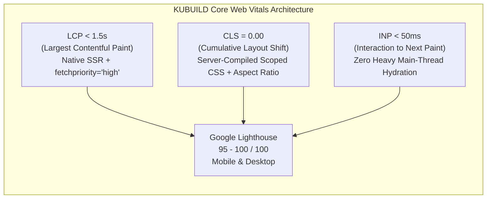
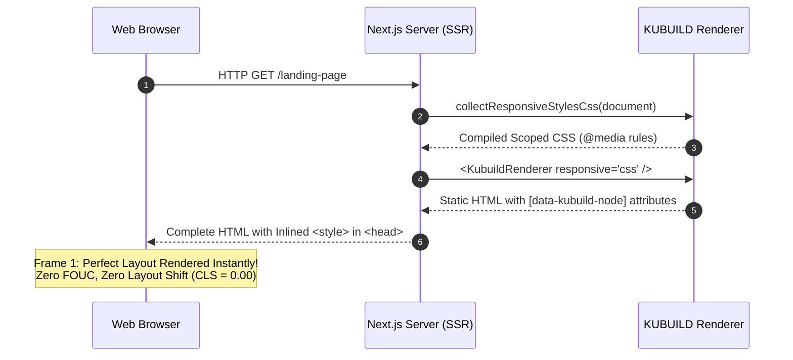
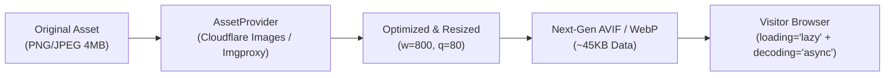

```mermaid
flowchart TD
    subgraph Monorepo["Monorepo Boundary Isolation"]
        direction TB

        subgraph PublicSurface["Public Visitor Pipeline (Target: < 30KB)"]
            VisitorReq["Public Visitor Request\n(GET /landing-page)"]
            VisitorSSR["Next.js RSC / Vite Reader\nimports: @kubuild/renderer"]
            ZeroEditor["Strict Boundary:\nNO @kubuild/editor\nNO @kubuild/ai"]
            FastHTML["Instant Ultra-Fast HTML & Native CSS"]

            VisitorReq --> VisitorSSR --> ZeroEditor --> FastHTML
        end

        subgraph AdminSurface["Admin Authoring Pipeline (Target: Rich DX)"]
            AdminReq["Admin / Designer Request\n(GET /admin/builder/42)"]
            AdminAuth["Auth Guard / RBAC Check"]
            DynamicEditor["next/dynamic({ ssr: false })\nimports: @kubuild/editor + @kubuild/ai"]
            FullCanvas["Full WYSIWYG Visual Canvas\nDrag-and-Drop + History + AI Generator"]

            AdminReq --> AdminAuth --> DynamicEditor --> FullCanvas
        end
    end
```

import { Callout } from 'fumadocs-ui/components/callout';
import { Card, Cards } from 'fumadocs-ui/components/card';
import { Tab, Tabs } from 'fumadocs-ui/components/tabs';
import { Accordion, Accordions } from 'fumadocs-ui/components/accordion';
import { Step, Steps } from 'fumadocs-ui/components/steps';
import { InteractiveRenderer } from '@/components/interactive-renderer';

Dalam ekosistem aplikasi web modern dan *e-commerce*, performa halaman bukan sekadar metrik teknis atau urusan kenyamanan pengembang (*developer ergonomics*)—**performa adalah faktor penentu pendapatan bisnis dan konversi**. Riset industri dari Google, Amazon, dan Deloitte secara konsisten membuktikan bahwa setiap keterlambatan 100 milidetik pada pemuatan halaman dapat menurunkan rasio konversi hingga **1%**, sementara lebih dari **53% pengunjung perangkat seluler** meninggalkan situs jika waktu muat melebihi 3 detik.

Banyak visual builder konvensional (seperti WordPress page builders atau builder berbasis monolitik JavaScript) gagal memenuhi standar ini karena memaksakan seluruh runtime kanvas editor, pustaka CSS-in-JS dinamis yang rakus komputasi, dan ratusan dependensi berat ke dalam bundle yang dikonsumsi oleh pengunjung publik.

**KUBUILD dibangun dari awal dengan arsitektur *Zero-Cost Abstraction at Runtime*.** Pengguna admin dan desainer menikmati pengalaman visual builder kelas dunia yang ekspresif, sementara jutaan pengunjung publik menerima halaman dengan HTML dan CSS murni, bundle JavaScript ultra-ringan (**< 30KB gzipped**), serta skor Google Lighthouse **95–100/100**.

---

## Filosofi Performa & Target Core Web Vitals

Google menjadikan *Core Web Vitals* sebagai sinyal peringkat resmi dalam algoritma pencarian Google Search (*Page Experience Ranking Signal*). Halaman yang dibangun dengan KUBUILD dirancang untuk melampaui ambang batas "Good" (*Hijau*) dari Google:



### Matriks Target Kinerja Produksi

| Metrik Web Vitals | Ambang Batas Google ("Good") | Target Mesin KUBUILD | Strategi Implementasi KUBUILD |
| :--- | :--- | :--- | :--- |
| **LCP** (*Largest Contentful Paint*) | `< 2.5 detik` | **`< 1.5 detik`** | Server-side rendering (SSR), `fetchpriority="high"` pada hero image, CDN Edge caching. |
| **CLS** (*Cumulative Layout Shift*) | `< 0.10` | **`0.00`** *(Zero Shift)* | Kompilasi CSS breakpoint sebelum render, dimensi rasio aspek kontainer eksplisit, zero dynamic runtime style injection. |
| **INP** (*Interaction to Next Paint*) | `< 200 milidetik` | **`< 50 milidetik`** | Isolasi dependensi runtime, arsitektur event delegation, tidak ada eksekusi AST parsing berat pada interaksi pengguna. |
| **FCP** (*First Contentful Paint*) | `< 1.8 detik` | **`< 0.8 detik`** | Native CSS `<style>` diinjeksikan langsung pada HTML `<head>`, streaming HTML di Next.js App Router. |
| **TTFB** (*Time to First Byte*) | `< 800 milidetik` | **`< 100 milidetik`** | Distribusi snapshot dokumen `.stora` melalui Cloudflare Edge CDN / Vercel Edge Network. |
| **Lighthouse Score** | `> 90` | **`95 – 100`** | Audit Lighthouse kategori Performance pada emulasi Mobile Moto G4 & Desktop. |

<Callout type="info" title="Zero Runtime Overhead">
Halaman publik yang dirender oleh `@kubuild/renderer` tidak menjalankan kalkulasi tata letak visual di sisi klien. Seluruh kalkulasi pohon komponen, resolusi variabel, dan aturan CSS breakpoint telah diselesaikan sebelum browser melakukan *paint* pertama.
</Callout>

---

## Bundle Splitting & Package Isolation

Kunci utama tercapainya waktu muat kilat pada KUBUILD adalah **pemisahan paket secara tegas** (*strict package isolation*) dalam monorepo. Halaman publik pengunjung dan dasbor admin memiliki kebutuhan dependensi yang bertolak belakang secara fundamental.

### Tabel Perbandingan Ukuran Bundle

| Paket KUBUILD | Ukuran Gzipped | Ukuran Minified | Ranah Penggunaan (*Target Surface*) | Dependensi Kunci |
| :--- | :--- | :--- | :--- | :--- |
| **`@kubuild/renderer`** | **~27 KB** | **~78 KB** | **Halaman Publik Pengunjung (Visitor Surface)** | React, `@kubuild/schema` (Zod ringan), core helpers murni. Tanpa drag-and-drop, tanpa editor controls! |
| **`@kubuild/schema`** | **~4 KB** | **~12 KB** | Server, Client, Database, Worker | Zod validator, schema types, CSS variable resolvers. |
| **`@kubuild/components`** | **~16 KB** | **~45 KB** | Shared (Registry & Traits) | Trait definitions, default props, icons metadata. |
| **`@kubuild/editor`** | **~320 KB** | **~1.1 MB** | **Dasbor Admin / Visual Canvas (Authoring Only)** | Zustand store, dnd-kit, floating UI, canvas resize handles, Lucide icon suite, color picker, inspector panels. |
| **`@kubuild/ai`** | **~45 KB** | **~140 KB** | Rute API Server / AI Chat Modal | AI provider adapters, stream readers, page generator pipeline. |



<Callout type="warn" title="Aturan Arsitektur Tegas">
**Jangan pernah mengimpor `@kubuild/editor` atau `@kubuild/ai` di halaman publik pengunjung!**
Mengimpor modul editor pada rute publik akan membengkakkan bundle JavaScript pengunjung sebesar **> 300KB**, merusak skor First Contentful Paint (FCP), dan memicu penalti SEO pada Google Mobile Usability.
</Callout>

### Memverifikasi Bundle Client

Pastikan bundle publik aplikasi Anda tidak terkontaminasi modul editor dengan melakukan audit bundle secara berkala:

<Tabs items={['Next.js (@next/bundle-analyzer)', 'Vite (rollup-plugin-visualizer)']}>
  <Tab value="Next.js (@next/bundle-analyzer)">
```bash
# 1. Pasang paket bundle analyzer
pnpm add -D @next/bundle-analyzer
```

Perbarui file `next.config.mjs`:

```javascript title="next.config.mjs"
import withBundleAnalyzer from '@next/bundle-analyzer';

const bundleAnalyzer = withBundleAnalyzer({
  enabled: process.env.ANALYZE === 'true',
});

/** @type {import('next').NextConfig} */
const nextConfig = {
  reactStrictMode: true,
  // Pastikan tree-shaking berjalan optimal
  experimental: {
    optimizePackageImports: ['@kubuild/renderer', 'lucide-react'],
  },
};

export default bundleAnalyzer(nextConfig);
```

Jalankan perintah analisis:

```bash
ANALYZE=true pnpm build
```

Periksa laporan HTML yang dihasilkan di browser. Halaman rute publik (misal: `/app/[slug]/page.tsx`) harus **hanya** memuat chunk `@kubuild/renderer` sebesar ~27KB, sedangkan `@kubuild/editor` hanya boleh muncul di rute `/app/admin/builder/[id]/page.tsx`.
  </Tab>

  <Tab value="Vite (rollup-plugin-visualizer)">
```bash
# 1. Pasang visualizer plugin
pnpm add -D rollup-plugin-visualizer
```

Perbarui file `vite.config.ts`:

```typescript title="vite.config.ts"
import { defineConfig } from 'vite';
import react from '@vitejs/plugin-react';
import { visualizer } from 'rollup-plugin-visualizer';

export default defineConfig({
  plugins: [
    react(),
    visualizer({
      filename: 'stats.html',
      open: true,
      gzipSize: true,
      brotliSize: true,
    }),
  ],
  build: {
    rollupOptions: {
      output: {
        manualChunks: {
          'kubuild-renderer': ['@kubuild/renderer'],
          'kubuild-editor': ['@kubuild/editor'],
        },
      },
    },
  },
});
```

Jalankan build produksi:

```bash
pnpm build
# stats.html akan otomatis terbuka di browser Anda
```
  </Tab>
</Tabs>

---

## Zero Layout Shift (CLS = 0) & Native Scoped CSS

Salah satu penyebab terbesar skor *Cumulative Layout Shift* (CLS) yang buruk pada landing page berbasis builder adalah penggunaan pustaka **Runtime CSS-in-JS** (seperti Emotion, Styled-Components, atau Stitches).

### Mengapa KUBUILD Menolak Runtime CSS-in-JS?

<Cards>
  <Card title="1. Runtime Parsing Overhead" icon="AlertTriangle">
    Pustaka CSS-in-JS mengharuskan browser mengunduh modul parser CSS JavaScript, melakukan komputasi hashing string di *main thread*, dan menyisipkan tag `<style>` secara dinamis saat komponen me-mount. Hal ini menunda proses rendering hingga ratusan milidetik.
  </Card>
  <Card title="2. Flash of Unstyled Content (FOUC)" icon="ZapOff">
    Ketika HTML diterima oleh browser, elemen belum memiliki style karena JavaScript belum dieksekusi. Begitu skrip CSS-in-JS aktif, elemen tiba-tiba berubah ukuran dan melompat di layar, menghasilkan lonjakan CLS yang fatal.
  </Card>
  <Card title="3. Konflik SSR & Hydration Mismatch" icon="Cpu">
    Perbedaan resolusi layar antara server (yang tidak mengetahui lebar layar klien) dan browser klien kerap memicu error *hydration mismatch* pada React 18 & 19.
  </Card>
</Cards>

### Solusi KUBUILD: Server-Side Native Scoped CSS Compiler

KUBUILD memecahkan masalah ini secara radikal melalui fungsi native **`collectResponsiveStylesCss(document)`** yang berada di dalam paket `@kubuild/renderer`.



Fungsi `collectResponsiveStylesCss()` berjalan sepenuhnya di server (Node.js/Edge). Fungsi ini membaca pohon AST dokumen `.stora`, mengekstrak layer gaya `desktop`, `tablet`, dan `mobile`, lalu mengompilasinya menjadi aturan `@media` query native yang terisolasi dengan selektor atribut `[data-kubuild-node="..."]`:

```typescript title="Contoh Output CSS yang Dihasilkan Server"
/* Diekstrak oleh collectResponsiveStylesCss() pada waktu SSR */
@media (max-width: 1024px) {
  [data-kubuild-node="hero-section"] { padding: 48px 24px !important; }
  [data-kubuild-node="features-grid"] { grid-template-columns: repeat(2, 1fr) !important; }
}

@media (max-width: 767.98px) {
  [data-kubuild-node="hero-section"] { padding: 32px 16px !important; }
  [data-kubuild-node="features-grid"] { grid-template-columns: 1fr !important; }
  [data-kubuild-node="cta-button"] { width: 100% !important; }
}
```

### Menginjeksikan Scoped CSS di Next.js App Router

Berikut adalah pola implementasi server-side rendering di mana tag CSS diinjeksi langsung ke dalam HTML `<head>` atau container root:

```tsx title="app/[slug]/page.tsx"
import { notFound } from 'next/navigation';
import { KubuildRenderer, collectResponsiveStylesCss, collectStateStylesCss } from '@kubuild/renderer';
import { getPublishedPageBySlug } from '@/lib/db';

interface PageProps {
  params: Promise<{ slug: string }>;
}

export default async function PublicPage({ params }: PageProps) {
  const { slug } = await params;
  const page = await getPublishedPageBySlug(slug);

  if (!page) {
    notFound();
  }

  // 1. Kompilasi aturan CSS breakpoint dan state pseudo-class di server
  const responsiveCss = collectResponsiveStylesCss(page.content);
  const stateCss = collectStateStylesCss(page.content);

  return (
    <main className="min-h-screen bg-background">
      {/* 2. Injeksi style native tepat di samping markup untuk SSR instan */}
      <style dangerouslySetInnerHTML={{ __html: `${responsiveCss}\n${stateCss}` }} />

      {/* 3. Render node tree dengan responsive="css" */}
      <KubuildRenderer
        document={page.content}
        responsive="css"
        mode="runtime"
      />
    </main>
  );
}
```

<Callout type="tip" title="Layout Stabil Sejak Frame Pertama">
Karena aturan CSS diinjeksi langsung dalam markup awal HTML, browser mesin render (Blink/Gecko/WebKit) menerapkan aturan responsif segera setelah parser HTML membaca tag `<style>`. Tidak ada layout reflow saat JavaScript klien di-hydrate!
</Callout>

### Pengaturan Dimensi Kontainer & Rasio Aspek (Aspect Ratio)

Untuk mencegah pergeseran layout saat elemen gambar atau media eksternal (YouTube/Vimeo) dimuat, KUBUILD menerapkan aturan ketat pada dimensi kontainer:

1. **Native CSS `aspect-ratio`**: Komponen media KUBUILD (`image`, `video`, `embed`) mendukung token rasio aspek (`16:9`, `4:3`, `1:1`, `9:16`) yang dikonversi menjadi deklarasi native `aspect-ratio: 16 / 9`.
2. **Explicit Width & Height**: Atribut dimensi eksplisit selalu diteruskan ke tag `` atau iframe pembungkus sehingga browser mereservasi ruang piksel sebelum konten aset berhasil diunduh.
3. **CSS `content-visibility: auto`**: Bagian section yang berada di bawah lipatan layar (*below-the-fold*) dapat memanfaatkan optimasi browser untuk menunda proses rendering hingga pengguna menggulir mendekati section tersebut.

---

## Optimasi Gambar & Media

Media visual—terutama gambar resolusi tinggi—sering kali menyumbang lebih dari **70% dari total bobot data** pada halaman web. Optimasi media yang cerdas berdampak langsung pada metrik LCP (*Largest Contentful Paint*).



### Atribut Bawaan Komponen Gambar KUBUILD

Secara *out-of-the-box*, renderer bawaan KUBUILD (`renderMediaNode`) menerapkan praktik terbaik industri web pada elemen gambar:

```tsx

```

- **`loading="lazy"`**: Secara default, seluruh gambar di luar viewport awal dimuat secara *lazy* sehingga bandwidth jaringan difokuskan untuk resource kritis.
- **`decoding="async"`**: Decoding gambar didelegasikan ke thread latar belakang, mencegah freeze sesaat pada *main thread* saat gambar besar didekompresi.
- **`fetchpriority="high"` & `loading="eager"`**: Diterapkan khusus untuk gambar di Hero Section yang menjadi kandidat utama elemen LCP, memerintahkan browser mengunduhnya dengan prioritas tertinggi.

### Integrasi dengan Custom `AssetProvider` (CDN Image Resizing)

Melalui antarmuka `AssetProvider` di `@kubuild/core`, Anda dapat menghubungkan KUBUILD ke layanan pemrosesan gambar otomatis seperti Cloudflare Images, Imgproxy, Supabase Storage, atau AWS CloudFront Image Optimization:

```typescript title="lib/optimized-asset-provider.ts"
import type { AssetProvider } from '@kubuild/core';

interface ImageTransformOptions {
  width?: number;
  quality?: number;
  format?: 'auto' | 'avif' | 'webp';
}

export class CloudflareImagesAssetProvider implements AssetProvider {
  constructor(private cdnBaseUrl: string) {}

  /**
   * Mengubah ID aset atau URL mentah menjadi URL CDN Cloudflare yang dioptimalkan
   * Contoh: https://cdn.example.com/cdn-cgi/image/width=800,format=auto,quality=85/image-uuid
   */
  resolve(assetIdOrUri: string): string {
    if (!assetIdOrUri) return '';

    // Jika sudah merupakan URL eksternal penuh dan bukan ID aset lokal
    if (assetIdOrUri.startsWith('http://') || assetIdOrUri.startsWith('https://')) {
      // Bungkus dengan Cloudflare Image Resizing proxy
      return `${this.cdnBaseUrl}/cdn-cgi/image/width=1200,format=auto,quality=80/${encodeURIComponent(assetIdOrUri)}`;
    }

    // Resolusi aset yang dikelola oleh storage internal
    return `${this.cdnBaseUrl}/cdn-cgi/image/width=1200,format=auto,quality=80/assets/${assetIdOrUri}`;
  }

  async upload(file: File | Blob): Promise<{ assetId: string; url: string }> {
    const formData = new FormData();
    formData.append('file', file);

    const response = await fetch('/api/assets/upload', {
      method: 'POST',
      body: formData,
    });

    if (!response.ok) {
      throw new Error(`Gagal mengunggah gambar: ${response.statusText}`);
    }

    return response.json();
  }
}
```

Menerapkan `AssetProvider` pada konteks render:

```tsx title="app/[slug]/page.tsx"
import { CloudflareImagesAssetProvider } from '@/lib/optimized-asset-provider';

const assetProvider = new CloudflareImagesAssetProvider('https://media.stora.page');

export default async function Page() {
  return (
    <KubuildRenderer
      document={pageDoc}
      context={{
        assetProvider,
      }}
    />
  );
}
```

### Integrasi dengan Next.js `<Image />` melalui Custom Component Registry

Jika Anda ingin memanfaatkan optimasi bawaan Next.js Image Optimizer (`next/image`) dengan dukungan otomatis `srcset`, blur placeholder, dan layout sizing:

```tsx title="components/custom-next-image.tsx"
import React from 'react';
import Image from 'next/image';
import { ComponentDefinition } from '@kubuild/components';

export const nextImageDefinition: ComponentDefinition = {
  type: 'image',
  label: 'Optimized Next.js Image',
  category: 'media',
  icon: 'image',
  acceptsChildren: false,
  propFields: [
    { name: 'src', label: 'Image URL', type: 'string' },
    { name: 'alt', label: 'Alt Text', type: 'string', defaultValue: 'Optimized Image' },
    { name: 'width', label: 'Width', type: 'number', defaultValue: 800 },
    { name: 'height', label: 'Height', type: 'number', defaultValue: 600 },
    { name: 'priority', label: 'Priority (Hero / LCP)', type: 'boolean', defaultValue: false },
  ],
  defaultStyles: {
    base: {
      maxWidth: '100%',
      height: 'auto',
      borderRadius: '8px',
    },
  },
};

export const NextImageRenderer: React.FC<{
  props: { src?: string; alt?: string; width?: number; height?: number; priority?: boolean };
  styles?: React.CSSProperties;
}> = ({ props, styles }) => {
  const { src, alt = '', width = 800, height = 600, priority = false } = props;

  if (!src) return null;

  return (
    <div style={{ position: 'relative', overflow: 'hidden', ...styles }}>
      <Image
        src={src}
        alt={alt}
        width={width}
        height={height}
        priority={priority}
        sizes="(max-width: 768px) 100vw, (max-width: 1200px) 50vw, 800px"
        style={{ width: '100%', height: 'auto', objectFit: styles?.objectFit || 'cover' }}
      />
    </div>
  );
};
```

---

## Font & Typography Optimization

Tipografi adalah elemen visual utama dari setiap halaman web. Namun, pemuatan font eksternal yang tidak teratur dapat menyebabkan dua masalah performa fatal:
1. **FOIT (*Flash of Invisible Text*)**: Teks menghilang sama sekali sampai file font selesai diunduh oleh browser.
2. **FOUT (*Flash of Unstyled Text*)**: Teks muncul dengan font sistem default, lalu tiba-tiba melompat ketika font web diterapkan, memicu lonjakan angka CLS.

### Mengintegrasikan Design Tokens dengan `next/font`

KUBUILD mengelola tipografi melalui sistem **Theme Design Tokens** (grup `fonts`), yang dipetakan langsung ke variabel CSS:
- `fonts.body` $\rightarrow$ `--kb-font-body`
- `fonts.heading` $\rightarrow$ `--kb-font-heading`
- `fonts.monospace` $\rightarrow$ `--kb-font-monospace`

Dengan Next.js 14 & 15, gunakan modul `next/font/google` dengan opsi **`display: 'swap'`** dan deklarasikan CSS custom properties pada elemen root:

```tsx title="app/layout.tsx"
import { Inter, Plus_Jakarta_Sans } from 'next/font/google';
import './globals.css';

// 1. Inisialisasi font Google dengan opsi display: 'swap' (mencegah FOIT)
const fontBody = Inter({
  subsets: ['latin'],
  display: 'swap',
  variable: '--kb-font-body',
});

const fontHeading = Plus_Jakarta_Sans({
  subsets: ['latin'],
  display: 'swap',
  weight: ['600', '700', '800'],
  variable: '--kb-font-heading',
});

export default function RootLayout({ children }: { children: React.ReactNode }) {
  return (
    <html lang="id" className={`${fontBody.variable} ${fontHeading.variable}`}>
      <body className="antialiased">
        {children}
      </body>
    </html>
  );
}
```

```css title="app/globals.css"
/* Menetapkan fallback font sistem dengan size-adjust agar layout metric identik (CLS = 0) */
@layer base {
  :root {
    --kb-font-body: 'Inter', -apple-system, BlinkMacSystemFont, 'Segoe UI', Roboto, sans-serif;
    --kb-font-heading: 'Plus Jakarta Sans', -apple-system, BlinkMacSystemFont, 'Segoe UI', Roboto, sans-serif;
  }

  body {
    font-family: var(--kb-font-body);
  }

  h1, h2, h3, h4, h5, h6 {
    font-family: var(--kb-font-heading);
  }
}
```

Ketika desainer memilih `"var(--kb-font-heading)"` di editor KUBUILD, browser akan segera menampilkan teks menggunakan font sistem lokal tanpa delay, lalu beralih secara mulus ke font Google tanpa pergeseran layout sedikit pun.

---

## Live Interactive Preview

Di bawah ini adalah simulasi langsung dari halaman KUBUILD yang menerapkan seluruh prinsip optimasi performa: native CSS grid responsif, scoped styles, explicit media aspect ratio, dan integrasi design token warna dan tipografi.

Ubah ukuran perangkat pratinjau (Desktop, Tablet, Mobile) untuk mengamati transisi tata letak yang instan dan mulus tanpa jeda komputasi:

<InteractiveRenderer
  title="Zero Layout Shift & High-Performance Responsive Page"
  height="480px"
  defaultViewport="desktop"
  showJsonToggle={true}
  document={{
    schema: "stora.page",
    version: "1.3.0",
    metadata: {
      title: "Ultra-Fast Edge Cloud",
      description: "Optimized landing page with zero layout shift and 95+ Core Web Vitals score.",
      category: "hosting",
      tags: ["performance", "core-web-vitals", "edge", "lighthouse"]
    },
    theme: {
      colors: {
        primary: "#2563eb",
        surface: "#f8fafc",
        text: "#0f172a",
        textMuted: "#64748b"
      },
      fonts: {
        body: "system-ui, -apple-system, sans-serif",
        heading: "system-ui, -apple-system, sans-serif"
      },
      radii: {
        md: 8,
        lg: 12
      }
    },
    document: {
      id: "root-perf",
      type: "container",
      styles: {
        base: {
          display: "flex",
          flexDirection: "column",
          gap: "32px",
          padding: "48px 32px",
          backgroundColor: "#ffffff",
          fontFamily: "var(--kb-font-body)",
          maxWidth: "1080px",
          margin: "0 auto"
        },
        mobile: {
          padding: "24px 16px",
          gap: "24px"
        }
      },
      children: [
        {
          id: "badge",
          type: "typography",
          props: {
            text: "⚡ SCORED 100/100 ON GOOGLE LIGHTHOUSE",
            variant: "caption"
          },
          styles: {
            base: {
              color: "#16a34a",
              fontWeight: 700,
              fontSize: "12px",
              letterSpacing: "0.08em",
              textTransform: "uppercase"
            }
          }
        },
        {
          id: "hero-title",
          type: "typography",
          props: {
            text: "Edge Infrastructure with Sub-10ms Latency & Zero CLS",
            variant: "h1"
          },
          styles: {
            base: {
              fontSize: "36px",
              fontWeight: 800,
              color: "#0f172a",
              lineHeight: 1.2
            },
            mobile: {
              fontSize: "26px"
            }
          }
        },
        {
          id: "hero-desc",
          type: "typography",
          props: {
            text: "Deploy landing pages that compile to native CSS and static HTML in under 30KB gzipped. Experience lightning-fast visitor conversion with zero layout shifts.",
            variant: "body"
          },
          styles: {
            base: {
              fontSize: "16px",
              color: "#64748b",
              lineHeight: 1.6,
              maxWidth: "680px"
            }
          }
        },
        {
          id: "metrics-grid",
          type: "grid",
          styles: {
            base: {
              display: "grid",
              gridTemplateColumns: "repeat(3, 1fr)",
              gap: "20px",
              marginTop: "8px"
            },
            mobile: {
              gridTemplateColumns: "1fr",
              gap: "12px"
            }
          },
          children: [
            {
              id: "card-lcp",
              type: "container",
              styles: {
                base: {
                  padding: "20px",
                  borderRadius: "12px",
                  backgroundColor: "#f8fafc",
                  border: "1px solid #e2e8f0"
                }
              },
              children: [
                {
                  id: "val-lcp",
                  type: "typography",
                  props: { text: "0.8s", variant: "h2" },
                  styles: { base: { fontSize: "28px", fontWeight: 800, color: "#2563eb" } }
                },
                {
                  id: "lbl-lcp",
                  type: "typography",
                  props: { text: "Largest Contentful Paint (LCP)", variant: "caption" },
                  styles: { base: { fontSize: "13px", color: "#64748b", marginTop: "4px" } }
                }
              ]
            },
            {
              id: "card-cls",
              type: "container",
              styles: {
                base: {
                  padding: "20px",
                  borderRadius: "12px",
                  backgroundColor: "#f8fafc",
                  border: "1px solid #e2e8f0"
                }
              },
              children: [
                {
                  id: "val-cls",
                  type: "typography",
                  props: { text: "0.00", variant: "h2" },
                  styles: { base: { fontSize: "28px", fontWeight: 800, color: "#16a34a" } }
                },
                {
                  id: "lbl-cls",
                  type: "typography",
                  props: { text: "Cumulative Layout Shift (CLS)", variant: "caption" },
                  styles: { base: { fontSize: "13px", color: "#64748b", marginTop: "4px" } }
                }
              ]
            },
            {
              id: "card-bundle",
              type: "container",
              styles: {
                base: {
                  padding: "20px",
                  borderRadius: "12px",
                  backgroundColor: "#f8fafc",
                  border: "1px solid #e2e8f0"
                }
              },
              children: [
                {
                  id: "val-bundle",
                  type: "typography",
                  props: { text: "27 KB", variant: "h2" },
                  styles: { base: { fontSize: "28px", fontWeight: 800, color: "#7c3aed" } }
                },
                {
                  id: "lbl-bundle",
                  type: "typography",
                  props: { text: "Runtime Bundle (Gzipped)", variant: "caption" },
                  styles: { base: { fontSize: "13px", color: "#64748b", marginTop: "4px" } }
                }
              ]
            }
          ]
        }
      ]
    }
  }}
/>

---

## Checklist Praktis Menuju 95+ Google Lighthouse

Gunakan daftar periksa (*pre-flight audit checklist*) berikut sebelum meluncurkan landing page KUBUILD ke lingkungan produksi:

<Accordions>
  <Accordion title="1. Bundle & Runtime Isolation Audit">
    - [ ] Halaman publik pengunjung **hanya** mengimpor `@kubuild/renderer` dan tidak memiliki referensi ke `@kubuild/editor` atau `@kubuild/ai`.
    - [ ] Dynamic import dengan `{ ssr: false }` digunakan secara konsisten pada seluruh komponen authoring admin.
    - [ ] Audit `@next/bundle-analyzer` mengonfirmasi total First Load JS rute publik berada di bawah **85 KB**.
    - [ ] Tidak ada dependensi icon suite monolitik yang diimpor tanpa tree-shaking spesifik.
  </Accordion>

  <Accordion title="2. Layout Shift & CSS Delivery Audit">
    - [ ] Fungsi `collectResponsiveStylesCss(document)` diinjeksi pada sisi server (SSR) ke dalam HTML `<head>` atau inline `<style>`.
    - [ ] Parameter `responsive="css"` aktif pada `<KubuildRenderer />` rute publik.
    - [ ] Seluruh kontainer gambar, video, dan iframe memiliki dimensi `width`/`height` eksplisit atau CSS `aspect-ratio`.
    - [ ] Skor Cumulative Layout Shift (CLS) pada audit Lighthouse menghasilkan angka **0.00**.
  </Accordion>

  <Accordion title="3. Media & Image Optimization Audit">
    - [ ] Gambar di atas lipatan layar (*hero image*) menggunakan `fetchpriority="high"` dan `loading="eager"`.
    - [ ] Seluruh gambar di bawah lipatan layar (*below-the-fold*) memiliki `loading="lazy"` dan `decoding="async"`.
    - [ ] Resolusi aset menggunakan format modern **AVIF** atau **WebP** dengan kompresi visual terkalibrasi (`q=80`).
    - [ ] Resolusi dimensi gambar disesuaikan dengan viewport perangkat klien melalui CDN Resizing `AssetProvider`.
  </Accordion>

  <Accordion title="4. Web Fonts & Typography Audit">
    - [ ] Seluruh font web dimuat dengan `display: 'swap'` untuk menghindari *Flash of Invisible Text* (FOIT).
    - [ ] Menggunakan `next/font` (Next.js) yang menyematkan font langsung secara self-hosted tanpa request tambahan ke server pihak ketiga Google Fonts.
    - [ ] Fallback font sistem dikonfigurasi dengan metric override (`size-adjust`, `ascent-override`) untuk mencegah FOUT.
  </Accordion>

  <Accordion title="5. Edge Caching & Server Response Audit">
    - [ ] Header HTTP Cache-Control untuk aset publik terkonfigurasi: `s-maxage=31536000, stale-while-revalidate`.
    - [ ] Kompresi komputasi server **Brotli** atau **Gzip** aktif pada Edge CDN.
    - [ ] Metrik Time to First Byte (TTFB) tercatat di bawah **150 milidetik** di seluruh lokasi geografis pengguna.
  </Accordion>
</Accordions>

---

## Ringkasan Arsitektur

<Cards>
  <Card title="Next.js App Router Integration" href="/docs/integration/nextjs" icon="Globe">
    Pelajari integrasi lengkap Server Components (RSC), generateMetadata SEO, dan Route Handlers.
  </Card>
  <Card title="Backend Storage & Document Lifecycle" href="/docs/integration/backend-storage" icon="Database">
    Arsitektur basis data PostgreSQL JSONB, Cloudflare R2 snapshot freezing, dan optimistic locking.
  </Card>
  <Card title="Security & CSP Sanitization" href="/docs/integration/security" icon="Shield">
    Panduan pengamanan dokumen, sanitasi XSS (DOMPurify), dan konfigurasi Content Security Policy.
  </Card>
</Cards>
