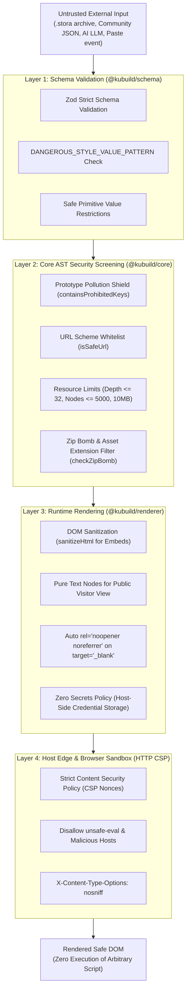
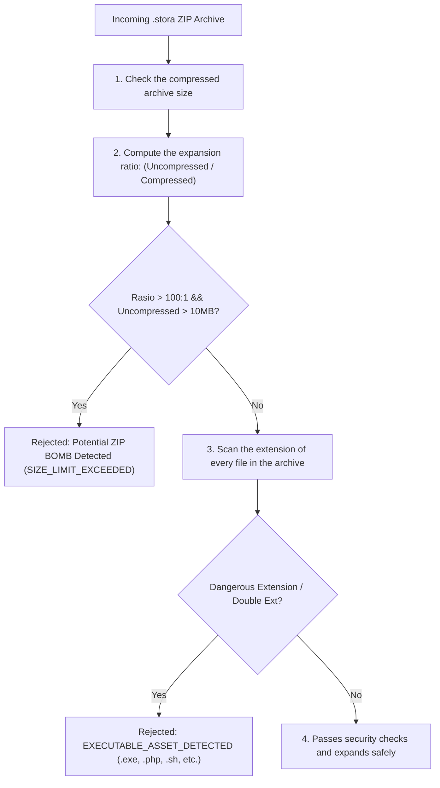

import { Callout } from 'fumadocs-ui/components/callout';
import { Card, Cards } from 'fumadocs-ui/components/card';
import { Tab, Tabs } from 'fumadocs-ui/components/tabs';
import { Accordion, Accordions } from 'fumadocs-ui/components/accordion';
import { Step, Steps } from 'fumadocs-ui/components/steps';

In a modern visual page builder, security is a foundation that can't be compromised. A builder receives, manipulates, and renders complex documents from many external sources: community templates, `.stora` uploads from public users, third-party cloud sync, and content generated on the fly by Large Language Models (LLMs) such as Google Gemini or OpenAI.

A builder that naively trusts external documents is open to a range of attacks:
- **Cross-Site Scripting (XSS)** through inline event-handler attributes (`onload`, `onerror`), `javascript:` pseudo-protocol URLs, or direct DOM manipulation.
- **CSS injection & data exfiltration** through legacy CSS expressions (`expression(...)`), `@import` calls to an attacker's server, or `url(javascript:...)`.
- **Prototype pollution** that corrupts built-in JavaScript objects (`Object.prototype`) while interpolating dynamic variables or deserializing document state.
- **Denial of Service (DoS) & zip bombs** through small compressed `.stora` archives that expand to tens of gigabytes in memory, or document trees with 100,000 nodes that freeze the browser's main thread.
- **Credential leakage** when backend API tokens, Facebook Pixel CAPI keys, or database credentials end up in the document payload by accident.

**KUBUILD adopts a *"never trust untrusted input"* posture with a layered *defense-in-depth* architecture.**

---

## Security Philosophy & Threat Model

Every `.stora` document, AST fragment, or AI Copilot output is treated as **untrusted data** from the moment it enters the system until it is rendered on the end user's screen.

KUBUILD applies four independent filter layers:



<Cards>
  <Card title="Layer 1: Schema" description="Safe primitive types and CSS injection blocking in @kubuild/schema." />
  <Card title="Layer 2: Core Engine" description="Prototype pollution protection, document limit screening, and zip bomb protection in @kubuild/core." />
  <Card title="Layer 3: Runtime Renderer" description="DOM attribute sanitization, rich-text paste cleanup, and auto-noopener in @kubuild/renderer." />
  <Card title="Layer 4: HTTP CSP" description="Browser-level isolation through a strict Content Security Policy in the Next.js host." />
</Cards>

---

## Layer 1 Protection: Schema & Style Value Sanitization

In `@kubuild/schema`, every object that defines *styles*, *assets*, *actions*, and *variable bindings* is validated with strict Zod schemas before it is allowed into application memory.

### Blocking CSS Injection (`DANGEROUS_STYLE_VALUE_PATTERN`)

Modern CSS has powerful features that, if abused, can trigger code execution or data leaks (*CSS-based keylogging / exfiltration*). KUBUILD applies the `DANGEROUS_STYLE_VALUE_PATTERN` regex to every style property value:

```typescript
// packages/schema/src/document.ts
const DANGEROUS_STYLE_VALUE_PATTERN =
  /javascript:|expression\(|@import|<script|vbscript:|data:text\/html/i;

export const StyleValueSchema = z.union([
  z.string().refine((value) => !DANGEROUS_STYLE_VALUE_PATTERN.test(value), {
    message: 'Style value contains a disallowed or unsafe pattern',
  }),
  z.number(),
  z.boolean(),
  z.null(),
  z.undefined(),
]);
```

The pattern detects and rejects:
- `javascript:...` — the classic XSS vector in CSS, e.g. `background: url('javascript:alert(1)')`.
- `expression(...)` — a legacy Internet Explorer feature that runs JavaScript inside CSS.
- `@import` — prevents injecting unauthorized external style sheets that change the page.
- `<script` — attempts to smuggle script tags into CSS string properties.
- `vbscript:` — the legacy VBScript scheme that some web views still execute.
- `data:text/html` — HTML data URIs that can trigger dangerous sandboxed execution.

### Safe Primitives Only

In `StyleValueSchema`, style values are **strictly limited to serializable primitive types**:
- `string` (after passing the sanitization regex)
- `number` (e.g. `opacity: 0.8`, `zIndex: 10`, `flexGrow: 1`)
- `boolean`
- `null` or `undefined` (to remove or reset a style)

Objects, functions, *class instances*, or arrays are not allowed as style values, closing off unexpected function execution while documents are evaluated.

<Tabs items={["Rejected Payload Example", "Valid Payload Example"]}>
  <Tab value="Rejected Payload Example">
```json
{
  "type": "button",
  "id": "btn-malicious",
  "styles": {
    "background": "url(javascript:alert('pwned'))", // REJECTED: contains 'javascript:'
    "color": "expression(document.cookie)",         // REJECTED: contains 'expression('
    "fontFamily": "@import url('https://evil.com/font.css')", // REJECTED: contains '@import'
    "border": "<script>alert(1)</script>"          // REJECTED: contains '<script'
  }
}
```
  </Tab>
  <Tab value="Valid Payload Example">
```json
{
  "type": "button",
  "id": "btn-valid",
  "styles": {
    "backgroundColor": "#2563eb",
    "color": "#ffffff",
    "borderRadius": "8px",
    "padding": "12px 24px",
    "boxShadow": "0 4px 6px -1px rgba(0, 0, 0, 0.1)",
    "opacity": 1,
    "display": "inline-flex"
  }
}
```
  </Tab>
</Tabs>

---

## Layer 2 Protection: Core Engine & Untrusted Import

When a document is imported (for example through `importStoraPackage` or `validateDocumentSecurity`), `@kubuild/core` runs a comprehensive set of security checks before building the AST or editor state.

### Prototype Pollution Protection

*Prototype pollution* is a vulnerability where an attacker manipulates the global `Object.prototype`, which can hijack authentication logic, bypass validation, or lead to *Remote Code Execution* (RCE) in Node.js.

KUBUILD blocks this attack at two critical points:

1. **Recursive object structure scanning (`containsProhibitedKeys`)**:
   Every document AST node is scanned deeply. If any of these forbidden keys is found, the import fails immediately:
   - `__proto__`
   - `constructor`
   - `prototype`
   - `__defineGetter__`
   - `__defineSetter__`
   - `__lookupGetter__`
   - `__lookupSetter__`

2. **Safe variable resolution (`resolveBinding`)**:
   The dynamic variable interpolation engine (e.g. `{{ site.name }}` or `{{ user.profile.email }}`) never uses `eval()` or `Function()`. Resolution is plain data traversal:

```typescript
// packages/core/src/runtime/binding-resolver.ts
const FORBIDDEN_KEY_SEGMENTS = new Set(['__proto__', 'constructor', 'prototype']);

export function resolveBinding(
  binding: Pick<VariableBinding, 'key' | 'fallback'>,
  context: RuntimeContext | undefined,
): ResolveOutcome {
  const segments = binding.key.split('.').filter(Boolean);
  
  // Early detection: reject forbidden segments
  if (segments.some((segment) => FORBIDDEN_KEY_SEGMENTS.has(segment))) {
    return applyMissingPolicy(binding);
  }

  let current: unknown = context?.variables;

  for (const segment of segments) {
    if (FORBIDDEN_KEY_SEGMENTS.has(segment)) return applyMissingPolicy(binding);
    if (current === null || typeof current !== 'object') return applyMissingPolicy(binding);
    // Require an explicit own property (not inherited from the prototype)
    if (!Object.prototype.hasOwnProperty.call(current, segment)) {
      return applyMissingPolicy(binding);
    }
    current = (current as Record<string, unknown>)[segment];
  }

  // Never return an executable function
  if (current === undefined || typeof current === 'function') {
    return applyMissingPolicy(binding);
  }

  return { status: 'resolved', value: current };
}
```

### URL Scheme Whitelist & Protocol Sanitization

All navigation links, action targets, and image source URLs are filtered with `isSafeUrl` and `sanitizeUrl`:

| URL Scheme | Status | Notes / Usage Rules |
| :--- | :--- | :--- |
| `http:`, `https:` | **Allowed** | Standard web protocols for links and external assets. |
| `mailto:`, `tel:` | **Allowed** | Visitor interaction links (*click to email*, *click to call*). |
| `#`, `/path`, `./`, `?` | **Allowed** | Internal anchors, relative pages, and query parameters. |
| `data:image/*` | **Allowed** | Image-only data URIs (`png`, `jpeg`, `webp`, `gif`, `avif`, `svg+xml`). |
| `blob:` | **Restricted** | Only allowed in in-memory editor sessions for local media previews; blocked in imported public archives. |
| `javascript:`, `vbscript:` | **ALWAYS BLOCKED** | Script execution vectors; replaced with `#` or rejected. |
| `data:text/html` | **ALWAYS BLOCKED** | Prevents unexpected raw HTML rendering in iframes or browser windows. |
| `file:`, `ftp:` | **ALWAYS BLOCKED** | Prevents access to the client's or server's local file system. |

```typescript
import { isSafeUrl, sanitizeUrl } from '@kubuild/core';

// URL sanitization examples
sanitizeUrl('javascript:alert(1)', '#'); // Returns '#'
sanitizeUrl('https://example.com/checkout'); // Returns 'https://example.com/checkout'
sanitizeUrl('data:text/html,<script>alert(1)</script>', '#'); // Returns '#'
sanitizeUrl('data:image/png;base64,...'); // Returns 'data:image/png;base64,...'
```

### Resource Limits & Denial of Service Defense

To prevent *ReDoS*, *memory exhaustion*, and crashed browser tabs, `validateDocumentSecurity` enforces size limits:

```typescript
// packages/core/src/validation/security.ts
export const DEFAULT_DOCUMENT_SECURITY_LIMITS = {
  maxNodeCount: 5000,               // Maximum total nodes in one document
  maxTreeDepth: 32,                 // Maximum nesting depth
  maxPropsCount: 200,               // Maximum props per node
  maxStringLength: 100_000,         // Maximum characters per string
  maxChildrenPerNode: 1000,         // Maximum direct children per container
  maxDocumentSizeBytes: 10 * 1024 * 1024, // Maximum JSON payload size (10 MB)
  maxZipExpansionRatio: 100,        // Maximum decompression ratio to stop zip bombs
};
```

### Zip Bomb & Malicious Asset Protection (`checkZipBomb`)

When a user uploads a `.stora` archive (a compressed ZIP container holding `manifest.json`, `page.json`, and graphic assets), KUBUILD verifies it before extracting the contents:



```typescript
import { checkZipBomb, isDangerousAssetFilename } from '@kubuild/core';

// 1. Zip bomb check: excessive expansion ratio
const isBomb = checkZipBomb(archiveBytes.byteLength, totalUncompressedBytes);
if (isBomb) {
  throw new Error('Security violation: Potential Zip Bomb attack detected.');
}

// 2. Dangerous asset extensions & double extensions
isDangerousAssetFilename('malicious.php');         // true (rejected)
isDangerousAssetFilename('innocent.png.exe');     // true (rejected: double extension)
isDangerousAssetFilename('script.js');            // true (rejected)
isDangerousAssetFilename('banner.webp');          // false (accepted)
```

Asset extensions that are rejected automatically:
`.exe`, `.dll`, `.so`, `.sh`, `.bat`, `.cmd`, `.js`, `.mjs`, `.cjs`, `.php`, `.py`, `.vbs`, `.wasm`, `.bin`, `.com`, `.scr`, `.pif`, `.hta`, `.jar`.

---

## Layer 3 Protection: Runtime Rendering & DOM Sanitization

When a document is rendered into the DOM (in the visual editor or on public visitor pages), `@kubuild/renderer` enforces these DOM security rules:

### 1. HTML Embed Sanitization (`sanitizeHtml`)

For components such as `html-embed` or *rich text* areas, `@kubuild/renderer` uses built-in sanitization utilities to clean injected HTML:

- **Removes executable tags**: all `<script>`, `<object>`, `<embed>`, `<applet>`, `<base>`, and `<link rel="import">` tags.
- **Removes event-handler attributes**: every attribute starting with `on` (e.g. `onload=`, `onclick=`, `onerror=`, `onmouseover=`) is stripped with regular expressions.
- **Neutralizes dangerous protocol links**: `href`, `src`, `data`, or `action` attributes using `javascript:`, `vbscript:`, or `data:text/html` become `#`.

```typescript
// packages/core/src/validation/security.ts
export function sanitizeHtml(rawHtml: unknown): string {
  if (typeof rawHtml !== 'string') return '';
  let html = rawHtml;

  // 1. Strip script tags
  html = html.replace(/<script\b[^<]*(?:(?!<\/script>)<[^<]*)*<\/script>/gi, '');

  // 2. Strip embed/object tags
  html = html.replace(/<\/?(object|embed|applet|base|link)\b[^>]*>/gi, '');

  // 3. Strip on* handlers
  html = html.replace(/\s+on[a-z0-9_-]+\s*=\s*(?:'[^']*'|"[^"]*"|[^\s>]+)/gi, '');

  // 4. Neutralize dangerous protocols
  html = html.replace(
    /\b(href|src|data|action)\s*=\s*(['"])\s*(?:javascript:|vbscript:|data:text\/html)[^'"]*\2/gi,
    '$1="#"'
  );

  return html;
}
```

### 2. Safe Public Text (*Zero Client-Side DOM Injection*)

In public runtime mode (`mode="runtime"`, or `@kubuild/renderer` in Next.js Server Components):
- Text and heading nodes render as plain React text children (`{value}`), not through `dangerouslySetInnerHTML`. React escapes every string value by default.
- In editor mode (`mode="editor"`), the `EditableText` component uses an internal `escapeHtml` function and reads user input via `textContent` / `innerText`, so pasted text cannot execute scripts.

### 3. Reverse Tabnabbing Protection (`rel="noopener noreferrer"`)

When a button or link is configured to open a new tab (`target="_blank"`), `@kubuild/renderer` **automatically adds `rel="noopener noreferrer"`**:

```html
<!-- Generated automatically by @kubuild/renderer -->
<a href="https://partner-site.com" target="_blank" rel="noopener noreferrer">
  Kunjungi Situs Mitra
</a>
```

This prevents *reverse tabnabbing*, where the external destination page uses `window.opener` to redirect the user's original tab to a *phishing* site.

### 4. Zero Secrets Policy

KUBUILD follows a **zero secrets policy**:
- Secret credentials (Facebook CAPI access tokens, Google Analytics API secrets, database connection strings, or OpenAI API keys) are **never stored in the `.stora` AST**.
- Documents only store *opaque identifiers* (e.g. `credentialId: "cred_fb_checkout_01"` or `actionId: "action_submit_lead"`).
- When a form or tracking event runs, the browser only sends those opaque references to your host backend. The isolated backend then loads the real credentials from server environment variables (`process.env.FB_CAPI_TOKEN`) and calls the third-party API securely.

<Callout type="warn" title="Architecture Warning">
Never put secret third-party API keys in builder component props. Everything inside a `.stora` document can be read by visitors' browsers once the document is published.
</Callout>

---

## Content Security Policy (CSP) Recommendations

Even though KUBUILD sanitizes thoroughly at the application level, a **Content Security Policy (CSP)** on the host server is a crucial last line of defense (*browser-level sandbox*). CSP restricts which scripts, images, fonts, and connections the browser may load.

### Recommended CSP Directive Matrix

| CSP Directive | Recommended Value | Security Rationale |
| :--- | :--- | :--- |
| `default-src` | `'self'` | Restrict every source to your own origin unless explicitly allowed. |
| `script-src` | `'self' 'nonce-...' https://connect.facebook.net https://www.googletagmanager.com` | Allow app scripts and official tracking pixels. **Never use `'unsafe-eval'`**. |
| `style-src` | `'self' 'unsafe-inline'` | Required for the builder components' dynamic inline styles. |
| `img-src` | `'self' data: https: blob:` | Allow images from the host CDN, safe image data URIs, and in-memory editor previews. |
| `font-src` | `'self' https://fonts.gstatic.com data:` | Allow internal fonts and Google Fonts used by templates. |
| `frame-src` | `'self' https://www.youtube.com https://player.vimeo.com` | Allow responsive YouTube and Vimeo embeds. |
| `connect-src` | `'self' https://api.kustora.id https://*.google-analytics.com` | Restrict fetch/XHR targets to the host API and verified tracking endpoints. |
| `object-src` | `'none'` | Block dangerous legacy plugins such as Flash or Java applets. |
| `base-uri` | `'self'` | Prevent attackers from changing the document base URL via `<base>`. |
| `form-action` | `'self'` | Ensure builder forms only submit to trusted host endpoints. |

---

## CSP in a Next.js Host Application

How to implement a Content Security Policy in your Next.js app:

<Tabs items={["Next.js App Router (Middleware + Nonce)", "next.config.mjs (Static Headers)", "Custom Express / Node.js Server"]}>
  <Tab value="Next.js App Router (Middleware + Nonce)">
A **nonce-based CSP** in `middleware.ts` is the strongest option for the Next.js App Router. A unique random nonce is generated for every request and passed to Server Components through request headers:

```typescript
// middleware.ts
import { NextResponse } from 'next/server';
import type { NextRequest } from 'next/server';

export function middleware(request: NextRequest) {
  // 1. Generate a random base64 nonce (16 bytes)
  const nonce = Buffer.from(crypto.randomUUID()).toString('base64');

  // 2. Build strict CSP directives
  const cspHeader = `
    default-src 'self';
    script-src 'self' 'nonce-${nonce}' 'strict-dynamic' https://connect.facebook.net https://www.googletagmanager.com;
    style-src 'self' 'unsafe-inline';
    img-src 'self' data: https: blob:;
    font-src 'self' https://fonts.gstatic.com data:;
    frame-src 'self' https://www.youtube.com https://player.vimeo.com;
    connect-src 'self' https://api.kustora.id https://*.google-analytics.com;
    object-src 'none';
    base-uri 'self';
    form-action 'self';
    frame-ancestors 'self';
    upgrade-insecure-requests;
  `.replace(/\s{2,}/g, ' ').trim();

  // 3. Forward the nonce to components via request headers
  const requestHeaders = new Headers(request.headers);
  requestHeaders.set('x-nonce', nonce);
  requestHeaders.set('Content-Security-Policy', cspHeader);

  const response = NextResponse.next({
    request: {
      headers: requestHeaders,
    },
  });

  // 4. Set Content-Security-Policy on the browser response
  response.headers.set('Content-Security-Policy', cspHeader);
  response.headers.set('X-Content-Type-Options', 'nosniff');
  response.headers.set('X-Frame-Options', 'SAMEORIGIN');
  response.headers.set('Referrer-Policy', 'strict-origin-when-cross-origin');

  return response;
}

export const config = {
  matcher: [
    /*
     * Apply to every route except static files, _next/image, and favicon.ico
     */
    {
      source: '/((?!api|_next/static|_next/image|favicon.ico).*)',
      missing: [
        { type: 'header', key: 'next-router-prefetch' },
        { type: 'header', key: 'purpose', value: 'prefetch' },
      ],
    },
  ],
};
```
  </Tab>

  <Tab value="next.config.mjs (Static Headers)">
If you use fully static pages (*Static Site Generation — SSG*) without dynamic middleware, configure static CSP headers in `next.config.mjs`:

```javascript
// next.config.mjs
/** @type {import('next').NextConfig} */
const nextConfig = {
  async headers() {
    return [
      {
        source: '/(.*)',
        headers: [
          {
            key: 'Content-Security-Policy',
            value: [
              "default-src 'self';",
              "script-src 'self' 'unsafe-inline' https://connect.facebook.net https://www.googletagmanager.com;",
              "style-src 'self' 'unsafe-inline';",
              "img-src 'self' data: https: blob:;",
              "font-src 'self' https://fonts.gstatic.com data:;",
              "frame-src 'self' https://www.youtube.com https://player.vimeo.com;",
              "connect-src 'self' https://*.google-analytics.com;",
              "object-src 'none';",
              "base-uri 'self';",
              "form-action 'self';",
            ].join(' '),
          },
          {
            key: 'X-Content-Type-Options',
            value: 'nosniff',
          },
          {
            key: 'X-Frame-Options',
            value: 'SAMEORIGIN',
          },
          {
            key: 'Referrer-Policy',
            value: 'strict-origin-when-cross-origin',
          },
        ],
      },
    ];
  },
};

export default nextConfig;
```
  </Tab>

  <Tab value="Custom Express / Node.js Server">
If you embed `@kubuild/renderer` in an Express or Hono.js server:

```typescript
// server.ts (Express)
import express from 'express';
import helmet from 'helmet';

const app = express();

app.use(
  helmet({
    contentSecurityPolicy: {
      directives: {
        defaultSrc: ["'self'"],
        scriptSrc: [
          "'self'",
          "https://connect.facebook.net",
          "https://www.googletagmanager.com",
        ],
        styleSrc: ["'self'", "'unsafe-inline'"],
        imgSrc: ["'self'", "data:", "https:", "blob:"],
        fontSrc: ["'self'", "https://fonts.gstatic.com", "data:"],
        frameSrc: ["'self'", "https://www.youtube.com", "https://player.vimeo.com"],
        connectSrc: ["'self'", "https://*.google-analytics.com"],
        objectSrc: ["'none'"],
        baseUri: ["'self'"],
        formAction: ["'self'"],
      },
    },
    crossOriginEmbedderPolicy: false,
  })
);
```
  </Tab>
</Tabs>

---

## Security Guide for Host Integrators

Teams integrating KUBUILD into multi-tenant apps or public SaaS portals should follow these steps:

<Steps>
  <Step title="Validate Every Document Input on the Backend">
    Never store `.stora` JSON documents in the database without running `validateDocumentSecurity` and Zod schema validation on your server.
  </Step>

  <Step title="Separate the User Upload Asset Domain">
    Store user-uploaded images and files in an S3 or Cloudflare R2 bucket on a separate domain (e.g. `assets.kustora.id`, not `app.kustora.id`). Set `Content-Disposition: inline` and `X-Content-Type-Options: nosniff` headers.
  </Step>

  <Step title="Proxy AI Requests Through a Protected Server">
    Never put LLM API keys (Gemini, Claude, OpenAI) in the browser. Always create a host backend API route (e.g. `/api/kubuild/ai-copilot`) with rate limiting and user authentication.
  </Step>

  <Step title="Audit Custom Component Renderers">
    If you register a custom component (`registry.register(...)`), make sure your custom renderer never uses `dangerouslySetInnerHTML` without first calling `sanitizeHtml(rawHtml)`.
  </Step>
</Steps>

---

## Security FAQ

<Accordions>
  <Accordion title="Why does KUBUILD need 'unsafe-inline' for style-src in the CSP?">
    KUBUILD supports responsive breakpoint styling (*mobile, tablet, desktop*), CSS grid, and dynamic flexbox that designers customize in real time. These styles are emitted as inline styles and `<style>` tags for maximum render performance. With `DANGEROUS_STYLE_VALUE_PATTERN` validation, every style string is sterilized of CSS injection vectors before it reaches the browser.
  </Accordion>

  <Accordion title="How does KUBUILD handle SVG XSS attacks?">
    SVG files can contain hidden JavaScript (`<svg onload="alert(1)">`). In KUBUILD, uploaded SVG images go through extension validation, and when embedded via an `` element the browser runs the SVG in a pure image sandbox without executing inline scripts.
  </Accordion>

  <Accordion title="Can .stora documents execute custom JavaScript functions?">
    **No.** The `.stora` format is a *pure declarative AST*. There is no runtime JavaScript parser (`eval()`, `new Function()`, or a VM) in `@kubuild/core` or `@kubuild/renderer`. User actions (such as button clicks) map to registered *action pipelines* that only run handlers statically defined by the host app.
  </Accordion>

  <Accordion title="How do I report a security vulnerability?">
    We run a *coordinated vulnerability disclosure* program. Report through a [GitHub private security advisory](https://github.com/kustora/kubuild/security/advisories/new) or email `contact@kustora.id`, following the guidelines in `SECURITY.md`.
  </Accordion>
</Accordions>
