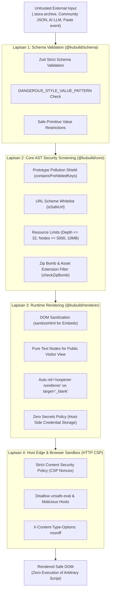
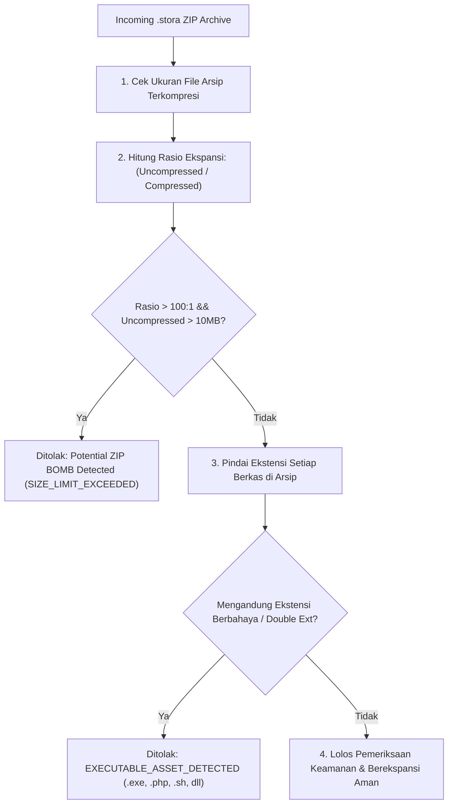

import { Callout } from 'fumadocs-ui/components/callout';
import { Card, Cards } from 'fumadocs-ui/components/card';
import { Tab, Tabs } from 'fumadocs-ui/components/tabs';
import { Accordion, Accordions } from 'fumadocs-ui/components/accordion';
import { Step, Steps } from 'fumadocs-ui/components/steps';

Dalam sistem visual page builder modern, keamanan adalah pondasi mutlak yang tidak boleh dikompromikan. Aplikasi builder menerima, memanipulasi, dan merender dokumen kompleks yang dapat berasal dari berbagai sumber eksternal: template komunitas, unggahan file `.stora` dari pengguna publik, sinkronisasi cloud pihak ketiga, hingga kode yang di-*generate* secara dinamis oleh Large Language Models (LLM) seperti Google Gemini atau OpenAI.

Jika sistem visual builder mempercayai dokumen eksternal secara naif, sistem tersebut rentan terhadap serangkaian serangan berbahaya:
- **Cross-Site Scripting (XSS)** melalui injeksi atribut event handler inline (`onload`, `onerror`), skema pseudo-protokol `javascript:`, atau manipulasi DOM langsung.
- **CSS Injection & Data Exfiltration** melalui ekspresi CSS kuno (`expression(...)`), pemanggilan `@import` ke server penyerang, atau `url(javascript:...)`.
- **Prototype Pollution** yang merusak objek bawaan JavaScript (`Object.prototype`) saat memproses interpolasi variabel dinamis atau deserialisasi state dokumen.
- **Denial of Service (DoS) & Zip Bombs** melalui file arsip `.stora` terkompresi berukuran kecil yang membengkak menjadi puluhan gigabyte saat diekstrak di memori, atau pohon dokumen dengan 100.000 node yang membekukan thread utama browser.
- **Credential Leakage** jika token API backend, kunci Facebook Pixel CAPI, atau kredensial database tersimpan secara tidak sengaja di dalam payload dokumen.

**KUBUILD mengadopsi postur keamanan *"Never Trust Untrusted Input"* dengan arsitektur pertahanan berlapis (*Defense-in-Depth*).**

---

## Filosofi Keamanan & Model Ancaman

Setiap dokumen `.stora`, cuplikan AST, atau input dari AI Copilot diperlakukan sebagai **untrusted data** sejak pertama kali diterima oleh sistem hingga saat dirender di layar pengguna akhir. 

KUBUILD menerapkan 4 lapis filter independen:



<Cards>
  <Card title="Lapisan 1: Schema" description="Penyaringan tipe primitif aman dan pemblokiran CSS injection di @kubuild/schema." />
  <Card title="Lapisan 2: Core Engine" description="Proteksi prototype pollution, screening batas dokumen, dan proteksi Zip Bomb di @kubuild/core." />
  <Card title="Lapisan 3: Runtime Renderer" description="Sanitasi atribut DOM, pembersihan paste rich-text, dan auto-noopener di @kubuild/renderer." />
  <Card title="Lapisan 4: HTTP CSP" description="Isolasi tingkat browser melalui Content Security Policy ketat di Next.js Host." />
</Cards>

---

## Proteksi Lapisan 1: Schema & Style Value Sanitization

Di level `@kubuild/schema`, seluruh objek yang mendefinisikan gaya grafis (*styles*), aset (*assets*), aksi (*actions*), dan variabel (*variable bindings*) divalidasi menggunakan skema Zod yang ketat sebelum diizinkan masuk ke memori aplikasi.

### Pemblokiran CSS Injection (`DANGEROUS_STYLE_VALUE_PATTERN`)

CSS modern memiliki fitur-fitur berdaya tinggi yang, jika disalahgunakan, dapat memicu eksekusi kode atau kebocoran data (*CSS-based keylogging / exfiltration*). KUBUILD menerapkan regex filter `DANGEROUS_STYLE_VALUE_PATTERN` pada seluruh nilai properti gaya:

```typescript
// packages/schema/src/document.ts
const DANGEROUS_STYLE_VALUE_PATTERN =
  /javascript:|expression\(|@import|<script|vbscript:|data:text\/html/i;

export const StyleValueSchema = z.union([
  z.string().refine((value) => !DANGEROUS_STYLE_VALUE_PATTERN.test(value), {
    message: 'Style value contains a disallowed or unsafe pattern',
  }),
  z.number(),
  z.boolean(),
  z.null(),
  z.undefined(),
]);
```

Pola ini secara aktif mendeteksi dan menolak:
- `javascript:...` — Vektor klasik XSS dalam atribut CSS `background: url('javascript:alert(1)')`.
- `expression(...)` — Fitur warisan Internet Explorer yang memungkinkan eksekusi JavaScript di dalam CSS.
- `@import` — Mencegah injeksi style sheet eksternal yang tidak sah untuk mengubah hierarki halaman.
- `<script` — Upaya menyelipkan tag script ke dalam property string CSS.
- `vbscript:` — Skema VBScript lawas yang dapat dieksekusi di beberapa engine web view.
- `data:text/html` — URI data berkonten HTML yang dapat memicu eksekusi sandbox berbahaya.

### Pembatasan Safe Primitives

Dalam `StyleValueSchema`, nilai style **dibatasi secara ketat hanya pada tipe primitif yang dapat diserialisasi**:
- `string` (yang telah lolos uji regex sanitasi)
- `number` (contoh: `opacity: 0.8`, `zIndex: 10`, `flexGrow: 1`)
- `boolean`
- `null` atau `undefined` (untuk menghapus atau me-reset style)

Objek, fungsi (`Function`), *class instance*, atau array tidak diperbolehkan sebagai nilai properti gaya, menutup celah eksekusi fungsi tak terduga saat dokumen dievaluasi.

<Tabs items={["Contoh Payload Ditolak", "Contoh Payload Sah (Valid)"]}>
  <Tab value="Contoh Payload Ditolak">
```json
{
  "type": "button",
  "id": "btn-malicious",
  "styles": {
    "background": "url(javascript:alert('pwned'))", // DITOLAK: Mengandung 'javascript:'
    "color": "expression(document.cookie)",         // DITOLAK: Mengandung 'expression('
    "fontFamily": "@import url('https://evil.com/font.css')", // DITOLAK: Mengandung '@import'
    "border": "<script>alert(1)</script>"          // DITOLAK: Mengandung '<script'
  }
}
```
  </Tab>
  <Tab value="Contoh Payload Sah (Valid)">
```json
{
  "type": "button",
  "id": "btn-valid",
  "styles": {
    "backgroundColor": "#2563eb",
    "color": "#ffffff",
    "borderRadius": "8px",
    "padding": "12px 24px",
    "boxShadow": "0 4px 6px -1px rgba(0, 0, 0, 0.1)",
    "opacity": 1,
    "display": "inline-flex"
  }
}
```
  </Tab>
</Tabs>

---

## Proteksi Lapisan 2: Core Engine & Untrusted Import

Saat dokumen diimpor ke dalam aplikasi (misalnya melalui fungsi `importStoraZip` atau `validateDocumentSecurity`), paket `@kubuild/core` menjalankan serangkaian pemeriksaan keamanan komprehensif sebelum membuat pohon AST atau state editor.

### Proteksi Prototype Pollution

*Prototype Pollution* adalah kerentanan di mana penyerang memanipulasi properti global `Object.prototype`, yang dapat membajak logika autentikasi, bypass validasi, atau memicu *Remote Code Execution* (RCE) di lingkungan Node.js.

KUBUILD memblokir serangan ini di dua titik krusial:

1. **Pemindaian Struktur Objek Rekursif (`containsProhibitedKeys`)**:
   Setiap simpul AST dokumen dipindai secara mendalam. Jika ditemukan kunci terlarang berikut, proses impor langsung digagalkan:
   - `__proto__`
   - `constructor`
   - `prototype`
   - `__defineGetter__`
   - `__defineSetter__`
   - `__lookupGetter__`
   - `__lookupSetter__`

2. **Resolusi Variabel Aman (`resolveBinding`)**:
   Mesin interpolasi variabel dinamis (seperti `{{ site.name }}` atau `{{ user.profile.email }}`) tidak pernah menggunakan `eval()` atau `Function()`. Resolusi dilakukan melalui traversal data murni:

```typescript
// packages/core/src/runtime/binding-resolver.ts
const FORBIDDEN_KEY_SEGMENTS = new Set(['__proto__', 'constructor', 'prototype']);

export function resolveBinding(
  binding: Pick<VariableBinding, 'key' | 'fallback'>,
  context: RuntimeContext | undefined,
): ResolveOutcome {
  const segments = binding.key.split('.').filter(Boolean);
  
  // Deteksi dini: Tolak jika ada segmen terlarang
  if (segments.some((segment) => FORBIDDEN_KEY_SEGMENTS.has(segment))) {
    return applyMissingPolicy(binding);
  }

  let current: unknown = context?.variables;

  for (const segment of segments) {
    if (FORBIDDEN_KEY_SEGMENTS.has(segment)) return applyMissingPolicy(binding);
    if (current === null || typeof current !== 'object') return applyMissingPolicy(binding);
    // Verifikasi kepemilikan properti eksplisit (bukan warisan prototype)
    if (!Object.prototype.hasOwnProperty.call(current, segment)) {
      return applyMissingPolicy(binding);
    }
    current = (current as Record<string, unknown>)[segment];
  }

  // Jangan pernah kembalikan fungsi yang dapat dieksekusi
  if (current === undefined || typeof current === 'function') {
    return applyMissingPolicy(binding);
  }

  return { status: 'resolved', value: current };
}
```

### URL Scheme Whitelist & Protocol Sanitization

Semua link navigasi, target aksi, dan URL sumber gambar disaring menggunakan utilitas `isSafeUrl` dan `sanitizeUrl`:

| Skema URL | Status | Catatan / Aturan Penggunaan |
| :--- | :--- | :--- |
| `http:`, `https:` | **Diizinkan** | Protokol web standar untuk tautan dan aset eksternal. |
| `mailto:`, `tel:` | **Diizinkan** | Tautan interaksi pengunjung (*Click to Email*, *Click to Call*). |
| `#`, `/path`, `./`, `?` | **Diizinkan** | Navigasi jangkar (*anchor*) internal, halaman relatif, dan parameter kueri. |
| `data:image/*` | **Diizinkan** | Data URI khusus gambar murni (`png`, `jpeg`, `webp`, `gif`, `avif`, `svg+xml`). |
| `blob:` | **Diizinkan Terbatas** | Hanya diizinkan pada sesi editor in-memory untuk pratinjau media lokal, diblokir dari impor arsip publik. |
| `javascript:`, `vbscript:` | **DIBLOKIR MUTLAK** | Vektor eksekusi script; otomatis diganti menjadi `#` atau dibatalkan. |
| `data:text/html` | **DIBLOKIR MUTLAK** | Mencegah rendering HTML mentah tak terduga di dalam iframe atau browser window. |
| `file:`, `ftp:` | **DIBLOKIR MUTLAK** | Mencegah akses ke sistem file lokal klien atau server. |

```typescript
import { isSafeUrl, sanitizeUrl } from '@kubuild/core';

// Contoh sanitasi URL
sanitizeUrl('javascript:alert(1)', '#'); // Mengembalikan '#'
sanitizeUrl('https://example.com/checkout'); // Mengembalikan 'https://example.com/checkout'
sanitizeUrl('data:text/html,<script>alert(1)</script>', '#'); // Mengembalikan '#'
sanitizeUrl('data:image/png;base64,...'); // Mengembalikan 'data:image/png;base64,...'
```

### Resource Limits & Denial of Service Defense

Untuk mencegah serangan *ReDoS*, pembekuan memori (*Memory Exhaustion*), dan tab crash di browser pengguna, `validateDocumentSecurity` menerapkan batasan dimensi:

```typescript
// packages/core/src/validation/security.ts
export const DEFAULT_DOCUMENT_SECURITY_LIMITS = {
  maxNodeCount: 5000,               // Maksimum total node dalam 1 dokumen
  maxTreeDepth: 32,                 // Kedalaman nesting maksimum
  maxPropsCount: 200,               // Maksimum properti per node
  maxStringLength: 100_000,         // Panjang karakter maksimum per string
  maxChildrenPerNode: 1000,         // Maksimum anak langsung per kontainer
  maxDocumentSizeBytes: 10 * 1024 * 1024, // Ukuran payload JSON maksimum (10 MB)
  maxZipExpansionRatio: 100,        // Rasio dekompresi maksimum untuk pencegahan Zip Bomb
};
```

### Zip Bomb & Malicious Asset Protection (`checkZipBomb`)

Saat pengguna mengunggah arsip `.stora` (yang merupakan kontainer ZIP terkompresi berisi `manifest.json`, `page.json`, dan aset grafis), KUBUILD melakukan verifikasi keamanan sebelum mengekstrak konten:



```typescript
import { checkZipBomb, isDangerousAssetFilename } from '@kubuild/core';

// 1. Pengecekan Zip Bomb: rasio ekspansi berlebih
const isBomb = checkZipBomb(archiveBytes.byteLength, totalUncompressedBytes);
if (isBomb) {
  throw new Error('Security violation: Potential Zip Bomb attack detected.');
}

// 2. Pengecekan Ekstensi Aset Berbahaya & Double Extensions
isDangerousAssetFilename('malicious.php');         // true (Ditolak)
isDangerousAssetFilename('innocent.png.exe');     // true (Ditolak: double extension)
isDangerousAssetFilename('script.js');            // true (Ditolak)
isDangerousAssetFilename('banner.webp');          // false (Diterima)
```

Daftar ekstensi aset yang otomatis dilarang:
`.exe`, `.dll`, `.so`, `.sh`, `.bat`, `.cmd`, `.js`, `.mjs`, `.cjs`, `.php`, `.py`, `.vbs`, `.wasm`, `.bin`, `.com`, `.scr`, `.pif`, `.hta`, `.jar`.

---

## Proteksi Lapisan 3: Runtime Rendering & DOM Sanitization

Pada saat dokumen dirender ke dalam DOM (baik di editor visual maupun di halaman publik pengunjung), paket `@kubuild/renderer` menegakkan aturan keamanan DOM berikut:

### 1. Sanitasi HTML Embed (`sanitizeHtml`)

Untuk komponen seperti `html-embed` atau area teks kaya (*rich text*), `@kubuild/renderer` memanfaatkan utilitas sanitasi bawaan untuk membersihkan kode HTML yang diinjeksikan:

- **Menghapus Tag Eksekusi**: Menghapus seluruh tag `<script>`, `<object>`, `<embed>`, `<applet>`, `<base>`, dan `<link rel="import">`.
- **Menghapus Atribut Event Handler**: Seluruh atribut yang diawali dengan `on` (misal: `onload=`, `onclick=`, `onerror=`, `onmouseover=`) dibersihkan menggunakan ekspresi reguler.
- **Melumpuhkan Tautan Protokol Berbahaya**: Atribut `href`, `src`, `data`, atau `action` yang menggunakan `javascript:`, `vbscript:`, atau `data:text/html` diubah menjadi `#`.

```typescript
// packages/core/src/validation/security.ts
export function sanitizeHtml(rawHtml: unknown): string {
  if (typeof rawHtml !== 'string') return '';
  let html = rawHtml;

  // 1. Bersihkan tag script
  html = html.replace(/<script\b[^<]*(?:(?!<\/script>)<[^<]*)*<\/script>/gi, '');

  // 2. Bersihkan tag embed/object
  html = html.replace(/<\/?(object|embed|applet|base|link)\b[^>]*>/gi, '');

  // 3. Bersihkan handler on*
  html = html.replace(/\s+on[a-z0-9_-]+\s*=\s*(?:'[^']*'|"[^"]*"|[^\s>]+)/gi, '');

  // 4. Netralkan protokol berbahaya
  html = html.replace(
    /\b(href|src|data|action)\s*=\s*(['"])\s*(?:javascript:|vbscript:|data:text\/html)[^'"]*\2/gi,
    '$1="#"'
  );

  return html;
}
```

### 2. Teks Publik Aman (*Zero Client-Side DOM Injection*)

Pada mode runtime publik (`mode="preview"` atau `@kubuild/renderer` di Next.js Server Components):
- Node teks dan heading dirender sebagai anak teks murni React (`{value}`), bukan via `dangerouslySetInnerHTML`. React secara bawaan melakukan HTML escaping pada semua nilai string.
- Pada mode editor (`mode="editor"`), komponen `EditableText` menggunakan fungsi `escapeHtml` internal dan membaca input pengguna via `textContent` / `innerText`, sehingga penempelan teks (*paste event*) tidak dapat mengeksekusi script.

### 3. Proteksi Reverse Tabnabbing (`rel="noopener noreferrer"`)

Ketika komponen tombol atau tautan dikonfigurasi untuk membuka tab baru (`target="_blank"`), `@kubuild/renderer` **secara otomatis menambahkan atribut `rel="noopener noreferrer"`**:

```html
<!-- Dihasilkan secara otomatis oleh @kubuild/renderer -->
<a href="https://partner-site.com" target="_blank" rel="noopener noreferrer">
  Kunjungi Situs Mitra
</a>
```

Atribut ini mencegah eksploitasi *Reverse Tabnabbing*, di mana halaman tujuan eksternal dapat mengakses objek `window.opener` dan mengarahkan kembali tab asal pengguna ke situs *phishing*.

### 4. Zero Secrets Policy

Arsitektur KUBUILD mengadopsi prinsip **Zero Secrets Policy**:
- Kredensial rahasia (seperti Facebook CAPI Access Token, Google Analytics API Secret, Database Connection String, atau API Key OpenAI) **tidak pernah disimpan di dalam pohon AST `.stora`**.
- Dokumen hanya menyimpan *opaque identifiers* (misalnya: `credentialId: "cred_fb_checkout_01"` atau `actionId: "action_submit_lead"`).
- Pada saat formulir atau tracking dieksekusi, browser hanya mengirim referensi opaque tersebut ke backend host aplikasi Anda. Server backend yang terisolasi kemudian mengambil kredensial asli dari environment variable server (`process.env.FB_CAPI_TOKEN`) dan menghubungi API pihak ketiga secara aman.

<Callout type="warn" title="Peringatan Arsitektur">
Jangan pernah menaruh API key pihak ketiga yang bersifat rahasia di dalam prop komponen builder. Segala data yang berada di dalam dokumen `.stora` dapat dibaca oleh browser pengunjung jika dokumen tersebut dipublikasikan.
</Callout>

---

## Rekomendasi Content Security Policy (CSP)

Meskipun KUBUILD melakukan sanitasi menyeluruh di sisi aplikasi, menerapkan **Content Security Policy (CSP)** pada server host adalah lapisan pertahanan terakhir yang krusial (*browser-level sandbox*). CSP membatasi sumber script, gambar, font, dan koneksi yang dapat dimuat oleh browser.

### Matriks Direktif CSP Rekomendasi KUBUILD

| Direktif CSP | Nilai Rekomendasi | Alasan Keamanan |
| :--- | :--- | :--- |
| `default-src` | `'self'` | Batasi semua sumber ke origin sendiri kecuali diizinkan eksplisit. |
| `script-src` | `'self' 'nonce-...' https://connect.facebook.net https://www.googletagmanager.com` | Izinkan script aplikasi dan pixel tracking resmi. **Jangan gunakan `'unsafe-eval'`**. |
| `style-src` | `'self' 'unsafe-inline'` | Diperlukan untuk render dynamic inline styles komponen builder. |
| `img-src` | `'self' data: https: blob:` | Izinkan gambar dari CDN host, data URI gambar aman, dan media preview in-memory editor. |
| `font-src` | `'self' https://fonts.gstatic.com data:` | Izinkan font internal dan Google Fonts yang digunakan template. |
| `frame-src` | `'self' https://www.youtube.com https://player.vimeo.com` | Izinkan penyematan video responsif YouTube dan Vimeo. |
| `connect-src` | `'self' https://api.kustora.id https://*.google-analytics.com` | Batasi target HTTP fetch/XHR hanya ke API host dan tracking terverifikasi. |
| `object-src` | `'none'` | Memblokir plugin lawas berbahaya seperti Flash atau Java Applet. |
| `base-uri` | `'self'` | Mencegah penyerang mengubah base URL dokumen melalui tag `<base>`. |
| `form-action` | `'self'` | Memastikan formulir builder hanya mengirim data ke endpoint host terpercaya. |

---

## Implementasi CSP di Next.js Host Application

Berikut adalah cara mengimplementasikan Content Security Policy pada aplikasi Next.js Anda:

<Tabs items={["Next.js App Router (Middleware + Nonce)", "next.config.mjs (Static Headers)", "Custom Express / Node.js Server"]}>
  <Tab value="Next.js App Router (Middleware + Nonce)">
Pendekatan **Nonce-based CSP** di `middleware.ts` adalah standar keamanan tertinggi untuk Next.js App Router. Nonce acak unik dihasilkan pada setiap request dan diinjeksikan ke dalam request header untuk Server Components:

```typescript
// middleware.ts
import { NextResponse } from 'next/server';
import type { NextRequest } from 'next/server';

export function middleware(request: NextRequest) {
  // 1. Buat nonce acak berbasis base64 (16 bytes)
  const nonce = Buffer.from(crypto.randomUUID()).toString('base64');

  // 2. Susun direktif CSP ketat
  const cspHeader = `
    default-src 'self';
    script-src 'self' 'nonce-${nonce}' 'strict-dynamic' https://connect.facebook.net https://www.googletagmanager.com;
    style-src 'self' 'unsafe-inline';
    img-src 'self' data: https: blob:;
    font-src 'self' https://fonts.gstatic.com data:;
    frame-src 'self' https://www.youtube.com https://player.vimeo.com;
    connect-src 'self' https://api.kustora.id https://*.google-analytics.com;
    object-src 'none';
    base-uri 'self';
    form-action 'self';
    frame-ancestors 'self';
    upgrade-insecure-requests;
  `.replace(/\s{2,}/g, ' ').trim();

  // 3. Teruskan nonce ke komponen via request headers
  const requestHeaders = new Headers(request.headers);
  requestHeaders.set('x-nonce', nonce);
  requestHeaders.set('Content-Security-Policy', cspHeader);

  const response = NextResponse.next({
    request: {
      headers: requestHeaders,
    },
  });

  // 4. Set Content-Security-Policy pada response browser
  response.headers.set('Content-Security-Policy', cspHeader);
  response.headers.set('X-Content-Type-Options', 'nosniff');
  response.headers.set('X-Frame-Options', 'SAMEORIGIN');
  response.headers.set('Referrer-Policy', 'strict-origin-when-cross-origin');

  return response;
}

export const config = {
  matcher: [
    /*
     * Terapkan ke semua rute kecuali file statis, _next/image, dan favicon.ico
     */
    {
      source: '/((?!api|_next/static|_next/image|favicon.ico).*)',
      missing: [
        { type: 'header', key: 'next-router-prefetch' },
        { type: 'header', key: 'purpose', value: 'prefetch' },
      ],
    },
  ],
};
```
  </Tab>

  <Tab value="next.config.mjs (Static Headers)">
Jika Anda menggunakan halaman statis murni (*Static Site Generation - SSG*) tanpa runtime middleware dinamis, Anda dapat mengonfigurasi header CSP statis di `next.config.mjs`:

```javascript
// next.config.mjs
/** @type {import('next').NextConfig} */
const nextConfig = {
  async headers() {
    return [
      {
        source: '/(.*)',
        headers: [
          {
            key: 'Content-Security-Policy',
            value: [
              "default-src 'self';",
              "script-src 'self' 'unsafe-inline' https://connect.facebook.net https://www.googletagmanager.com;",
              "style-src 'self' 'unsafe-inline';",
              "img-src 'self' data: https: blob:;",
              "font-src 'self' https://fonts.gstatic.com data:;",
              "frame-src 'self' https://www.youtube.com https://player.vimeo.com;",
              "connect-src 'self' https://*.google-analytics.com;",
              "object-src 'none';",
              "base-uri 'self';",
              "form-action 'self';",
            ].join(' '),
          },
          {
            key: 'X-Content-Type-Options',
            value: 'nosniff',
          },
          {
            key: 'X-Frame-Options',
            value: 'SAMEORIGIN',
          },
          {
            key: 'Referrer-Policy',
            value: 'strict-origin-when-cross-origin',
          },
        ],
      },
    ];
  },
};

export default nextConfig;
```
  </Tab>

  <Tab value="Custom Express / Node.js Server">
Jika Anda menyematkan `@kubuild/renderer` pada server Express atau Hono.js:

```typescript
// server.ts (Express)
import express from 'express';
import helmet from 'helmet';

const app = express();

app.use(
  helmet({
    contentSecurityPolicy: {
      directives: {
        defaultSrc: ["'self'"],
        scriptSrc: [
          "'self'",
          "https://connect.facebook.net",
          "https://www.googletagmanager.com",
        ],
        styleSrc: ["'self'", "'unsafe-inline'"],
        imgSrc: ["'self'", "data:", "https:", "blob:"],
        fontSrc: ["'self'", "https://fonts.gstatic.com", "data:"],
        frameSrc: ["'self'", "https://www.youtube.com", "https://player.vimeo.com"],
        connectSrc: ["'self'", "https://*.google-analytics.com"],
        objectSrc: ["'none'"],
        baseUri: ["'self'"],
        formAction: ["'self'"],
      },
    },
    crossOriginEmbedderPolicy: false,
  })
);
```
  </Tab>
</Tabs>

---

## Panduan Keamanan untuk Host Integrator

Bagi tim pengembang yang mengintegrasikan KUBUILD ke dalam aplikasi multi-tenant atau portal SaaS publik, ikuti langkah-langkah rekomendasi berikut:

<Steps>
  <Step title="Validasi Seluruh Input Dokumen di Backend">
    Jangan pernah menyimpan dokumen `.stora` JSON langsung ke database tanpa melalui `validateDocumentSecurity` dan validasi Zod schema di server Anda.
  </Step>

  <Step title="Pisahkan Domain Aset Pengguna (User Uploads)">
    Simpan gambar dan berkas yang diunggah pengguna ke bucket S3 atau Cloudflare R2 dengan domain terpisah (misalnya `assets.kustora.id`, bukan `app.kustora.id`). Konfigurasikan header `Content-Disposition: inline` dan `X-Content-Type-Options: nosniff`.
  </Step>

  <Step title="Proxy AI Request Melalui Server Terproteksi">
    Jangan pernah menaruh API key LLM (Gemini, Claude, OpenAI) di sisi browser klien. Selalu buat rute API backend host (misal `/api/kubuild/ai-copilot`) dengan rate limiting dan autentikasi pengguna.
  </Step>

  <Step title="Audit Custom Component Renderers">
    Jika Anda mendaftarkan custom component (`registerComponent`), pastikan renderer kustom Anda tidak menggunakan `dangerouslySetInnerHTML` tanpa memanggil `sanitizeHtml(rawHtml)` terlebih dahulu.
  </Step>
</Steps>

---

## Tanya Jawab Keamanan (FAQ)

<Accordions>
  <Accordion title="Mengapa KUBUILD membutuhkan 'unsafe-inline' untuk style-src di CSP?">
    KUBUILD mendukung responsive styling breakpoint (*mobile, tablet, desktop*), CSS grid, dan flexbox dinamis yang dapat dikustomisasi secara real-time oleh desainer. Gaya-gaya ini disematkan sebagai inline CSS style properties pada node DOM untuk performa render maksimal. Dengan adanya validasi `DANGEROUS_STYLE_VALUE_PATTERN`, seluruh string gaya telah disterilkan dari vektor CSS injection sebelum mencapai browser.
  </Accordion>

  <Accordion title="Bagaimana cara KUBUILD menangani serangan SVG XSS?">
    File SVG dapat memuat script JavaScript tersembunyi (`<svg onload="alert(1)">`). Di KUBUILD, gambar SVG yang diunggah diproses melalui validasi ekstensi, dan jika disematkan via elemen ``, browser secara otomatis menjalankan SVG dalam sandbox gambar murni tanpa mengeksekusi script inline di dalamnya.
  </Accordion>

  <Accordion title="Apakah dokumen .stora dapat mengeksekusi fungsi JavaScript kustom?">
    **Tidak.** Format dokumen `.stora` bersifat murni deklaratif (*Pure Declarative AST*). Tidak ada parser JavaScript runtime (`eval()`, `new Function()`, atau VM) di dalam `@kubuild/core` maupun `@kubuild/renderer`. Aksi pengguna (seperti klik tombol) dipetakan ke *Action Pipeline* terdaftar yang hanya menjalankan handler yang telah didefinisikan secara statis oleh aplikasi host.
  </Accordion>

  <Accordion title="Bagaimana cara melaporkan kerentanan keamanan yang ditemukan?">
    Kami menjalankan program pengungkapan kerentanan terkoordinasi (*Coordinated Vulnerability Disclosure*). Silakan laporkan melalui [GitHub Private Security Advisory](https://github.com/kustora/kubuild/security/advisories/new) atau kirim email langsung ke `contact@kustora.id` sesuai panduan di `SECURITY.md`.
  </Accordion>
</Accordions>
