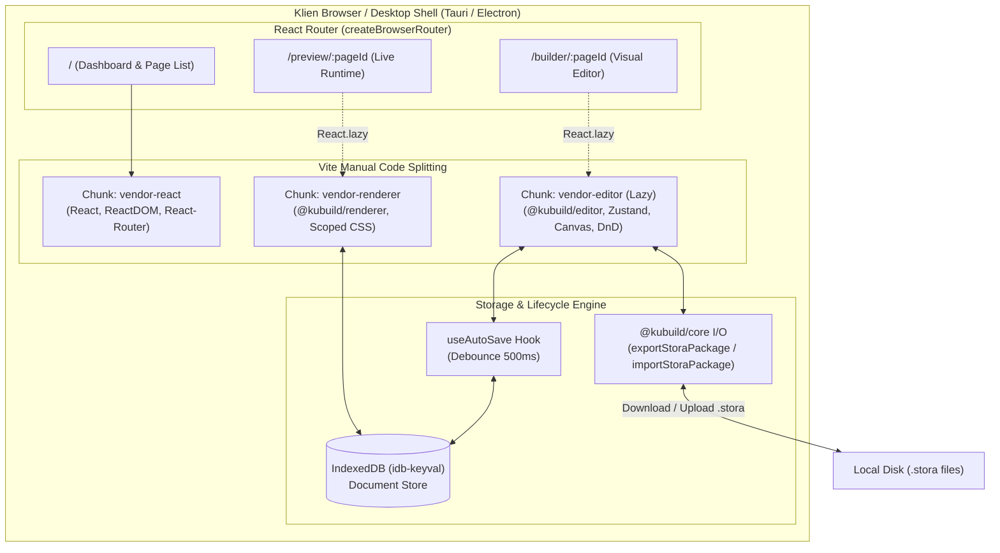

import { Callout } from 'fumadocs-ui/components/callout';
import { Card, Cards } from 'fumadocs-ui/components/card';
import { Tab, Tabs } from 'fumadocs-ui/components/tabs';
import { Accordion, Accordions } from 'fumadocs-ui/components/accordion';
import { Step, Steps } from 'fumadocs-ui/components/steps';
import { File, Folder, Files } from 'fumadocs-ui/components/files';
import { InteractiveRenderer } from '@/components/interactive-renderer';

Mengintegrasikan visual web page builder ke dalam aplikasi Single-Page Application (SPA) berbasis **Vite + React** menawarkan alur kerja pengembangan (*developer experience*) yang instan berkat Hot Module Replacement (HMR) milidetik, bundle rollup yang sangat teroptimasi, serta kemudahan *deployment* ke infrastruktur static hosting seperti Cloudflare Pages, AWS S3, Vercel Static, maupun aplikasi desktop berbasis **Electron** atau **Tauri**.

Berbeda dengan Next.js yang memprioritaskan Server-Side Rendering (SSR) dan Server Components untuk Core Web Vitals pada halaman publik masif, arsitektur Vite SPA sangat ideal untuk sistem di mana interaktivitas klien, manipulasi state lokal, dan kecepatan iterasi antarmuka admin menjadi prioritas utama.

---

## Karakteristik & Use Cases Ideal

Integrasi KUBUILD ke dalam Vite React SPA dirancang secara khusus untuk skenario-skenario berikut:

<Cards>
  <Card title="Internal CMS & Dashboard Admin" icon="LayoutDashboard">
    Portal admin SaaS multi-tenant atau back-office internal tim marketing untuk merancang *landing pages*, *checkout funnels*, dan *promo banners* tanpa memerlukan backend rendering server yang kompleks.
  </Card>
  <Card title="Desktop Apps (Tauri / Electron)" icon="Monitor">
    Aplikasi *native desktop* mandiri untuk perancang halaman web offline. File `.stora` dapat dibaca dan disimpan langsung ke sistem file lokal pengguna melalui adapter I/O.
  </Card>
  <Card title="Client-Only PWA / Offline-First" icon="WifiOff">
    Aplikasi web progresif (PWA) yang beroperasi penuh di dalam browser pengguna dengan persistensi data berbasis `IndexedDB` dan kemampuan ekspor/impor paket `.stora` tanpa ketergantungan koneksi internet.
  </Card>
  <Card title="Embedded Micro-Frontend Builder" icon="Component">
    Sub-modul visual editor yang di-mount sebagai micro-frontend atau web component di dalam ekosistem aplikasi web enterprise yang sudah ada (React, Vue, Angular, atau legacy portals).
  </Card>
</Cards>

---

## Arsitektur Vite SPA Integration

Berikut adalah alur arsitektur interaksi antara bundler Vite, React Router, dan modul KUBUILD:



<Callout type="info" title="Pemisahan Bundle Klien">
  Meskipun aplikasi berjalan 100% di browser, kita **tidak boleh** memuat modul editor (`@kubuild/editor`) pada halaman daftar dashboard atau halaman live preview. Dengan memanfaatkan `React.lazy()` dan konfigurasi `manualChunks` di Vite, ukuran initial bundle tetap di bawah **60KB gzipped**, sementara modul editor sebesar ~280KB hanya diunduh saat pengguna membuka rute `/builder/:pageId`.
</Callout>

---

## Live Interactive Preview

Di bawah ini adalah demonstrasi runtime `@kubuild/renderer` yang berjalan murni secara *client-side* di dalam browser Anda. Anda dapat beralih antara breakpoint desktop, tablet, dan ponsel secara instan:

<InteractiveRenderer
  title="Vite React Runtime Demonstration"
  height="440px"
  defaultViewport="desktop"
  showJsonToggle={true}
  document={{
    schema: "stora.page",
    version: "1.3.0",
    metadata: {
      title: "Vite SPA Showcase",
      description: "Interactive landing page embedded in a Vite React SPA.",
      category: "spa",
      tags: ["vite", "react", "spa", "client-side"]
    },
    document: {
      id: "root-vite-demo",
      type: "page",
      props: {
        title: "Vite Single Page Application"
      },
      styles: {
        base: {
          backgroundColor: "#09090b",
          minHeight: "100%",
          padding: "36px 24px",
          color: "#fafafa",
          fontFamily: "Inter, sans-serif"
        }
      },
      children: [
        {
          id: "badge-vite",
          type: "badge",
          props: {
            text: "⚡ Vite 6 + React 19 Compatible",
            variant: "outline"
          },
          styles: {
            base: {
              marginBottom: "16px",
              borderColor: "#3b82f6",
              color: "#60a5fa"
            }
          }
        },
        {
          id: "heading-vite",
          type: "heading",
          props: {
            text: "Build Fast, Ship Faster",
            level: 1
          },
          styles: {
            base: {
              fontSize: "32px",
              fontWeight: "800",
              lineHeight: "1.2",
              marginBottom: "12px",
              color: "#ffffff"
            },
            mobile: {
              fontSize: "24px"
            }
          }
        },
        {
          id: "paragraph-vite",
          type: "paragraph",
          props: {
            text: "KUBUILD menyediakan visual drag-and-drop editor dan high-performance renderer tanpa ketergantungan server runtime."
          },
          styles: {
            base: {
              fontSize: "15px",
              color: "#a1a1aa",
              maxWidth: "600px",
              marginBottom: "24px",
              lineHeight: "1.6"
            }
          }
        },
        {
          id: "btn-vite-cta",
          type: "button",
          props: {
            text: "Explore Documentation",
            variant: "primary"
          },
          styles: {
            base: {
              backgroundColor: "#2563eb",
              color: "#ffffff",
              padding: "10px 20px",
              borderRadius: "8px",
              fontWeight: "600"
            }
          }
        }
      ]
    }
  }}
/>

---

## Instalasi & Setup Proyek

Ikuti panduan bertahap berikut untuk mengonfigurasi proyek Vite baru atau mengintegrasikan KUBUILD ke aplikasi yang sudah berjalan.

<Steps>
  <Step>
    ### Buat Proyek Vite Baru
    
    Inisialisasi aplikasi React dengan TypeScript menggunakan template resmi Vite:

    <Tabs items={['pnpm', 'npm', 'yarn', 'bun']}>
      <Tab value="pnpm">
        ```bash
        pnpm create vite my-builder-app --template react-ts
        cd my-builder-app
        ```
      </Tab>
      <Tab value="npm">
        ```bash
        npm create vite@latest my-builder-app -- --template react-ts
        cd my-builder-app
        ```
      </Tab>
      <Tab value="yarn">
        ```bash
        yarn create vite my-builder-app --template react-ts
        cd my-builder-app
        ```
      </Tab>
      <Tab value="bun">
        ```bash
        bun create vite my-builder-app --template react-ts
        cd my-builder-app
        ```
      </Tab>
    </Tabs>
  </Step>

  <Step>
    ### Pasang Dependensi KUBUILD & Ekosistem
    
    Instal paket inti KUBUILD, ikon antarmuka, routing, dan pustaka persistensi client-side:

    <Tabs items={['pnpm', 'npm', 'yarn', 'bun']}>
      <Tab value="pnpm">
        ```bash
        pnpm add @kubuild/react @kubuild/schema @kubuild/core lucide-react react-router-dom idb-keyval
        pnpm add -D @types/node
        ```
      </Tab>
      <Tab value="npm">
        ```bash
        npm install @kubuild/react @kubuild/schema @kubuild/core lucide-react react-router-dom idb-keyval
        npm install -D @types/node
        ```
      </Tab>
      <Tab value="yarn">
        ```bash
        yarn add @kubuild/react @kubuild/schema @kubuild/core lucide-react react-router-dom idb-keyval
        yarn add -D @types/node
        ```
      </Tab>
      <Tab value="bun">
        ```bash
        bun add @kubuild/react @kubuild/schema @kubuild/core lucide-react react-router-dom idb-keyval
        bun add -d @types/node
        ```
      </Tab>
    </Tabs>
  </Step>

  <Step>
    ### Setup Tailwind CSS
    
    KUBUILD mendukung **Tailwind CSS v4** (menggunakan plugin resmi `@tailwindcss/vite`) maupun **Tailwind CSS v3**:

    <Tabs items={['Tailwind CSS v4 (Modern)', 'Tailwind CSS v3 (Legacy)']}>
      <Tab value="Tailwind CSS v4 (Modern)">
        ```bash
        pnpm add @tailwindcss/vite tailwindcss
        ```

        Tambahkan plugin di `vite.config.ts`, lalu import di `src/index.css`:
        ```css title="src/index.css"
        @import "tailwindcss";
        ```
      </Tab>
      <Tab value="Tailwind CSS v3 (Legacy)">
        ```bash
        pnpm add -D tailwindcss postcss autoprefixer
        npx tailwindcss init -p
        ```

        Konfigurasikan content matcher di `tailwind.config.js`:
        ```javascript title="tailwind.config.js"
        /** @type {import('tailwindcss').Config} */
        export default {
          content: [
            "./index.html",
            "./src/**/*.{js,ts,jsx,tsx}",
            "./node_modules/@kubuild/**/*.{js,ts,jsx,tsx}"
          ],
          theme: { extend: {} },
          plugins: [],
        }
        ```
      </Tab>
    </Tabs>
  </Step>
</Steps>

---

## Konfigurasi `vite.config.ts`

Konfigurasi Vite memegang peranan krusial dalam performa aplikasi visual builder. Dua aspek penting yang harus dikonfigurasi adalah:
1. **Manual Chunking (`rollupOptions.output.manualChunks`)**: Memisahkan modul editor yang berat ke chunk terisolasi agar tidak membebani initial loading.
2. **Path Aliasing**: Mempermudah impor modul internal dengan alias `@/`.

Berikut adalah konfigurasi produksi lengkap:

```typescript title="vite.config.ts"
import { defineConfig } from 'vite';
import react from '@vitejs/plugin-react';
import tailwindcss from '@tailwindcss/vite';
import { fileURLToPath, URL } from 'node:url';

// https://vitejs.dev/config/
export default defineConfig({
  plugins: [
    react(),
    tailwindcss(),
  ],
  resolve: {
    alias: {
      '@': fileURLToPath(new URL('./src', import.meta.url)),
    },
  },
  build: {
    target: 'esnext',
    sourcemap: true,
    // Batas peringatan ukuran chunk dinaikkan ke 600KB untuk modul rich editor
    chunkSizeWarningLimit: 600,
    rollupOptions: {
      output: {
        manualChunks(id) {
          // 1. Chunk Vendor Inti React & Routing
          if (id.includes('node_modules/react') || 
              id.includes('node_modules/react-dom') || 
              id.includes('node_modules/react-router-dom')) {
            return 'vendor-react';
          }

          // 2. Chunk Editor KUBUILD (Canvas, Zustand, Drag & Drop, Inspector)
          if (id.includes('@kubuild/editor') || id.includes('lucide-react')) {
            return 'vendor-editor';
          }

          // 3. Chunk Renderer Runtime & Schema
          if (id.includes('@kubuild/renderer') || 
              id.includes('@kubuild/schema') || 
              id.includes('@kubuild/core')) {
            return 'vendor-renderer';
          }

          // 4. Utilitas penyimpanan & parsing
          if (id.includes('idb-keyval') || id.includes('fflate')) {
            return 'vendor-storage';
          }
        },
      },
    },
  },
  server: {
    port: 3000,
    open: true,
  },
  preview: {
    port: 3000,
  },
});
```

<Callout type="warning" title="Peringatan Duplicate React Instance">
  Jika Anda mengintegrasikan paket lokal melalui `pnpm link` atau monorepo workspaces, pastikan opsi `resolve.dedupe: ['react', 'react-dom']` ditambahkan ke `vite.config.ts` untuk mencegah error *"Invalid Hook Call"* akibat adanya dua instance React yang berbeda.
</Callout>

---

## Struktur Direktori Proyek

Struktur folder modular yang direkomendasikan untuk proyek Vite SPA:

<Files>
  <Folder name="src" defaultOpen>
    <Folder name="components" defaultOpen>
      <Folder name="layout">
        <File name="Header.tsx" />
        <File name="Sidebar.tsx" />
      </Folder>
      <Folder name="ui">
        <File name="LoadingSpinner.tsx" />
        <File name="Toast.tsx" />
      </Folder>
    </Folder>
    <Folder name="hooks" defaultOpen>
      <File name="useAutoSave.ts" />
      <File name="useStoraStorage.ts" />
    </Folder>
    <Folder name="lib" defaultOpen>
      <File name="storage.ts" />
      <File name="sample-document.ts" />
    </Folder>
    <Folder name="pages" defaultOpen>
      <File name="DashboardPage.tsx" />
      <File name="EditorPage.tsx" />
      <File name="PreviewPage.tsx" />
    </Folder>
    <File name="App.tsx" />
    <File name="main.tsx" />
    <File name="index.css" />
    <File name="vite-env.d.ts" />
  </Folder>
  <File name="index.html" />
  <File name="vite.config.ts" />
  <File name="tsconfig.json" />
  <File name="package.json" />
</Files>

---

## Setup Routing dengan React Router

Aplikasi dibagi menjadi tiga rute utama:
- `/`: **Dashboard** untuk melihat daftar halaman yang tersimpan, mengimpor file `.stora`, atau membuat dokumen baru.
- `/builder/:pageId`: **Visual Editor** tempat `<KubuildEditor />` dimuat secara lazy.
- `/preview/:pageId`: **Live Preview** tempat `<KubuildRenderer />` menampilkan halaman secara akurat seperti di browser pengunjung.

### 1. Inisialisasi Router di `App.tsx`

```tsx title="src/App.tsx"
import React, { Suspense, lazy } from 'react';
import { createBrowserRouter, RouterProvider, Navigate } from 'react-router-dom';
import { DashboardPage } from './pages/DashboardPage';
import { LoadingSpinner } from './components/ui/LoadingSpinner';

// Lazy loading modul editor dan preview untuk membagi bundle (Code Splitting)
const EditorPage = lazy(() => import('./pages/EditorPage'));
const PreviewPage = lazy(() => import('./pages/PreviewPage'));

const router = createBrowserRouter([
  {
    path: '/',
    element: <DashboardPage />,
  },
  {
    path: '/builder/:pageId',
    element: (
      <Suspense fallback={<LoadingSpinner label="Memuat Kanvas Editor KUBUILD..." />}>
        <EditorPage />
      </Suspense>
    ),
  },
  {
    path: '/preview/:pageId',
    element: (
      <Suspense fallback={<LoadingSpinner label="Menyiapkan Live Preview..." />}>
        <PreviewPage />
      </Suspense>
    ),
  },
  {
    path: '*',
    element: <Navigate to="/" replace />,
  },
]);

export function App() {
  return <RouterProvider router={router} />;
}

export default App;
```

---

## State Persistence & Auto-Save

Salah satu tantangan terbesar pada aplikasi SPA client-side adalah mengelola siklus hidup data dokumen tanpa kehilangan pekerjaan pengguna saat browser di-refresh atau koneksi terputus.

<Callout type="warn" title="Hindari localStorage untuk Dokumen Kompleks">
  Penyimpanan `localStorage` memiliki kuota ketat (maksimal 5MB) dan bersifat sinkronik (*blocking* pada main thread). Dokumen visual builder yang memuat struktur node banyak atau *embedded assets* dapat melampaui kuota dan memicu error `QuotaExceededError`. Gunakan **IndexedDB** melalui pustaka ringan seperti `idb-keyval` yang asinkron dan berkapasitas ratusan megabyte.
</Callout>

### 1. Layer Penyimpanan IndexedDB (`src/lib/storage.ts`)

```typescript title="src/lib/storage.ts"
import { get, set, del, keys } from 'idb-keyval';
import type { PageDocument } from '@kubuild/schema';
import { createBlankDocument } from '@kubuild/core';

const STORAGE_PREFIX = 'kubuild_page_';

export interface PageMetadataSummary {
  id: string;
  title: string;
  updatedAt: string;
  nodeCount: number;
}

/**
 * Menyimpan atau memperbarui dokumen halaman di IndexedDB.
 */
export async function saveDocument(id: string, doc: PageDocument): Promise<void> {
  const docWithTimestamp: PageDocument = {
    ...doc,
    metadata: {
      ...doc.metadata,
      updatedAt: new Date().toISOString(),
    },
  };
  await set(`${STORAGE_PREFIX}${id}`, docWithTimestamp);
}

/**
 * Mengambil dokumen berdasarkan pageId. Jika belum ada, kembalikan dokumen default baru.
 */
export async function loadDocument(id: string): Promise<PageDocument> {
  const data = await get<PageDocument>(`${STORAGE_PREFIX}${id}`);
  if (!data) {
    const blank = createBlankDocument(`Page ${id}`);
    await saveDocument(id, blank);
    return blank;
  }
  return data;
}

/**
 * Mengambil ringkasan seluruh halaman yang tersimpan untuk dashboard.
 */
export async function listAllPages(): Promise<PageMetadataSummary[]> {
  const allKeys = await keys();
  const pageKeys = allKeys.filter((k) => typeof k === 'string' && k.startsWith(STORAGE_PREFIX));
  
  const summaries: PageMetadataSummary[] = [];
  for (const k of pageKeys) {
    const doc = await get<PageDocument>(k);
    if (doc) {
      const pageId = String(k).replace(STORAGE_PREFIX, '');
      summaries.push({
        id: pageId,
        title: doc.metadata?.title || 'Untitled Page',
        updatedAt: doc.metadata?.updatedAt || new Date().toISOString(),
        nodeCount: doc.document?.children?.length || 0,
      });
    }
  }

  return summaries.sort((a, b) => new Date(b.updatedAt).getTime() - new Date(a.updatedAt).getTime());
}

/**
 * Menghapus dokumen halaman dari IndexedDB.
 */
export async function deleteDocument(id: string): Promise<void> {
  await del(`${STORAGE_PREFIX}${id}`);
}
```

### 2. Custom Hook `useAutoSave` dengan Debounce

Hook ini mendengarkan perubahan dokumen dari event `onChange` editor, melakukan *debounce* 500ms, serta mengelola status penyimpanan (`idle`, `saving`, `saved`, `error`):

```typescript title="src/hooks/useAutoSave.ts"
import { useState, useEffect, useRef, useCallback } from 'react';
import type { PageDocument } from '@kubuild/schema';
import { saveDocument } from '../lib/storage';

export type SaveStatus = 'idle' | 'saving' | 'saved' | 'error';

export function useAutoSave(pageId: string, debounceMs: number = 500) {
  const [status, setStatus] = useState<SaveStatus>('idle');
  const [lastSaved, setLastSaved] = useState<Date | null>(null);
  const [error, setError] = useState<Error | null>(null);

  const pendingDocRef = useRef<PageDocument | null>(null);
  const timerRef = useRef<ReturnType<typeof setTimeout> | null>(null);

  const triggerSave = useCallback(
    async (docToSave: PageDocument) => {
      try {
        setStatus('saving');
        await saveDocument(pageId, docToSave);
        setStatus('saved');
        setLastSaved(new Date());
        setError(null);
      } catch (err) {
        console.error('AutoSave Error:', err);
        setStatus('error');
        setError(err instanceof Error ? err : new Error('Failed to auto-save document'));
      }
    },
    [pageId]
  );

  const onDocumentChange = useCallback(
    (newDoc: PageDocument) => {
      pendingDocRef.current = newDoc;
      setStatus('idle');

      if (timerRef.current) {
        clearTimeout(timerRef.current);
      }

      timerRef.current = setTimeout(() => {
        if (pendingDocRef.current) {
          triggerSave(pendingDocRef.current);
        }
      }, debounceMs);
    },
    [debounceMs, triggerSave]
  );

  // Bersihkan timer dan simpan perubahan yang masih tertunda saat unmount
  useEffect(() => {
    return () => {
      if (timerRef.current) {
        clearTimeout(timerRef.current);
      }
      if (pendingDocRef.current) {
        saveDocument(pageId, pendingDocRef.current).catch(console.error);
      }
    };
  }, [pageId]);

  return {
    status,
    lastSaved,
    error,
    onDocumentChange,
    forceSave: () => {
      if (pendingDocRef.current) {
        return triggerSave(pendingDocRef.current);
      }
    },
  };
}
```

---

## Implementasi Halaman Visual Editor (`EditorPage.tsx`)

Komponen `EditorPage` menghubungkan `<KubuildEditor />`, toolbar kustom, indikator status auto-save, tombol live preview, dan fungsi ekspor/impor `.stora`:

```tsx title="src/pages/EditorPage.tsx"
import React, { useEffect, useState, useRef } from 'react';
import { useParams, useNavigate, Link } from 'react-router-dom';
import { KubuildEditor, type EditorHandle } from '@kubuild/editor';
import { exportStoraPackage } from '@kubuild/core';
import type { PageDocument } from '@kubuild/schema';
import { loadDocument } from '../lib/storage';
import { useAutoSave } from '../hooks/useAutoSave';
import { 
  ArrowLeft, 
  Eye, 
  Download, 
  CheckCircle2, 
  Clock, 
  AlertCircle 
} from 'lucide-react';

export default function EditorPage() {
  const { pageId } = useParams<{ pageId: string }>();
  const navigate = useNavigate();
  const editorRef = useRef<EditorHandle | null>(null);

  const [document, setDocument] = useState<PageDocument | null>(null);
  const [isLoading, setIsLoading] = useState(true);

  const safePageId = pageId || 'default';
  const { status, lastSaved, error, onDocumentChange, forceSave } = useAutoSave(safePageId, 500);

  useEffect(() => {
    let isMounted = true;
    loadDocument(safePageId)
      .then((doc) => {
        if (isMounted) {
          setDocument(doc);
          setIsLoading(false);
        }
      })
      .catch((err) => {
        console.error('Failed to load page document:', err);
        setIsLoading(false);
      });

    return () => {
      isMounted = false;
    };
  }, [safePageId]);

  const handleExportStora = async () => {
    if (!document) return;
    await forceSave();

    try {
      const result = await exportStoraPackage(document, {
        metadata: {
          title: document.metadata?.title || `Page-${safePageId}`,
        },
      });

      if (!result.success || !result.archive) {
        alert('Gagal mengekspor file .stora: ' + result.diagnosticMessage);
        return;
      }

      // Buat file Blob dan unduh otomatis
      const blob = new Blob([result.archive], { type: 'application/octet-stream' });
      const url = URL.createObjectURL(blob);
      const anchor = document.createElement('a');
      anchor.href = url;
      anchor.download = `${(document.metadata?.title || safePageId).toLowerCase().replace(/\s+/g, '-')}.stora`;
      anchor.click();
      URL.revokeObjectURL(url);
    } catch (err) {
      console.error('Export Error:', err);
      alert('Terjadi kesalahan saat memproses ekspor .stora.');
    }
  };

  if (isLoading) {
    return (
      <div className="flex h-screen w-screen items-center justify-center bg-zinc-950 text-zinc-100">
        <p className="animate-pulse">Menyiapkan workspace kanvas...</p>
      </div>
    );
  }

  if (!document) {
    return (
      <div className="flex h-screen w-screen flex-col items-center justify-center gap-4 bg-zinc-950 text-zinc-100">
        <p>Halaman tidak ditemukan.</p>
        <button 
          onClick={() => navigate('/')} 
          className="rounded bg-blue-600 px-4 py-2 text-sm font-semibold hover:bg-blue-500"
        >
          Kembali ke Dashboard
        </button>
      </div>
    );
  }

  return (
    <div className="flex h-screen w-screen flex-col overflow-hidden bg-zinc-900">
      {/* Top Navigation Bar */}
      <header className="flex h-14 items-center justify-between border-b border-zinc-800 bg-zinc-950 px-4 text-zinc-200">
        <div className="flex items-center gap-3">
          <Link 
            to="/" 
            className="flex items-center gap-1.5 rounded px-2.5 py-1.5 text-xs font-medium text-zinc-400 hover:bg-zinc-800 hover:text-zinc-100 transition-colors"
          >
            <ArrowLeft className="h-4 w-4" />
            Dashboard
          </Link>
          <span className="text-zinc-700">/</span>
          <span className="font-semibold text-sm text-zinc-100">
            {document.metadata?.title || safePageId}
          </span>
        </div>

        {/* AutoSave Indicator */}
        <div className="flex items-center gap-2 text-xs">
          {status === 'saving' && (
            <span className="flex items-center gap-1.5 text-amber-400">
              <Clock className="h-3.5 w-3.5 animate-spin" />
              Menyimpan perubahan...
            </span>
          )}
          {status === 'saved' && (
            <span className="flex items-center gap-1.5 text-emerald-400">
              <CheckCircle2 className="h-3.5 w-3.5" />
              Tersimpan {lastSaved?.toLocaleTimeString()}
            </span>
          )}
          {status === 'error' && (
            <span className="flex items-center gap-1.5 text-rose-400" title={error?.message}>
              <AlertCircle className="h-3.5 w-3.5" />
              Gagal menyimpan
            </span>
          )}
        </div>

        {/* Action Controls */}
        <div className="flex items-center gap-2">
          <button
            onClick={handleExportStora}
            className="flex items-center gap-1.5 rounded bg-zinc-800 px-3 py-1.5 text-xs font-medium text-zinc-200 hover:bg-zinc-700 transition-colors"
            title="Download package file .stora"
          >
            <Download className="h-3.5 w-3.5" />
            Export .stora
          </button>
          <Link
            to={`/preview/${safePageId}`}
            className="flex items-center gap-1.5 rounded bg-blue-600 px-3.5 py-1.5 text-xs font-semibold text-white hover:bg-blue-500 transition-colors shadow-sm"
          >
            <Eye className="h-3.5 w-3.5" />
            Live Preview
          </Link>
        </div>
      </header>

      {/* KUBUILD Visual Canvas Editor */}
      <div className="flex-1 relative">
        <KubuildEditor
          ref={editorRef}
          initialDocument={document}
          onChange={(newDoc) => {
            setDocument(newDoc);
            onDocumentChange(newDoc);
          }}
        />
      </div>
    </div>
  );
}
```

---

## Implementasi Live Preview (`PreviewPage.tsx`)

Komponen `PreviewPage` merender dokumen secara akurat menggunakan `<KubuildRenderer />` dengan mode responsif CSS scoped (`responsive="css"`):

```tsx title="src/pages/PreviewPage.tsx"
import React, { useEffect, useState } from 'react';
import { useParams, Link } from 'react-router-dom';
import { KubuildRenderer } from '@kubuild/renderer';
import type { PageDocument } from '@kubuild/schema';
import { loadDocument } from '../lib/storage';
import { ArrowLeft, Monitor, Tablet, Smartphone } from 'lucide-react';

export default function PreviewPage() {
  const { pageId } = useParams<{ pageId: string }>();
  const [document, setDocument] = useState<PageDocument | null>(null);
  const [viewport, setViewport] = useState<'desktop' | 'tablet' | 'mobile'>('desktop');

  const safePageId = pageId || 'default';

  useEffect(() => {
    loadDocument(safePageId).then(setDocument).catch(console.error);
  }, [safePageId]);

  if (!document) {
    return (
      <div className="flex h-screen w-screen items-center justify-center bg-zinc-950 text-zinc-100">
        <p className="animate-pulse">Menyiapkan pratinjau halaman...</p>
      </div>
    );
  }

  const viewportWidths = {
    desktop: 'w-full',
    tablet: 'max-w-[768px]',
    mobile: 'max-w-[390px]',
  };

  return (
    <div className="flex min-h-screen flex-col bg-zinc-950 text-zinc-100">
      {/* Top Preview Control Bar */}
      <header className="sticky top-0 z-50 flex h-12 items-center justify-between border-b border-zinc-800 bg-zinc-900/90 px-4 backdrop-blur">
        <Link
          to={`/builder/${safePageId}`}
          className="flex items-center gap-1.5 rounded px-2.5 py-1 text-xs font-medium text-zinc-300 hover:bg-zinc-800 hover:text-white"
        >
          <ArrowLeft className="h-4 w-4" />
          Kembali ke Editor
        </Link>

        {/* Viewport Width Switchers */}
        <div className="flex items-center rounded-lg border border-zinc-800 bg-zinc-950 p-0.5">
          <button
            onClick={() => setViewport('desktop')}
            className={`flex items-center gap-1 rounded px-2.5 py-1 text-xs font-medium transition-colors ${
              viewport === 'desktop' ? 'bg-zinc-800 text-white' : 'text-zinc-400 hover:text-zinc-200'
            }`}
          >
            <Monitor className="h-3.5 w-3.5" />
            Desktop
          </button>
          <button
            onClick={() => setViewport('tablet')}
            className={`flex items-center gap-1 rounded px-2.5 py-1 text-xs font-medium transition-colors ${
              viewport === 'tablet' ? 'bg-zinc-800 text-white' : 'text-zinc-400 hover:text-zinc-200'
            }`}
          >
            <Tablet className="h-3.5 w-3.5" />
            Tablet
          </button>
          <button
            onClick={() => setViewport('mobile')}
            className={`flex items-center gap-1 rounded px-2.5 py-1 text-xs font-medium transition-colors ${
              viewport === 'mobile' ? 'bg-zinc-800 text-white' : 'text-zinc-400 hover:text-zinc-200'
            }`}
          >
            <Smartphone className="h-3.5 w-3.5" />
            Mobile
          </button>
        </div>

        <div className="w-24 text-right text-xs text-zinc-500">
          Preview Mode
        </div>
      </header>

      {/* Render Frame Container */}
      <main className="flex flex-1 justify-center p-4">
        <div className={`transition-all duration-300 shadow-2xl ${viewportWidths[viewport]}`}>
          <KubuildRenderer
            document={document}
            responsive="css"
            mode="runtime"
          />
        </div>
      </main>
    </div>
  );
}
```

---

## Import & Export File `.stora`

File `.stora` adalah format arsip ZIP biner standar KUBUILD yang mengemas `manifest.json`, `page.json`, `metadata.json`, dan direktori `assets/`. Format ini menjamin portabilitas konten antara environment development, staging, dan production tanpa kebocoran data rahasia.

### 1. Ekspor Dokumen (`exportStoraPackage`)

Fungsi `exportStoraPackage` menerima `PageDocument` dan menghasilkan `archive` berupa `Uint8Array`:

```typescript
import { exportStoraPackage } from '@kubuild/core';

async function downloadStoraFile(doc: PageDocument, filename = 'landing-page') {
  const result = await exportStoraPackage(doc, {
    metadata: {
      title: doc.metadata?.title || filename,
      author: 'Admin Portal',
    },
  });

  if (!result.success || !result.archive) {
    throw new Error(result.diagnosticMessage || 'Gagal mengekspor paket .stora');
  }

  // Bungkus ke dalam Blob dan buat link download sementara
  const blob = new Blob([result.archive], { type: 'application/octet-stream' });
  const objectUrl = URL.createObjectURL(blob);
  
  const a = document.createElement('a');
  a.href = objectUrl;
  a.download = `${filename}.stora`;
  document.body.appendChild(a);
  a.click();
  document.body.removeChild(a);
  URL.revokeObjectURL(objectUrl);
}
```

### 2. Impor Dokumen via File Upload (`importStoraPackage`)

Fungsi `importStoraPackage` menerima `Uint8Array` atau `ArrayBuffer` dari file yang diunggah pengguna, memvalidasi integritas skema dokumen, dan mengembalikan `PageDocument`:

```typescript
import { importStoraPackage } from '@kubuild/core';
import { saveDocument } from '@/lib/storage';

async function handleFileUpload(file: File): Promise<string> {
  const arrayBuffer = await file.arrayBuffer();
  
  // Impor dan validasi paket
  const result = await importStoraPackage(arrayBuffer);

  if (!result.success || !result.page) {
    throw new Error(result.diagnosticMessage || 'File .stora tidak valid atau rusak');
  }

  const newPageId = `imported-${Date.now()}`;
  await saveDocument(newPageId, result.page);

  return newPageId;
}
```

---

## Implementasi Dashboard (`DashboardPage.tsx`)

Dashboard menyediakan antarmuka pengguna untuk melihat daftar halaman yang tersimpan, membuat halaman kosong baru, dan mengunggah paket `.stora` melalui drag-and-drop:

```tsx title="src/pages/DashboardPage.tsx"
import React, { useEffect, useState } from 'react';
import { Link, useNavigate } from 'react-router-dom';
import { listAllPages, deleteDocument, saveDocument, type PageMetadataSummary } from '../lib/storage';
import { createBlankDocument, importStoraPackage } from '@kubuild/core';
import { Plus, Upload, Trash2, Edit3, Eye, FileText } from 'lucide-react';

export function DashboardPage() {
  const [pages, setPages] = useState<PageMetadataSummary[]>([]);
  const [isUploading, setIsUploading] = useState(false);
  const navigate = useNavigate();

  const refreshPages = () => {
    listAllPages().then(setPages).catch(console.error);
  };

  useEffect(() => {
    refreshPages();
  }, []);

  const handleCreateNewPage = async () => {
    const id = `page-${Date.now().toString(36)}`;
    const blankDoc = createBlankDocument('Halaman Baru');
    await saveDocument(id, blankDoc);
    navigate(`/builder/${id}`);
  };

  const handleImportFile = async (e: React.ChangeEvent<HTMLInputElement>) => {
    const file = e.target.files?.[0];
    if (!file) return;

    try {
      setIsUploading(true);
      const buffer = await file.arrayBuffer();
      const result = await importStoraPackage(buffer);

      if (!result.success || !result.page) {
        alert('Gagal mengimpor: ' + result.diagnosticMessage);
        return;
      }

      const newId = `imported-${Date.now().toString(36)}`;
      await saveDocument(newId, result.page);
      refreshPages();
      navigate(`/builder/${newId}`);
    } catch (err) {
      console.error(err);
      alert('Terjadi kesalahan saat membaca file .stora');
    } finally {
      setIsUploading(false);
    }
  };

  const handleDelete = async (id: string, e: React.MouseEvent) => {
    e.preventDefault();
    if (confirm('Yakin ingin menghapus halaman ini?')) {
      await deleteDocument(id);
      refreshPages();
    }
  };

  return (
    <div className="min-h-screen bg-zinc-950 text-zinc-100 p-8">
      <div className="mx-auto max-w-5xl">
        {/* Header */}
        <div className="flex items-center justify-between border-b border-zinc-800 pb-6 mb-8">
          <div>
            <h1 className="text-2xl font-bold tracking-tight text-white">KUBUILD Pages Dashboard</h1>
            <p className="text-sm text-zinc-400 mt-1">Kelola dan rancang halaman web interaktif berbasis Vite React SPA.</p>
          </div>
          <div className="flex items-center gap-3">
            <label className="flex items-center gap-2 cursor-pointer rounded-lg border border-zinc-700 bg-zinc-900 px-3.5 py-2 text-xs font-semibold text-zinc-200 hover:bg-zinc-800 hover:border-zinc-600 transition-colors">
              <Upload className="h-4 w-4" />
              {isUploading ? 'Mengimpor...' : 'Import .stora'}
              <input type="file" accept=".stora" onChange={handleImportFile} className="hidden" disabled={isUploading} />
            </label>
            <button
              onClick={handleCreateNewPage}
              className="flex items-center gap-2 rounded-lg bg-blue-600 px-4 py-2 text-xs font-semibold text-white hover:bg-blue-500 transition-colors shadow-sm"
            >
              <Plus className="h-4 w-4" />
              Buat Halaman Baru
            </button>
          </div>
        </div>

        {/* Page Grid */}
        {pages.length === 0 ? (
          <div className="flex flex-col items-center justify-center rounded-2xl border border-dashed border-zinc-800 p-12 text-center">
            <FileText className="h-10 w-10 text-zinc-600 mb-3" />
            <h3 className="text-base font-semibold text-zinc-300">Belum ada halaman</h3>
            <p className="text-xs text-zinc-500 mt-1 max-w-sm">Mulai dengan membuat halaman baru atau impor arsip file .stora yang telah diekspor sebelumnya.</p>
            <button onClick={handleCreateNewPage} className="mt-5 rounded-lg bg-blue-600 px-4 py-2 text-xs font-semibold text-white hover:bg-blue-500">
              Buat Halaman Pertama
            </button>
          </div>
        ) : (
          <div className="grid grid-cols-1 gap-4 sm:grid-cols-2 lg:grid-cols-3">
            {pages.map((p) => (
              <div key={p.id} className="group relative flex flex-col justify-between rounded-xl border border-zinc-800 bg-zinc-900/60 p-5 hover:border-zinc-700 hover:bg-zinc-900 transition-all">
                <div>
                  <div className="flex items-start justify-between">
                    <h3 className="font-semibold text-zinc-200 group-hover:text-blue-400 transition-colors line-clamp-1">
                      {p.title}
                    </h3>
                    <button onClick={(e) => handleDelete(p.id, e)} className="text-zinc-500 hover:text-rose-400 p-1 rounded" title="Hapus Halaman">
                      <Trash2 className="h-4 w-4" />
                    </button>
                  </div>
                  <p className="text-xs text-zinc-500 mt-2">ID: {p.id}</p>
                  <p className="text-xs text-zinc-500">Node: {p.nodeCount} elemen</p>
                  <p className="text-xs text-zinc-400 mt-1">Diperbarui: {new Date(p.updatedAt).toLocaleDateString()}</p>
                </div>

                <div className="mt-6 flex items-center gap-2 pt-4 border-t border-zinc-800/80">
                  <Link to={`/builder/${p.id}`} className="flex-1 flex items-center justify-center gap-1.5 rounded bg-zinc-800 py-1.5 text-xs font-medium text-zinc-200 hover:bg-blue-600 hover:text-white transition-colors">
                    <Edit3 className="h-3.5 w-3.5" />
                    Buka Editor
                  </Link>
                  <Link to={`/preview/${p.id}`} className="flex items-center justify-center rounded bg-zinc-800/80 p-1.5 text-zinc-300 hover:bg-zinc-700 transition-colors" title="Pratinjau Halaman">
                    <Eye className="h-4 w-4" />
                  </Link>
                </div>
              </div>
            ))}
          </div>
        )}
      </div>
    </div>
  );
}
```

---

## Production Deployment & SPA Rewrite Configuration

Saat mendistribusikan aplikasi Vite SPA ke production server atau static hosting (seperti Nginx, Apache, Cloudflare Pages, atau Vercel), seluruh rute non-file harus diarahkan kembali (*fallback rewrite*) ke `index.html` agar React Router dapat menangani routing di sisi klien:

<Tabs items={['Cloudflare Pages', 'Vercel', 'Nginx', 'Netlify']}>
  <Tab value="Cloudflare Pages">
    Buat file `_redirects` di direktori `public/`:
    ```txt title="public/_redirects"
    /*    /index.html   200
    ```
  </Tab>
  <Tab value="Vercel">
    Tambahkan konfigurasi `vercel.json` di root proyek:
    ```json title="vercel.json"
    {
      "rewrites": [
        { "source": "/(.*)", "destination": "/index.html" }
      ]
    }
    ```
  </Tab>
  <Tab value="Nginx">
    Konfigurasi blok server Nginx:
    ```nginx title="/etc/nginx/conf.d/default.conf"
    server {
        listen 80;
        server_name builder.example.com;
        root /usr/share/nginx/html;
        index index.html;

        location / {
            try_files $uri $uri/ /index.html;
        }

        # Cache aset statis rollup secara agresif
        location /assets/ {
            expires 1y;
            add_header Cache-Control "public, immutable";
        }
    }
    ```
  </Tab>
  <Tab value="Netlify">
    Buat file `_redirects` di direktori `public/`:
    ```txt title="public/_redirects"
    /*    /index.html   200
    ```
  </Tab>
</Tabs>

---

## Pertanyaan Umum & Troubleshooting

<Accordions>
  <Accordion title="Mengapa muncul error 404 saat melakukan refresh di rute /builder/:id pada server production?">
    Ini adalah perilaku standar Single-Page Application (SPA). Web server statis mencari file fisik pada path `/builder/page-1/index.html` yang tidak ada di disk. Pastikan Anda telah mengonfigurasi *fallback rewrite rule* (seperti konfigurasi Nginx `try_files $uri /index.html;` atau `_redirects` di Cloudflare/Netlify) agar setiap permintaan non-file diarahkan ke `index.html`.
  </Accordion>

  <Accordion title="Bagaimana cara mencegah memory leak jika pengguna sering membuka dan menutup kanvas editor?">
    Zustand store dan event listeners canvas dibersihkan secara otomatis saat komponen `<KubuildEditor />` di-unmount. Pastikan jika Anda menggunakan custom hooks atau interval auto-save, bersihkan seluruh timer via cleanup function `useEffect` seperti yang dicontohkan pada implementasi `useAutoSave`.
  </Accordion>

  <Accordion title="Apakah saya bisa mengemas aplikasi Vite ini menjadi installer Desktop offline?">
    Tentu saja. Anda dapat menambahkan **Tauri v2** (`pnpm add -D @tauri-apps/cli`) atau **Electron**. Karena penyimpanan menggunakan `IndexedDB` dan ekspor/impor berkas menggunakan `Uint8Array`, aplikasi dapat berjalan 100% offline tanpa modifikasi kode runtime KUBUILD.
  </Accordion>

  <Accordion title="Bagaimana cara mengatasi gambar eksternal yang diblokir oleh browser saat di-render di Canvas?">
    Canvas editor memerlukan akses ke gambar untuk *drag preview* dan *color sampling*. Jika gambar di-host di domain eksternal tanpa header CORS (`Access-Control-Allow-Origin: *`), browser akan memblokirnya. Solusinya: implementasikan `AssetProvider` kustom yang mengunggah gambar ke storage internal Anda atau gunakan reverse proxy media.
  </Accordion>
</Accordions>
