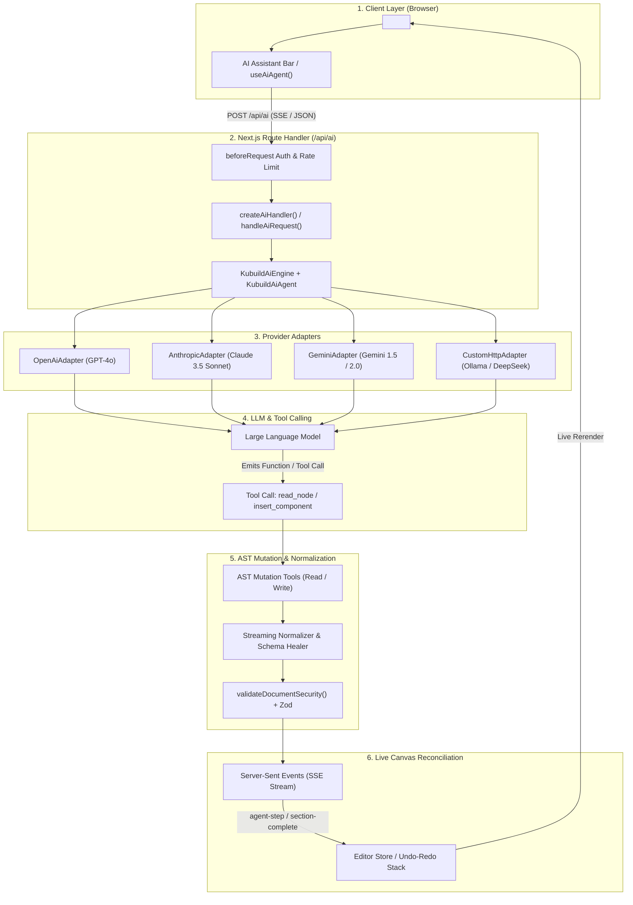
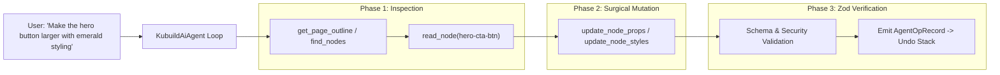
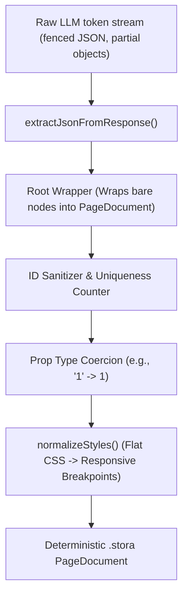

import { Callout } from 'fumadocs-ui/components/callout';
import { Card, Cards } from 'fumadocs-ui/components/card';
import { Tab, Tabs } from 'fumadocs-ui/components/tabs';
import { Accordion, Accordions } from 'fumadocs-ui/components/accordion';
import { TypeTable } from 'fumadocs-ui/components/type-table';

The **`@kubuild/ai`** package is the multi-provider generative AI engine and agentic copilot orchestrator for the KUBUILD ecosystem. It bridges large language models (LLMs) and visual canvas editing by providing streaming prompt-to-page generation, agentic multi-turn editing loops, deterministic AST mutation tools, runtime schema validation, and fault-tolerant JSON normalizers.

Unlike traditional prompt-to-code builders that output raw HTML or JSX strings that frequently break runtime execution, `@kubuild/ai` operates directly on the portable **`.stora`** document AST (`PageDocument`). Every node generated or modified by an AI model passes through an infallible normalization pipeline and strict Zod runtime verification before it touches canvas state.

---

## Key Highlights & Architecture

<Cards>
  <Card title="Multi-Provider Adapters" icon="Layers">
    Unified interface for OpenAI (GPT-4o), Anthropic (Claude 3.5 Sonnet), Google Gemini (Gemini 1.5/2.0), and local LLMs (Ollama, DeepSeek via OpenAI-compatible endpoints).
  </Card>
  <Card title="Deterministic AST Safety" icon="ShieldCheck">
    Automated Zod schema validation, tree nesting rules, and security limits that strip malicious scripts, unauthorized protocols, and structural anomalies.
  </Card>
  <Card title="Streaming Normalizer" icon="Zap">
    Fault-tolerant JSON streaming engine that parses and heals truncated LLM response chunks on the fly without causing canvas crashes or flickering.
  </Card>
  <Card title="Agent Mutation Tools" icon="Terminal">
    Full suite of LLM tool calling definitions: read tools (`get_page_outline`, `read_node`) and write tools (`insert_component`, `update_node_props`, `delete_node`).
  </Card>
  <Card title="Custom Skills Specification" icon="Sparkles">
    Composable domain knowledge packages adhering to the Agent Skills format (`SKILL.md`) for specialized design patterns, styling tones, and layout systems.
  </Card>
  <Card title="Canvas Copilot Hooks" icon="Cpu">
    Ready-to-use React hooks (`useAiChat`, `useAiGenerator`, `useAiAgent`) for headless AI bars, floating prompts, and full-page generators.
  </Card>
</Cards>

---

## Installation

Install `@kubuild/ai` alongside core peer dependencies:

<Tabs items={["pnpm", "npm", "yarn", "bun"]}>
  <Tab value="pnpm">
```bash
pnpm add @kubuild/ai @kubuild/schema @kubuild/core
```
  </Tab>
  <Tab value="npm">
```bash
npm install @kubuild/ai @kubuild/schema @kubuild/core
```
  </Tab>
  <Tab value="yarn">
```bash
yarn add @kubuild/ai @kubuild/schema @kubuild/core
```
  </Tab>
  <Tab value="bun">
```bash
bun add @kubuild/ai @kubuild/schema @kubuild/core
```
  </Tab>
</Tabs>

### Subpath Entry Points

`@kubuild/ai` is organized into focused subpaths to prevent leaking server secrets or node-only packages into browser bundles:

```typescript
// Core types, prompt compiler, normalization & message helpers (universal)
import { normalizeAndValidatePageDocument, compileComponentCatalog } from '@kubuild/ai';

// Server-side engine, agent loop, handler & tool sets (Node.js / Edge / Serverless)
import { KubuildAiEngine, KubuildAiAgent, createAiHandler } from '@kubuild/ai/server';

// Provider adapters (server-side only)
import { OpenAiAdapter, AnthropicAdapter, GeminiAdapter, CustomHttpAdapter } from '@kubuild/ai/adapters';

// Skill loader for reading SKILL.md bundles from disk (Node.js only)
import { loadSkillsFromDirectory } from '@kubuild/ai/skills-loader';

// Client SDK for invoking AI endpoints (browser / client components)
import { createAiClient, KubuildAiClient } from '@kubuild/ai/client';

// Client React hooks for in-editor chat, generator & agent timelines
import { useAiChat, useAiGenerator, useAiAgent } from '@kubuild/ai/react';
```

<Callout type="warn">
  **Security Rule:** Never import `@kubuild/ai/server`, `@kubuild/ai/adapters`, or `@kubuild/ai/skills-loader` in client components or browser code. Provider API keys (`OPENAI_API_KEY`, `ANTHROPIC_API_KEY`, `GEMINI_API_KEY`) must remain strictly in backend environment variables.
</Callout>

---

## Provider Adapter Architecture

`@kubuild/ai` uses an adapter pattern conforming to the `AiProviderAdapter` contract. The host application decides which LLM provider to instantiate, while all downstream operations (prompt compilation, catalog injection, tool calling, response parsing, and streaming reconciliation) remain completely provider-agnostic.



### Supported Providers

<Tabs items={["OpenAI", "Anthropic", "Google Gemini", "Local LLMs (Ollama / DeepSeek)"]}>
  <Tab value="OpenAI">
```typescript
import { OpenAiAdapter } from '@kubuild/ai/adapters';

const adapter = new OpenAiAdapter({
  apiKey: process.env.OPENAI_API_KEY!,
  model: 'gpt-4o', // Default: 'gpt-4o' (supports gpt-4o-mini, o1, o3-mini)
  temperature: 0.3,
  // Custom baseUrl for OpenAI-compatible proxies (Groq, Together, vLLM)
  baseUrl: process.env.OPENAI_BASE_URL,
});
```

**Strengths:** High reliability for complex function/tool calling schemas, deterministic JSON response adherence, native vision input support.

**Stop Reason Mapping:** Directly maps `tool_calls`, `stop`, `length`, and `content_filter` to universal `AiStopReason`.
  </Tab>

  <Tab value="Anthropic">
```typescript
import { AnthropicAdapter } from '@kubuild/ai/adapters';

const adapter = new AnthropicAdapter({
  apiKey: process.env.ANTHROPIC_API_KEY!,
  model: 'claude-3-5-sonnet-20241022',
  maxTokens: 4096,
  temperature: 0.4,
});
```

**Strengths:** Superior spatial layout reasoning, sophisticated aesthetic sensibilities, native content block tool-use structures.

**Block Alignment:** Automatically normalizes multi-turn tool results within `user` turns for Anthropic's block schema.
  </Tab>

  <Tab value="Google Gemini">
```typescript
import { GeminiAdapter } from '@kubuild/ai/adapters';

const adapter = new GeminiAdapter({
  apiKey: process.env.GEMINI_API_KEY!,
  model: 'gemini-2.0-flash', // Supports gemini-1.5-pro, gemini-2.0-flash
  temperature: 0.4,
});
```

**Strengths:** Ultra-fast latency, massive context window (ideal for large multi-page document outlines), low per-token generation cost.

**Structured Schema:** Automatically configures `responseSchema` and `responseMimeType: "application/json"` for single-shot generation.
  </Tab>

  <Tab value="Local LLMs (Ollama / DeepSeek)">
```typescript
import { CustomHttpAdapter, OpenAiAdapter } from '@kubuild/ai/adapters';

// Option A: Via OpenAiAdapter targeting Ollama's OpenAI-compatible endpoint
const localOllama = new OpenAiAdapter({
  apiKey: 'ollama', // Ollama does not require a key, pass any dummy string
  baseUrl: process.env.OLLAMA_BASE_URL || 'http://localhost:11434/v1',
  model: 'deepseek-r1:14b', // or 'llama3.3', 'qwen2.5-coder'
});

// Option B: Via CustomHttpAdapter for completely custom HTTP endpoints
const customHttp = new CustomHttpAdapter({
  url: 'http://localhost:11434/api/chat',
  name: 'ollama-native',
  formatRequestBody: (params) => ({
    model: 'deepseek-coder:6.7b',
    messages: [
      { role: 'system', content: params.systemPrompt },
      ...(params.messages || [{ role: 'user', content: params.userPrompt }]),
    ],
    stream: false,
  }),
  parseResponse: (json: any) => json.message?.content || '',
});
```

**Strengths:** Complete on-premises data privacy, zero API costs, runs on self-hosted GPU clusters or developer laptops.
  </Tab>
</Tabs>

---

## Server Route Handler Integration

To power AI features in `<KubuildEditor />`, implement an HTTP endpoint using Next.js App Router (or any standard Web Fetch API runtime such as Remix, SvelteKit, Bun, or Cloudflare Workers).

`createAiHandler()` wraps `KubuildAiEngine` and `KubuildAiAgent` into a standard `(request: Request) => Promise<Response>` handler that supports both non-streaming JSON responses and Server-Sent Events (SSE) streaming.

### Step-by-Step Implementation

Create `app/api/ai/route.ts` in your Next.js application:

```typescript title="app/api/ai/route.ts"
import { 
  KubuildAiEngine, 
  KubuildAiAgent, 
  createAiHandler, 
  createDocumentTools 
} from '@kubuild/ai/server';
import { OpenAiAdapter } from '@kubuild/ai/adapters';
import { createDefaultComponentRegistry } from '@kubuild/components';

// 1. Initialize component registry to make the AI component-aware
const registry = createDefaultComponentRegistry();

// 2. Select and configure your AI Provider Adapter
const adapter = new OpenAiAdapter({
  apiKey: process.env.OPENAI_API_KEY!,
  model: 'gpt-4o',
  temperature: 0.4, // sampling settings live on the adapter
});

// 3. Initialize the core generation engine
const engine = new KubuildAiEngine({
  adapter,
  registry,
});

// 4. Initialize the agent for multi-turn canvas mutations
const agent = new KubuildAiAgent({
  adapter,
  registry,
  tools: createDocumentTools({ allowWrites: true }),
  maxAgentSteps: 10, // default: 8
});

// 5. Export the Next.js Route Handler with auth & rate limiting
export const POST = createAiHandler(engine, {
  agent,
  
  // Optional security hook: runs before hitting LLM providers
  beforeRequest: async (request: Request) => {
    // A. Validate user authentication session
    const authHeader = request.headers.get('authorization');
    if (!authHeader) {
      return new Response(
        JSON.stringify({ success: false, error: { code: 'UNAUTHORIZED', message: 'Missing auth token' } }),
        { status: 401, headers: { 'Content-Type': 'application/json' } }
      );
    }

    // B. Verify rate-limiting quotas
    const isLimited = false; // Replace with your Redis / Upstash check
    if (isLimited) {
      return new Response(
        JSON.stringify({ success: false, error: { code: 'RATE_LIMIT_EXCEEDED', message: 'Quota exceeded' } }),
        { status: 429, headers: { 'Content-Type': 'application/json' } }
      );
    }

    // Returning void lets the request proceed normally
  },

  // Protect system prompt integrity
  allowClientInstructions: true,
  maxClientInstructionsLength: 4000,
});
```

### Environment Variables Configuration

Store your provider credentials in your server environment (e.g. `.env.local`):

```bash title=".env.local"
# OpenAI Configuration
OPENAI_API_KEY="sk-proj-..."
OPENAI_BASE_URL="https://api.openai.com/v1"

# Anthropic Configuration
ANTHROPIC_API_KEY="sk-ant-api03-..."

# Google Gemini Configuration
GEMINI_API_KEY="AIzaSy..."

# Local / Ollama Endpoint (Optional)
OLLAMA_BASE_URL="http://localhost:11434/v1"
```

<Callout type="info">
  **Direct Function Execution with `handleAiRequest()` / `processAiRequest()`:**
  If you are using custom backend frameworks (such as Express, NestJS, or background job workers) where you want to manually inspect the parsed request body rather than binding an HTTP Request/Response pipeline, use `processAiRequest(engine, body, signal, agent)` directly from `@kubuild/ai/server`.
</Callout>

---

## Document Mutation Tools

In **Agent Mode** (`mode: 'agent'`), the AI model is granted an atomic set of read and write tools. Rather than attempting to rewrite the entire 500-node document AST on every turn (which exhausts tokens and causes hallucination bugs), the agent inspects the tree using read tools and applies targeted mutations using write tools.



### Read Tools

Read tools execute synchronously against the server-side document snapshot with zero additional LLM latency:

| Tool Name | Function / Purpose | Input Parameters |
| :--- | :--- | :--- |
| `get_page_outline` | Returns a compact, indented summary of node IDs, component types, labels, and child counts. Keeps initial system prompt small. | `{ maxDepth?: number }` (default: 3) |
| `read_node` | Fetches full props and styles of a single node, including parent ID, index, and sibling node IDs. | `{ nodeId: string, includeChildren?: boolean }` |
| `find_nodes` | Locates nodes in the document tree matching a component type, text content, CSS class, or property value. | `{ componentType?: string, query?: string }` |
| `list_component_types` | Retrieves registered components from the registry, complete with prop schemas, categories, and slot definitions. | `{ category?: string }` |

### Write Tools

Write tools mutate the AST atomically and return structured diff operations:

| Tool Name | Function / Purpose | Safety Checks Applied |
| :--- | :--- | :--- |
| `insert_component` | Inserts a new atomic component node with specified props, styles, and placement (`append`, `prepend`, `before`, `after`). | Nesting rules (`checkNesting`), component existence (`checkComponentType`). |
| `insert_section` | Inserts a full layout section (hero, features, pricing) at a specified index in the page root. | Section root type enforcement, unique ID allocation across entire subtree. |
| `update_node_props` | Merges new props into an existing node while preserving unmodified fields. | Type coercion (e.g. string to number), URL protocol sanitization. |
| `update_node_styles` | Updates responsive CSS styles (`base`, `desktop`, `tablet`, `mobile`) and states (`:hover`, `:focus`). | Style normalization, flat-to-breakpoint mapping, allowed CSS attributes. |
| `delete_node` | Safely removes a node from the tree. Prevents deleting the immutable `page` root node. | Ancestor hierarchy preservation, orphan cleanup. |
| `replace_node` | Replaces a node or entire subtree atomically with a newly generated node tree. | Full subtree normalization, depth limit validation. |
| `move_node` | Relocates a node to a different parent container or reorders it among siblings. | Cycle detection (cannot move a node into its own descendant). |
| `duplicate_node` | Clones a node and its descendants, regenerating all node IDs to prevent duplicates. | Global unique ID verification. |

### Deterministic AST Safety Pipeline

Before any tool execution result is committed to the document, it undergoes rigorous runtime verification:

```typescript
import { compileComponentCatalog } from '@kubuild/ai';
import {
  checkNesting,
  checkComponentType,
  checkDocumentSecurity,
  normalizeIncomingNode,
} from '@kubuild/ai/server';
import { validateDocumentSecurity } from '@kubuild/core';

// The catalog is the AI-facing view of your component registry
const catalog = compileComponentCatalog(registry);

// 1. Verify the component exists in the host registry.
//    Each check returns `null` when valid, or a retry hint string for the model.
const typeHint = checkComponentType(catalog, 'custom-card');

// 2. Validate structural hierarchy rules
//    (e.g. a button cannot contain a form)
const nestingHint = checkNesting(catalog, buttonNode, 'form');

// 3. Normalize styles and generate IDs that don't collide with the document
const safeNode = normalizeIncomingNode(rawLlmNode, currentDocument);

// 4. Validate security limits against oversized or malicious trees
const securityHint = checkDocumentSecurity(updatedDocument); // string | null
const { safe, errors } = validateDocumentSecurity(updatedDocument, {
  maxTreeDepth: 32,
  maxNodeCount: 2000,
  maxStringLength: 100000,
  allowedUrlSchemes: ['https:', 'http:', 'mailto:', 'tel:'],
});
```

---

## Streaming Normalizer & Error Recovery

Generative LLMs frequently emit incomplete JSON chunks during token streaming, markdown block formatting artifacts, or slight syntax hallucinations (e.g. passing number props as strings, omitting the `base` breakpoint in styles, or generating duplicate IDs).

`@kubuild/ai` includes an infallible **Streaming Normalizer** (`normalizeAndValidatePageDocument`, `normalizeNodeTree`, `normalizeStyles`) that guarantees your canvas never crashes on malformed LLM tokens.



### Self-Healing Mechanisms

<Accordions>
  <Accordion title="1. Markdown & Boundary Cleaning">
    LLMs commonly wrap outputs in ````json ... ```` fences or append commentary text like `"Here is your page: {...}"`. `extractJsonFromResponse()` isolates the outermost `{ ... }` boundaries, strips markdown delimiters, and parses the clean payload.
  </Accordion>

  <Accordion title="2. Deterministic ID Allocation">
    If an AI generates a node with missing IDs or duplicates (e.g. multiple `button-1` elements), `normalizeNodeTree()` assigns sequential unique IDs (`button-1`, `button-2`) using an active `Set<string>` registry.
  </Accordion>

  <Accordion title="3. Flat CSS to Breakpoint Auto-Grouping">
    When an LLM outputs flat CSS properties instead of the nested responsive structure:
    ```json
    // Raw AI output:
    { "padding": "24px", "backgroundColor": "#ffffff", "hover": { "backgroundColor": "#f3f4f6" } }
    ```
    `normalizeStyles()` automatically structures it into responsive breakpoint blocks and valid state selectors:
    ```json
    // Normalized AST:
    {
      "base": { "padding": "24px", "backgroundColor": "#ffffff" },
      "states": {
        ":hover": { "backgroundColor": "#f3f4f6" }
      }
    }
    ```
  </Accordion>

  <Accordion title="4. Auto Root Wrapping">
    If an LLM returns a single container or an array of section nodes without the required `PageDocument` metadata header, `normalizeAndValidatePageDocument()` wraps the node in a valid document schema with `version: CURRENT_SCHEMA_VERSION` and default metadata.
  </Accordion>
</Accordions>

---

## Custom Skills & Prompt Compilation

`@kubuild/ai` implements the open [Agent Skills Specification](https://agentskills.io/specification). Skills allow you to teach the AI specialized design systems, company brand guidelines, and domain-specific section patterns.

### Directory Structure of a Skill

Each skill resides in its own folder named after the skill, containing a `SKILL.md` file:

```
skills/
├── generate-pricing-table/
│   ├── SKILL.md
│   └── references/
│       └── tier-matrix.json
└── redesign-hero-section/
    ├── SKILL.md
    └── assets/
        └── hero-templates.json
```

### Anatomy of `SKILL.md`

`SKILL.md` requires YAML frontmatter with `name` and `description` (which are compiled into the LLM system prompt catalog), followed by prompt instructions:

```markdown title="skills/generate-pricing-table/SKILL.md"
---
name: generate-pricing-table
description: Generates high-converting SaaS pricing tables with monthly/annual billing toggles, popular badges, and feature lists.
---

# SaaS Pricing Table Design Rules

When generating a pricing section:
1. Always create a 3-tier layout using a CSS Grid or Flex container (`Starter`, `Pro`, `Enterprise`).
2. Highlight the middle tier (`Pro`) with a subtle border highlight (`borderColor: "#6366f1"`) and a "Most Popular" badge.
3. Include an unordered list of at least 5 checkmark features per plan.
4. Add a prominent Call-to-Action button with `:hover` elevation in each tier card.
```

### Loading Skills on the Server

Load your skills folder during server initialization using `@kubuild/ai/skills-loader`:

```typescript title="app/api/ai/route.ts"
import path from 'node:path';
import { loadSkillsFromDirectory } from '@kubuild/ai/skills-loader';
import { KubuildAiEngine, KubuildAiAgent } from '@kubuild/ai/server';

// Load all skills from the project's skills directory
const skills = await loadSkillsFromDirectory(path.join(process.cwd(), 'skills'));

const engine = new KubuildAiEngine({
  adapter,
  registry,
  skills, // Pass active skills to prompt compiler
});

const agent = new KubuildAiAgent({
  adapter,
  registry,
  skills, // Enables load_skill and read_skill_file agent tools
});
```

---

## Connecting to `<KubuildEditor />`

Once your backend route is live, connecting `<KubuildEditor />` takes just a few lines of configuration.

### Recommended: Backend Endpoint Proxy

Pass the `ai` prop with your backend route endpoint:

```tsx title="components/BuilderPage.tsx"
import { KubuildEditor } from '@kubuild/editor';
import { createDefaultComponentRegistry } from '@kubuild/components';

const registry = createDefaultComponentRegistry();

export function BuilderPage({ initialDocument }) {
  return (
    <KubuildEditor
      initialDocument={initialDocument}
      registry={registry}
      ai={{
        // Point to your secure Next.js Route Handler
        provider: { 
          endpoint: '/api/ai',
          headers: {
            'Authorization': 'Bearer user-session-token',
          },
        },
        // Opt-in capability flags
        features: {
          chat: true,      // In-editor AI Chat panel
          generate: true,  // Prompt-to-Page generation
          enhance: true,   // Selection-aware refactoring & style enhance
        },
        // Default drawer mode on initial mount
        defaultPanelMode: 'docked', // 'docked' | 'floating' | 'hidden'
        // Host-level branding or instruction prefix
        systemPromptPrefix: 'Design with a clean, Scandinavian minimalist aesthetic using neutral palettes.',
      }}
    />
  );
}
```

### Convenience Shorthand

For simple setups, `<KubuildEditor />` also accepts a convenient shorthand:

```tsx
<KubuildEditor
  initialDocument={initialDocument}
  registry={registry}
  ai={{
    enabled: true,
    endpoint: '/api/ai',
  }}
/>
```

---

## Standalone React Client Hooks

If you are building custom AI experiences outside the editor chrome (such as a floating prompt modal, command palette shortcut `Cmd+K`, or standalone dashboard generator), use the dedicated React hooks:

### 1. `useAiChat` — Conversational Copilot

```tsx
import { useAiChat } from '@kubuild/ai/react';

export function AiChatWidget() {
  const { messages, isStreaming, sendMessage, cancel, clearMessages } = useAiChat({
    endpoint: '/api/ai',
    onMessage: (msg) => console.log('New message received:', msg),
  });

  return (
    <div className="chat-widget">
      <div className="messages">
        {messages.map((m, index) => (
          <div key={m.timestamp ?? index} className={`message-${m.role}`}>
            {typeof m.content === 'string' ? m.content : JSON.stringify(m.content)}
          </div>
        ))}
      </div>
      <input 
        onKeyDown={(e) => {
          if (e.key === 'Enter') {
            sendMessage(e.currentTarget.value);
            e.currentTarget.value = '';
          }
        }} 
        placeholder="Ask AI about this layout..."
      />
    </div>
  );
}
```

### 2. `useAiGenerator` — Full-Page & Section Streaming

```tsx
import { useAiGenerator } from '@kubuild/ai/react';

export function PromptToPageModal({ onApplyDocument }) {
  const { streamPage, isStreaming, currentStep, cancel } = useAiGenerator({
    endpoint: '/api/ai',
    onSuccess: (generatedDocument) => {
      onApplyDocument(generatedDocument);
    },
  });

  return (
    <button
      onClick={() => {
        streamPage({
          prompt: 'Modern SaaS landing page for an AI vector database with dark mode aesthetic',
          stylePreference: 'dark-mode',
          sectionCount: 4,
        });
      }}
      disabled={isStreaming}
    >
      {isStreaming ? `Generating: ${currentStep}...` : 'Generate Full Page'}
    </button>
  );
}
```

---

## API Reference & Type Tables

### `KubuildAiEngineOptions`

<TypeTable
  type={{
    adapter: {
      description: 'Concrete AI provider adapter instance (OpenAiAdapter, AnthropicAdapter, etc.).',
      type: 'AiProviderAdapter',
      required: true,
    },
    registry: {
      description: 'Component registry instance defining available nodes, props, and schemas.',
      type: 'ComponentRegistryLike',
      required: false,
    },
    skills: {
      description: 'Array of loaded Agent Skills to inject into the system prompt compilation.',
      type: 'AiSkill[]',
      required: false,
    },
    systemPrompt: {
      description: 'Base system prompt instructions overriding the default KUBUILD builder prompt.',
      type: 'string',
      required: false,
    },
    temperature: {
      description: 'Sampling temperature for the underlying provider model (0.0 to 1.0).',
      type: 'number',
      default: '0.4',
      required: false,
    },
    maxTokens: {
      description: 'Maximum generation output tokens before halting stream.',
      type: 'number',
      default: '4096',
      required: false,
    },
  }}
/>

### `CreateAiHandlerOptions`

<TypeTable
  type={{
    agent: {
      description: 'Optional KubuildAiAgent instance enabling mode: "agent" multi-turn tool loops.',
      type: 'KubuildAiAgent',
      required: false,
    },
    beforeRequest: {
      description: 'Security & rate-limit hook invoked with incoming Request. Return a Response to abort.',
      type: '(request: Request) => Promise<Response | void> | Response | void',
      required: false,
    },
    allowClientInstructions: {
      description: 'Whether to append client-provided instructions to the model system prompt.',
      type: 'boolean',
      default: 'true',
      required: false,
    },
    maxClientInstructionsLength: {
      description: 'Maximum character length of client instructions before truncating.',
      type: 'number',
      default: '4000',
      required: false,
    },
  }}
/>

### `AiEditorConfig`

<TypeTable
  type={{
    provider: {
      description: 'Backend HTTP proxy config ({ endpoint, headers }) or direct provider adapter.',
      type: 'AiProviderAdapter | { endpoint: string; headers?: Record<string, string> }',
      required: true,
    },
    features: {
      description: 'Capability flags toggling chat, prompt-to-page generation, and node enhancement.',
      type: '{ chat?: boolean; generate?: boolean; enhance?: boolean }',
      required: false,
    },
    defaultPanelMode: {
      description: 'Initial panel display state when editor mounts.',
      type: '"docked" | "floating" | "hidden"',
      default: '"hidden"',
      required: false,
    },
    systemPromptPrefix: {
      description: 'Host-specific styling and brand instructions prepended to the AI prompt.',
      type: 'string',
      required: false,
    },
  }}
/>

---

## Troubleshooting & Common Errors

<Accordions>
  <Accordion title="Error: INVALID_IMAGES (Status 400)">
    **Cause:** An image attached to a message exceeds `MAX_IMAGES_PER_MESSAGE` (4 images), has a total request count greater than 20, or uses a `data:` URL instead of a hosted `https://` URL.  
    **Resolution:** Upload images to an object store (S3, Cloudinary, Stora CDN) and pass public HTTPS URLs only.
  </Accordion>

  <Accordion title="Error: 501 Agent mode is not enabled on this endpoint">
    **Cause:** A client initiated a tool-calling agent turn (`mode: 'agent'`), but `createAiHandler(engine)` was initialized without the `agent` option.  
    **Resolution:** Instantiate `new KubuildAiAgent(...)` and pass it to `createAiHandler(engine, { agent })`.
  </Accordion>

  <Accordion title="Error: METHOD_NOT_ALLOWED (Status 405)">
    **Cause:** An HTTP `GET` request was sent to the AI endpoint.  
    **Resolution:** All AI endpoints only accept `POST` requests carrying a JSON payload.
  </Accordion>

  <Accordion title="Client Browser Bundle Contains API Keys">
    **Cause:** Direct import of `OpenAiAdapter` or `@kubuild/ai/adapters` in a client component.  
    **Resolution:** Move all provider adapters and `createAiHandler` into `app/api/ai/route.ts` and pass `{ endpoint: '/api/ai' }` to the client.
  </Accordion>
</Accordions>
