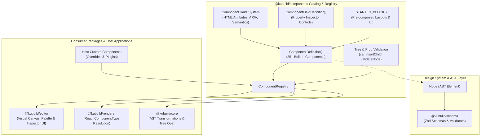
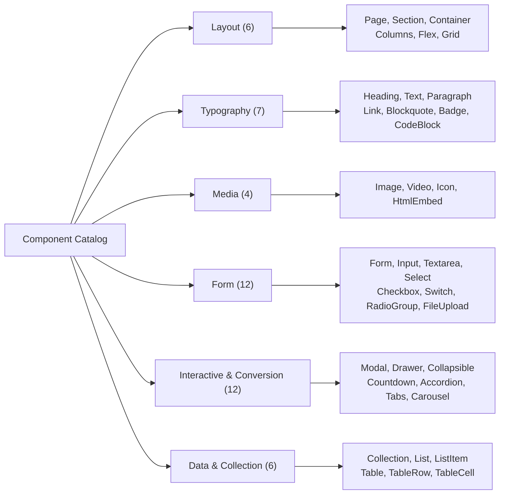

import { Callout } from 'fumadocs-ui/components/callout';
import { Card, Cards } from 'fumadocs-ui/components/card';
import { Tab, Tabs } from 'fumadocs-ui/components/tabs';
import { Accordion, Accordions } from 'fumadocs-ui/components/accordion';
import { TypeTable } from 'fumadocs-ui/components/type-table';

The **`@kubuild/components`** package is the component metadata authority, schema definition catalog, and registry engine of the KUBUILD ecosystem. It establishes the declarative contract for all visual elements—defining their semantic roles, responsive style presets, child insertion hierarchies, property inspector controls, and accessibility traits.

Unlike traditional component libraries that couple markup, styles, and React rendering hooks into opaque UI bundles, `@kubuild/components` is **100% headless and framework-agnostic**. It operates strictly on component definitions (`ComponentDefinition<TRenderer>`), allowing the same metadata catalog to power canvas drag-and-drop palettes, visual property inspectors, headless AST tree validators, code generators, and multi-framework rendering engines.

---

## Architecture & Design Principles



`@kubuild/components` is engineered around four core architectural principles:

1. **Framework-Agnostic Contract (`TRenderer = unknown`):** Components are described as declarative data contracts rather than JSX components. The `renderer` property in `ComponentDefinition<TRenderer>` is generic. Visual hosts (such as `@kubuild/renderer`) specialize this slot with `React.ComponentType<NodeProps>`, while non-React environments (e.g. Astro, Vue, Svelte, or headless email compilers) can supply their own renderers.
2. **Clear Separation of Concerns (Styles vs. Traits):** Visual styling (colors, layout, margins, typography) belongs to `node.styles` and is governed by responsive CSS tokens. In contrast, functional, behavioral, and accessibility attributes (`href`, `alt`, `placeholder`, `aria-label`, `target`, `id`) belong to `node.props` and are declared via the **Traits System (STORA-210)**.
3. **Strict Bidirectional Nesting Governance:** Document hierarchy is safeguarded both top-down (`acceptsChildren`, `allowedChildren`) and bottom-up (`disallowedParents`). The registry verifies insertions before nodes are instantiated (`canInsertChild`) and validates the entire subtree on demand (`validateNode`).
4. **Metadata-Driven Property Inspector:** Editors do not need to hardcode property panels for every component. Each definition exposes `propFields` (`ComponentFieldDefinition`), detailing input controls (string, select, color, number, action, image) so host editors can generate property inspectors dynamically.

---

## Installation & Setup

Install `@kubuild/components` alongside `@kubuild/schema`:

<Tabs items={['pnpm', 'npm', 'yarn', 'bun']}>
  <Tab value="pnpm">
```bash
pnpm add @kubuild/components @kubuild/schema
```
  </Tab>
  <Tab value="npm">
```bash
npm install @kubuild/components @kubuild/schema
```
  </Tab>
  <Tab value="yarn">
```bash
yarn add @kubuild/components @kubuild/schema
```
  </Tab>
  <Tab value="bun">
```bash
bun add @kubuild/components @kubuild/schema
```
  </Tab>
</Tabs>

<Callout type="info" title="Dual ESM & CJS Output">
  `@kubuild/components` is distributed with dual ESM (`.js`) and CommonJS (`.cjs`) outputs alongside full TypeScript declaration maps (`.d.ts`). It works seamlessly in Next.js Server Components, client bundles, Node.js scripts, and Vite builds.
</Callout>

---

## The `ComponentDefinition<TRenderer>` Specification

The core building block of `@kubuild/components` is the `ComponentDefinition<TRenderer>` interface. Every built-in element and third-party extension implements this contract.

```typescript
import type { Node, ResponsiveStyles } from '@kubuild/schema';
import type { ComponentTraits } from './traits/index.js';

export type ComponentCategory =
  | 'layout'
  | 'typography'
  | 'media'
  | 'form'
  | 'interactive'
  | 'data'
  | 'custom';

export interface ComponentFieldDefinition {
  name: string;
  label: string;
  type: 'string' | 'textarea' | 'number' | 'boolean' | 'select' | 'color' | 'image' | 'action' | 'json' | 'datetime';
  defaultValue?: unknown;
  options?: Array<{ label: string; value: unknown }>;
  description?: string;
}

export interface ComponentDefaultChildSpec {
  type: string;
  props?: Record<string, unknown>;
  styles?: ResponsiveStyles;
  children?: ComponentDefaultChildSpec[];
}

export interface ComponentDefinition<TRenderer = unknown> {
  type: string;
  label: string;
  category: ComponentCategory;
  description?: string;
  icon?: string;
  acceptsChildren?: boolean;
  allowedChildren?: string[];
  disallowedParents?: string[];
  defaultProps?: Record<string, unknown>;
  defaultStyles?: ResponsiveStyles;
  defaultChildren?: ComponentDefaultChildSpec[];
  propFields?: ComponentFieldDefinition[];
  traits?: ComponentTraits;
  validateProps?: (props: Record<string, unknown>) => boolean | string[];
  renderer?: TRenderer;
  capabilities?: string[];
  canonicalTextProp?: string;
  deprecatedPropAliases?: Record<string, string>;
}
```

### Specification Fields Reference

<TypeTable
  type={{
    type: {
      description: 'Unique element identifier in kebab-case or snake-case (e.g. "heading", "accordion", "countdown").',
      type: 'string',
      required: true,
    },
    label: {
      description: 'Human-readable title displayed in component palettes and breadcrumbs.',
      type: 'string',
      required: true,
    },
    category: {
      description: 'Categorization for UI grouping and nesting rules: "layout" | "typography" | "media" | "form" | "interactive" | "data" | "custom".',
      type: 'ComponentCategory',
      required: true,
    },
    description: {
      description: 'Short explanatory text describing the purpose and usage of the component.',
      type: 'string',
    },
    icon: {
      description: 'Visual icon identifier rendered in canvas toolbars and element trees (e.g. "heading", "rows", "image").',
      type: 'string',
    },
    acceptsChildren: {
      description: 'Whether this element can house child nodes in its AST subtree. Defaults to false.',
      type: 'boolean',
      default: 'false',
    },
    allowedChildren: {
      description: 'Whitelist of permissible child element types or categories. Supports ["*"] for any type, or category strings like ["form"].',
      type: 'string[]',
    },
    disallowedParents: {
      description: 'Blacklist of parent component types where this component cannot be placed (e.g. ["page"]).',
      type: 'string[]',
    },
    defaultProps: {
      description: 'Default prop key-value pairs applied when the element is instantiated in the tree.',
      type: 'Record<string, unknown>',
      default: '{}',
    },
    defaultStyles: {
      description: 'Initial responsive CSS properties mapped across base, tablet, and mobile breakpoints.',
      type: 'ResponsiveStyles',
    },
    defaultChildren: {
      description: 'Pre-assembled child nodes automatically generated when dropping this component onto the canvas.',
      type: 'ComponentDefaultChildSpec[]',
    },
    propFields: {
      description: 'Field schema instructing visual property editors how to render input controls for props.',
      type: 'ComponentFieldDefinition[]',
    },
    traits: {
      description: 'Definitions of functional HTML/ARIA attributes (href, target, alt, id, aria-label).',
      type: 'ComponentTraitDefinition[]',
    },
    validateProps: {
      description: 'Runtime validator function returning true or an array of error messages.',
      type: '(props: Record<string, unknown>) => boolean | string[]',
    },
    renderer: {
      description: 'Framework-specific renderer component slot (e.g. React.ComponentType). Untyped in components package.',
      type: 'TRenderer',
    },
    capabilities: {
      description: 'Host runtime capabilities needed for execution (e.g. ["assetProvider", "actionRegistry"]).',
      type: 'string[]',
    },
    canonicalTextProp: {
      description: 'STORA-550: Canonical prop name holding visible text (e.g. "text" or "label") for inline editors.',
      type: 'string',
    },
    deprecatedPropAliases: {
      description: 'STORA-550: Map of deprecated prop names to canonical replacements for automatic schema migration.',
      type: 'Record<string, string>',
    },
  }}
/>

---

## Functional Traits System (STORA-210)

One of the foundational innovations of `@kubuild/components` is the **Traits System**. In standard visual builders, HTML attributes like `href`, `target`, `alt`, and `title` are frequently conflated with visual styling knobs or ad-hoc custom props. 

In KUBUILD:
- **Visual Styles** are isolated into `node.styles` and mapped to CSS properties across breakpoints.
- **Traits** are functional, semantic, behavioral, or accessibility attributes mapped directly to HTML attributes on `node.props`.

```typescript
export interface ComponentTraitDefinition {
  name: string;              // Prop key on node.props (e.g. 'href', 'alt')
  label: string;             // Human-readable label in inspector
  type: 'string' | 'number' | 'boolean' | 'select';
  defaultValue?: unknown;    // Default value when unset
  options?: TraitOption[];   // Options when type === 'select'
  description?: string;      // Help tooltip in editor
  attribute?: string;        // Target HTML attribute (e.g. 'name' -> 'id')
  required?: boolean;        // Validation constraint
  group?: TraitGroup;        // Grouping in inspector panel
}
```

### Trait Groups & Organization

Traits are organized into standard groups sorted by `TRAIT_GROUP_ORDER`:

1. **`identity`**: Anchor IDs, DOM identifiers (`id`, `name`).
2. **`link`**: Navigation targets, anchors, relation flags (`href`, `target`, `rel`).
3. **`media`**: Source URLs, alt descriptions, image dimensions, loading behaviors (`src`, `alt`, `loading`).
4. **`form`**: Form controls and submission attributes (`type`, `placeholder`, `required`, `action`, `method`).
5. **`behavior`**: Execution flags (`preventDefault`, `autoPlay`, `loop`, `controls`).
6. **`semantic`**: Role definitions and structural hints (`level`, `role`).
7. **`accessibility`**: ARIA standards (`aria-label`, `aria-hidden`, `aria-expanded`).

### Built-in Trait Factories

`@kubuild/components` provides pre-configured factory functions with sensible defaults:

```typescript
import { 
  idTrait, 
  ariaLabelTrait, 
  titleTrait, 
  hrefTrait, 
  targetTrait, 
  relTrait, 
  srcTrait, 
  altTrait, 
  loadingTrait, 
  actionTrait, 
  methodTrait, 
  placeholderTrait, 
  requiredTrait 
} from '@kubuild/components';

// Example: Attaching traits to an anchor or button
const myTraits = [
  idTrait(),
  hrefTrait({ defaultValue: 'https://example.com' }),
  targetTrait(),
  relTrait(),
  ariaLabelTrait({ description: 'Screen reader announcement' }),
];
```

---

## Inspector Controls (`propFields`) & Binding Compatibility

The `propFields` array tells the visual editor how to render property editing widgets without hardcoding component-specific UI:

```typescript
export interface ComponentFieldDefinition {
  name: string;
  label: string;
  type: 
    | 'string'    // Single-line text input
    | 'textarea'  // Multi-line text area
    | 'number'    // Numeric input with increment/decrement
    | 'boolean'   // Switch or checkbox toggle
    | 'select'    // Dropdown selection (requires options)
    | 'color'     // Color picker palette
    | 'image'     // Asset picker or media library URL
    | 'action'    // Workflow action pipeline selector
    | 'json'      // Code editor modal for raw JSON
    | 'datetime'; // Date and time picker
  defaultValue?: unknown;
  options?: Array<{ label: string; value: unknown }>;
  description?: string;
}
```

### Dynamic Data Binding Verification

`@kubuild/components` provides utilities to verify whether a field is eligible for Mustache variable binding (`{{ user.name }}`):

```typescript
import { isBindableField, primitiveTypeForField } from '@kubuild/components';

const field: ComponentFieldDefinition = {
  name: 'title',
  label: 'Card Title',
  type: 'string',
};

if (isBindableField(field)) {
  console.log(`Field ${field.name} can bind to primitive type: ${primitiveTypeForField(field)}`);
  // Outputs: 'Field title can bind to primitive type: string'
}
```

Fields of type `'select'`, `'image'`, `'action'`, and `'json'` are intentionally non-bindable by default, as they require strict structured payloads that cannot be safely satisfied by arbitrary string interpolation.

---

## Built-in Components Catalog

`@kubuild/components` ships with **35+ core components** spanning seven primary categories:



### 1. Layout Components

Layout components form the structural scaffolding of every KUBUILD page document.

| Type | Label | Children Allowed | Allowed Types / Categories | Key Default Props | Key Default Styles |
| :--- | :--- | :--- | :--- | :--- | :--- |
| `page` | **Page** | Yes | `['section']` | `{}` | `base: { minHeight: '100vh', width: '100%' }` |
| `section` | **Section** | Yes | `['section', 'container', 'columns', 'flex', 'grid', ...content]` | `{}` | Responsive padding: 48px (base), 32px (tablet), 24px (mobile) |
| `container` | **Container** | Yes | `['*']` | `{ tag: 'div' }` | `base: { maxWidth: '1200px', margin: '0 auto', width: '100%' }` |
| `columns` | **Columns** | Yes | `['container', 'flex', 'grid', ...content]` | `{ columns: 2, gap: '24px' }` | Responsive flex: `display: 'flex'`, collapses to column on mobile |
| `flex` | **Flex Box** | Yes | `['*']` | `{ direction: 'row', gap: '16px' }` | `display: 'flex'`, customizable `alignItems`, `justifyContent`, `flexWrap` |
| `grid` | **2D Grid** | Yes | `['*']` | `{ columns: 3, gap: '16px' }` | `repeat(3, minmax(0, 1fr))` base, `repeat(2)` tablet, `repeat(1)` mobile |

<Callout type="warning" title="Nesting Rules (STORA-021)">
  The `page` component is the absolute root node of a `.stora` document. It is listed in `disallowedParents: ['page']` for layout inner components, meaning a `page` node can never be nested inside another node.
</Callout>

### 2. Typography Components

Typography components convey semantic hierarchy and formatted textual content.

| Type | Label | Children Allowed | Canonical Text Prop | Default Props | Default Styles |
| :--- | :--- | :--- | :--- | :--- | :--- |
| `heading` | **Heading** | No | `text` | `{ text: 'Heading Text', level: 2 }` | `fontSize: '32px', fontWeight: '700', color: '#111827'` |
| `paragraph` | **Paragraph** | No | `text` | `{ text: 'Enter paragraph text...' }` | `fontSize: '16px', lineHeight: '1.6', color: '#4B5563'` |
| `text` | **Inline Text** | No | `text` | `{ text: 'Inline text' }` | `display: 'inline-block', fontSize: '14px'` |
| `link` | **Hyperlink** | Yes | `text` | `{ href: '#', target: '_self' }` | `color: '#2563EB', textDecoration: 'underline'` |
| `blockquote` | **Blockquote** | Yes | `quote` | `{ cite: '' }` | `borderLeft: '4px solid #E5E7EB', paddingLeft: '16px', fontStyle: 'italic'` |
| `badge` | **Badge** | No | `text` | `{ text: 'New', variant: 'default' }` | `borderRadius: '9999px', padding: '4px 8px', fontSize: '12px'` |
| `code-block` | **Code Block** | No | `code` | `{ language: 'typescript', code: '' }` | `fontFamily: 'monospace', backgroundColor: '#1F2937', color: '#F9FAFB'` |

<Callout type="info" title="Canonical Text Props (STORA-550)">
  Every textual component declares a `canonicalTextProp` (e.g. `'text'` for headings, `'label'` for buttons). If legacy `.stora` documents use deprecated aliases (e.g. `'content'` or `'title'`), `deprecatedPropAliases` ensures backwards compatibility and triggers automatic migration during document loading.
</Callout>

### 3. Media Components

Media components embed visual, audio, or external assets into the page.

| Type | Label | Children Allowed | Capabilities | Key Default Props | Key Default Styles |
| :--- | :--- | :--- | :--- | :--- | :--- |
| `image` | **Image** | No | `['assetProvider']` | `{ src: '...', alt: 'Default image', width: 600, height: 400 }` | `maxWidth: '100%', height: 'auto', borderRadius: '8px'` |
| `video` | **Video** | No | `['assetProvider']` | `{ src: '', controls: true, autoPlay: false, loop: false }` | `maxWidth: '100%', borderRadius: '8px'` |
| `icon` | **Icon** | No | `[]` | `{ name: 'check', size: 24, color: 'currentColor' }` | `display: 'inline-flex', alignItems: 'center'` |
| `html-embed` | **HTML / Embed** | No | `[]` | `{ html: '<div>Custom HTML</div>', sandbox: true }` | `width: '100%', overflow: 'hidden'` |

### 4. Form Components

Form components capture user input, manage validation states, and execute submission action pipelines.

| Type | Label | Children Allowed | Key Default Props | Default Children Spec |
| :--- | :--- | :--- | :--- | :--- |
| `form` | **Form** | Yes | `{ name: 'contact_form', method: 'POST', preventDefault: true, scrollToFirstError: true }` | Pre-populates Name, Email, Message, Agree Checkbox, and Submit Button |
| `input` | **Text Input** | No | `{ name: 'field_name', type: 'text', placeholder: 'Enter text...', required: false }` | None |
| `textarea` | **Textarea** | No | `{ name: 'message', placeholder: 'Type here...', rows: 4, required: false }` | None |
| `select` | **Select Dropdown** | No | `{ name: 'choice', options: [{ label: 'Option 1', value: '1' }] }` | None |
| `checkbox` | **Checkbox** | No | `{ name: 'agree', label: 'Agree to terms', checked: false }` | None |
| `switch` | **Toggle Switch** | No | `{ name: 'toggle', label: 'Enable feature', checked: false }` | None |
| `radio-group` | **Radio Group** | Yes | `{ name: 'radio_group', defaultValue: '' }` | Houses child `radio-item` nodes |
| `radio-item` | **Radio Item** | No | `{ value: 'option_1', label: 'Option 1' }` | None |
| `file-upload` | **File Upload** | No | `{ name: 'attachment', maxFileSizeMb: 10, accept: '*/*' }` | None |
| `button-submit`| **Submit Button** | No | `{ label: 'Submit Form', loadingText: 'Submitting...' }` | None |

### 5. Interactive & Conversion Components

Built specifically for high-converting marketing landing pages, lead capture, and dynamic overlays.

| Type | Label | Children Allowed | Key Default Props | Purpose / Behavior |
| :--- | :--- | :--- | :--- | :--- |
| `button` | **Button** | No | `{ label: 'Click Me', variant: 'primary', size: 'md' }` | Triggers actions (URLs, modals, scrolls, custom events). |
| `countdown` | **Countdown Timer** | No | `{ mode: 'evergreen', durationMinutes: 15, expireBehavior: 'text' }` | Urgency countdown timer (per-visitor evergreen or fixed deadline). |
| `accordion` | **Accordion** | Yes | `{ allowMultiple: false, defaultOpenIndex: 0 }` | Houses collapsible FAQ or feature rows (`accordion-item`). |
| `accordion-item` | **Accordion Item** | Yes | `{ title: 'Accordion Title', isOpen: false }` | Expandable drawer with header and content slot. |
| `modal` | **Modal Dialog** | Yes | `{ modalId: 'promo-modal', title: 'Special Offer', backdrop: true }` | Overlay dialog targeted by `open_modal` / `close_modal` actions. |
| `drawer` | **Slide-out Drawer** | Yes | `{ drawerId: 'cart-drawer', position: 'right', backdrop: true }` | Off-canvas drawer sliding in from left, right, top, or bottom. |
| `collapsible` | **Collapsible** | Yes | `{ title: 'Toggle Details', defaultOpen: false }` | Minimal inline toggle section. |
| `tabs` | **Tabs Container** | Yes | `{ defaultTab: 0, orientation: 'horizontal' }` | Segmented tab switcher containing `tab-panel` children. |
| `carousel` | **Carousel** | Yes | `{ autoPlay: true, interval: 5000, showArrows: true }` | Multi-slide slider for testimonials, features, or product galleries. |
| `rating` | **Star Rating** | No | `{ rating: 5, maxRating: 5, showScore: true }` | Review rating stars with aggregate display. |
| `divider` | **Divider** | No | `{ orientation: 'horizontal', thickness: '1px' }` | Visual line separator with optional center badge. |
| `spacer` | **Spacer** | No | `{ height: '32px' }` | Responsive whitespace buffer between sections. |

### 6. Data & Collection Components

| Type | Label | Children Allowed | Key Default Props | Purpose |
| :--- | :--- | :--- | :--- | :--- |
| `collection` | **Collection** | Yes | `{ sourceKey: 'products', emptyMessage: 'No items found.' }` | Repeater container looping over array data sources. |
| `list` | **List** | Yes | `{ listType: 'unordered', spacing: '8px' }` | Container for `list-item` nodes (`ul` or `ol`). |
| `list-item` | **List Item** | Yes | `{ icon: 'check' }` | Individual item with optional prefix icon. |
| `table` | **Data Table** | Yes | `{ striped: true, bordered: true }` | Responsive HTML table housing `table-row` nodes. |
| `table-row` | **Table Row** | Yes | `{ isHeader: false }` | Row container housing `table-cell` nodes. |
| `table-cell` | **Table Cell** | Yes | `{ isHeader: false, colSpan: 1 }` | Cell slot for content (`td` or `th`). |

---

## Component Registry API (`ComponentRegistry<TRenderer>`)

The `ComponentRegistry` class is the runtime container that indexes component definitions, enforces nesting rules, and validates AST nodes.

### Instantiation & Pre-population

To get a registry pre-loaded with all 35+ standard KUBUILD components:

```typescript
import { createDefaultComponentRegistry, ComponentRegistry } from '@kubuild/components';

// Registry with all core definitions registered:
const registry = createDefaultComponentRegistry();

// Or instantiate an empty, isolated registry:
const customRegistry = new ComponentRegistry();
```

### Registry Methods Reference

<TypeTable
  type={{
    register: {
      description: 'Registers a new component definition. Throws if type already exists unless allowOverride is true.',
      type: '(definition: ComponentDefinition<TRenderer>, allowOverride?: boolean) => void',
      required: true,
    },
    unregister: {
      description: 'Removes a registered component definition by type string. Returns true if removed.',
      type: '(type: string) => boolean',
      required: true,
    },
    get: {
      description: 'Retrieves a registered component definition by its type name, or undefined if not found.',
      type: '(type: string) => ComponentDefinition<TRenderer> | undefined',
      required: true,
    },
    has: {
      description: 'Checks whether a component definition is registered for the given type string.',
      type: '(type: string) => boolean',
      required: true,
    },
    list: {
      description: 'Returns an array of all registered component definitions in the registry.',
      type: '() => ComponentDefinition<TRenderer>[]',
      required: true,
    },
    listByCategory: {
      description: 'Filters registered component definitions matching a specific category.',
      type: '(category: ComponentCategory) => ComponentDefinition<TRenderer>[]',
      required: true,
    },
    canInsertChild: {
      description: 'Pre-flight check verifying whether childType can legally be inserted under parentType.',
      type: '(parentType: string, childType: string) => { valid: boolean; errors: string[] }',
      required: true,
    },
    validateNode: {
      description: 'Deeply validates an AST Node against its definition, allowed children, and prop validation rules.',
      type: '(node: Node, parentType?: string) => { valid: boolean; errors: string[] }',
      required: true,
    },
  }}
/>

### Pre-flight Child Insertion Checks

Before dragging a component onto the canvas or inserting a node programmatically, call `canInsertChild`. It evaluates both parent constraints (`acceptsChildren`, `allowedChildren`) and child constraints (`disallowedParents`):

```typescript
const result = registry.canInsertChild('container', 'button');
if (!result.valid) {
  console.error('Cannot insert button inside container:', result.errors);
}

// Checking invalid nesting:
const invalidCheck = registry.canInsertChild('heading', 'section');
console.log(invalidCheck.valid); // false: "Heading does not accept children."
```

### AST Node & Prop Validation

To validate an existing node and its props:

```typescript
import type { Node } from '@kubuild/schema';

const invalidHeading: Node = {
  id: 'h1',
  type: 'heading',
  props: {
    text: '', // Invalid: heading requires non-empty text
    level: 7, // Invalid: level must be between 1 and 6
  },
};

const validation = registry.validateNode(invalidHeading);
console.log(validation.valid); // false
console.log(validation.errors);
// [
//   'Heading requires a non-empty "text".',
//   'Heading "level" must be a number between 1 and 6.'
// ]
```

---

## Overriding Built-in Components

A host application can easily override any built-in component definition (for example, substituting KUBUILD's default `image` with a Next.js `Image` wrapper or providing custom default styles):

```typescript
import { createDefaultComponentRegistry, imageDefinition } from '@kubuild/components';

const registry = createDefaultComponentRegistry();

// Create an enhanced definition
const customImageDefinition = {
  ...imageDefinition,
  label: 'Optimized CDN Image',
  defaultProps: {
    ...imageDefinition.defaultProps,
    loading: 'lazy',
    sizes: '(max-width: 768px) 100vw, 1200px',
  },
  defaultStyles: {
    base: {
      borderRadius: '12px',
      boxShadow: '0 4px 6px -1px rgba(0, 0, 0, 0.1)',
    },
  },
};

// Register with allowOverride = true
registry.register(customImageDefinition, true);
```

---

## Starter Blocks Catalog (`STARTER_BLOCKS`)

`@kubuild/components` includes pre-composed UI patterns and templates via the `STARTER_BLOCKS` collection (spanning STORA-241, STORA-242, STORA-350, and STORA-549):

```typescript
import { 
  STARTER_BLOCKS, 
  LAYOUT_STARTER_BLOCKS, 
  UI_STARTER_BLOCKS, 
  FORM_STARTER_BLOCKS, 
  SALES_STARTER_BLOCKS 
} from '@kubuild/components';

// Example: Instantiating a 2-Column Hero layout
const heroBlock = UI_STARTER_BLOCKS.find((b) => b.id === 'section-hero-split');

if (heroBlock) {
  // Generates a fully populated Node tree with deterministic IDs
  const nodeTree = heroBlock.createNodeTree();
  console.log(`Generated ${nodeTree.type} with ${nodeTree.children?.length} children`);
}
```

Starter block categories include:
- **`LAYOUT_STARTER_BLOCKS`**: Single column, 50/50 split, 3-column feature grids, 4-column metric bars.
- **`UI_STARTER_BLOCKS`**: Hero headers, feature showcases, customer testimonials, team profiles, FAQ accordions.
- **`FORM_STARTER_BLOCKS`**: Newsletter subscribe forms, contact inquiries, multi-field lead capture.
- **`SALES_STARTER_BLOCKS`**: Pricing tier comparison cards, checkout guarantee badges, urgency discount timers.

---

## Practical Tutorial: Building & Registering a Custom Component

Let's build a production-ready custom component: a **"Pricing Card"** (`pricing-card`) with custom property inspector controls, validation, responsive default styles, and functional traits.

### Step 1: Define Props Interface & Validation

```typescript
// src/components/pricing-card.definition.ts
import type { ComponentDefinition } from '@kubuild/components';
import { idTrait, ariaLabelTrait, hrefTrait } from '@kubuild/components';

export interface PricingCardProps {
  planName: string;
  price: string;
  billingPeriod: string;
  isPopular?: boolean;
  ctaText: string;
  ctaHref: string;
}

export const pricingCardDefinition: ComponentDefinition = {
  type: 'pricing-card',
  label: 'Pricing Card',
  category: 'custom',
  description: 'High-converting pricing plan card with highlight badge and CTA button.',
  icon: 'credit-card',
  acceptsChildren: true,
  allowedChildren: ['list', 'text', 'paragraph', 'badge', 'divider'],
  disallowedParents: ['page'],

  defaultProps: {
    planName: 'Professional',
    price: '$49',
    billingPeriod: 'per month',
    isPopular: true,
    ctaText: 'Get Started Today',
    ctaHref: '/signup',
  },

  defaultStyles: {
    base: {
      padding: '32px 24px',
      backgroundColor: '#FFFFFF',
      borderRadius: '16px',
      border: '2px solid #E5E7EB',
      boxShadow: '0 10px 15px -3px rgba(0, 0, 0, 0.05)',
      display: 'flex',
      flexDirection: 'column',
      gap: '16px',
    },
    mobile: {
      padding: '24px 16px',
    },
  },

  propFields: [
    {
      name: 'planName',
      label: 'Plan Name',
      type: 'string',
      defaultValue: 'Professional',
      description: 'The title of this subscription tier.',
    },
    {
      name: 'price',
      label: 'Price Label',
      type: 'string',
      defaultValue: '$49',
    },
    {
      name: 'billingPeriod',
      label: 'Billing Cadence',
      type: 'select',
      defaultValue: 'per month',
      options: [
        { label: 'Per Month', value: 'per month' },
        { label: 'Per Year (Billed Annually)', value: 'per year' },
        { label: 'One-time Lifetime Access', value: 'one-time' },
      ],
    },
    {
      name: 'isPopular',
      label: 'Highlight as Most Popular',
      type: 'boolean',
      defaultValue: true,
    },
    {
      name: 'ctaText',
      label: 'Button Label',
      type: 'string',
      defaultValue: 'Get Started Today',
    },
    {
      name: 'ctaHref',
      label: 'Button Destination URL',
      type: 'string',
      defaultValue: '/signup',
    },
  ],

  traits: [
    idTrait(),
    hrefTrait({ name: 'ctaHref', label: 'Checkout URL' }),
    ariaLabelTrait({ description: 'Screen reader summary of this tier.' }),
  ],

  validateProps: (props) => {
    const errors: string[] = [];
    if (typeof props.planName !== 'string' || props.planName.trim().length === 0) {
      errors.push('Pricing Card requires a non-empty "planName".');
    }
    if (typeof props.price !== 'string' || props.price.trim().length === 0) {
      errors.push('Pricing Card requires a "price" label (e.g. "$49" or "Free").');
    }
    return errors.length > 0 ? errors : true;
  },
};
```

### Step 2: Register in ComponentRegistry

```typescript
import { createDefaultComponentRegistry } from '@kubuild/components';
import { pricingCardDefinition } from './pricing-card.definition.js';

const registry = createDefaultComponentRegistry();
registry.register(pricingCardDefinition);

console.log(`Registered components count: ${registry.list().length}`);
console.log(`Custom components: ${registry.listByCategory('custom').map((c) => c.label)}`);
```

### Step 3: Implement Framework Renderer (`@kubuild/renderer`)

When integrating with React in `@kubuild/renderer` or your custom application, bind a React component to the definition:

```tsx
// src/renderers/pricing-card.renderer.tsx
import React from 'react';
import type { Node } from '@kubuild/schema';

export interface PricingCardRendererProps {
  node: Node;
  children?: React.ReactNode;
}

export const PricingCardRenderer: React.FC<PricingCardRendererProps> = ({ node, children }) => {
  const { planName, price, billingPeriod, isPopular, ctaText, ctaHref } = node.props as any;

  return (
    <div
      id={node.id}
      className={`relative flex flex-col p-8 bg-white rounded-2xl border transition-all ${
        isPopular ? 'border-blue-600 shadow-xl ring-2 ring-blue-600' : 'border-gray-200'
      }`}
    >
      {isPopular && (
        <span className="absolute -top-3 left-1/2 -translate-x-1/2 bg-blue-600 text-white text-xs font-semibold px-3 py-1 rounded-full uppercase tracking-wider">
          Most Popular
        </span>
      )}

      <div className="mb-4">
        <h3 className="text-xl font-bold text-gray-900">{planName}</h3>
        <div className="mt-2 flex items-baseline gap-1">
          <span className="text-4xl font-extrabold text-gray-900">{price}</span>
          <span className="text-sm font-medium text-gray-500">/{billingPeriod}</span>
        </div>
      </div>

      <div className="flex-1 my-4 space-y-2">
        {children}
      </div>

      <a
        href={ctaHref}
        className={`mt-6 w-full text-center py-3 px-4 rounded-xl font-semibold transition-colors ${
          isPopular
            ? 'bg-blue-600 hover:bg-blue-700 text-white'
            : 'bg-gray-100 hover:bg-gray-200 text-gray-900'
        }`}
      >
        {ctaText}
      </a>
    </div>
  );
};
```

### Step 4: Extracting Document Requirements

When exporting a document to a `.stora` package or validating before render, extract custom component dependencies:

```typescript
import { extractComponentRequirements } from '@kubuild/components';
import type { Node } from '@kubuild/schema';

const documentRoot: Node = {
  id: 'root-page',
  type: 'page',
  children: [
    {
      id: 'custom-card-1',
      type: 'pricing-card',
      props: { planName: 'Enterprise', price: '$299' },
    },
  ],
};

const requirements = extractComponentRequirements(documentRoot, registry);
console.log(requirements);
// {
//   requiredComponents: ['pricing-card'],
//   requiredCapabilities: []
// }
```

The host can now ensure that `'pricing-card'` is present in its renderer mapping before accepting the document.

---

## Best Practices & Guidelines

<Cards>
  <Card title="Keep Definitions Headless" href="#">
    Never import React, Vue, DOM APIs, or CSS-in-JS libraries inside your definition files. Keep definitions pure data contracts so they remain portable across worker threads, Node.js CLI tools, and servers.
  </Card>
  <Card title="Provide Fallbacks in validateProps" href="#">
    Ensure <code>validateProps</code> handles undefined or missing fields gracefully without throwing unhandled exceptions. Return descriptive human-readable strings to assist editor users.
  </Card>
  <Card title="Preserve Responsive Defaults" href="#">
    Always specify responsive defaults for grid templates, column directions, and padding across <code>base</code>, <code>tablet</code>, and <code>mobile</code> breakpoints.
  </Card>
  <Card title="Leverage ARIA Traits" href="#">
    Always include <code>idTrait()</code> and <code>ariaLabelTrait()</code> on interactive or landmark elements to ensure compliance with web accessibility standards.
  </Card>
</Cards>
