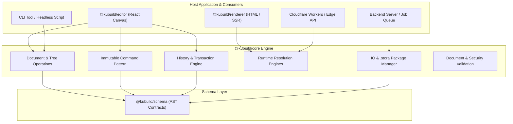
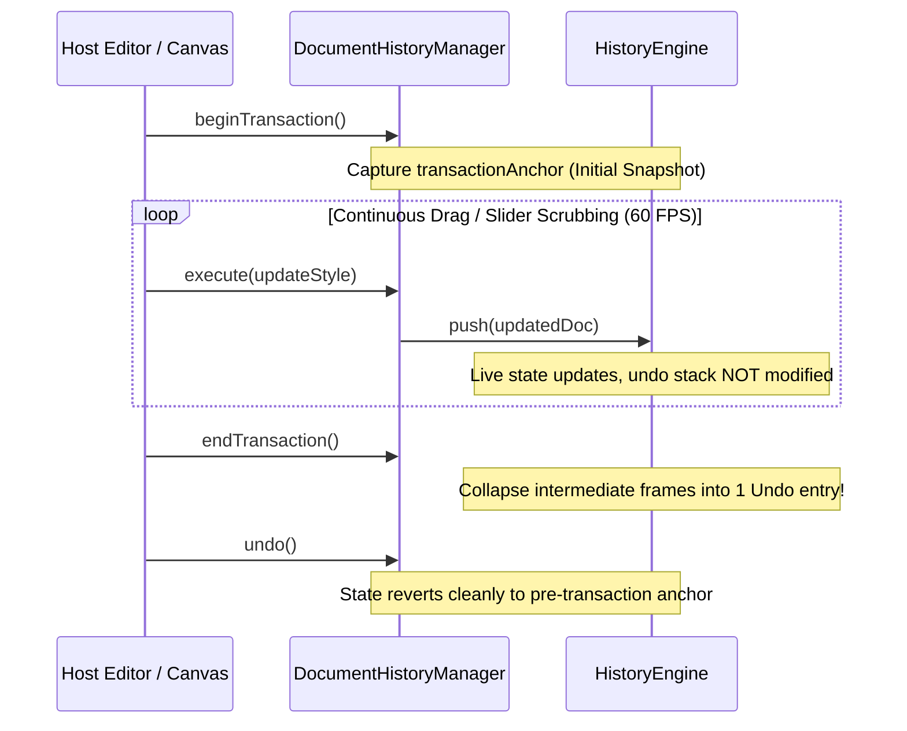
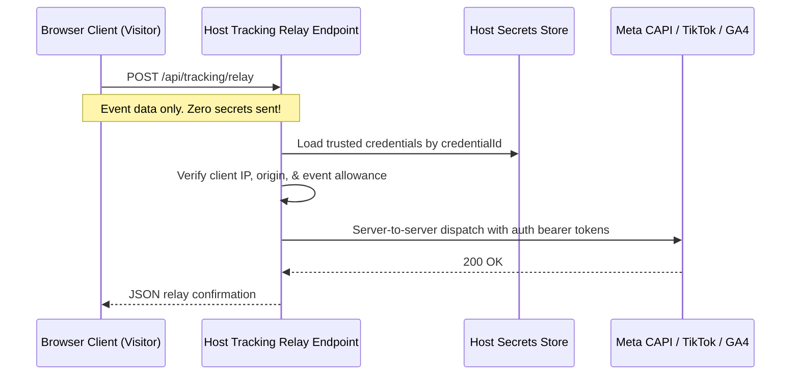
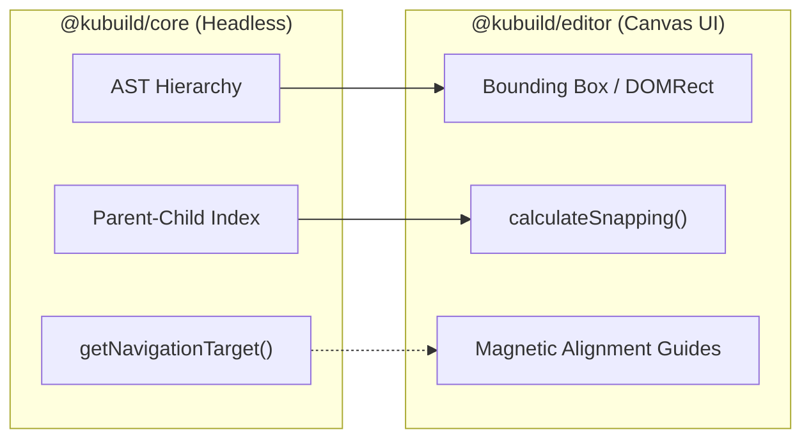

import { Callout } from 'fumadocs-ui/components/callout';
import { Card, Cards } from 'fumadocs-ui/components/card';
import { Tab, Tabs } from 'fumadocs-ui/components/tabs';
import { Accordion, Accordions } from 'fumadocs-ui/components/accordion';

The **`@kubuild/core`** package is the foundational headless layout and manipulation engine of the KUBUILD ecosystem. It houses the deterministic algorithms, immutable tree transformations, transactional history management, runtime evaluation engines, and `.stora` package serialization workflows.

Unlike visual builder frameworks that tightly couple document state to React component lifecycles or browser DOM APIs, `@kubuild/core` is written in **pure TypeScript** with zero UI or browser dependencies. It can run seamlessly anywhere JavaScript executes—including Node.js backend services, serverless edge workers, CLI tools, worker threads, and client-side web applications.

---

## Architecture & Design Principles



`@kubuild/core` is built upon five foundational design tenets:

1. **Headless Execution & Zero DOM Leak:** Core never accesses `window`, `document`, React hooks, or browser layout engines. It treats documents as pure data structures.
2. **Immutable Transformations:** Every tree mutation produces a clean, immutable state transition accompanied by a descriptive `DocumentChangeEvent` for undo stacks, audit trails, and collaborative synchronizers.
3. **Atomic Grouped Transactions:** High-frequency visual updates (continuous text typing, slider scrubbing, drag-and-drop movements) collapse into single atomic undo steps via transaction boundaries.
4. **Deterministic Runtime Engines:** Mustache variable interpolation, conditional visibility logic, and action pipeline execution are evaluated in sandboxed, prototype-pollution-safe headless environments.
5. **Lossless Binary IO & Schema Migrations:** Reads, validates, migrates, and writes portable `.stora` ZIP packages containing deterministic AST JSON and associated binary assets.

---

## Installation & Setup

Install `@kubuild/core` along with its peer dependency `@kubuild/schema`:

<Tabs items={['pnpm', 'npm', 'yarn', 'bun']}>
  <Tab value="pnpm">
```bash
pnpm add @kubuild/core @kubuild/schema
```
  </Tab>
  <Tab value="npm">
```bash
npm install @kubuild/core @kubuild/schema
```
  </Tab>
  <Tab value="yarn">
```bash
yarn add @kubuild/core @kubuild/schema
```
  </Tab>
  <Tab value="bun">
```bash
bun add @kubuild/core @kubuild/schema
```
  </Tab>
</Tabs>

<Callout type="info" title="Dual ESM & CJS Output">
  `@kubuild/core` ships with fully typed dual ESM (`.js`) and CommonJS (`.cjs`) outputs with strict type declarations (`.d.ts`). It works out-of-the-box in Next.js, Vite, Node.js, and Remix projects.
</Callout>

---

## Document Tree Operations & Utilities

A KUBUILD document (`PageDocument`) is a deterministic tree whose root node (`doc.document`, a `RootPageNode` of type `page`) branches into structural containers, layouts, and leaf elements. `@kubuild/core` provides comprehensive headless utilities to inspect, traverse, clone, and navigate this hierarchy.

### Creating a Blank Document

Initialize an empty, fully validated document conforming to the latest schema:

```typescript
import { createBlankDocument } from '@kubuild/core';

// Creates a blank PageDocument with default root container and theme tokens
const doc = createBlankDocument('Landing Page');

console.log(doc.schema); // "stora.page"
console.log(doc.version); // "1.3.0" (CURRENT_SCHEMA_VERSION)
console.log(doc.document.type); // "page"
```

### Tree Traversal & Inspection

Inspect and locate nodes within deep hierarchies without mutating the tree:

```typescript
import {
  findNodeById,
  findNodeLocation,
  getAncestorChain,
  getParentNodeId,
  getNodeAncestors,
  isDescendantOf,
  collectNodeIdSet,
} from '@kubuild/core';

// 1. Locate a node directly by unique ID
const targetNode = findNodeById(doc.document, 'btn-cta');

// 2. Discover node location (parent reference, index in parent, and node itself)
const location = findNodeLocation(doc.document, 'btn-cta');
if (location) {
  console.log(`Parent ID: ${location.parent?.id ?? "(root)"}`);
  console.log(`Index in parent: ${location.index}`);
}

// 3. Ancestry inspection
const ancestorIds = getAncestorChain(doc.document, 'btn-cta'); // ['root', 'section-hero', 'container-actions']
const parentId = getParentNodeId(doc.document, 'btn-cta'); // 'container-actions'
const ancestors = getNodeAncestors(doc.document, 'btn-cta'); // Node[]

// 4. Hierarchical relationships
const isInsideHero = isDescendantOf(heroSectionNode, 'btn-cta'); // true

// 5. Collect all node IDs across the entire subtree
const allIds = collectNodeIdSet(doc.root); // Set<string>
```

### Keyboard & Outline Navigation

Compute adjacent nodes across four spatial hierarchy directions (`parent`, `child`, `previous-sibling`, `next-sibling`) for keyboard canvas navigation and accessibility:

```typescript
import { getNavigationTarget } from '@kubuild/core';

// Navigate upwards to container
const parentId = getNavigationTarget(doc.document, 'btn-cta', 'parent');

// Navigate to sibling
const prevSiblingId = getNavigationTarget(doc.document, 'btn-cta', 'previous-sibling');
const nextSiblingId = getNavigationTarget(doc.document, 'btn-cta', 'next-sibling');

// Navigate to first child (if node is a container)
const firstChildId = getNavigationTarget(doc.document, 'section-hero', 'child');
```

### Tree Cloning & Reference Remapping

When duplicating blocks, copying sections, or importing template snippets, node IDs and internal reference pointers (such as action targets, modal triggers, and form associations) must be systematically remapped:

```typescript
import { cloneNodeTreeWithFreshIds, remapNodeReferences } from '@kubuild/core';

// Deep-clone a node and its descendants. You supply the ID generator, so the
// IDs stay collision-free against your own document.
const { clonedNode, idMap } = cloneNodeTreeWithFreshIds(
  sourceSection,
  (oldId) => `${oldId}-${crypto.randomUUID().slice(0, 8)}`,
);

// idMap contains oldId -> newId mappings
console.log(idMap.get('source-hero-id')); // 'node-a8f3b2...'

// Manually remap custom references within an AST fragment
const customRefMap = new Map([['old-target', 'new-target']]);
remapNodeReferences(clonedNode, customRefMap);
```

---

## The Immutable Command Pattern

Direct, uncontrolled mutation of document trees creates race conditions, invalid states, and broken undo stacks. `@kubuild/core` enforces the **Command Pattern**: pure transformer functions that take a document and an intent parameter, returning a new document state and a descriptive change event.

```typescript
type Command<TParams> = (document: PageDocument, params: TParams) => CommandResult;

interface CommandResult {
  document: PageDocument;
  event: DocumentChangeEvent;
}
```

Every command is completely deterministic, non-destructive to the input object, and self-validating.

### Core Command Catalog

<Cards>
  <Card title="Node Lifecycle" href="#node-lifecycle-commands">
    `insertNode`, `removeNode`, `duplicateNode`, `replaceNode`
  </Card>
  <Card title="Layout & Hierarchy" href="#layout--hierarchy-commands">
    `moveNode`, `wrapNodeIntoFrame`, `ungroupNodeFrame`
  </Card>
  <Card title="Props & Visual Styling" href="#props--styling-commands">
    `updateProps`, `updateStyle`, `updateTheme`
  </Card>
  <Card title="Interactivity & Workflows" href="#interactivity--workflows-commands">
    `updateActions`, `updateFormConfig`, `updateAnimation`
  </Card>
</Cards>

#### Node Lifecycle Commands

```typescript
import {
  insertNode,
  removeNode,
  duplicateNode,
  replaceNode,
} from '@kubuild/core';

// 1. Insert a new child node into a container at index 0
const { document: doc1 } = insertNode(currentDoc, {
  parentId: 'section-hero',
  node: {
    id: 'heading-hero',
    type: 'heading',
    props: { text: 'Welcome to KUBUILD', level: 'h1' },
    styles: { base: { color: '#0f172a', fontSize: '2.5rem' } },
  },
  index: 0,
});

// 2. Duplicate an existing node subtree
const { document: doc2, event } = duplicateNode(doc1, {
  nodeId: 'heading-hero',
});

// 3. Replace a placeholder node with a richer component
const { document: doc3 } = replaceNode(doc2, {
  nodeId: 'placeholder-widget',
  // The replacement keeps the same id — identity is never silently changed.
  node: { ...enrichedWidgetNode, id: 'placeholder-widget' },
});

// 4. Remove a node and its descendants
const { document: doc4 } = removeNode(doc3, {
  nodeId: 'old-banner',
});
```

#### Layout & Hierarchy Commands

```typescript
import { moveNode, wrapNodeIntoFrame, ungroupNodeFrame } from '@kubuild/core';

// Move a node across containers or reorder siblings
const { document: movedDoc } = moveNode(doc, {
  nodeId: 'btn-cta',
  targetParentId: 'footer-container',
  index: 2,
});

// Wrap one or more nodes into a container frame
const { document: wrappedDoc } = wrapNodeIntoFrame(doc, {
  nodeId: 'btn-cta', // or nodeIds: ['btn-cta', 'btn-secondary']
  frameId: 'container-temp',
  frameStyles: { base: { display: 'flex', gap: '1rem' } },
});

// Ungroup a frame, promoting its children up to the frame's parent
const { document: ungroupedDoc } = ungroupNodeFrame(wrappedDoc, {
  nodeId: 'container-temp',
});
```

#### Props & Styling Commands

The `updateStyle` command supports viewport breakpoints (`base`, `desktop`, `tablet`, `mobile`), pseudo-states (`:hover`, `:active`, `:focus`), and merge modes:

```typescript
import { updateProps, updateStyle, updateTheme } from '@kubuild/core';

// Update node props (shallow merge by default)
const { document: updatedPropsDoc } = updateProps(doc, {
  nodeId: 'heading-hero',
  props: { text: 'Next Generation Visual Builder' },
});

// Update responsive styles for mobile breakpoint
const { document: responsiveDoc } = updateStyle(doc, {
  nodeId: 'heading-hero',
  breakpoint: 'mobile',
  styles: { fontSize: '1.75rem', lineHeight: '1.2' },
});

// Apply styles to a pseudo-state layer (:hover)
const { document: hoverDoc } = updateStyle(doc, {
  nodeId: 'btn-cta',
  state: ':hover',
  styles: { backgroundColor: '#1d4ed8' },
});

// Update global document theme tokens
const { document: themedDoc } = updateTheme(doc, {
  theme: {
    colors: { primary: '#2563eb', secondary: '#475569' },
  },
  merge: true,
});
```

---

## Headless Document Manipulation Example

Here is a complete, runnable TypeScript script demonstrating headless document creation, node insertion, multi-breakpoint styling, and programmatic hierarchy reordering without React:

```typescript
import {
  createBlankDocument,
  insertNode,
  updateProps,
  updateStyle,
  moveNode,
  validateDocument,
} from '@kubuild/core';

// 1. Initialize empty canvas
let doc = createBlankDocument('E-Commerce Promo Page');

// 2. Insert a Hero Section
const heroInsert = insertNode(doc, {
  parentId: doc.document.id,
  node: {
    id: 'section-hero',
    type: 'section',
    props: { fullWidth: true },
    styles: {
      base: { padding: '4rem 2rem', backgroundColor: '#f8fafc' },
    },
    children: [],
  },
});
doc = heroInsert.document;

// 3. Insert Title and CTA Button
const titleInsert = insertNode(doc, {
  parentId: 'section-hero',
  node: {
    id: 'hero-title',
    type: 'heading',
    props: { text: 'Summer Sale 2026', level: 'h1' },
    styles: {
      base: { fontSize: '3rem', fontWeight: '800', color: '#0f172a' },
      mobile: { fontSize: '2rem' },
    },
  },
});
doc = titleInsert.document;

const btnInsert = insertNode(doc, {
  parentId: 'section-hero',
  node: {
    id: 'hero-cta',
    type: 'button',
    props: { label: 'Shop Now', variant: 'primary' },
    styles: {
      base: {
        backgroundColor: '#2563eb',
        color: '#ffffff',
        borderRadius: '0.5rem',
        padding: '0.75rem 1.5rem',
      },
      states: {
        ':hover': { backgroundColor: '#1d4ed8' },
      },
    },
  },
});
doc = btnInsert.document;

// 4. Reorder: Place CTA before Title (e.g. for a custom layout test)
const reorderResult = moveNode(doc, {
  nodeId: 'hero-cta',
  targetParentId: 'section-hero',
  index: 0,
});
doc = reorderResult.document;

// 5. Validate resulting document structure
const validation = validateDocument(doc);
if (!validation.valid) {
  console.error('Validation errors:', validation.errors);
} else {
  console.log('Document successfully assembled headlessly!');
}
```

---

## History & Transaction Management

Visual authoring requires undo and redo capabilities. In a naive implementation, every keystroke, continuous drag coordinate, or slider increment pushes an entry onto the undo stack. This results in poor user experience: pressing `Ctrl+Z` undoes a single character or a 1-pixel drag rather than the entire logical action.

`@kubuild/core` solves this via `HistoryEngine<T>` and `DocumentHistoryManager` with **Atomic Grouped Transactions** (STORA-510).



### `DocumentHistoryManager` API

The `DocumentHistoryManager` wraps a `PageDocument` and coordinates command executions:

```typescript
import { createBlankDocument, DocumentHistoryManager, insertNode } from '@kubuild/core';

const initialDoc = createBlankDocument('Interactive Page');
const manager = new DocumentHistoryManager(initialDoc, { maxHistory: 50 });

// Access current document
console.log(manager.document.metadata?.title);

// Execute commands immutably and record history
manager.execute((currentDoc) =>
  insertNode(currentDoc, {
    parentId: currentDoc.document.id,
    node: { id: 'card-1', type: 'container', props: {}, children: [] },
  })
);

console.log(manager.canUndo); // true
console.log(manager.canRedo); // false

// Undo state transition
const revertedDoc = manager.undo();

// Redo state transition
const restoredDoc = manager.redo();
```

### Transaction Batching (Continuous Updates)

To bundle continuous user gestures into a single undo step, surround your mutation loop with `beginTransaction()` and `endTransaction()`:

```typescript
// Example: User drags a width resize handle from 200px to 450px
manager.beginTransaction();

try {
  // Dispatched on every mousemove event (e.g. 50 times during drag)
  for (let width = 200; width <= 450; width += 5) {
    manager.execute((currentDoc) =>
      updateStyle(currentDoc, {
        nodeId: 'resizable-box',
        styles: { width: `${width}px` },
      })
    );
  }
} finally {
  // Commits the transaction
  manager.endTransaction();
}

// Result: Even though 50 executions occurred, undo stack contains exactly ONE step!
manager.undo(); // Reverts width directly back to 200px
```

<Callout type="warning" title="Nested Transactions">
  `beginTransaction()` calls can be nested safely. Only the outermost `beginTransaction()` and `endTransaction()` pair finalizes the transaction commit.
</Callout>

---

## Runtime Resolution & Execution Engines

Once an AST is built, runtime engines resolve dynamic data, verify conditional display rules, execute interactive pipelines, and dispatch telemetry events.

### Variable Interpolator

The interpolator safely parses double-mustache `{{ expression }}` template strings without using `eval()` or `Function()`. It features built-in protection against prototype pollution by blocking access to `__proto__`, `constructor`, and `prototype`.

```typescript
import {
  interpolateTemplateString,
  interpolateValue,
  hasTemplateExpressions,
  extractTemplateVariables,
} from '@kubuild/core';

const template = 'Welcome back, {{ variables.user.firstName }}! You have {{ form.cart.items.length }} items.';

const context = {
  variables: {
    user: { firstName: 'Alex' },
  },
  form: {
    cart: { items: ['Item 1', 'Item 2'] },
  },
};

// 1. Check for template markers
hasTemplateExpressions(template); // true

// 2. Extract referenced paths
const vars = extractTemplateVariables(template);
// ['variables.user.firstName', 'form.cart.items.length']

// 3. Interpolate string
const result = interpolateTemplateString(template, context);
// "Welcome back, Alex! You have 2 items."

// 4. Exact type preservation (e.g. string to number/object)
const exactNum = interpolateValue('{{ variables.user.age }}', { variables: { user: { age: 28 } } });
console.log(typeof exactNum); // "number" (28)
```

### Conditional Logic Resolver

Evaluate boolean conditions and complex rule trees to determine whether a node should render or whether an action step should proceed:

```typescript
import {
  evaluateCondition,
  evaluateConditions,
  evaluateConditionGroup,
  type ConditionGroup,
} from '@kubuild/core';

// 1. Single condition evaluation
const isVisible = evaluateCondition(
  {
    field: 'variables.user.isSubscribed',
    operator: 'equals',
    value: true,
  },
  { variables: { user: { isSubscribed: true } } }
);

// 2. Compound condition group (AND / OR)
const group: ConditionGroup = {
  combinator: 'and',
  conditions: [
    { field: 'form.billing.country', operator: 'equals', value: 'ID' },
    { field: 'variables.cart.total', operator: 'gte', value: 500000 },
  ],
};

const passesRules = evaluateConditionGroup(group, runtimeContext);
```

#### Supported Conditional Operators

| Operator | Meaning | Example Rule |
| :--- | :--- | :--- |
| `equals` / `not_equals` | Equality / inequality | `{ field: 'plan', operator: 'equals', value: 'pro' }` |
| `gt` / `gte` | Greater than / or equal | `{ field: 'cart.total', operator: 'gte', value: 100 }` |
| `lt` / `lte` | Less than / or equal | `{ field: 'inventory', operator: 'lte', value: 5 }` |
| `contains` / `not_contains` | Substring or array inclusion | `{ field: 'roles', operator: 'contains', value: 'admin' }` |
| `is_truthy` / `is_falsy` | JavaScript truthiness of the field value | `{ field: 'shippingAddress', operator: 'is_truthy' }` |
| `regex` | Field value matches a regular expression | `{ field: 'email', operator: 'regex', value: '@acme\\.com$' }` |

### Headless Action Pipeline Executor

User interactions (form submissions, button clicks, modal triggers) invoke declarative action pipelines (`ActionPipeline`). The `ActionPipelineExecutor` runs these pipelines headlessly with timeout handling, step condition evaluation, and execution context cascading:

```typescript
import { ActionPipelineExecutor } from '@kubuild/core';

const executor = new ActionPipelineExecutor({
  defaultTimeout: 5000, // ms, applied to steps without their own `timeout`
  handlers: {
    // Step-specific settings live in `step.payload`
    api_request: async (step, context, signal) => {
      const { url, method = 'POST' } = step.payload as { url: string; method?: string };
      const response = await fetch(url, {
        method,
        body: JSON.stringify(context.form),
        signal,
      });
      return response.json();
    },
    navigate: async (step) => {
      console.log(`Navigating to ${String(step.payload?.url)}`);
    },
  },
});

const pipelineResult = await executor.execute(buttonActionPipeline, {
  context: {
    form: { email: 'developer@kustora.com' },
    variables: { leadSource: 'organic' },
  },
});

console.log(pipelineResult.status); // 'completed' | 'failed' | 'cancelled'
console.log(pipelineResult.stepResults); // StepExecutionResult[] for each step
```

### Server Tracking Relay & Zero-Secret Client Model

To prevent leaking sensitive marketing API secrets (Meta Conversion API tokens, TikTok Access Tokens, GA4 Measurement Protocol API secrets) to client browsers, KUBUILD uses the **Server Tracking Relay protocol**:



Create a production tracking relay handler in Next.js or Node.js using `createTrackingRelayHandler`:

```typescript
import { createTrackingRelayHandler } from '@kubuild/core';

// In Next.js route handler: app/api/tracking/relay/route.ts
export const POST = createTrackingRelayHandler({
  allowedOrigins: ['https://example.com', 'https://builder.example.com'],

  // 1. Retrieve page tracking config from trusted database (never trust client body!)
  getConfig: async ({ documentId }) => {
    return await db.pages.findTrackingConfig(documentId);
  },

  // 2. Resolve provider API keys from server environment or vault
  resolveSecrets: async (credentialId) => {
    return await vault.getSecret(credentialId);
  },

  // 3. Security check: allow only specific client event types
  isEventAllowed: (event) => {
    // Prevent client browsers from forging backend-only events like 'Purchase'
    return event.eventName !== 'Purchase';
  },
});
```

---

## IO, Serialization & `.stora` Packaging

The `.stora` package format is an open, self-contained ZIP archive holding everything required to inspect, render, or edit a page offline:

```
my-page.stora
├── manifest.json         # Package manifest, schema version, checksums, asset directory
├── document.json         # Full PageDocument AST
└── assets/               # Bundled binary assets (images, svgs, fonts)
    ├── hero-bg.webp
    └── logo.svg
```

### Exporting `.stora` Packages

Serialize a document and its referenced assets into a compressed binary package using `exportStoraPackage` (powered by `fflate`):

```typescript
import { exportStoraPackage } from '@kubuild/core';

const packageBuffer = await exportStoraPackage(doc, {
  assets: {
    'hero-bg-id': new Uint8Array([/* binary image bytes */]),
  },
  knownComponentTypes: ['page', 'section', 'container', 'heading', 'button'],
});

// packageBuffer is a standard Uint8Array ready for disk storage or S3 upload
```

### Importing & Preflight Inspection

Before extracting an untrusted package, perform safety preflight checks to detect zip bombs, malicious directory traversal paths (`../`), and missing component dependencies:

```typescript
import { importStoraPackage, preflightPackage } from '@kubuild/core';

// 1. Run lightweight preflight check
const preflight = await preflightPackage(uploadedBuffer);
if (!preflight.valid) {
  console.error('Package preflight rejected:', preflight.diagnostics);
  return;
}

// 2. Safely import document and extract embedded assets
const result = await importStoraPackage(uploadedBuffer, {
  // Optional: persist each asset to your own storage and return its host URL / AssetInfo
  onAssetImport: async (assetId, bytes, meta) => uploadToBucket(assetId, bytes, meta.mimeType),
});

if (result.success) {
  console.log('Imported document title:', result.metadata.title);
  console.log('Extracted assets count:', result.extractedAssets.size);
} else {
  console.error(result.diagnosticMessage, result.errors);
}
```

### Schema Migration Engine

When importing older `.stora` files, the `migrateDocument` utility upgrades older schema representations to the latest specification:

```typescript
import { migrateDocument, canMigrate, getMigrationPath } from '@kubuild/core';

const rawLegacyDoc = JSON.parse(legacyJsonString);

// Verify upgrade feasibility
// The target version defaults to CURRENT_SCHEMA_VERSION (from @kubuild/schema)
if (canMigrate(rawLegacyDoc.version)) {
  const path = getMigrationPath(rawLegacyDoc.version);
  console.log('Migration steps to execute:', path);

  const migrationResult = migrateDocument(rawLegacyDoc);
  if (migrationResult.success && migrationResult.document) {
    console.log('Document upgraded to', migrationResult.document.version);
  } else {
    console.error(migrationResult.diagnostic);
  }
}
```

### Semantic Round-Trip Comparator

Verify that serialization, deserialization, and storage cycles preserve 100% data fidelity without false positives from transient fields:

```typescript
import { compareDocumentsSemantically } from '@kubuild/core';

const comparison = compareDocumentsSemantically(originalDoc, deserializedDoc, {
  ignoreTimestamps: true,
});

if (comparison.equivalent) {
  console.log('Lossless round-trip verified!');
} else {
  console.warn('Semantic differences detected:', comparison.differences);
}
```

---

## Layout Geometry & Snapping Boundaries

To maintain clean separation of concerns:

- **`@kubuild/core`** handles pure **topological hierarchy**: node index ordering, parent-child trees, depth-first traversals, and keyboard navigation targets (`getNavigationTarget`).
- **`@kubuild/editor`** handles **visual canvas geometry**: bounding boxes (`DOMRect`), collision detection, 60 FPS transform calculations, and magnetic alignment snapping (`calculateSnapping`).



When building custom headless renderers or automated layout testing suites, rely on `@kubuild/core` for hierarchy integrity and pass bounding boxes to canvas layers for spatial alignment.

---

## Document Validation & Security Controls

Before persisting or distributing documents, `@kubuild/core` runs comprehensive structural and security validations:

```typescript
import {
  validateDocument,
  validateDocumentSecurity,
  isSafeUrl,
  sanitizeUrl,
} from '@kubuild/core';

// 1. Structural AST validation
const structuralCheck = validateDocument(doc);
if (!structuralCheck.valid) {
  for (const err of structuralCheck.errors) {
    console.error(`[${err.code}] ${err.path}: ${err.message}`);
  }
}

// 2. Security validation: checks URL schemes and script injections
const securityResult = validateDocumentSecurity(doc);
if (!securityResult.safe) {
  console.error('Security violations detected:', securityResult.errors);
}

// 3. Sanitizing untrusted links
const safeLink = sanitizeUrl('javascript:alert(1)', 'https://fallback.com');
console.log(safeLink); // 'https://fallback.com'
```

---

## API Reference Summary

<Accordions>
  <Accordion title="Document Operations (document-utils.ts & command-tree-utils.ts)">
    - `createBlankDocument(title?: string): PageDocument`
    - `findNodeById(rootNode: Node, targetId: string): Node | null`
    - `findNodeLocation(root: Node, targetId: string): NodeLocation | null`
    - `getAncestorChain(root: Node, targetId: string): string[]`
    - `getParentNodeId(root: Node, targetId: string): string | null`
    - `getNodeAncestors(root: Node, targetId: string): Node[]`
    - `isDescendantOf(ancestorNode: Node, targetId: string): boolean`
    - `collectNodeIdSet(root: Node): Set<string>`
    - `getNavigationTarget(root: Node, targetId: string, direction: NavigationDirection): string | null`
    - `cloneNodeTreeWithFreshIds(node: Node, existingIds?: Set<string>): ClonedSubtreeResult`
    - `remapNodeReferences(node: Node, idMap: ReadonlyMap<string, string>): void`
    - `collectAssetReferences(rootNode: Node): CollectedAssetReference[]`
  </Accordion>

  <Accordion title="Document Commands (commands.ts)">
    - `insertNode(doc, params: InsertNodeParams): CommandResult`
    - `moveNode(doc, params: MoveNodeParams): CommandResult`
    - `updateProps(doc, params: UpdatePropsParams): CommandResult`
    - `updateStyle(doc, params: UpdateStyleParams): CommandResult`
    - `removeNode(doc, params: RemoveNodeParams): CommandResult`
    - `duplicateNode(doc, params: DuplicateNodeParams): CommandResult`
    - `wrapNodeIntoFrame(doc, params: WrapNodeIntoFrameParams): CommandResult`
    - `ungroupNodeFrame(doc, params: UngroupNodeFrameParams): CommandResult`
    - `replaceNode(doc, params: ReplaceNodeParams): CommandResult`
    - `updateTheme(doc, params: UpdateThemeParams): CommandResult`
    - `updateActions(doc, params: UpdateActionsParams): CommandResult`
    - `updateFormConfig(doc, params: UpdateFormConfigParams): CommandResult`
    - `updateAnimation(doc, params: UpdateAnimationParams): CommandResult`
  </Accordion>

  <Accordion title="History & Transactions (history.ts)">
    - `HistoryEngine<T>`: Generic immutable undo/redo engine with transaction grouping.
    - `DocumentHistoryManager`: High-level manager binding `PageDocument` commands to history stacks.
    - `beginTransaction()`: Marks the start of an atomic transaction anchor.
    - `endTransaction()`: Finalizes the transaction, collapsing intermediate states into a single undo frame.
  </Accordion>

  <Accordion title="Runtime Engines (runtime/)">
    - `interpolateTemplateString(text, context)`: Safe mustache variable interpolator.
    - `interpolateValue(value, context)`: Type-preserving variable interpolator.
    - `evaluateCondition(cond, context)`: Evaluates boolean condition against runtime context.
    - `evaluateConditionGroup(group, context)`: Evaluates nested condition tree.
    - `ActionPipelineExecutor`: Headless async executor for interactive workflows.
    - `createTrackingRelayHandler(options)`: HTTP server relay handler for secure multi-pixel dispatch.
    - `RuntimeStateStore` / `createRuntimeStore`: Centralized observable store for forms, variables, and runtime state.
  </Accordion>

  <Accordion title="IO & Packaging (io/)">
    - `exportStoraPackage(doc, options)`: Creates compressed `.stora` ZIP archive.
    - `importStoraPackage(buffer, options)`: Inspects and extracts `.stora` package.
    - `preflightPackage(buffer)`: Non-destructive security and integrity check.
    - `migrateDocument(doc, targetVersion)`: Upgrades AST across schema versions.
    - `compareDocumentsSemantically(docA, docB, options)`: Lossless AST fidelity verification.
  </Accordion>
</Accordions>
