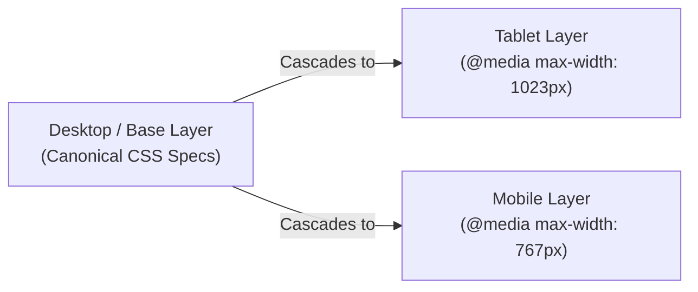
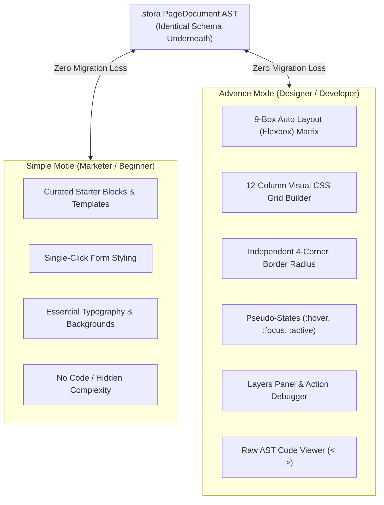

import { Callout } from 'fumadocs-ui/components/callout';
import { Card, Cards } from 'fumadocs-ui/components/card';
import { Tab, Tabs } from 'fumadocs-ui/components/tabs';
import { Accordion, Accordions } from 'fumadocs-ui/components/accordion';
import { TypeTable } from 'fumadocs-ui/components/type-table';

The **`@kubuild/editor`** package is the visual canvas and design studio of the KUBUILD ecosystem. It delivers a fluid, Figma-grade visual authoring experience directly inside your React web application—combining Auto Layout (Flexbox), Visual CSS Grid, 8-point interactive resize handles, real-time smart snapping, responsive breakpoint cascading, dual-mode progressive disclosure (`Simple` vs `Advance`), and an atomic Zustand-powered state machine.

Whether embedding a simple landing page builder for content marketers or offering an advanced visual CSS ideation studio for professional designers and developers, `@kubuild/editor` handles direct DOM manipulation, caret-stable inline editing, keyboard shortcuts, and asset management while generating clean, portable, and deterministic `.stora` PageDocument JSON.

---

## Architectural Overview & Layout

```mermaid
flowchart TD
    subgraph TopbarToolbar["1. Topbar Toolbar"]
        direction LR
        Brand["Page Title & Status"] --- ModeSwitch["Simple | Advance Switcher"]
        ModeSwitch --- ViewportSwitch["Desktop | Tablet | Mobile"]
        ViewportSwitch --- HistoryActions["Undo / Redo / History"]
        HistoryActions --- SaveActions["Save / Autosave Status"]
        SaveActions --- Tools["Code Viewer / Pixel Tracking / AI Chat"]
    end

    subgraph MainWorkspace["Editor Canvas Workspace"]
        direction LR
        subgraph LeftSidebarPanel["2. Left Sidebar"]
            TabsNav["Tab Switcher"]
            BlocksTab["Blocks (Starter Templates)"]
            ComponentsTab["Components (Atomic Registry)"]
            LayersTab["Layers Tree (DOM Hierarchy)"]
        end

        subgraph CenterCanvasPanel["3. Center Canvas"]
            FrameHolder["Viewport Frame Holder"]
            OverlayTools["8-Point Handles & Spacing Sliders"]
            SmartSnap["Smart Snapping & Distance Guides"]
            MultiDev["Multi-Device Preview (Side-by-Side)"]
            BreadcrumbBar["Hierarchy Breadcrumbs Navigation"]
        end

        subgraph RightInspectorPanel["4. Right Inspector"]
            InspectorTabs["Style | Traits (Props) | AI"]
            BoxModel["Visual Box Model (Margin / Padding)"]
            AutoLayout["Auto Layout Matrix & CSS Grid"]
            DesignTokens["Typography, Colors, Radius & Effects"]
        end
    end

    TopbarToolbar --> MainWorkspace
    LeftSidebarPanel --- CenterCanvasPanel
    CenterCanvasPanel --- RightInspectorPanel
```

The editor shell is centered around the `<KubuildEditor />` component, which orchestrates five main UI zones into an integrated design workstation:



### Layout Zone Breakdown

1. **Topbar Toolbar:** Global command center for page-level actions, including responsive breakpoint switching, history traversal (Undo/Redo), save/dirty persistence indicators, code viewer modal, tracking pixel credentials, template pickers, and the dual-mode complexity toggle.
2. **Left Sidebar:** Tabbed asset and hierarchy drawer containing pre-assembled UI sections (**Blocks**), atomic building blocks (**Components**), and a draggable visual tree representation of the active document AST (**Layers**).
3. **Center Canvas:** The GPU-accelerated direct manipulation area. Houses the resizable viewport frame, 8-point transform handles, on-canvas spacing sliders, smart snapping guidelines, distance meters, and floating node action badges.
4. **Right Inspector:** Deep design and trait editor. Switches dynamically between style sectors (Box Model, Auto Layout, CSS Grid, Dimensions, Typography, Backgrounds, Borders, Effects, Motion) and component-specific properties (Traits & Validation).
5. **State & Orchestration Engine:** Headless state management layer powered by Zustand (`useEditorStore`) and `@kubuild/core`, ensuring 60 FPS interactions without re-rendering unaffected subtree nodes.

---

## Installation & Setup

Install `@kubuild/editor` alongside its required peer packages:

<Tabs items={['pnpm', 'npm', 'yarn', 'bun']}>
  <Tab value="pnpm">
```bash
pnpm add @kubuild/editor @kubuild/schema @kubuild/core @kubuild/components @kubuild/renderer lucide-react zustand
```
  </Tab>
  <Tab value="npm">
```bash
npm install @kubuild/editor @kubuild/schema @kubuild/core @kubuild/components @kubuild/renderer lucide-react zustand
```
  </Tab>
  <Tab value="yarn">
```bash
yarn add @kubuild/editor @kubuild/schema @kubuild/core @kubuild/components @kubuild/renderer lucide-react zustand
```
  </Tab>
  <Tab value="bun">
```bash
bun add @kubuild/editor @kubuild/schema @kubuild/core @kubuild/components @kubuild/renderer lucide-react zustand
```
  </Tab>
</Tabs>

<Callout type="info">
`@kubuild/editor` requires a client-side browser DOM environment. When building with Next.js App Router or Pages Router, always import the editor dynamically with `{ ssr: false }`. See the [Next.js SSR Integration Guide](#nextjs-ssr-integration-guide) below.
</Callout>

---

## Core Props & Configuration

The `<KubuildEditor />` component can be mounted as an uncontrolled or fully controlled visual editor. It accepts the following props:

```tsx
import React, { useRef } from 'react';
import { KubuildEditor, EditorHandle } from '@kubuild/editor';
import { PageDocument } from '@kubuild/schema';

export function PageBuilderPage({ initialDoc }: { initialDoc: PageDocument }) {
  const editorRef = useRef<EditorHandle>(null);

  return (
    <div className="h-screen w-screen">
      <KubuildEditor
        ref={editorRef}
        initialDocument={initialDoc}
        mode="advance"
        locale="en"
        onChange={(updatedDoc) => {
          console.log('Document updated:', updatedDoc.document.id);
        }}
        onSave={async (doc) => {
          await fetch('/api/pages/save', {
            method: 'POST',
            body: JSON.stringify(doc),
          });
        }}
        autosave={{ debounceMs: 2500 }}
      />
    </div>
  );
}
```

### Complete Props Breakdown

<TypeTable
  type={{
    initialDocument: {
      description: 'The baseline .stora PageDocument AST loaded into the editor store on mount.',
      type: 'PageDocument',
      required: false,
    },
    onChange: {
      description: 'Callback fired whenever document nodes, styles, properties, or animations change.',
      type: '(doc: PageDocument) => void',
      required: false,
    },
    mode: {
      description: 'Controlled UI complexity mode: "simple" for streamlined marketer view or "advance" for full studio designer view.',
      type: '"simple" | "advance"',
      default: '"advance"',
      required: false,
    },
    defaultMode: {
      description: 'Initial uncontrolled complexity mode when not using controlled mode prop.',
      type: '"simple" | "advance"',
      default: '"advance"',
      required: false,
    },
    onModeChange: {
      description: 'Fired when the user toggles between Simple and Advance mode in the editor toolbar.',
      type: '(mode: EditorMode) => void',
      required: false,
    },
    selectedNodeId: {
      description: 'Controlled active node ID. When provided, the canvas, Layers tree, and Inspector focus this element.',
      type: 'string | null',
      required: false,
    },
    onSelectionChange: {
      description: 'Fired whenever the user selects or deselects a node on the canvas or in the Layers panel.',
      type: '(nodeId: string | null) => void',
      required: false,
    },
    locale: {
      description: 'Editor interface language ("en" | "id" | custom registered locale code).',
      type: 'EditorLocale',
      default: '"en"',
      required: false,
    },
    onLocaleChange: {
      description: 'Callback fired when the user selects a different language via the toolbar language switcher.',
      type: '(locale: EditorLocale) => void',
      required: false,
    },
    translations: {
      description: 'Custom dictionary translation overrides merged into the built-in i18n dictionaries.',
      type: 'TranslationOverrides',
      required: false,
    },
    onSave: {
      description: 'Async persistence handler. Enables the Save button, dirty tracking indicators, Cmd/Ctrl+S, and autosave.',
      type: '(doc: PageDocument) => Promise<void> | void',
      required: false,
    },
    onDirtyChange: {
      description: 'Fired whenever the editor transitions between clean and dirty (unsaved edits) state.',
      type: '(isDirty: boolean) => void',
      required: false,
    },
    autosave: {
      description: 'Debounced automated save configuration. Automatically executes onSave after a period of user inactivity.',
      type: '{ debounceMs?: number }',
      required: false,
    },
    warnOnUnsavedChanges: {
      description: 'Triggers the native browser "Leave site?" confirmation dialog if the user attempts to unload with dirty state.',
      type: 'boolean',
      default: 'true (when onSave is provided)',
      required: false,
    },
    config: {
      description: 'Fine-grained visibility and feature configuration for toolbar, sidebar, canvas overlays, and inspector sectors.',
      type: 'EditorConfig',
      required: false,
    },
    variableCatalog: {
      description: 'Host-declared bindable variables catalog (e.g. {{ variables.user_name }}) with sample preview values.',
      type: 'VariableCatalog',
      required: false,
    },
    assetProvider: {
      description: 'Asset management adapter providing upload endpoints, media browser modal integration, and asset:// URL resolution.',
      type: 'AssetProvider',
      required: false,
    },
    blocks: {
      description: 'Custom host block library displayed in the Blocks sidebar tab and accessible via drag-and-drop.',
      type: 'BlockDefinition[]',
      required: false,
    },
    blocksMode: {
      description: 'Strategy for resolving blocks: "append" merges host blocks with built-in starters; "replace" shows host blocks exclusively.',
      type: '"append" | "replace"',
      default: '"append"',
      required: false,
    },
    templates: {
      description: 'Pre-built landing page templates shown in the Template Picker toolbar dialog.',
      type: 'TemplateRecord[]',
      required: false,
    },
    onApplyTemplate: {
      description: 'Callback fired after an author replaces the current page with a chosen template (fully undoable).',
      type: '(template: TemplateRecord, doc: PageDocument) => void',
      required: false,
    },
    ai: {
      description: 'Optional AI configuration enabling streaming page generator, AI chat assistant panel, and prompt copilot.',
      type: 'AiEditorConfig',
      required: false,
    },
    className: {
      description: 'Custom CSS class names applied to the outermost editor container wrapper.',
      type: 'string',
      required: false,
    },
  }}
/>

---

## Imperative EditorHandle API

Passing a React `ref` to `<KubuildEditor />` gives host applications imperative access to the **`EditorHandle`** interface. This lets you inspect state, swap documents dynamically, trigger programmatic saves, and manage undo/redo stacks:

```tsx
import { useRef } from 'react';
import { KubuildEditor, EditorHandle } from '@kubuild/editor';

export function EditorController() {
  const editorRef = useRef<EditorHandle>(null);

  const handleExternalRevert = () => {
    if (editorRef.current?.canUndo()) {
      editorRef.current.undo();
    }
  };

  const handleManualExport = () => {
    const activeDoc = editorRef.current?.getDocument();
    console.log('Exporting JSON:', JSON.stringify(activeDoc, null, 2));
  };

  const handleProgrammaticSave = async () => {
    const success = await editorRef.current?.save();
    if (success) {
      console.log('Saved successfully!');
    }
  };

  return (
    <>
      <div className="toolbar-addons">
        <button onClick={handleExternalRevert}>External Undo</button>
        <button onClick={handleManualExport}>Export AST</button>
        <button onClick={handleProgrammaticSave}>Save Now</button>
      </div>
      <KubuildEditor ref={editorRef} />
    </>
  );
}
```

### EditorHandle Methods

<TypeTable
  type={{
    getDocument: {
      description: 'Returns the current active PageDocument AST from the editor store.',
      type: '() => PageDocument',
      required: true,
    },
    replaceDocument: {
      description: 'Replaces the current document with a new AST after validating schema constraints. Passing { keepHistory: true } records the replacement as an undoable history step.',
      type: '(doc: PageDocument, options?: { keepHistory?: boolean }) => ReplaceDocumentResult',
      required: true,
    },
    insertBlock: {
      description: 'Inserts a pre-built BlockDefinition or block ID into targetId (defaults to selected node or page root).',
      type: '(block: BlockDefinition | string, targetId?: string, index?: number) => InsertComponentResult',
      required: true,
    },
    applyTemplate: {
      description: 'Clones and replaces the page document with a TemplateRecord. Recorded as a single undoable step.',
      type: '(template: TemplateRecord) => ApplyTemplateResult',
      required: true,
    },
    undo: {
      description: 'Reverts the most recent document mutation command in the history manager.',
      type: '() => void',
      required: true,
    },
    redo: {
      description: 'Re-applies the next previously undone command.',
      type: '() => void',
      required: true,
    },
    canUndo: {
      description: 'Returns true if there are commands available to undo.',
      type: '() => boolean',
      required: true,
    },
    canRedo: {
      description: 'Returns true if there are undone commands available to re-apply.',
      type: '() => boolean',
      required: true,
    },
    isDirty: {
      description: 'Returns true if edits have occurred since the last successful onSave execution.',
      type: '() => boolean',
      required: true,
    },
    save: {
      description: 'Triggers the onSave pipeline programmatically (equivalent to pressing Cmd/Ctrl+S). Resolves true on success.',
      type: '() => Promise<boolean>',
      required: true,
    },
  }}
/>

---

## Direct Canvas Manipulation Experience

`@kubuild/editor` implements a physical, direct-manipulation design canvas modeled on modern CAD and UI design tools like Figma.

```
┌────────────────────────────────────────────────────────────────────────┐
│                        DIRECT CANVAS MANIPULATION                      │
├────────────────────────────────────────────────────────────────────────┤
│ 1. 8-Point Visual Transform Handles (Corner & Edge Scaling)           │
│ 2. Smart Alignment Guidelines & 5px Magnet Snapping                    │
│ 3. On-Canvas Spacing Sliders (Interactive Margins & Gaps)              │
│ 4. Distance Meter (Hold Alt/Option + Hover to Measure)                 │
│ 5. Caret-Stable Inline Text Editing (Buffered Transaction History)     │
│ 6. Infinite Pan & Zoom Canvas Navigation (Space+Drag & Cmd+Wheel)      │
└────────────────────────────────────────────────────────────────────────┘
```

### 1. 8-Point Resize Handles & Smart Snapping

Selecting any block or container on the canvas activates an interactive bounding box equipped with 8 transform handles:

- **Edge Handles (Top, Bottom, Left, Right):** Dragging edge handles directly adjusts `width`, `minWidth`, `height`, or `minHeight`.
- **Corner Handles (NW, NE, SW, SE):** Dragging corner handles scales dimensions bidirectionally. Holding <kbd>Shift</kbd> during resize locks the component's aspect ratio.
- **Real-Time Dimension HUD:** An active dimension tooltip hovers above the selection during drag operations, displaying exact pixel values:
  ```text
  W: 420px  ·  H: 240px
  ```
- **Smart Alignment Guides (Magnetic Snapping):** When moving or resizing elements, magenta and cyan alignment lines snap into place when edges or centerlines align with neighboring siblings or parent container boundaries (snapping threshold: `5px`).

### 2. Distance Meter (Holding Alt / Option)

Holding down <kbd>Alt</kbd> (Windows/Linux) or <kbd>Option</kbd> (macOS) while an element is selected activates the visual **Distance Meter**. Hovering the cursor over any other canvas element displays projected alignment rays with real-time numeric pixel distance tags between their bounding boxes.

### 3. Viewport Switching & Responsive Cascade

The editor toolbar provides instant viewport toggles: **Desktop** (`≥ 1024px`), **Tablet** (`768px – 1023px`), and **Mobile** (`< 768px`).



- **Differential Overrides:** Changes made while in Tablet or Mobile view do **not** duplicate the entire style object. The editor writes only differential overrides to `node.responsiveStyles[breakpoint]`.
- **Visual Inheritance Indicators:** In the Inspector, properties inherited from the `base` breakpoint appear with dimmed text and inherited placeholders. Overridden properties display a colored indicator dot alongside a 1-click **Reset to Inherited** button.
- **Draggable Fluid Viewport Frame:** A grip handle along the right border of the canvas allows dragging to arbitrary custom widths (e.g., `320px` to `1920px`) to test fluid typography, CSS grid wrapping, and flex reflows.

### 4. Multi-Device Side-by-Side Preview

Clicking the **Multi-Device Mode** button in the zoom toolbar renders Desktop, Tablet, and Mobile artboards simultaneously side-by-side in real time. Scrolling, hover states, and live edits sync across all three frames synchronously.

### 5. Inline Text Editing with Caret Stability

Double-clicking any text, heading, button, or link switches the canvas into inline text editing mode:

- **Zero Cursor Jumping:** Text input directly updates the canvas DOM element via internal transaction buffering (`beginHistoryTransaction()` on focus).
- **History Grouping:** Typing keystrokes are batched into a single discrete undo step that finalizes only on blur (`endHistoryTransaction()`), preventing keystroke-by-keystroke history bloat.

### 6. Pan & Zoom Canvas Navigation

Canvas navigation operates smoothly at 60 FPS using GPU hardware-accelerated CSS transforms (`translate3d` and `scale`):

- **Pan Tool:** Hold <kbd>Space</kbd> + click and drag anywhere on the canvas, or click-drag using the Middle Mouse Button. You can also press <kbd>H</kbd> to activate the persistent Hand tool.
- **Zoom Tool:** Hold <kbd>Cmd</kbd> / <kbd>Ctrl</kbd> + scroll mouse wheel, or use the zoom toolbar presets (`50%`, `75%`, `100%`, `150%`, or `Fit to Screen`). Press <kbd>V</kbd> to switch back to the Selection tool.

---

## Dual-Mode Progressive Disclosure: Simple vs Advance

KUBUILD features a dual-mode design system engineered to accommodate both non-technical creators and professional developers within the exact same software engine.



### Design Philosophy

- **Simple Mode:** Designed for content marketers, copywriters, and non-technical business users. Hides CSS terminology, suppresses deep DOM hierarchies, and exposes curated block layouts with straightforward property controls.
- **Advance Mode:** Designed for UI/UX designers and frontend engineers. Exposes comprehensive CSS flexbox and grid auto-layout, pseudo-state selectors (`:hover`, `:focus`), independent 4-corner border radius, multi-layer drop shadows, glassmorphism filters, DOM layer ordering, and tracking pixel configurations.
- **Zero Loss Switching:** Toggling between Simple and Advance mode is instantaneous and lossless. Because both modes operate on the identical underlying AST, switching never corrupts custom CSS properties or advanced actions.

### Feature Comparison Matrix

| Capability / Feature | Simple Mode | Advance Mode |
| :--- | :--- | :--- |
| **Primary Sidebar Focus** | Curated Starter Blocks (`blocksMode: append`) | Atomic Elements + Custom Registry |
| **DOM Layers Panel** | Hidden | Full interactive drag-and-drop tree |
| **Auto Layout (Flexbox)** | Basic Horizontal / Vertical orientation | 9-Box Alignment Matrix, Wrap, Hug/Fill/Fixed |
| **Visual CSS Grid** | Predefined column presets (2, 3, 4 cols) | Full 12-col visual grid, `minmax()`, `fr` units |
| **State Selectors** | Base normal state only | `:hover`, `:focus`, `:active`, `:disabled` |
| **Border Radius** | Unified single slider (e.g. `8px`) | Independent 4-corner controls `[TL, TR, BR, BL]` |
| **Box Model Editor** | Simple padding slider | Full 4-quadrant interactive Margin & Padding map |
| **Code Viewer (`< >`)** | Hidden | Full JSON AST & Generated React JSX inspect |
| **Breadcrumbs Bar** | Hidden | Interactive ancestor hierarchy breadcrumbs |
| **Action Debugger Panel** | Hidden | Real-time dispatch logger & payload tracer |
| **Component Whitelist** | Curated 12 essential beginner elements | All 35+ components + custom host plugins |

---

## Zustand State Store (`useEditorStore`)

The editor's internal state machine is managed by an atomic Zustand store (`useEditorStore`). Host applications can subscribe to fine-grained state slices or invoke store actions:

```tsx
import { useEditorStore } from '@kubuild/editor';

// Selective atomic subscription (prevents unnecessary re-renders)
export function DocumentStatsBadge() {
  const nodeCount = useEditorStore((state) => {
    let count = 0;
    const walk = (node: any) => {
      count++;
      node.children?.forEach(walk);
    };
    walk(state.document.document);
    return count;
  });

  const canUndo = useEditorStore((state) => state.canUndo);
  const activeViewport = useEditorStore((state) => state.viewport);

  return (
    <div className="flex gap-4 items-center text-sm">
      <span>Nodes: {nodeCount}</span>
      <span>Viewport: {activeViewport}</span>
      <span>Undo Available: {canUndo ? 'Yes' : 'No'}</span>
    </div>
  );
}
```

### Core State Atoms & Selectors

<Cards>
  <Card title="document" description="Active PageDocument AST containing metadata, styles, breakpoints, and the root node tree." />
  <Card title="selectedNodeId / selectedNodeIds" description="IDs of currently focused nodes. Supports single selection and marquee multi-selection." />
  <Card title="viewport" description="Active responsive breakpoint frame: 'desktop' | 'tablet' | 'mobile'." />
  <Card title="isDirty & canUndo / canRedo" description="Reactive persistence state tracking unsaved modifications and command history stack availability." />
  <Card title="editorMode" description="Active UI complexity tier ('simple' | 'advance'), controlling visible toolbars and inspector sectors." />
  <Card title="variableCatalog" description="Host-supplied catalog of runtime variable tokens available for dynamic expression binding." />
</Cards>

---

## Keyboard Shortcuts Cheatsheet

`@kubuild/editor` includes an extensive set of Figma-standard keyboard shortcuts for high-velocity editing:

| Action | macOS Shortcut | Windows / Linux Shortcut | Scope |
| :--- | :--- | :--- | :--- |
| **Undo** | <kbd>Cmd</kbd> + <kbd>Z</kbd> | <kbd>Ctrl</kbd> + <kbd>Z</kbd> | Global |
| **Redo** | <kbd>Cmd</kbd> + <kbd>Shift</kbd> + <kbd>Z</kbd> | <kbd>Ctrl</kbd> + <kbd>Y</kbd> / <kbd>Ctrl</kbd>+<kbd>Shift</kbd>+<kbd>Z</kbd> | Global |
| **Save Document** | <kbd>Cmd</kbd> + <kbd>S</kbd> | <kbd>Ctrl</kbd> + <kbd>S</kbd> | Global |
| **Duplicate Selection** | <kbd>Cmd</kbd> + <kbd>D</kbd> | <kbd>Ctrl</kbd> + <kbd>D</kbd> | Selected Node |
| **Copy Node** | <kbd>Cmd</kbd> + <kbd>C</kbd> | <kbd>Ctrl</kbd> + <kbd>C</kbd> | Selected Node |
| **Paste Node** | <kbd>Cmd</kbd> + <kbd>V</kbd> | <kbd>Ctrl</kbd> + <kbd>V</kbd> | Selected Node |
| **Delete Node** | <kbd>Backspace</kbd> / <kbd>Delete</kbd> | <kbd>Delete</kbd> / <kbd>Backspace</kbd> | Selected Node |
| **Deselect / Cancel** | <kbd>Escape</kbd> | <kbd>Escape</kbd> | Canvas |
| **Wrap in Auto Layout Frame** | <kbd>Cmd</kbd> + <kbd>G</kbd> | <kbd>Ctrl</kbd> + <kbd>G</kbd> | Selected Node(s) |
| **Ungroup Frame** | <kbd>Cmd</kbd> + <kbd>Shift</kbd> + <kbd>G</kbd> | <kbd>Ctrl</kbd> + <kbd>Shift</kbd> + <kbd>G</kbd> | Selected Frame |
| **Navigate Siblings / Parent** | <kbd>Arrow Up</kbd> / <kbd>Arrow Down</kbd> | <kbd>Arrow Up</kbd> / <kbd>Arrow Down</kbd> | Selected Node |
| **Pan Canvas** | <kbd>Space</kbd> + Drag / Middle Mouse | <kbd>Space</kbd> + Drag / Middle Mouse | Canvas |
| **Zoom In / Out** | <kbd>Cmd</kbd> + Scroll Wheel | <kbd>Ctrl</kbd> + Scroll Wheel | Canvas |
| **Distance Meter** | Hold <kbd>Option</kbd> + Hover | Hold <kbd>Alt</kbd> + Hover | Selected Node |
| **Select Tool Mode** | <kbd>V</kbd> | <kbd>V</kbd> | Global |
| **Hand Tool Mode** | <kbd>H</kbd> | <kbd>H</kbd> | Global |

---

## Next.js SSR Integration Guide

Because `@kubuild/editor` uses direct browser DOM measurements, drag-and-drop pointer listeners, and client-side web APIs, it must **never** be rendered on the Node.js server during SSR.

### Next.js App Router Setup

Create an isolated client wrapper component with `next/dynamic` and `{ ssr: false }`:

```tsx title="components/editor-client-wrapper.tsx"
'use client';

import dynamic from 'next/dynamic';
import React from 'react';
import type { KubuildEditorProps, EditorHandle } from '@kubuild/editor';

// Dynamically import KubuildEditor with SSR disabled
const KubuildEditorClient = dynamic(
  () => import('@kubuild/editor').then((mod) => mod.KubuildEditor),
  {
    ssr: false,
    loading: () => (
      <div className="flex h-screen w-full items-center justify-center bg-neutral-900 text-neutral-400">
        <div className="flex flex-col items-center gap-3">
          <div className="h-8 w-8 animate-spin rounded-full border-2 border-indigo-500 border-t-transparent" />
          <p className="text-sm font-medium">Initializing KUBUILD Studio Canvas...</p>
        </div>
      </div>
    ),
  }
);

export const ClientEditor = React.forwardRef<EditorHandle, KubuildEditorProps>(
  function ClientEditor(props, ref) {
    return <KubuildEditorClient {...props} ref={ref} />;
  }
);
```

Then render `ClientEditor` inside your Next.js page:

```tsx title="app/editor/[pageId]/page.tsx"
import { ClientEditor } from '@/components/editor-client-wrapper';
import { getPageDocumentById } from '@/lib/db';

export default async function PageEditorRoute({
  params,
}: {
  params: Promise<{ pageId: string }>;
}) {
  const { pageId } = await params;
  const initialDoc = await getPageDocumentById(pageId);

  return (
    <main className="h-screen w-screen overflow-hidden">
      <ClientEditor
        initialDocument={initialDoc}
        mode="advance"
        autosave={{ debounceMs: 2000 }}
        onSave={async (doc) => {
          'use server';
          // Server action or API mutation
          console.log('Document persisted:', doc.document.id);
        }}
      />
    </main>
  );
}
```

---

## Frequently Asked Questions

<Accordions>
  <Accordion title="Does switching between Simple and Advance mode strip advanced CSS properties?">
    No. Both modes share the exact same underlying `PageDocument` AST and Zustand store state. If an author configures advanced properties (such as a 12-column CSS Grid or glassmorphism filters) in Advance mode and subsequently switches to Simple mode, those styles remain 100% active and are preserved during saves and exports.
  </Accordion>
  <Accordion title="Can I customize which components appear in the Left Sidebar?">
    Yes. Pass `config.sidebar.allowedComponents` or `config.sidebar.hiddenComponents` to the `<KubuildEditor />` component. You can also provide custom block collections via the `blocks` prop.
  </Accordion>
  <Accordion title="How do I integrate custom asset uploading (S3, Cloudinary, Supabase)?">
    Supply a custom `assetProvider` prop adhering to the `AssetProvider` interface from `@kubuild/core`. The editor modal calls your provider's `upload()` and `list()` methods and resolves `asset://` IDs inside the canvas automatically.
  </Accordion>
</Accordions>

---

## Related Packages

<Cards>
  <Card title="@kubuild/renderer" href="/docs/packages/renderer" description="Runtime recursive renderer powering the visual canvas preview and production SSR." />
  <Card title="@kubuild/core" href="/docs/packages/core" description="Headless command pattern, tree manipulation algorithms, and transactional history." />
  <Card title="@kubuild/components" href="/docs/packages/components" description="35+ built-in UI components, starter blocks, and trait definition registries." />
</Cards>
