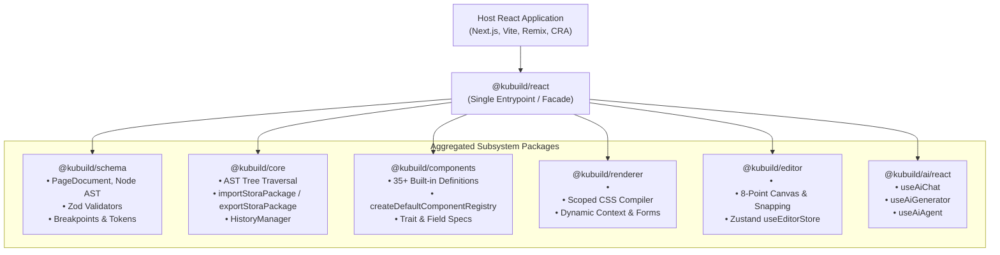
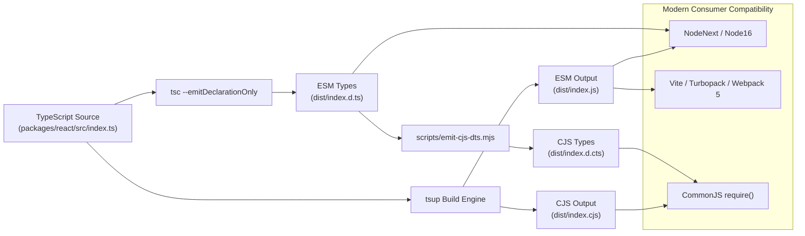

import { Callout } from 'fumadocs-ui/components/callout';
import { Card, Cards } from 'fumadocs-ui/components/card';
import { Tab, Tabs } from 'fumadocs-ui/components/tabs';
import { Accordion, Accordions } from 'fumadocs-ui/components/accordion';
import { TypeTable } from 'fumadocs-ui/components/type-table';

The **`@kubuild/react`** package is the unified, batteries-included facade for the entire KUBUILD React ecosystem. Instead of managing multiple separate package dependencies and coordinating cross-package version alignment, `@kubuild/react` re-exports all core primitives, AST schemas, component metadata registries, rendering engines, visual editor studios, and AI copilot hooks through a single, cohesive import interface.

```tsx
// Single import for the complete KUBUILD ecosystem
import {
  // Visual Editor Canvas
  KubuildEditor,
  useEditorStore,
  // Pure Runtime Renderer
  KubuildRenderer,
  createRenderContext,
  // AST Schema & Document Factory
  PageDocument,
  createBlankDocument,
  // Component Registry
  createDefaultComponentRegistry,
  // AI Copilot Hooks
  useAiChat,
  useAiGenerator,
} from '@kubuild/react';
```

---

## Interactive Live Preview

The interactive sandbox below demonstrates the unified `@kubuild/react` runtime in action. Switch viewports, inspect the rendered component tree, and test responsive layouts:

<InteractiveRenderer
  title="Unified @kubuild/react Ecosystem Sandbox"
  height="440px"
  defaultViewport="desktop"
/>

---

## Architectural Aggregation & Packaging

`@kubuild/react` acts as an aggregation layer that unifies six foundational packages into a single developer entrypoint:



### Underlying Package Responsibilities

<Cards>
  <Card title="@kubuild/schema" href="/docs/packages/schema">
    Immutable JSON AST definitions, document and node schemas, responsive breakpoint types, and runtime Zod validation guards.
  </Card>
  <Card title="@kubuild/core" href="/docs/packages/core">
    Deterministic tree traversal, parent-child lookups, `.stora` package serialization/deserialization, and undo/redo history managers.
  </Card>
  <Card title="@kubuild/components" href="/docs/packages/components">
    Headless catalog of 35+ built-in visual components, field inspectors, property schemas, and custom component registries.
  </Card>
  <Card title="@kubuild/renderer" href="/docs/packages/renderer">
    Pure recursive React renderer featuring zero runtime CSS-in-JS overhead, SSR-safe responsive cascade, and isolated error boundaries.
  </Card>
  <Card title="@kubuild/editor" href="/docs/packages/editor">
    Figma-grade visual authoring canvas with 8-point resize handles, smart snapping guides, multi-device viewports, and Zustand state store.
  </Card>
  <Card title="@kubuild/ai" href="/docs/packages/ai">
    Multi-provider AI generation engine, streaming AST normalizers, visual copilot chat hooks, and autonomous page generation agents.
  </Card>
</Cards>

---

## Installation & Setup

Install `@kubuild/react` and its peer dependencies (`react` and `react-dom` version 18 or 19):

<Tabs items={['pnpm', 'npm', 'yarn', 'bun']}>
  <Tab value="pnpm">
```bash
pnpm add @kubuild/react react react-dom
```
  </Tab>
  <Tab value="npm">
```bash
npm install @kubuild/react react react-dom
```
  </Tab>
  <Tab value="yarn">
```bash
yarn add @kubuild/react react react-dom
```
  </Tab>
  <Tab value="bun">
```bash
bun add @kubuild/react react react-dom
```
  </Tab>
</Tabs>

<Callout type="info" title="React 18 & 19 Support">
`@kubuild/react` fully supports modern React 19 concurrent features as well as React 18 LTS applications. All exported components are client-ready and server-safe where appropriate.
</Callout>

---

## Comprehensive Import Cheatsheet

Below is the definitive catalog of all primary symbols, interfaces, and utilities re-exported from `@kubuild/react`:

### 1. Visual Editor Primitives

Exported from `@kubuild/editor`:

| Symbol | Kind | Description |
| :--- | :--- | :--- |
| `<KubuildEditor />` | Component | The complete Figma-grade visual editor studio including toolbar, canvas, layer tree, and inspector. |
| `useEditorStore` | Hook / Store | Zustand-powered editor state store hook for accessing selection, zoom, history, and document mutations. |
| `EditorHandle` | Type | Imperative ref interface for triggering editor actions programmatically (`save`, `undo`, `redo`, `selectNode`). |
| `EditorMode` | Type | Visual disclosure mode: `'simple'` (streamlined content editing) or `'advance'` (full CSS layout studio). |
| `EditorCanvas` | Component | Low-level interactive canvas workspace with 8-point resize handles and distance snapping overlays. |
| `createEditorStore` | Function | Factory for instantiating an isolated editor Zustand store instance outside React lifecycle. |

### 2. Runtime Renderer Primitives

Exported from `@kubuild/renderer`:

| Symbol | Kind | Description |
| :--- | :--- | :--- |
| `<KubuildRenderer />` | Component | Pure recursive React renderer that compiles `.stora` AST nodes into responsive, zero-overhead DOM trees. |
| `createRenderContext` | Function | Creates an immutable runtime context containing variable resolvers, form handlers, and tracking proxies. |
| `RenderContextProvider` | Component | Context provider supplying render configuration, dynamic variables, and handlers down the component tree. |
| `useRenderContext` | Hook | Consumes the active render context within custom component implementations. |
| `resolveRuntimeTheme` | Function | Compiles design tokens into scoped CSS custom properties (`--kubuild-color-primary`, etc.). |
| `collectResponsiveStylesCss` | Function | Server-side utility compiling document AST style rules into an optimized `@media` stylesheet. |

### 3. Schema & AST Primitives

Exported from `@kubuild/schema`:

| Symbol | Kind | Description |
| :--- | :--- | :--- |
| `PageDocument` | Type | TypeScript interface representing a complete, portable `.stora` document root. |
| `Node` | Type | TypeScript interface representing an individual element in the document tree (`type`, `styles`, `children`). |
| `PageDocumentSchema` | Zod Schema | Runtime Zod validator for verifying structural integrity of `.stora` document JSON files. |
| `NodeSchema` | Zod Schema | Runtime Zod validator for verifying individual AST node structures and attributes. |
| `createBlankDocument` | Function | Factory returning a clean, valid default `.stora` document with metadata and root container node. |
| `Breakpoint` | Type | Responsive breakpoint configuration (`desktop`, `tablet`, `mobile`). |
| `ThemeTokens` | Type | Design system token specifications for colors, typography scales, spacing, and shadows. |

### 4. Core Utilities & Tree Operations

Exported from `@kubuild/core`:

| Symbol | Kind | Description |
| :--- | :--- | :--- |
| `exportStoraPackage` | Function | Serializes a document and its embedded binary assets into a portable `.stora` zip/tarball container. |
| `importStoraPackage` | Function | Parses and validates a binary `.stora` package into a live `PageDocument` and asset map. |
| `findNodeById` | Function | High-performance recursive lookup locating any node in the AST by its unique string identifier. |
| `findNodeParent` | Function | Locates the parent node and index of a specified child node within the AST hierarchy. |
| `HistoryManager` | Class | Undo/redo stack manager managing immutable document snapshots with debounce grouping. |
| `createHistoryManager` | Function | Factory helper instantiating an isolated `HistoryManager` instance. |
| `traverseDocument` | Function | Depth-first or breadth-first visitor executing callback operations across all nodes in a document. |

### 5. Component Registry & Built-ins

Exported from `@kubuild/components`:

| Symbol | Kind | Description |
| :--- | :--- | :--- |
| `createDefaultComponentRegistry` | Function | Instantiates the default component registry loaded with all 35+ native KUBUILD elements. |
| `builtinComponents` | Array | Metadata definitions for all atomic built-in elements (Text, Button, Container, Grid, Form, Video, etc.). |
| `ComponentRegistry` | Class | Registry manager for registering, querying, and overriding component definitions and inspectors. |
| `ComponentDefinition` | Type | Declarative contract specifying a component's traits, schema fields, allowed children, and renderer. |

### 6. AI Copilot & Generation Hooks

Exported from `@kubuild/ai/react`:

| Symbol | Kind | Description |
| :--- | :--- | :--- |
| `useAiChat` | Hook | Conversational AI copilot hook with streaming message history and optional host persistence adapter. |
| `useAiGenerator` | Hook | Hook for generating complete landing pages or targeted sections via multi-step LLM pipelines. |
| `useAiAgent` | Hook | Autonomous page builder agent hook executing multi-turn tool calling and visual DOM mutations. |
| `AgentTimelineEntry` | Type | Progress record emitted during autonomous agent planning, drafting, and reconciliation phases. |
| `UseAiChatOptions` | Type | Configuration options for the AI copilot chat interface (`clientOptions`, `initialMessages`, `onToolCall`). |

---

## Bundling & Performance Considerations

When architecting an application with KUBUILD, choosing between the unified `@kubuild/react` entrypoint and granular individual packages is a critical performance decision.

<Cards>
  <Card title="Use @kubuild/react for" icon="Zap">
    **Rapid Prototyping & Internal Portals**
    - Fast MVPs and internal company tools
    - Admin CMS builder portals & content management suites
    - All-in-one builder applications where the user both designs and previews pages in the same session
    - Minimal boilerplate: single package in `package.json`
  </Card>
  <Card title="Switch to @kubuild/renderer for" icon="Sparkles">
    **High-Traffic Public Visitor Pages**
    - Public marketing landing pages & storefronts
    - Next.js App Router Server / Client visitor routes
    - High-volume blogs, documentation, and dynamic page readers
    - Strict Core Web Vitals optimization (< 30KB gzipped runtime)
  </Card>
</Cards>

### Why You Should Never Import the Editor on Visitor Pages

<Callout type="warn" title="Bundle Size Warning: Keep Visitor Pages Lightweight">
The `@kubuild/editor` module bundled inside `@kubuild/react` contains heavy visual authoring systems:
- 8-point resize handle calculations and DOM matrix transformers
- Smart distance snapping collision algorithms
- Visual CSS Box Model interactive controls
- Drag-and-drop layer hierarchy tree rendering
- Iconography sets, color pickers, and font loaders

Importing `@kubuild/react` on a public visitor page forces browsers to download, parse, and evaluate hundreds of kilobytes of visual editor JavaScript that will **never be executed** by visitor reading the page.
</Callout>

### Bundle Size Comparison Matrix

| Package Imported | Client Bundle (Gzipped) | Best Suited For | Includes Canvas / Handles? |
| :--- | :--- | :--- | :--- |
| **`@kubuild/react`** | ~180 KB – 240 KB | Admin CMS, internal builder app, design studio | **Yes** (Full Editor UI) |
| **`@kubuild/renderer`** | **< 30 KB** | Public landing page, marketing site, SSR reader | **No** (Zero Editor Overhead) |
| **`@kubuild/schema`** | < 8 KB | API routes, backend ingestion, microservices | **No** (Types & Validators only) |

---

## Code Comparison: Two Architectural Patterns

### Pattern A: Full Visual Builder Application (`@kubuild/react`)

Use `@kubuild/react` when building an admin page, CMS dashboard, or SaaS application where end users construct and edit pages visually:

```tsx title="app/admin/builder/page.tsx"
'use client';

import React, { useState, useCallback, useRef } from 'react';
import {
  KubuildEditor,
  EditorHandle,
  EditorMode,
  PageDocument,
  createBlankDocument,
  exportStoraPackage,
  useAiChat,
} from '@kubuild/react';

export default function AdminPageBuilder() {
  const [document, setDocument] = useState<PageDocument>(() =>
    createBlankDocument('New Marketing Campaign')
  );
  const [mode, setMode] = useState<EditorMode>('simple');
  const editorRef = useRef<EditorHandle>(null);

  // Integrated AI Assistant
  // Provider keys stay on the server: the hook talks to your AI route (see @kubuild/ai)
  const { messages, sendMessage, isLoading } = useAiChat({
    endpoint: '/api/ai',
  });
  // Pass document context per message: sendMessage(prompt, { currentDocument: document })

  const handleSave = useCallback(async (doc: PageDocument) => {
    setDocument(doc);
    const result = await exportStoraPackage(doc);
    if (!result.success) throw new Error(result.diagnosticMessage);
    await fetch('/api/documents/save', {
      method: 'POST',
      headers: { 'Content-Type': 'application/octet-stream' },
      body: new Uint8Array(result.archive),
    });
  }, []);

  return (
    <div style={{ width: '100vw', height: '100vh', display: 'flex', flexDirection: 'column' }}>
      <header style={{ padding: '8px 16px', display: 'flex', gap: 12, borderBottom: '1px solid #e2e8f0' }}>
        <button onClick={() => setMode(m => (m === 'simple' ? 'advance' : 'simple'))}>
          Toggle Mode: {mode.toUpperCase()}
        </button>
        <button onClick={() => editorRef.current?.save()}>Manual Save</button>
      </header>

      <main style={{ flex: 1, position: 'relative' }}>
        <KubuildEditor
          ref={editorRef}
          document={document}
          mode={mode}
          onChange={setDocument}
          onSave={handleSave}
          autoSave={{ enabled: true, intervalMs: 10000 }}
        />
      </main>
    </div>
  );
}
```

---

### Pattern B: Lightweight Public Visitor Page (`@kubuild/renderer`)

For public customer-facing routes, bypass `@kubuild/react` and import **only** `@kubuild/renderer` and `@kubuild/components`. This achieves sub-30KB runtime delivery and instantaneous First Contentful Paint (FCP):

```tsx title="app/(public)/[slug]/page.tsx"
import React from 'react';
import { notFound } from 'next/navigation';
import { KubuildRenderer, createRenderContext } from '@kubuild/renderer';
import { createDefaultComponentRegistry } from '@kubuild/components';
import type { PageDocument } from '@kubuild/schema';

// 1. Fetch document from CMS / Database at Server Request time
async function getPageBySlug(slug: string): Promise<PageDocument | null> {
  const res = await fetch(`https://api.example.com/pages/${slug}`, {
    next: { revalidate: 60 },
  });
  if (!res.ok) return null;
  return res.json();
}

export default async function PublicVisitorLandingPage({
  params,
}: {
  params: Promise<{ slug: string }>;
}) {
  const { slug } = await params;
  const document = await getPageBySlug(slug);

  if (!document) {
    notFound();
  }

  // 2. Initialize lightweight component registry & immutable render context
  const registry = createDefaultComponentRegistry();
  const context = createRenderContext({
    variables: {
      siteName: 'Acme Corporation',
      currentYear: new Date().getFullYear().toString(),
    },
    onFormSubmit: async (formId, data) => {
      'use server';
      // Server action processing customer lead submission
      console.log('Lead captured on public page:', formId, data);
    },
  });

  return (
    <main className="min-h-screen w-full bg-white">
      {/* 3. Pure SSR-safe HTML emission without canvas, handles, or editor store */}
      <KubuildRenderer
        document={document}
        registry={registry}
        context={context}
        responsive="css"
      />
    </main>
  );
}
```

---

## Dual CJS/ESM & NodeNext Toolchain

`@kubuild/react` is built using a modern, dual-format compilation pipeline powered by [`tsup`](https://tsup.egoist.dev/) and TypeScript:



### Packaging Highlights

1. **Dual Format Distribution:**
   - **ESM (`dist/index.js`):** Native ES Module format for modern bundlers (Next.js Turbopack, Vite, esbuild, Webpack 5) supporting top-level await and standard static `import` syntax.
   - **CommonJS (`dist/index.cjs`):** Fallback format for legacy Node.js environments and tools utilizing `require('@kubuild/react')`.
2. **Dual TypeScript Declarations:**
   - Generates both `.d.ts` (ESM) and `.d.cts` (CJS) files to ensure seamless type resolution under `moduleResolution: "NodeNext"` and `moduleResolution: "Bundler"`.
3. **Dead Code Elimination (`sideEffects: false`):**
   - The package manifests `sideEffects: false` in `package.json`. If a consumer application only imports `PageDocument` or `createBlankDocument`, bundlers safely shake out unused React rendering code during production builds.
4. **Target Standard:**
   - Compiled against `ES2022`, ensuring compatibility with all modern browser baselines and LTS Node.js engines (Node 18+).

---

## Frequently Asked Questions

<Accordions>
  <Accordion title="Does @kubuild/react add extra overhead if I tree-shake my build?">
    Modern production bundlers (Vite, Next.js Turbopack, Webpack 5) analyze ES module imports statically. Because `@kubuild/react` marks `sideEffects: false`, any unreferenced symbols will generally be excluded from your final output bundle.

    However, for high-traffic public visitor pages, we **strongly advise importing `@kubuild/renderer` directly**. This guarantees that your application bundle never accidentally retains editor sub-dependencies (such as canvas state hooks or inspector models) due to loose bundler configurations.
  </Accordion>

  <Accordion title="Can I mix @kubuild/react with granular package imports in the same repository?">
    Yes. In a typical monorepo setup:
    - Your **Admin App** (`apps/admin`) can depend on `@kubuild/react` for convenience and fast iteration.
    - Your **Public Web App** (`apps/web`) can depend strictly on `@kubuild/renderer` and `@kubuild/components` for maximum performance.
    - Both applications share the exact same `.stora` document structures because `@kubuild/react` re-exports the identical `@kubuild/schema` types.
  </Accordion>

  <Accordion title="How do I register custom components when using @kubuild/react?">
    You can use `createDefaultComponentRegistry` and `register` custom component definitions directly:

    ```tsx
    import { createDefaultComponentRegistry, KubuildRenderer } from '@kubuild/react';

    const registry = createDefaultComponentRegistry();
    registry.register({
      type: 'custom.status-badge',
      label: 'Status Badge',
      category: 'custom',
      defaultProps: { text: 'Active' },
      renderer: ({ node }) => (
        <span className="badge">{String(node.props?.text ?? '')}</span>
      ),
    });
    ```
  </Accordion>

  <Accordion title="What version of React is required?">
    `@kubuild/react` specifies a peer dependency of `react: ">=18.0.0"` and `react-dom: ">=18.0.0"`. It has been thoroughly tested with React 18 LTS and React 19.
  </Accordion>
</Accordions>
