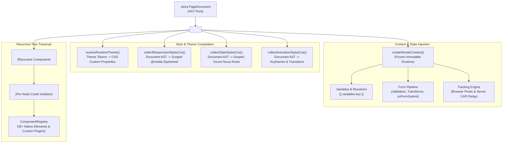
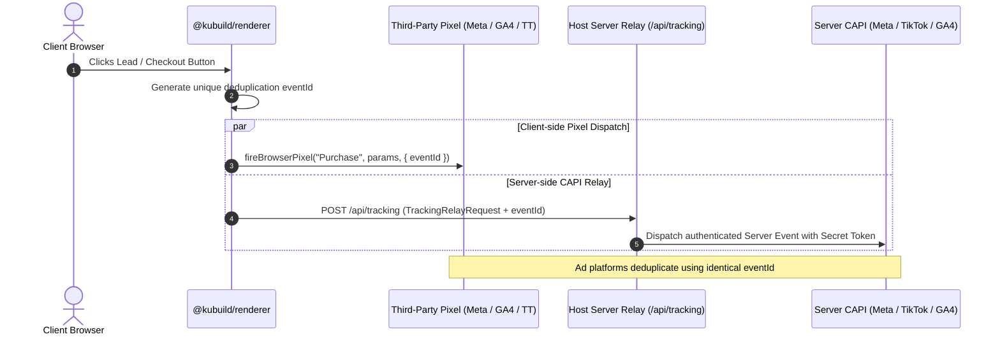

import { Callout } from 'fumadocs-ui/components/callout';
import { Card, Cards } from 'fumadocs-ui/components/card';
import { Tab, Tabs } from 'fumadocs-ui/components/tabs';
import { Accordion, Accordions } from 'fumadocs-ui/components/accordion';
import { TypeTable } from 'fumadocs-ui/components/type-table';

The **`@kubuild/renderer`** package is the runtime rendering engine of the KUBUILD ecosystem. It translates portable `.stora` JSON document trees into live, reactive React component hierarchies with **zero runtime CSS-in-JS dependencies**, deterministic server-side rendering (SSR), and built-in isolated component error boundaries.

Whether rendering high-traffic landing pages inside Next.js App Router, driving an interactive visual canvas inside `@kubuild/editor`, or powering headless email and static exports, `@kubuild/renderer` delivers native performance (< 30KB gzipped runtime), full multi-pixel tracking, and end-to-end form lifecycle management.

---

## Interactive Live Demo

Test the renderer below. Switch viewports to observe breakpoint styles, toggle the raw `.stora` JSON schema, and interact with the rendered elements in real time:

<InteractiveRenderer
  title="Live @kubuild/renderer Sandbox"
  height="440px"
  defaultViewport="desktop"
/>

---

## Architecture & Rendering Pipeline



`@kubuild/renderer` is built around four fundamental design pillars:

1. **Pure Functional Recursion:** The document AST (`node.children[]`) is traversed recursively via `<NodeRenderer />`. Each node resolves its properties, evaluates dynamic variable bindings, and executes registered action pipelines.
2. **SSR-Safe Responsive Cascade (`responsive="css"`):** Rather than evaluating `window.innerWidth` or guessing device dimensions on the server (which causes severe hydration mismatches), the renderer emits scoped `@media` stylesheets directly alongside the markup. The user's browser viewport determines layout rules purely via native CSS.
3. **Zero CSS-in-JS Runtime Overhead:** No Emotion, no Styled Components, and no JavaScript-driven style recalculations during scrolling or animation. All styles are compiled into native CSS rules tagged with `data-kubuild-node` selectors and standard inline styles.
4. **Resilient Failure Boundaries:** Every node is wrapped in a `<ComponentErrorBoundary />`. If a third-party custom node or malformed embed throws an uncaught JavaScript error, only that isolated node degrades gracefully—the rest of the page remains fully functional.

---

## Installation & Setup

Install `@kubuild/renderer` along with the core schema and component registry packages:

<Tabs items={['pnpm', 'npm', 'yarn', 'bun']}>
  <Tab value="pnpm">
```bash
pnpm add @kubuild/renderer @kubuild/schema @kubuild/components
```
  </Tab>
  <Tab value="npm">
```bash
npm install @kubuild/renderer @kubuild/schema @kubuild/components
```
  </Tab>
  <Tab value="yarn">
```bash
yarn add @kubuild/renderer @kubuild/schema @kubuild/components
```
  </Tab>
  <Tab value="bun">
```bash
bun add @kubuild/renderer @kubuild/schema @kubuild/components
```
  </Tab>
</Tabs>

<Callout type="info" title="Peer Dependencies">
  `@kubuild/renderer` requires `react >= 18.2.0` and `react-dom >= 18.2.0`. It is 100% compatible with React 19 and Next.js 15+ App Router.
</Callout>

---

## Core Component: `<KubuildRenderer />`

The `<KubuildRenderer />` component is the top-level entry point for rendering any `.stora` document.

```tsx
import React from 'react';
import { KubuildRenderer } from '@kubuild/renderer';
import type { PageDocument } from '@kubuild/schema';

export function MyPageView({ document }: { document: PageDocument }) {
  return (
    <KubuildRenderer
      document={document}
      mode="runtime"
      responsive="css"
    />
  );
}
```

### Complete Props Breakdown

<TypeTable
  type={{
    document: {
      description: 'The portable .stora PageDocument AST object containing metadata, theme, and root node hierarchy.',
      type: 'PageDocument',
      required: true,
    },
    context: {
      description: 'Runtime execution context created via createRenderContext(). Holds runtime variables, form submit hooks, tracking config, and action handlers.',
      type: 'RenderContext',
      required: false,
    },
    registry: {
      description: 'Component registry instance. Defaults to createDefaultComponentRegistry() containing all 35+ native KUBUILD elements.',
      type: 'ComponentRegistry',
      required: false,
    },
    viewport: {
      description: 'Target preview viewport ("desktop" | "tablet" | "mobile"). Automatically sets responsive="viewport" unless responsive is explicitly passed.',
      type: '"desktop" | "tablet" | "mobile"',
      default: '"desktop"',
      required: false,
    },
    mode: {
      description: 'Rendering environment. "runtime" produces optimized production markup; "editor" exposes contentEditable hooks, diagnostic badges, and error diagnostics.',
      type: '"editor" | "runtime"',
      default: '"runtime"',
      required: false,
    },
    responsive: {
      description: 'Strategy for applying responsive breakpoint layers: "css" emits scoped @media tags (SSR-safe); "viewport" merges layers inline for device-frame preview.',
      type: '"css" | "viewport"',
      default: 'runtime: "css", editor: "viewport"',
      required: false,
    },
    showToastContainer: {
      description: 'Whether to render the built-in ToastContainer for action runners (e.g. show_toast, copy_to_clipboard).',
      type: 'boolean',
      default: 'true',
      required: false,
    },
    className: {
      description: 'Additional CSS class names applied to the root container div (.kubuild-canvas-root).',
      type: 'string',
      required: false,
    },
    onNodeClick: {
      description: 'Callback invoked when a node is clicked in the canvas.',
      type: '(nodeId: string, event: React.MouseEvent) => void',
      required: false,
    },
    onDiagnostic: {
      description: 'Receives runtime diagnostics (e.g. unknown action types, failed variable bindings, rendering exceptions).',
      type: '(diagnostic: Diagnostic) => void',
      required: false,
    },
    onActionDispatch: {
      description: 'Callback triggered whenever an action pipeline or legacy action is dispatched by any node.',
      type: '(actionType: string, payload: Record<string, unknown> | undefined, nodeId: string) => void',
      required: false,
    },
    onNodePropChange: {
      description: 'Editor mode only: triggered when contentEditable elements update their text or props directly on canvas.',
      type: '(nodeId: string, propName: string, value: unknown, isBlur?: boolean) => void',
      required: false,
    },
    selectedNodeId: {
      description: 'Editor mode only: ID of the currently active/selected node. Governs inline contentEditable activation.',
      type: 'string | null',
      required: false,
    },
  }}
/>

---

## Responsive Strategy: `responsive="css"` vs `responsive="viewport"`

One of the most powerful architectural features in `@kubuild/renderer` is its dual-mode responsive styling engine (`STORA-540`).

<Cards>
  <Card title="responsive='css' (SSR & Production)" icon="Zap">
    **Recommended for public web pages and SSR.** Generates pure base inline styles and compiles all desktop/tablet/mobile overrides into scoped `@media` stylesheets. 100% hydration-safe with zero Cumulative Layout Shift (CLS).
  </Card>
  <Card title="responsive='viewport' (Visual Editor)" icon="Monitor">
    **Engineered for visual canvases and device frames.** Merges the chosen viewport layer directly into element inline styles, forcing the exact breakpoint layout regardless of the author's real physical monitor size.
  </Card>
</Cards>

### Detailed Mode Comparison

| Capability | `responsive="css"` | `responsive="viewport"` |
| :--- | :--- | :--- |
| **Primary Use Case** | Production web, SSR, headless export | Visual editor canvas, device frames |
| **Media Resolution** | Real browser screen width via native `@media` | Fixed viewport override (`desktop`, `tablet`, `mobile`) |
| **Hydration Determinism** | 100% deterministic (server output === client output) | Dependent on passed `viewport` prop |
| **CSS Output** | Base inline + scoped `<style data-kubuild-responsive-styles>` | Pre-merged inline styles on every DOM element |
| **Style Cascade** | `desktop` &rarr; `@media (max-width: 1023.98px)` &rarr; `@media (max-width: 767.98px)` | Normalized single-layer computation via `resolveNodeStyles()` |

```tsx
// 1. Production SSR Webpage: Screen width governs responsive breakpoints
<KubuildRenderer
  document={document}
  mode="runtime"
  responsive="css"
/>

// 2. Editor Device Frame: Force Mobile view (375px) on a 4K desktop monitor
<KubuildRenderer
  document={document}
  mode="editor"
  viewport="mobile"
  responsive="viewport"
/>
```

<Callout type="tip" title="Automatic Fallback (`resolveResponsiveMode`)">
  If you omit the `responsive` prop, the renderer automatically picks `'css'` when `mode="runtime"` without an explicit `viewport`. It selects `'viewport'` whenever `viewport` is specified or when `mode="editor"`.
</Callout>

---

## `RenderContext` & `createRenderContext()`

The **`RenderContext`** provides the runtime environment for an executing page. It supplies dynamic variables, action registries, form submit hooks, asset resolution, and analytics tracking.

To prevent inadvertent mutations during React render passes, `createRenderContext()` returns a **deeply frozen, immutable object**:

```tsx
import { createRenderContext } from '@kubuild/renderer';

const context = createRenderContext({
  variables: {
    userName: 'Sarah Connor',
    planName: 'Pro Enterprise',
    price: '$99/mo',
    discountCode: 'SUMMER26',
  },
  onFormSubmit: async ({ formId, nodeId, values }, { setErrors, resetForm }) => {
    // Custom form handling pipeline
  },
  tracking: {
    relayUrl: '/api/tracking',
  },
});
```

### 1. Dynamic Variables & String Interpolation

KUBUILD documents support dynamic variable substitution across text nodes, headings, buttons, and action payloads using mustache syntax:

```text
Welcome back, {{ variables.userName }}! Your plan: {{ variables.planName }}
```

Nested object paths and top-level shorthand are supported:

```tsx
const context = createRenderContext({
  variables: {
    user: {
      profile: {
        firstName: 'Jane',
        email: 'jane@example.com',
      },
    },
    cart: {
      total: 149.50,
      currency: 'USD',
    },
  },
});

// In .stora Text Node:
// "Hello {{ user.profile.firstName }}, total is {{ cart.currency }} {{ cart.total }}"
// Resolves to: "Hello Jane, total is USD 149.5"
```

<Callout type="info" title="Binding Outcomes">
  If a variable resolves successfully, its stringified value is inserted. If a variable binding has an author-declared `fallback`, the fallback is displayed. Missing paths without fallbacks emit a diagnostic warning to `onDiagnostic` without breaking layout.
</Callout>

---

### 2. Action Registry & Custom Handlers

Nodes in KUBUILD can trigger action pipelines on user events (`click`, `load`, `submit`, `change`). You can register custom application action handlers in the `actionRegistry`:

```tsx
import { createRenderContext } from '@kubuild/renderer';
import type { ActionHandler } from '@kubuild/core';

const customCheckoutHandler: ActionHandler = async (payload, executionContext) => {
  const { productId, coupon } = payload as { productId: string; coupon?: string };
  console.log(`Initiating checkout for product: ${productId} with coupon: ${coupon}`);
  
  // Navigate to external payment provider or open modal
  window.location.href = `/checkout?product=${encodeURIComponent(productId)}`;
};

const context = createRenderContext({
  actionRegistry: {
    get: (type: string) => {
      if (type === 'custom_checkout') return customCheckoutHandler;
      return undefined;
    },
    register: (type, handler) => { /* ... */ },
    unregister: (type) => { /* ... */ },
  },
  // Unknown actions and handler failures are reported as diagnostics
  onDiagnostic: (diagnostic) => {
    console.warn('[kubuild]', diagnostic);
  },
});

// To observe every dispatched action, use the renderer prop:
// <KubuildRenderer
//   document={doc}
//   context={context}
//   onActionDispatch={(actionType, payload, nodeId) => console.log(actionType, nodeId, payload)}
// />
```

---

### 3. Form Submit Pipeline & Validation

When a user submits a `<Form>` component, the runtime executes the built-in form pipeline:

1. **Client-side Field Validation:** Validates required constraints, regex patterns, email formats, and custom validator rules.
2. **Transforms:** Automatically applies transforms like `trim`, `lowercase`, or `number` casting.
3. **Execution of `onFormSubmit` Hook:** Awaits host-provided submission logic and passes helper utilities for setting field-level error messages or resetting the form.
4. **Action Pipeline:** Runs subsequent pipeline steps (e.g. `show_toast`, `track_event`, `navigate_url`).

```tsx
const context = createRenderContext({
  onFormSubmit: async ({ formId, nodeId, values }, { setErrors, resetForm }) => {
    try {
      const response = await fetch('/api/leads', {
        method: 'POST',
        headers: { 'Content-Type': 'application/json' },
        body: JSON.stringify({ formId, ...values }),
      });

      if (!response.ok) {
        const errorData = await response.json();
        // Return field-specific error feedback to the form UI
        setErrors(errorData.fieldErrors || { email: 'Failed to verify email address.' });
        return;
      }

      // Success: Reset form inputs and show success confirmation
      resetForm();
    } catch (err) {
      setErrors({ _form: 'Network error. Please try again later.' });
    }
  },
});
```

---

### 4. Multi-Pixel Tracking & Server CAPI Relay

KUBUILD features an enterprise-grade tracking architecture (`STORA-520`). It coordinates client-side browser pixels (Meta Pixel, Google Analytics 4, TikTok Pixel, Google Tag Manager) and server-side Conversions API (CAPI) through a secure host relay:



#### Security Guarantee: No Secrets in the Browser

The client browser **never** interacts directly with server Conversions API endpoints and **never** has access to API access tokens or CAPI secrets. All server-side analytics events are transmitted via the host relay configured in `RenderContext`:

```tsx
const context = createRenderContext({
  tracking: {
    relayUrl: '/api/tracking', // Host endpoint
    inheritedPixels: [
      { provider: 'meta', pixelId: '987654321012345', enabled: true },
      { provider: 'google', pixelId: 'G-XXXXXXXXXX', enabled: true },
    ],
  },
});
```

---

### 5. Asset Provider

By default, the renderer handles direct HTTP/HTTPS URLs. In enterprise systems where media assets are referenced by internal hash identifiers or custom storage protocols (e.g. `stora://assets/hero-banner.webp`), provide an `assetProvider`:

```tsx
import { createRenderContext } from '@kubuild/renderer';
import type { AssetProvider } from '@kubuild/core';

const s3AssetProvider: AssetProvider = {
  resolve: (assetIdOrUri: string) => {
    if (assetIdOrUri.startsWith('stora://')) {
      const assetKey = assetIdOrUri.replace('stora://', '');
      return `https://cdn.example.com/assets/${assetKey}`;
    }
    return assetIdOrUri;
  },
};

const context = createRenderContext({
  assetProvider: s3AssetProvider,
});
```

---

## Dynamic Styling & Performance Architecture

`@kubuild/renderer` was engineered from day one for sub-millisecond execution times and zero runtime CSS bloat.

### 1. Zero Runtime CSS-in-JS Dependency

Traditional CSS-in-JS libraries (such as Emotion or Styled Components) inject `<style>` tags dynamically at runtime during React reconciliation. This causes significant performance bottlenecks:

- Layout recalculations during scroll and hover.
- React hydration mismatches on server components.
- Ballooned JavaScript bundle sizes (> 40KB just for the style parser).

`@kubuild/renderer` dispenses with runtime parsers entirely:

- **Ultra-lightweight:** The complete renderer bundle is **< 30KB gzipped**.
- **Native CSS:** Compiles pure inline styles and static CSS stylesheets.
- **Pure Functions:** Compilation functions (`collectResponsiveStylesCss`, `collectStateStylesCss`, `collectAnimationStylesCss`) are deterministic pure functions of the document AST.

---

### 2. Generated CSS Stylesheets

When rendering with `responsive="css"`, `<KubuildRenderer />` computes three scoped `<style>` tags directly at the top of the canvas root:

```html
<div class="kubuild-canvas-root" style="--kb-color-primary: #3b82f6; ...">
  <!-- 1. Breakpoint overrides via native @media rules -->
  <style data-kubuild-responsive-styles>
    @media (max-width: 1023.98px) {
      [data-kubuild-node="grid-main"] { grid-template-columns: repeat(2, 1fr) !important; }
    }
    @media (max-width: 767.98px) {
      [data-kubuild-node="grid-main"] { grid-template-columns: 1fr !important; }
      [data-kubuild-node="hero-title"] { font-size: 28px !important; }
    }
  </style>

  <!-- 2. Pseudo-state rules (:hover, :focus, :active) -->
  <style data-kubuild-state-styles>
    [data-kubuild-node="btn-cta"]:hover { background-color: #1d4ed8 !important; transform: translateY(-1px) !important; }
    [data-kubuild-node="input-email"]:focus { border-color: #3b82f6 !important; }
  </style>

  <!-- 3. Keyframe animations and micro-interactions -->
  <style data-kubuild-animation-styles>
    @keyframes kb-fade-in { from { opacity: 0; } to { opacity: 1; } }
    [data-kubuild-node="hero-card"] { animation: kb-fade-in 0.4s ease-out forwards; }
  </style>

  <!-- 4. Pure recursive component tree -->
  <div data-kubuild-node="root-page" style="...">...</div>
</div>
```

<Callout type="warning" title="Specificity & !important Declarations">
  Because base styles and user overrides reside on DOM inline `style="..."` attributes, generated `@media` stylesheets append `!important` to override base properties deterministically. Pseudo-state selectors like `[data-kubuild-node="..."]:hover` naturally override base properties when active.
</Callout>

---

### 3. Built-in Component Error Boundary

When rendering complex documents containing custom user plugins, dynamic iframes, or unvetted HTML embeds, uncaught component errors can crash an entire React application.

`@kubuild/renderer` wraps every node in a **`ComponentErrorBoundary`**:

<Accordions>
  <Accordion title="Editor Mode Behavior (mode='editor')">
    Surfaces an inline visual error alert card immediately inside the affected component's bounding box. The card displays the component type (`<custom-slider>`), the unique Node ID, and the exception message, allowing authors to fix or remove the offending element without losing canvas state.
  </Accordion>
  <Accordion title="Runtime Mode Behavior (mode='runtime')">
    Silently renders a hidden placeholder (`display: none; aria-hidden="true"`), preventing UI breakage on live consumer pages while notifying host logging systems via the `onDiagnostic` callback.
  </Accordion>
</Accordions>

---

## Comprehensive Next.js App Router Recipe

Here is a production-ready Next.js App Router implementation (`app/[slug]/page.tsx`) rendering portable `.stora` documents with Server-Side Rendering, dynamic database variables, and server action form processing:

```tsx
// app/[slug]/page.tsx
import React from 'react';
import { notFound } from 'next/navigation';
import { KubuildRenderer, createRenderContext } from '@kubuild/renderer';
import type { PageDocument } from '@kubuild/schema';

// 1. Fetch .stora document from your database or headless CMS
async function getPageDocument(slug: string): Promise<PageDocument | null> {
  const res = await fetch(`https://api.example.com/pages/${slug}`, {
    next: { revalidate: 60 }, // ISR with 60s cache revalidation
  });
  if (!res.ok) return null;
  return res.json();
}

// 2. Fetch live dynamic catalog/user context
async function getRuntimeVariables() {
  return {
    siteName: 'Acme SaaS',
    currentYear: new Date().getFullYear(),
    promoBanner: 'Flash Sale: 30% off all annual plans!',
    pricing: {
      starter: '$19/mo',
      pro: '$49/mo',
      enterprise: 'Custom',
    },
  };
}

export async function generateMetadata({ params }: { params: Promise<{ slug: string }> }) {
  const { slug } = await params;
  const doc = await getPageDocument(slug);
  if (!doc) return {};

  return {
    title: doc.metadata?.title || 'KUBUILD Page',
    description: doc.metadata?.description,
  };
}

export default async function Page({ params }: { params: Promise<{ slug: string }> }) {
  const { slug } = await params;
  const document = await getPageDocument(slug);

  if (!document) {
    notFound();
  }

  const variables = await getRuntimeVariables();

  // 3. Create frozen execution context for SSR
  const context = createRenderContext({
    variables,
    tracking: {
      relayUrl: '/api/tracking',
    },
  });

  return (
    <main className="min-h-screen w-full bg-background text-foreground">
      <KubuildRenderer
        document={document}
        context={context}
        mode="runtime"
        responsive="css"
      />
    </main>
  );
}
```

---

## Related Packages & Next Steps

<Cards>
  <Card title="@kubuild/schema" href="/docs/packages/schema" icon="FileJson">
    Explore the Zod AST contracts, validation schemas, and portable `.stora` specifications.
  </Card>
  <Card title="@kubuild/components" href="/docs/packages/components" icon="Boxes">
    Inspect the 35+ native component definitions, traits system, and custom plugin registry.
  </Card>
  <Card title="@kubuild/core" href="/docs/packages/core" icon="Cpu">
    Discover headless tree operations, action pipeline execution, and AST manipulation utilities.
  </Card>
  <Card title="Multi-Pixel Tracking Guide" href="/docs/guides/tracking-pixels" icon="Activity">
    Set up CAPI server relay endpoints and client pixel deduplication.
  </Card>
</Cards>
