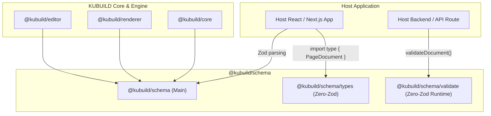
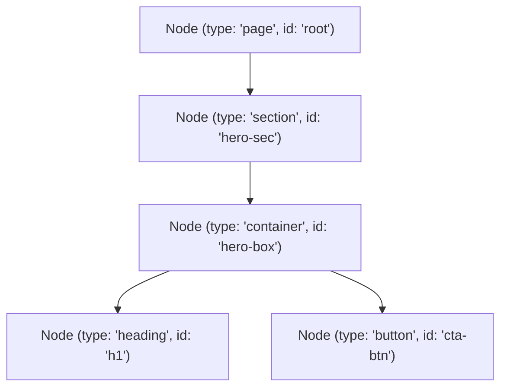
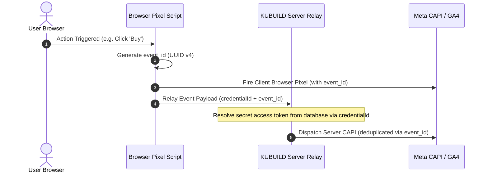

import { Callout } from 'fumadocs-ui/components/callout';
import { Card, Cards } from 'fumadocs-ui/components/card';
import { Tab, Tabs } from 'fumadocs-ui/components/tabs';
import { Accordion, Accordions } from 'fumadocs-ui/components/accordion';

The **`@kubuild/schema`** package defines the foundational data contracts, deterministic Abstract Syntax Tree (AST) specifications, and validation rules for the entire KUBUILD ecosystem. It acts as the canonical source of truth for the portable **`.stora`** document format (`stora.page` and `stora.project`).

Whether a document is authored on the canvas, streamed from an AI copilot, transmitted across HTTP APIs, or rendered into static HTML, `@kubuild/schema` guarantees structural integrity, security sanitization, and type safety across all environments.

---

## Architecture & Design Goals



The package is engineered around five strict architectural principles:

1. **Zero UI/DOM Dependencies:** The package does not import React, DOM APIs, or CSS processors. It runs identically in Node.js, Cloudflare Workers, Deno, Bun, and browser web workers.
2. **Deterministic AST Structure:** Every element in the tree has a deterministic identifier, immutable structure, and predictable property cascade.
3. **Dual Entry & Zero-Zod-Leak Boundary:** Host applications that do not use Zod—or that use a different major version of Zod—can import pure types from `@kubuild/schema/types` and runtime validators from `@kubuild/schema/validate` without pulling Zod into their dependency graph or compilation.
4. **Built-in Security Sanitization:** Style values, animation parameters, and theme tokens are screened at the schema boundary against CSS injection, `javascript:` URIs, and XSS attack vectors.
5. **Universal Portability:** Produces dual ESM (`.js`) and CJS (`.cjs`) outputs with fully resolved TypeScript declaration maps (`.d.ts`).

---

## Installation & Import Strategies

Install the package alongside your workspace dependencies:

<Tabs items={['pnpm', 'npm', 'yarn', 'bun']}>
  <Tab value="pnpm">
```bash
pnpm add @kubuild/schema
```
  </Tab>
  <Tab value="npm">
```bash
npm install @kubuild/schema
```
  </Tab>
  <Tab value="yarn">
```bash
yarn add @kubuild/schema
```
  </Tab>
  <Tab value="bun">
```bash
bun add @kubuild/schema
```
  </Tab>
</Tabs>

### Choosing the Right Entrypoint

`@kubuild/schema` offers three distinct entrypoints designed for different consumer requirements:

<Cards>
  <Card title="@kubuild/schema" href="#core-schemas--typescript-types">
    **Full Zod Schemas & Utilities**  
    Provides `PageDocumentSchema`, `NodeSchema`, `ThemeSchema`, and runtime constants. Use this in applications that leverage Zod for schema composition and form validation.
  </Card>
  <Card title="@kubuild/schema/types" href="#runtime-validation-api">
    **Pure TypeScript Interfaces**  
    Exported without any Zod runtime. Perfect for microservices, frontend consumers, and libraries that only need static typings (`PageDocument`, `Node`, `Theme`).
  </Card>
  <Card title="@kubuild/schema/validate" href="#zero-zod-leak-host-api">
    **Zero-Zod Runtime Validation**  
    Provides `validateDocument()`, `validateNode()`, and `isValidPageDocument()`. Returns plain result objects without leaking Zod types into your compilation.
  </Card>
</Cards>

<Callout type="info">
If your backend or microservice is already using an older version of Zod (e.g. Zod v3) or a different validation library like Yup or Valibot, import from `@kubuild/schema/validate` or `@kubuild/schema/types`. You will experience zero type collisions.
</Callout>

---

## Core Schemas & TypeScript Types

### PageDocument & PageDocumentSchema

The top-level portable document contract is governed by `PageDocumentSchema`.

```typescript
import { z } from 'zod';
import { DocumentMetadataSchema, PageDocumentSchema, type PageDocument } from '@kubuild/schema';

// Parsing and validating an unknown document
const parsedDocument: PageDocument = PageDocumentSchema.parse(rawPayload);
```

#### PageDocument Shape

```typescript
export interface PageDocument {
  /** Strictly 'stora.page' */
  schema: 'stora.page';
  /** Schema specification version (e.g. '1.3.0') */
  version: string;
  /** Metadata describing title, author, SEO, and custom properties */
  metadata?: DocumentMetadata;
  /** Multi-pixel marketing analytics configuration (Meta, GA4, TikTok, GTM) */
  tracking?: TrackingConfig;
  /** Design tokens emitted as CSS variables on document root */
  theme?: Theme;
  /** Root AST node containing the element hierarchy (type must be 'page') */
  document: RootPageNode;
}
```

<Callout type="warn">
The root node in `document` must have `type: 'page'`. Passing any other component type (such as `'section'` or `'container'`) at the document root will fail schema validation.
</Callout>

---

### Node & NodeSchema (Recursive AST)

All visual elements, layout wrappers, and dynamic widgets within a KUBUILD document are modeled as deterministic nodes in an AST:

```typescript
import { NodeSchema, type Node } from '@kubuild/schema';

export interface Node {
  /** Unique deterministic identifier (e.g. 'hero-heading-1') */
  id: string;
  /** Registered component type name (e.g. 'section', 'container', 'heading', 'button') */
  type: string;
  /** Component-specific configuration parameters */
  props?: Record<string, unknown>;
  /** Responsive CSS styling definitions across viewports */
  styles?: ResponsiveStyles;
  /** Entrance animations, hover micro-interactions, and loop effects */
  animation?: AnimationConfig;
  /** Event-driven interactive workflows and network pipelines */
  actions?: ActionPipeline[];
  /** Form container validation and submission rules */
  formConfig?: FormConfig;
  /** Recursive array of child nodes */
  children?: Node[];
}
```



#### Deterministic Node IDs
Node IDs must be non-empty strings. KUBUILD uses deterministic IDs rather than random runtime UUIDs or React component keys. This enables reliable history diffing, undo/redo states, and persistent analytics tagging across document revisions.

---

### StyleDefinition & ResponsiveStyles

KUBUILD employs a responsive cascade model. Styles are defined on a per-element basis and categorized into viewport layers:

```typescript
import {
  ResponsiveStylesSchema,
  BREAKPOINTS,
  BREAKPOINT_ORDER,
  type ResponsiveStyles,
  type StyleDefinition
} from '@kubuild/schema';
```

#### Cascade Layers

```typescript
export interface ResponsiveStyles {
  /** Styles applied across all viewports (mobile-first baseline) */
  base?: StyleDefinition;
  /** Overrides applied on viewports >= 1024px */
  desktop?: StyleDefinition;
  /** Overrides applied on viewports between 768px and 1023px */
  tablet?: StyleDefinition;
  /** Overrides applied on viewports < 768px */
  mobile?: StyleDefinition;
  /** Pseudo-class layers (:hover, :focus, :active) */
  states?: Record<string, StyleDefinition>;
}
```

#### Breakpoint Boundaries

The breakpoint ranges are codified directly into `@kubuild/schema` as immutable constants:

| Breakpoint | Min Width | Max Width | Target Device |
| :--- | :--- | :--- | :--- |
| `mobile` | `0px` | `767px` | Smartphones & compact screens |
| `tablet` | `768px` | `1023px` | Tablets & small laptops |
| `desktop` | `1024px` | Unbounded | Desktops, laptops & wide screens |

```typescript
// Querying canonical breakpoint boundaries
console.log(BREAKPOINTS.tablet.minWidth); // 768
console.log(BREAKPOINTS.tablet.maxWidth); // 1023
```

#### Supported Style Capabilities
`StyleDefinition` strongly types common CSS properties, including:
- **Flexbox / Auto Layout:** `display`, `flexDirection`, `justifyContent`, `alignItems`, `gap`, `flexGrow`, `flexShrink`, `flexBasis`.
- **CSS Grid:** `gridTemplateColumns`, `gridTemplateRows`, `gridAutoFlow`, `gridColumn`, `gridRow`, `colSpan`, `rowSpan`.
- **Sizing & Spacing:** `width`, `height`, `minWidth`, `maxWidth`, `padding`, `margin`.
- **Typography:** `fontSize`, `fontWeight`, `lineHeight`, `letterSpacing`, `color`, `textAlign`.
- **Borders & Effects:** `borderRadius`, `borderWidth`, `borderColor`, `boxShadow`, `opacity`, `transform`, `filter`.
- **Backgrounds:** `backgroundColor`, `backgroundImage`, `backgroundSize`, `backgroundPosition`.

---

### ActionPipeline & ActionPipelineSchema

Interactive behaviors in KUBUILD are declared as event-driven action pipelines rather than arbitrary JavaScript code:

```typescript
import { ActionPipelineSchema, type ActionPipeline } from '@kubuild/schema';
```

An `ActionPipeline` connects a DOM or lifecycle trigger to a sequence of execution steps:

```typescript
export interface ActionPipeline {
  id: string;
  name?: string;
  /** Event trigger: 'click' | 'submit' | 'change' | 'blur' | 'focus' | 'load' | 'expire' */
  trigger: ActionTriggerType;
  /** Sequential steps executed when trigger fires */
  steps: ActionStep[];
  enabled?: boolean;
}
```

#### Supported Step Types

<Accordions>
  <Accordion title="api_request — Network Invocations">
    Dispatches HTTP REST requests to external endpoints.
    - `url`: Target URL endpoint.
    - `method`: `'GET' | 'POST' | 'PUT' | 'PATCH' | 'DELETE'`.
    - `headers`: Key-value HTTP request headers.
    - `body`: Serialized JSON payload.
    - `onSuccess` / `onError`: Nested fallback step pipelines.
  </Accordion>
  <Accordion title="navigate — Client & Window Navigation">
    Redirects the user to an internal path or external URL.
    - `url`: Target destination.
    - `target`: `'_self' | '_blank'`.
  </Accordion>
  <Accordion title="set_state — Dynamic State Mutation">
    Updates client runtime state variables bound to UI components.
    - `key`: Target state variable identifier.
    - `value`: New value or expression.
  </Accordion>
  <Accordion title="open_modal / close_modal / toggle_modal — Overlays">
    Controls the visibility of modal dialogs and slide-over panels.
    - `modalId`: Identifier of the detached artboard or modal component.
  </Accordion>
  <Accordion title="show_toast — Notifications">
    Triggers UI feedback alerts.
    - `message`: Toast body text.
    - `variant`: `'success' | 'error' | 'info' | 'warning'`.
    - `duration`: Auto-dismiss timeout in milliseconds.
  </Accordion>
  <Accordion title="track_event — Analytics Dispatch">
    Fires tracking events to Meta CAPI, Google Analytics, TikTok, and webhooks.
    - `eventName`: Standard or custom event name (e.g. `'Lead'`, `'Purchase'`).
    - `payload`: Contextual parameters (`value`, `currency`, `content_ids`).
  </Accordion>
</Accordions>

#### Conditional Branching
Steps can be guarded by condition operators (`equals`, `not_equals`, `contains`, `not_contains`, `is_truthy`, `is_falsy`, `gt`, `gte`, `lt`, `lte`, `regex`):

```typescript
const conditionalStep = {
  type: 'open_modal',
  modalId: 'discount-dialog',
  conditions: [
    {
      field: 'cart.total',
      operator: 'gte',
      value: 100000,
    },
  ],
};
```

---

### FormConfig & FormConfigSchema

Form boundaries and field-level validation rules are standardized to guarantee predictable data capture:

```typescript
import {
  FormConfigSchema,
  FormFieldBindingSchema,
  type FormConfig,
  type FormFieldBinding
} from '@kubuild/schema';
```

```typescript
export interface FormConfig {
  formId: string;
  resetOnSubmit?: boolean;
  scrollToFirstError?: boolean;
  validateOn?: 'blur' | 'change' | 'submit';
  initialValues?: Record<string, unknown>;
  rules?: ValidationRule[];
}
```

#### Built-in Field Validation Rules
Each input element can bind to `ValidationRule` entries:

- `required`: Field must not be empty or whitespace.
- `email`: Value must match a valid email format.
- `url`: Value must be a valid HTTP/HTTPS URL.
- `min_length` / `max_length`: String character count bounds.
- `numeric_min` / `numeric_max`: Numerical range thresholds.
- `pattern`: RegEx string validation.
- `match_field`: Field value must equal another field (e.g. password confirmation).

---

### TrackingConfig & Multi-Pixel Architecture

Version `1.3.0` of `@kubuild/schema` introduces a robust multi-pixel architecture with complete secret isolation:

```typescript
import { TrackingConfigSchema, type TrackingConfig } from '@kubuild/schema';
```

```typescript
export interface TrackingConfig {
  enabled: boolean;
  debugMode?: boolean;
  autoPageView?: boolean;
  defaultDelivery?: 'both' | 'client_only' | 'server_only';
  pixels?: TrackingPixel[];
}
```



#### Security Model for Analytics Credentials
- **Document Payload:** Only stores **public identifiers** (`pixelId`, `measurementId`, `containerId`, `testEventCode`) and an opaque `credentialId`.
- **Zero Secrets in AST:** Sensitive access keys (Meta CAPI System User tokens, GA4 Measurement Protocol secrets) are **never** persisted in the `.stora` document.
- **Server-Side Resolution:** The host server resolves the private token from `credentialId` inside the secure relay pipeline.

---

### ThemeSchema & Design Tokens

Themes allow landing pages to share consistent design tokens without coupling to external CSS frameworks:

```typescript
import { ThemeSchema, type Theme } from '@kubuild/schema';

export interface Theme {
  colors?: Record<string, string | number>;
  fonts?: Record<string, string | number>;
  radii?: Record<string, string | number>;
  spacing?: Record<string, string | number>;
}
```

#### CSS Custom Property Mapping

Theme tokens are automatically emitted as CSS variables on the document root:

| Token Group | CSS Variable Pattern | Example Reference in `styles` |
| :--- | :--- | :--- |
| `colors` | `--kb-color-<key>` | `var(--kb-color-primary)` |
| `fonts` | `--kb-font-<key>` | `var(--kb-font-heading)` |
| `radii` | `--kb-radius-<key>` | `var(--kb-radius-md)` |
| `spacing` | `--kb-space-<key>` | `var(--kb-space-lg)` |

```typescript
const exampleTheme: Theme = {
  colors: {
    primary: '#4f46e5',
    surface: '#ffffff',
    text: '#0f172a',
  },
  radii: {
    sm: '4px',
    md: '8px',
    full: '9999px',
  },
};
```

---

## Security Model & Sanitization

Because KUBUILD documents can be authored by untrusted users or ingested from external third-party integrations, `@kubuild/schema` implements defensive sanitization patterns at runtime.

### Dangerous Style Value Pattern

Any CSS value or animation parameter passed into a style definition is screened against known injection vectors:

```typescript
// Screened pattern in document.ts
const DANGEROUS_STYLE_VALUE_PATTERN =
  /javascript:|expression\(|@import|<script|vbscript:|data:text\/html/i;
```

If an attacker attempts to inject an XSS vector:

```json
{
  "styles": {
    "base": {
      "backgroundImage": "url(javascript:alert('XSS'))"
    }
  }
}
```

Validation immediately fails with:
```
Style value contains a disallowed or unsafe pattern
```

### Theme Token Sanitization
Theme keys must match `^[a-zA-Z0-9][a-zA-Z0-9_-]{0,63}$`. Theme values cannot exceed 512 characters and must not contain CSS delimiter characters (`{`, `}`, `;`, `<`, `>`, `\`). This ensures that generated inline CSS blocks cannot be broken or escaped.

---

## Runtime Validation API

### Zero-Zod-Leak Host API

The `@kubuild/schema/validate` submodule provides runtime validation functions that return plain, predictable TypeScript result objects without exposing Zod types to the caller:

```typescript
import {
  validateDocument,
  validateNode,
  validateTheme,
  isValidPageDocument,
  type SchemaValidationResult,
  type SchemaValidationIssue
} from '@kubuild/schema/validate';
```

#### Return Type Contract

```typescript
export interface SchemaValidationIssue {
  /** Dot-separated path to the invalid field (e.g. "document.children.0.styles") */
  path: string;
  /** Human-readable error description */
  message: string;
  /** Zod validation issue code */
  code: string;
}

export type SchemaValidationResult<T> =
  | { success: true; data: T; issues: [] }
  | { success: false; issues: SchemaValidationIssue[] };
```

#### Example Usage

```typescript
import { validateDocument, isValidPageDocument } from '@kubuild/schema/validate';

// Quick boolean guard
if (isValidPageDocument(untrustedInput)) {
  console.log('Document is valid!', untrustedInput.metadata?.title);
}

// Detailed validation with issues
const result = validateDocument(untrustedInput);

if (result.success) {
  // result.data is strongly typed as PageDocument
  console.log('Successfully validated document:', result.data.version);
} else {
  for (const issue of result.issues) {
    console.error(`Validation error at [${issue.path}]: ${issue.message}`);
  }
}
```

---

## Extensibility & Custom Business Metadata

While KUBUILD provides standard metadata fields (`title`, `description`, `author`, `tags`, `category`), host applications frequently need to attach proprietary business properties—such as tenant identifiers, funnel steps, or custom SEO configurations.

Every `.stora` document includes a `metadata.custom` field reserved for this purpose:

```typescript
export interface DocumentMetadata {
  title: string;
  description?: string;
  author?: string;
  createdAt?: string;
  updatedAt?: string;
  tags?: string[];
  category?: string;
  version?: string;
  /** Arbitrary serializable key-value map reserved for host business logic */
  custom?: Record<string, unknown>;
  tracking?: TrackingConfig;
}
```

### Type-Safe Host Extension Pattern

To maintain strict typing for custom metadata in your application, define an application-specific Zod schema that wraps and asserts `metadata.custom`:

```typescript
import { z } from 'zod';
import { DocumentMetadataSchema, PageDocumentSchema, type PageDocument } from '@kubuild/schema';

// 1. Define your host-specific business metadata schema
export const HostCustomMetadataSchema = z.object({
  storeId: z.string().uuid(),
  funnelStep: z.enum(['optin', 'checkout', 'upsell', 'thank_you']),
  publishedByUserId: z.string().min(1),
  seo: z.object({
    canonicalUrl: z.string().url().optional(),
    robots: z.string().default('index, follow'),
    structuredDataJsonLd: z.record(z.string(), z.unknown()).optional(),
  }),
});

export type HostCustomMetadata = z.infer<typeof HostCustomMetadataSchema>;

// 2. Strongly typed parser for host documents
export function parseHostDocument(raw: unknown): PageDocument & {
  metadata: { custom: HostCustomMetadata };
} {
  const doc = PageDocumentSchema.parse(raw);
  // `metadata` is optional on the document; parsing `{}` fills in the schema defaults
  const metadata = doc.metadata ?? DocumentMetadataSchema.parse({});
  const validatedCustom = HostCustomMetadataSchema.parse(metadata.custom);

  return {
    ...doc,
    metadata: { ...metadata, custom: validatedCustom },
  };
}
```

---

## End-to-End TypeScript Examples

### 1. Validating External API Payloads (Next.js 15 Route Handler)

Here is a production-grade route handler verifying incoming `.stora` JSON payloads before writing them to a database:

```typescript
// app/api/pages/publish/route.ts
import { NextResponse } from 'next/server';
import { validateDocument } from '@kubuild/schema/validate';

export async function POST(request: Request) {
  try {
    const rawJson = await request.json();

    // Validate using the zero-zod-leak runtime validator
    const validation = validateDocument(rawJson);

    if (!validation.success) {
      return NextResponse.json(
        {
          error: 'Invalid .stora document schema',
          issues: validation.issues,
        },
        { status: 422 },
      );
    }

    const validDocument = validation.data;

    // Persist to database (e.g. Prisma / Drizzle)
    // await db.page.create({ data: { document: validDocument } });

    return NextResponse.json({
      success: true,
      documentId: validDocument.document.id,
      title: validDocument.metadata?.title,
    });
  } catch {
    return NextResponse.json(
      { error: 'Failed to process request payload' },
      { status: 400 },
    );
  }
}
```

### 2. Programmatically Constructing a Valid Document

```typescript
import {
  CURRENT_SCHEMA_VERSION,
  SCHEMA_NAME,
  type PageDocument,
  type Node,
} from '@kubuild/schema';

export function createPromotionalBanner(title: string, ctaUrl: string): PageDocument {
  const headingNode: Node = {
    id: 'banner-heading',
    type: 'heading',
    props: {
      text: title,
      level: 1,
    },
    styles: {
      base: {
        fontSize: '28px',
        fontWeight: 'bold',
        color: 'var(--kb-color-text)',
      },
    },
  };

  const buttonNode: Node = {
    id: 'banner-cta',
    type: 'button',
    props: {
      label: 'Claim Discount',
      variant: 'primary',
    },
    styles: {
      base: {
        backgroundColor: 'var(--kb-color-primary)',
        color: '#ffffff',
        padding: '12px 24px',
        borderRadius: 'var(--kb-radius-md)',
      },
      states: {
        ':hover': {
          opacity: 0.9,
        },
      },
    },
    actions: [
      {
        id: 'cta-click-pipeline',
        trigger: 'click',
        enabled: true,
        steps: [
          {
            id: 'open-offer',
            type: 'navigate',
            payload: { url: ctaUrl, target: '_blank' },
          },
        ],
      },
    ],
  };

  return {
    schema: SCHEMA_NAME,
    version: CURRENT_SCHEMA_VERSION,
    metadata: {
      title: 'Promotional Banner',
      description: 'Limited-time discount banner',
      author: 'Marketing',
      tags: ['promo', 'banner'],
      category: 'marketing',
      version: '1.0.0',
    },
    theme: {
      colors: {
        primary: '#2563eb',
        text: '#1e293b',
      },
      radii: {
        md: '8px',
      },
    },
    document: {
      id: 'page-root',
      type: 'page',
      children: [
        {
          id: 'banner-section',
          type: 'section',
          styles: {
            base: {
              display: 'flex',
              flexDirection: 'column',
              alignItems: 'center',
              gap: '16px',
              padding: '32px',
            },
          },
          children: [headingNode, buttonNode],
        },
      ],
    },
  };
}
```

---

## API & Export Reference

<Accordions>
  <Accordion title="Schemas (Zod Objects)">
    - `PageDocumentSchema` — Top-level `stora.page` schema.
    - `ProjectDocumentSchema` — Multi-artboard canvas document schema.
    - `NodeSchema` — Recursive AST node schema.
    - `RootPageNodeSchema` — Enforces root node `type: 'page'`.
    - `DocumentMetadataSchema` — Pure metadata specification.
    - `ResponsiveStylesSchema` — Viewport cascading styles schema.
    - `StyleDefinitionSchema` — CSS property key-value mapping.
    - `ThemeSchema` — Design token system schema.
    - `TrackingConfigSchema` — Multi-pixel and CAPI schema.
    - `ActionPipelineSchema` — Interactive workflow pipeline schema.
    - `FormConfigSchema` — Form submission and container configuration schema.
    - `FormFieldBindingSchema` — Form field validation schema.
    - `AnimationConfigSchema` — Entrance and micro-interaction animations.
    - `TemplateRecordSchema` — Reusable section/page template schema.
    - `ManifestSchema` — Package asset manifest schema.
  </Accordion>
  <Accordion title="TypeScript Types & Interfaces">
    - `PageDocument`, `ProjectDocument`
    - `Node`, `RootPageNode`
    - `DocumentMetadata`
    - `ResponsiveStyles`, `StyleDefinition`, `PseudoStateStyles`
    - `Theme`, `ThemeTokenGroup`, `ThemeTokenMap`
    - `TrackingConfig`, `TrackingPixel`, `TrackingDelivery`
    - `ActionPipeline`, `ActionStep`, `ActionTriggerType`
    - `FormConfig`, `FormFieldBinding`, `ValidationRule`
    - `AnimationConfig`
    - `BreakpointName`, `BreakpointRange`
    - `SchemaValidationResult<T>`, `SchemaValidationIssue`
  </Accordion>
  <Accordion title="Validation & Utility Functions">
    - `validateDocument(input: unknown): SchemaValidationResult<PageDocument>`
    - `validateNode(input: unknown): SchemaValidationResult<Node>`
    - `validateProjectDocument(input: unknown): SchemaValidationResult<ProjectDocument>`
    - `validateTheme(input: unknown): SchemaValidationResult<Theme>`
    - `isValidPageDocument(input: unknown): input is PageDocument`
    - `isSafeThemeTokenKey(key: unknown): key is string`
    - `isSafeThemeTokenValue(value: unknown): value is string | number`
    - `themeTokenCssVarName(group: ThemeTokenGroup, key: string): string | null`
    - `sanitizeActionPipeline(pipeline: ActionPipeline): ActionPipeline`
  </Accordion>
  <Accordion title="Constants">
    - `SCHEMA_NAME = 'stora.page'`
    - `CURRENT_SCHEMA_VERSION = '1.3.0'`
    - `PROJECT_SCHEMA_NAME = 'stora.project'`
    - `CURRENT_PROJECT_SCHEMA_VERSION = '1.0.0'`
    - `BREAKPOINTS` — `{ mobile: { minWidth: 0, maxWidth: 767 }, tablet: { minWidth: 768, maxWidth: 1023 }, desktop: { minWidth: 1024, maxWidth: null } }`
    - `BREAKPOINT_ORDER` — `['desktop', 'tablet', 'mobile']`
    - `BUILTIN_COMPONENT_TYPES` — List of 30+ default registered component names.
  </Accordion>
</Accordions>
