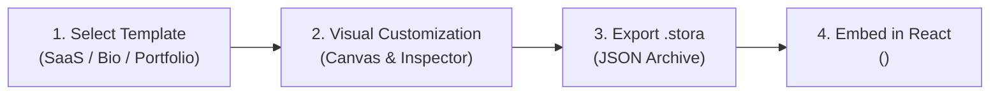

import { Callout } from 'fumadocs-ui/components/callout';
import { Card, Cards } from 'fumadocs-ui/components/card';
import { Tab, Tabs } from 'fumadocs-ui/components/tabs';
import { Step, Steps } from 'fumadocs-ui/components/steps';

## Overview

KUBUILD includes a standalone, zero-installation **Interactive Playground** accessible directly at [`/playground`](/playground). The playground embeds the production-grade visual editor (`<KubuildEditor />`) in a full-height workspace, allowing developers, designers, and product teams to evaluate builder capabilities without configuring a local development environment.

<Screenshot
  src="/screenshots/editor/editor-overview.webp"
  alt="The playground editor with the SaaS Landing Page template"
  caption="The playground with the SaaS Landing Page template loaded."
/>

<Callout type="info" title="Try It Now">
  Launch the live builder in full-screen mode by visiting the [Interactive Playground](/playground).
</Callout>



---

## Prebuilt Starter Templates

The playground comes preloaded with three distinct layouts demonstrating different responsive architectures and design patterns:

<Screenshot
  src="/screenshots/editor/editor-templates.webp"
  alt="The Replace with template dialog"
  caption="The Templates dialog replaces the current page with a starter template."
/>

<Cards>
  <Card
    title="SaaS Landing Page"
    description="High-density marketing layout featuring dark hero gradient, pill badge, feature columns grid, and primary/secondary CTA buttons."
  />
  <Card
    title="Creator Link-in-Bio"
    description="Mobile-first link tree with avatar badge, bio descriptions, social action buttons, and responsive touch targets."
  />
  <Card
    title="Minimal Portfolio"
    description="Editorial typographic layout showcasing designer introductions, selected client projects, and responsive dual-column cards."
  />
</Cards>

To switch between templates, use the **Template Selector** dropdown located at the top center of the playground toolbar.

---

## Core Playground Features

### 1. Figma-Grade Visual Canvas
- **Multi-Device Viewport Switcher**: Toggle between Desktop (`1200px`), Tablet (`768px`), and Mobile (`375px`) viewports to test cascading responsive styles.
- **Smart Drag & Drop**: Rearrange sections, containers, headings, and buttons directly on the interactive canvas.
- **Visual Selection & Breadcrumbs**: Click any element to highlight its hierarchy path and trigger the properties inspector.

<Screenshot
  src="/screenshots/editor/editor-inspector.webp"
  alt="A selected heading with its floating toolbar and inspector"
  caption="Click any element to select it, then edit it in the inspector or move it with the floating toolbar."
/>

### 2. Export `.stora` Archive
Click the **Export .stora** button in the header toolbar to immediately download the active page document. KUBUILD exports:
- Pure JSON AST conforming to the `stora.page` schema.
- Full metadata including page title, author, version, and timestamps.
- Zero secret leaks (automated security sanitization strips server tokens and sensitive API keys).

### 3. Copy React Embed Code
Click **Copy Code** to copy a drop-in React component snippet configured with `@kubuild/react`:

```tsx title="src/components/MyPortablePage.tsx"
import { KubuildRenderer } from '@kubuild/react';
// Import your exported .stora layout document
import pageDocument from './saas-landing-page.stora.json';

export default function MyPortablePage() {
  return (
    <main className="min-h-screen w-full">
      <KubuildRenderer document={pageDocument} />
    </main>
  );
}
```

---

## Technical Integration Guide

### Next.js Client-Only Isolation (`ssr: false`)

Because visual page builders rely on browser-specific APIs (such as DOM measurements, `window.innerWidth`, resize observers, and clipboard APIs), embedding `<KubuildEditor />` in Next.js requires dynamic client-only import to eliminate SSR hydration mismatches:

```tsx title="app/playground/page.tsx"
'use client';

import dynamic from 'next/dynamic';

const KubuildEditor = dynamic(
  () => import('@kubuild/editor').then((mod) => mod.KubuildEditor),
  {
    ssr: false,
    loading: () => (
      <div className="flex h-screen items-center justify-center bg-neutral-950 text-neutral-400">
        Loading KUBUILD Interactive Editor...
      </div>
    ),
  }
);

export default function Page() {
  return (
    <div className="h-screen w-screen">
      <KubuildEditor />
    </div>
  );
}
```

### Controlled Document Synchronization

You can control or observe document mutations via the `initialDocument` and `onChange` props:

```tsx
<KubuildEditor
  initialDocument={myDocument}
  templates={sampleTemplates}
  onChange={(updatedDoc) => {
    console.log('Document updated:', updatedDoc);
  }}
/>
```

---

## Next Steps

<Cards>
  <Card
    title="Getting Started Architecture"
    href="/docs/getting-started/architecture"
    description="Learn about the portable .stora schema and multi-package monorepo architecture."
  />
  <Card
    title="Custom Components Guide"
    href="/docs/guides/custom-components"
    description="Register custom React components into the builder registry and canvas."
  />
</Cards>
